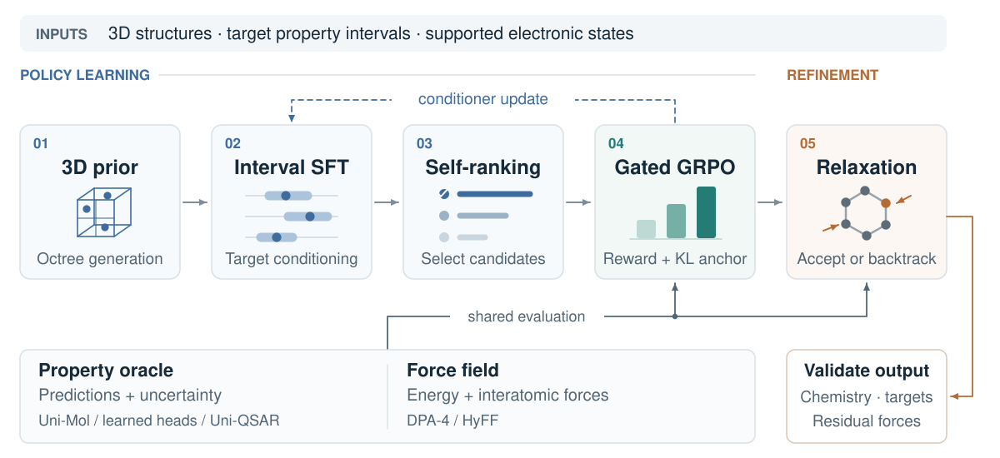

# ORBIT-3D

Interval-targeted 3D molecular generation with a pretrained octree prior,
property oracles and constrained force-field refinement.

**Authors:** Shangqian Chen, Guojiang Zhao, Zheng Cheng, Jiankun Wang, Hongshuai Wang, Zhifeng Gao.

The executable mainline is **Uni-3DAR octree → interval adaptation → candidate
ranking → DPA4 or HyFF refinement**. GRPO is available for experiments and disabled
in the recommended configuration: the completed three-training-seed ablation does
not show a consistent component advantage. The initial
BF16 comparison is retained as a numerical diagnostic. The dense-grid implementation remains a baseline.



## Verified scope

- MIM-Flow QM9s: explicit-H structure adaptation, fixed train/dev/test selection,
  molecular identity checks and original spectrum preservation.
- OCELOT: scaffold-separated HOMO/LUMO/vertical-S1/T1 training; DPA and HyFF
  use the same 8192/512/512 conformers, with an independent fingerprint reference.
- Real pretrained octree generation, multi-target conditioning, chemical checks,
  candidate ranking, real DPA4 forces and finite-step property/energy acceptance.
- HyFF-presto property adapters, calibration and the same octree end-to-end path;
  see the [verified HyFF workflow](docs/hyff-property-workflow.md).
- Whole-candidate ledgers, precise SDF export and re-evaluated exported predictions.

See the [experiment report](docs/qm9s-ocelot-experiments-2026-11-11.md) for metrics,
failed experiments and evidence. Oracle interval success is not independent
quantum-chemical accuracy. The initial generator covers neutral closed-shell
H/C/N/O/F molecules. The [expanded 15-element adaptation](docs/wide-element-adaptation.md)
uses official OCELOT labels, but rare-element generation and target success remain
weak. [Element weighting and temperature experiments](docs/element-balance-experiment.md)
report their quality tradeoffs. Open-shell generation is not established.

## Setup

```bash
uv sync --frozen --extra octree
uv run --frozen --extra octree pytest tests -q
uv build --wheel
python scripts/check_wheel.py
```

For the tested Linux/CUDA DPA4 runtime, use `uv sync --frozen --extra octree
--extra deepmd` and mount the DPA4 weights separately. The lock uses Torch2.7.1
and official DeepMD3.2.0 source with its Python PyTorch backend: the published
C++ wheel targets Torch2.11 and is incompatible. `pyproject.toml` fixes the build
switches and the SeZM dependencies (e3nn and Warp/nvalchemi neighbor lists).
CUDA still executes model inference. A fresh environment passed 64-molecule
serial/batch checks; see [installation evidence](docs/experiments/clean_deepmd_native_20261111.json).
Docker and other optional GPU combinations require separate execution checks.
The wheel contains pinned Uni-3DAR source and its license; datasets/weights are
obtained separately. See [data notes](data/README.md).

If PyPI is slow, install the **same exported hashes and versions** through a mirror:

```bash
uv export --frozen --extra octree --extra deepmd --no-emit-project -o requirements.lock.txt
DP_ENABLE_TENSORFLOW=0 DP_ENABLE_PYTORCH=0 uv pip install --python .venv/bin/python \
  --require-hashes --no-binary deepmd-kit \
  --index-url https://pypi.tuna.tsinghua.edu.cn/simple/ -r requirements.lock.txt
```

Build and install the project wheel after installing these dependencies. The
source-build switches follow [DeepMD's documented Python PyTorch mode](https://docs.deepmodeling.com/projects/deepmd/en/latest/install/install-from-source.html).
Optional same-level quantum diagnostics use `--extra quantum` (CPU) or
`--extra quantum-gpu` (Linux/CUDA12), described in the
[quantum protocol](docs/quantum-validation-protocol.md).

## Data and training

```bash
# Source is the extracted directory containing train.lmdb and valid.lmdb.
uv run --extra octree python scripts/adapt_qm9s.py \
  --source /data/mim-flow/qm9s --output dataset/processed/qm9s_octree

python scripts/prepare_ocelot.py --help
python scripts/train_ocelot_baseline.py --help
python scripts/train_ocelot_3d.py --help
```

QM9s spectral vectors are not HOMO/LUMO labels. In the main configuration,
`label_source: oracle` explicitly predicts adaptation labels with the OCELOT
model. Original OCELOT DFT geometries are unavailable in the supplied CSV;
the initial 3D property pilot uses ETKDG/MMFF conformers; the expanded, matched
DPA/HyFF experiments use ETKDG/UFF conformers.

Edit the mounted paths in [`configs/qm9s_ocelot_octree.json`](configs/qm9s_ocelot_octree.json), then run:

```bash
orbit3d --config configs/qm9s_ocelot_octree.json
```

For inference, set `mode` to `predict` and supply `checkpoint_load_path` for the
saved octree checkpoint. The original pretrained file and training SDF can then
be omitted. New checkpoints retain target scaling and training identities.
For GRPO-only updates, set `mode: align`, load an adapted checkpoint and set
positive `grpo_steps`; supply training data only when replay is enabled. This
mode saves the updated checkpoint without repeating SFT or generating a final
inference batch. Supervised modes require positive `sft_steps`. Pure `train` with
SDF labels and zero GRPO steps needs only the generator and labelled structures;
forcefield, property-model and applicability-domain paths are not loaded.

[Four-target OCELOT training](docs/ocelot-optical-targets.md) adds vertical S1/T1
labels, with explicit checkpoint target expansion and unchanged training/test
geometries. Its paired S1–T1 error is distinct from an adiabatic energy gap.
The [matched HyFF comparison](docs/hyff-optical-comparison.md) and
[BRICS generation baseline](docs/brics-baseline.md) retain evaluator disagreements
and the stronger fragment baseline on the central target window.

Consecutive element/depth migrations retain pending element-supervision
requirements. Structural-only adaptation cannot clear a property-label
requirement; pseudo-labels for new elements require observed Oracle training
coverage. See [expanded-element training](docs/wide-element-adaptation.md).

For fixed-scaffold fragment growth, use
[`configs/scaffold_graph_growth.json`](configs/scaffold_graph_growth.json) and an
SDF with `OpenAtomIndices` properties. This explicit graph backend preserves
float64 fixed world coordinates and uses the same configured evaluators and
refinement. [Input and output details](docs/scaffold-generation.md) distinguish it
from learned octree completion.

Each run writes `candidates.csv`, `generated.sdf`, `qualified.sdf`,
`relaxation_traces.json`, `run_config.json` and `summary.json`. `generated.sdf`
contains all retained/refined candidates; `qualified.sdf` contains those passing
both property intervals and the configured raw RMS-force threshold. Failed and
filtered proposals remain in the original candidate denominator.

[Inference bundles](docs/inference-bundles.md) collect the model, scaler, domain,
wheel and whole-cohort replay artifacts for relocation to persistent storage.
The verified bundle replays 64 candidates and six exports without training data.

## Code map

| Module | Responsibility |
| --- | --- |
| `generator/octree_model.py`, `octree_backend.py` | Pretrained hierarchical generator, interval conditioner and structure head |
| `generator/octree_alignment.py` | Complete-trajectory GRPO, differentiable KL and replay |
| `oracles/dpa4_oracle.py`, `fingerprint_oracle.py` | Independently bootstrapped 3D adapters and 2D reference predictor |
| `physics/dpa_forcefield.py`, `conformer_relaxer.py` | Coordinate-connected descriptors, raw forces and accepted refinement |
| `pipeline/octree_runner.py` | Main training/inference workflow |
| `utils/qm9s.py` | Spectrum-preserving structural adapter |
| `vendor/` | Pinned Uni-3DAR source and minimal runtime dependencies |

Every configuration declares `generator_config.backend` explicitly. Missing or
unknown values fail before model loading; they no longer select the legacy model.
The archived configurations explicitly name `dense_grid_v2`.

The older `internal_*.json` configurations and `benchmarks/runners/` belong to
previous baselines or archived experiments. They are not the recommended route
for the new QM9s/OCELOT workflow. Historical hardcoded comparisons cannot be
reported as fresh benchmark results.

[Architecture decision](docs/architecture-decision.md) · [Repair TODO](TODO.md) ·
[Initial regression report](docs/validation-2026-11-11.md) · [Manuscript](paper/README.md)

`dataset/`, `local_dev/`, weights and runtime outputs are ignored by Git. Private
server details are kept only in `local_dev/`.
