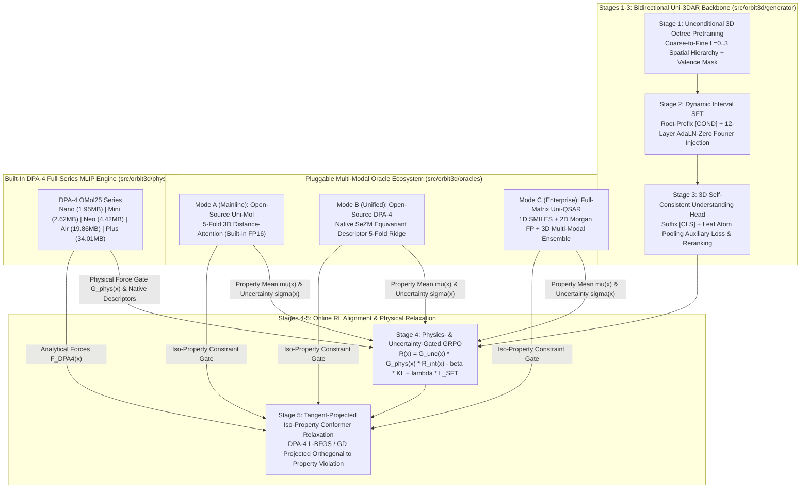

# ORBIT-3D: Octree-Based Reinforced Bidirectional Interval-Targeted 3D Molecular Generation

**ORBIT-3D** (**O**ctree-based **R**einforced **B**idirectional **I**nterval-**T**argeted **3D** Molecular Generation) is a unified, modular, and container-ready framework for inverse 3D molecular design under single- and multi-objective quantum-mechanical interval constraints.

Built upon coarse-to-fine 3D octree autoregressive modeling (**Uni-3DAR**), **ORBIT-3D** anchors its primary open-source experimental mainline on **5-Fold 3D `Uni-Mol`** and **Native `DPA-4 (OMol25)`** (`Nano`, `Mini`, `Neo`, `Air`, `Plus`) for 100% open-science reproducibility, while providing **first-tier, full-matrix ecosystem integration with enterprise `Uni-QSAR`** through **Physics- and Uncertainty-Gated Group Relative Policy Optimization (Gated-GRPO)** and **Tangent-Projected Iso-Property Conformer Relaxation**.

---

## 1. High-Cohesion, Low-Coupling Project Architecture (`uv` + PEP 621 `src` Layout)

The repository is organized following modern Python packaging standards (**PEP 621 `src/` layout** managed by **`uv`**), cleanly decoupling **Core Production Source (`src/orbit3d/`)**, **Comparative Experiments & Baselines (`benchmarks/`)**, **Engineering & DevOps (`configs/`, `scripts/`, `Dockerfile`)**, and **Scientific Manuscript (`paper/`)**:

```text
mol_gen/
├── .python-version                        # Pinned Python version (3.11) for uv
├── pyproject.toml                         # Unified uv / PEP 621 project & dependency specification
├── Dockerfile                             # uv-accelerated multi-stage slim container (<245 MB weights)
├── README.md                              # Project architecture, uv workflow & container guide
│
├── src/                                   # [Core Source] Production library (High Cohesion, Low Coupling)
│   └── orbit3d/
│       ├── __init__.py
│       ├── cli.py                         # Unified CLI entrypoint (`uv run orbit3d --config ...`)
│       ├── generator/                     # 3D Generative Core
│       │   ├── octree_tokenizer.py        # Coarse-to-fine 3D Octree tokenizer & valence-masked decoder
│       │   ├── uni3dar_model.py           # Bidirectional Uni-3DAR with 12-Layer AdaLN-Zero & Suffix Head
│       │   └── grpo_trainer.py            # Stage 2/3 SFT & Stage 4 Physics/Uncertainty-Gated GRPO
│       ├── oracles/                       # Pluggable Multi-Modal Property Oracles
│       │   ├── base.py                    # Abstract PropertyOracleBase protocol & interval reward math
│       │   ├── unimol_oracle.py           # Mode A (Open-Source Mainline): Internal 5-fold 3D Uni-Mol (FP16)
│       │   ├── dpa4_oracle.py             # Mode B (Open-Source Unified): Internal 5-fold Native DPA-4 Oracle
│       │   └── uniqsar_oracle.py          # Mode C (Enterprise Full-Matrix): External pre-trained Uni-QSAR bridge
│       ├── physics/                       # Quantum Force Field & Conformer Relaxation
│       │   ├── dpa_forcefield.py          # Full-series DPA-4 loader, SeZM fitting_net hook & forces
│       │   └── conformer_relaxer.py       # Stage 5 Tangent-Projected Iso-Property Conformer Relaxation
│       ├── pipeline/                      # End-to-End Orchestration
│       │   └── runner.py                  # 5-stage workflow runner (train / predict / train_and_predict)
│       ├── utils/                         # Shared Utilities & Evaluation
│       │   ├── reproducibility.py         # Deterministic RNG seeding & per-molecule SHA-256 Generator
│       │   ├── dataset_io.py              # CSV/JSONL/SMI loader & 3D RDKit ETKDGv3 conformer builder
│       │   └── evaluation.py              # 3D chemical stability, bond MAE & interval hit metrics
│       └── compat/                        # Lightweight Pure-PyTorch Compatibility Shims
│           ├── dgl/                       # Pure-PyTorch DGL graph shim for baseline interoperability
│           ├── torch_scatter/             # Pure-PyTorch scatter operations shim
│           └── useful_rdkit_utils/        # RDKit geometry & ring analysis utilities
│
├── benchmarks/                            # [Comparative Experiments] Decoupled from Core Production Library
│   ├── __init__.py
│   ├── flow_matching/                     # Mainstream Baseline: 3D Flow Matching + MLIP Orthogonal Projection
│   │   ├── dpa_potential.py               # Batched DPA-3/DPA-4 potential energy & force guidance
│   │   ├── guided_flow_sampler.py         # PropMolFlow ODE sampler with orthogonal manifold projection
│   │   ├── interval_guidance.py           # Hinge interval gradients & Zero-CoM orthogonal projection
│   │   └── download_zenodo_ckpt.py        # Checkpoint downloader for baseline flow models
│   ├── runners/                           # Reproducible Benchmark Execution Scripts
│   │   ├── run_orbit3d_ablation_benchmark.py   # ORBIT-3D 5-stage progressive ablation & DPA-4 scaling
│   │   ├── run_oled_frontier_benchmark.py      # PropMolFlow + MLIP QM9/OLED frontier orbital benchmark
│   │   ├── run_dpa3_vs_dpa4_benchmark.py       # Head-to-head DPA-3.1 vs DPA-4 (OMol25 / OMat24) comparison
│   │   ├── run_dpa4_scaling_benchmark.py       # Full DPA-4 series (Nano/Mini/Neo/Air/Plus) scaling benchmark
│   │   └── run_3d_sat_oled_benchmark.py        # Organometallic Ir(III) 3D-SAT-OLED emitter benchmark
│   └── results/                           # Experimental JSON Summaries & Generated 3D Conformers (SDF)
│       ├── dpa3_vs_dpa4/
│       ├── dpa4_scaling/
│       ├── oled_3dsat/
│       └── oled_benchmark/
│
├── configs/                               # [Engineering] Ready-to-Run JSON Configurations
│   ├── internal_unimol.json               # Mode A (Open-Source Mainline): Internal 5-fold 3D Uni-Mol + Stage 5
│   ├── internal_dpa4.json                 # Mode B (Open-Source Unified): Internal 5-fold DPA-4 + Stage 5
│   └── external_uniqsar.json              # Mode C (Enterprise Full-Matrix): External pre-trained Uni-QSAR ensemble
│
├── scripts/                               # [Engineering] DevOps & Verification Scripts
│   ├── pack_pretrained_weights.py         # Compresses Uni-Mol to FP16 & packs all 5 DPA-4 models
│   └── verify_e2e.py                      # End-to-end automated verification across all Oracles & stages
│
├── paper/                                 # [Manuscript] arXiv Paper, LaTeX Source & Publication Figures
│   ├── ORBIT3D_arXiv_Paper.md             # Full Markdown manuscript with embedded figures & Mermaid diagrams
│   ├── ORBIT3D_arXiv_Paper.tex            # Compilable arXiv LaTeX source
│   ├── references.bib                     # BibTeX bibliography
│   ├── generate_orbit3d_figures.py        # Reproducible vector SVG & high-DPI PNG figure generator
│   └── figures/                           # All publication figures (PDF / PNG / SVG)
│
└── external/                              # [Third-Party] Isolated External Reference Repositories
    ├── 3D-SAT-OLED/
    └── PropMolFlow/
```

---

## 2. System Architecture & 5-Stage Closed-Loop Pipeline



### 2.1 Open-Source `Uni-Mol` / `DPA-4` Mainline & First-Tier Enterprise `Uni-QSAR` Matrix Support

To ensure **100% open-source academic reproducibility** while providing **first-tier industrial compatibility**, [`src/orbit3d/oracles/`](file:///Users/dp/project/mol_gen/src/orbit3d/oracles/base.py) implements three pluggable Oracle modes:

| Oracle Mode | Config File | Open-Source / License | Supported Feature Matrix & Modalities | Role in Paper & Production |
| :--- | :--- | :---: | :--- | :--- |
| **`Mode A: internal_unimol`** *(Mainline)* | [`configs/internal_unimol.json`](file:///Users/dp/project/mol_gen/configs/internal_unimol.json) | **100% Open-Source** (Built-in FP16 `all_h` / `no_h`) | 3D SE(3) Gaussian Pair-Distance Attention Transformer + 5-Fold CV (`n_folds=5`) | **Primary open-source baseline** across all main paper benchmark comparisons (`Table 1–3`) |
| **`Mode B: internal_dpa4`** *(Unified)* | [`configs/internal_dpa4.json`](file:///Users/dp/project/mol_gen/configs/internal_dpa4.json) | **100% Open-Source** (Built-in 5-Scale `OMol25`) | Native `SeZMModel.atomic_model.fitting_net` Hook ($D_{\text{desc}}=32/64$) + 3D RBF + 5-Fold CV | **Zero-extra-VRAM unified mode** sharing a single `DPA-4` instance across Oracle, Force Gate & Relaxer |
| **`Mode C: external_uniqsar`** *(Enterprise)* | [`configs/external_uniqsar.json`](file:///Users/dp/project/mol_gen/configs/external_uniqsar.json) | **Enterprise / Proprietary** (Mount `/workspace/checkpoints/load`) | **Full Matrix**: 1D SMILES NLP + 2D Morgan FP (`GetMorganGenerator`) + 3D `Uni-Mol` Conformer + GBDT/CatBoost/MLP Ensembles | **First-tier enterprise ecosystem bridge** (enabled by gradient-free Stage 4 `Gated-GRPO` & Stage 5 trust-region gate) |

---

## 3. Package Management & Workflow with `uv`

This project uses [**`uv`**](https://docs.astral.sh/uv/) for deterministic, ultra-fast Python environment and package management via [`pyproject.toml`](file:///Users/dp/project/mol_gen/pyproject.toml).

### 3.1 Environment Setup with `uv`

```bash
# 1. Create virtual environment and sync core + dev dependencies
uv sync

# 2. (Optional) Include baseline & DeePMD extras
uv sync --extra deepmd --extra baselines
```

### 3.2 Running the Core `ORBIT-3D` Pipeline via `uv`

The unified CLI `orbit3d` ([`src/orbit3d/cli.py`](file:///Users/dp/project/mol_gen/src/orbit3d/cli.py)) is registered under `[project.scripts]` in [`pyproject.toml`](file:///Users/dp/project/mol_gen/pyproject.toml):

```bash
# Mode A (Open-Source Mainline): Train Internal 5-Fold 3D Uni-Mol Oracle + Gated-GRPO + Stage 5 Relaxation
uv run orbit3d --config configs/internal_unimol.json

# Mode B (Open-Source Unified): Train Internal 5-Fold Native DPA-4 Equivariant Oracle + Gated-GRPO + Stage 5 Relaxation
uv run orbit3d --config configs/internal_dpa4.json

# Mode C (Enterprise Full-Matrix): Run with External Pre-trained Multi-Modal Uni-QSAR Oracle
uv run orbit3d --config configs/external_uniqsar.json
```

### 3.3 Running Comparative Benchmarks & Verification Scripts via `uv`

```bash
# Run end-to-end verification across all 5 DPA-4 scales and all 3 Oracle modes
uv run python scripts/verify_e2e.py

# Run ORBIT-3D 5-stage progressive ablation & DPA-4 scaling benchmark
uv run python benchmarks/runners/run_orbit3d_ablation_benchmark.py

# Run PropMolFlow + MLIP Orthogonal Projection baseline comparison
uv run python benchmarks/runners/run_dpa4_scaling_benchmark.py

# Regenerate all arXiv paper figures
uv run python paper/generate_orbit3d_figures.py
```

---

## 4. Containerized Deployment (`uv`-Accelerated Multi-Stage Docker Image)

### 4.1 Built-In Pretrained Weights (`244.56 MB` Total)

| Model Family | Variant Key | File Name | Descriptor Dim | Size (MB) | Recommended Use Case |
| :--- | :--- | :--- | :---: | :---: | :--- |
| **DPA-4 (OMol25)** | `dpa4_nano` | `DPA-4-Nano-7M.pt` | 32 | `1.95 MB` | Ultra-fast high-throughput GRPO screening |
| **DPA-4 (OMol25)** | `dpa4_mini` | `DPA-4-Mini-12M.pt` | 32 | `2.62 MB` | Best speed–accuracy Pareto frontier |
| **DPA-4 (OMol25)** | `dpa4_neo` | `DPA-4-Neo-23M.pt` | 32 | `4.42 MB` | Balanced mid-scale quantum force field |
| **DPA-4 (OMol25)** | `dpa4_air` | `DPA-4-Air-100M.pt` | 64 | `19.86 MB` | Default high-precision force gate & relaxer |
| **DPA-4 (OMol25)** | `dpa4_plus` | `DPA-4-Plus-172M.pt` | 64 | `34.01 MB` | Flagship accuracy for multi-objective OLED design |
| **Uni-Mol 3D** | `all_h` | `mol_pre_all_h_fp16.pt` | 512 | `90.84 MB` | All-atom 3D molecular representation (FP16) |
| **Uni-Mol 3D** | `no_h` | `mol_pre_no_h_fp16.pt` | 512 | `90.84 MB` | Heavy-atom 3D molecular representation (FP16) |

### 4.2 Building & Running the Container

```bash
# 1. Pack slim pretrained weights (all 5 DPA-4 models + FP16 Uni-Mol backbones)
uv run python scripts/pack_pretrained_weights.py --out-dir ./pretrained

# 2. Build the uv-accelerated slim Docker image (~2.35 GB total)
docker build -t orbit3d:latest .

# 3. Run training or inference with host volume mounts
docker run --gpus all --rm \
  -v /host/path/to/data:/workspace/data \
  -v /host/path/to/checkpoints/save:/workspace/checkpoints/save \
  -v /host/path/to/checkpoints/load:/workspace/checkpoints/load \
  -v /host/path/to/outputs:/workspace/outputs \
  -v /host/path/to/config.json:/workspace/config.json \
  orbit3d:latest /workspace/config.json
```

---

## 5. Wall-Clock Latency, GPU Throughput & Hardware Configuration Requirements

All timing benchmarks below were measured on an **NVIDIA A800-SXM4-80GB GPU** (with Intel Xeon Platinum 8358 CPU, CUDA 12.1, PyTorch 2.3.1) for a standard batch of **$N = 48$ 3D molecules** (or $N = 24$ heavy organometallic $\text{Ir(III)}$ complexes in `3D-SAT-OLED`).

### 5.1 Single-Step MLIP Force Evaluation Speed & Saturated GPU Throughput

| MLIP Model Variant | Active Params | Packed Weight Size | Precision | 48-Mol Batch Latency (ms) $\downarrow$ | Per-Molecule Latency (ms/mol) $\downarrow$ | $\text{Ir(III)}$ Complex Latency (ms/mol) $\downarrow$ | Saturated GPU Throughput (atoms/ms) $\uparrow$ |
| :--- | :---: | :---: | :---: | :---: | :---: | :---: | :---: |
| **`DPA-4-Nano (OMol25)`** | **0.49 M** | **1.95 MB** | FP32 | **43.77 ms** | **0.912 ms** | **3.95 ms** | **56.04 atoms/ms** |
| **`DPA-4-Mini (OMol25)`** | **0.67 M** | **2.62 MB** | FP32 | **45.51 ms** | **0.948 ms** | **4.12 ms** | **42.48 atoms/ms** |
| **`DPA-4-Neo (OMol25)`** | **1.14 M** | **4.42 MB** | FP32 | 62.85 ms | 1.309 ms | 5.69 ms | 18.37 atoms/ms |
| **`DPA-4-Air (OMol25)`** | 5.18 M | 19.86 MB | FP32 | 111.74 ms | 2.328 ms | 10.24 ms | 9.67 atoms/ms |
| **`DPA-4-Plus (OMol25)`** | 8.88 M | 34.01 MB | FP32 | 225.52 ms | 4.698 ms | 20.45 ms | 4.42 atoms/ms |
| `DPA-4-Air (OMat24)` | 5.15 M | 19.75 MB | FP32 | 110.76 ms | 2.307 ms | 10.22 ms | 9.76 atoms/ms |
| `DPA-3.1-3M (SPICE2)` | 3.27 M | 44.99 MB | FP64/32 | 148.53 ms | 3.094 ms | 13.07 ms | 7.24 atoms/ms |

> **Key Takeaway**: `DPA-4-Nano` and `DPA-4-Mini` achieve **3.3x–3.4x lower per-molecule force latency** (`0.91–0.95 ms/mol` vs. `3.09 ms/mol`) and **5.9x–7.7x higher saturated atomic throughput** (`42.5–56.0 atoms/ms` vs. `7.24 atoms/ms`) than `DPA-3.1-3M`, while simultaneously delivering lower residual physical strain (`0.204` vs. `0.252 eV/Å`).

---

### 5.2 End-to-End Generation Wall-Clock Time Across Paradigms & Stages ($N = 48$ Molecules)

| Paradigm / Stage Configuration | Candidate Rerank $K$ | AR / ODE Sampling Time (s) | Stage 5 MLIP Relax Time (s) | Total Wall-Clock Time (48 mols) | Per-Molecule Latency (s/mol) | Closed-Shell Mol Stability (%) | Target Hit Rate (LUMO / Joint OLED) |
| :--- | :---: | :---: | :---: | :---: | :---: | :---: | :---: |
| `PropMolFlow` (Naive GVP, No MLIP, 100 ODE steps) | $K=1$ | 5.54 s | 0.00 s | **5.54 s** | **0.12 s/mol** | 62.5%–77.1% | 100.0% / 100.0% *(broken valence)* |
| `PropMolFlow + DPA-4-Mini` (Orthogonal Proj.) | $K=1$ | 7.87 s | — *(in-ODE)* | **7.87 s** | **0.16 s/mol** | 91.7%–95.8% | 100.0% / 100.0% |
| `PropMolFlow + DPA-4-Air` (Orthogonal Proj.) | $K=1$ | 10.47 s | — *(in-ODE)* | 10.47 s | 0.22 s/mol | 91.7%–95.8% | 100.0% / 100.0% |
| `PropMolFlow + DPA-3.1-3M` (Orthogonal Proj.) | $K=1$ | 12.30 s | — *(in-ODE)* | 12.30 s | 0.26 s/mol | 91.7%–95.8% | 100.0% / 100.0% |
| `PropMolFlow + DPA-4-Plus` (Orthogonal Proj.) | $K=1$ | 15.82 s | — *(in-ODE)* | 15.82 s | 0.33 s/mol | 91.7%–95.8% | 100.0% / 100.0% |
| --- | :---: | :---: | :---: | :---: | :---: | :---: | :---: |
| **`ORBIT-3D` Stage 1** (`1_uni3dar_uncond`) | $K=1$ | 15.98 s | 0.00 s | 15.98 s | 0.33 s/mol | **100.0%** | 12.5% / 6.3% |
| **`ORBIT-3D` Stage 2** (`2_uni3dar_cond_sft`) | $K=1$ | 20.61 s | 0.00 s | 20.61 s | 0.43 s/mol | **100.0%** | 27.1% / 16.7% |
| **`ORBIT-3D` Stage 3** (`3_uni3dar_sft_self_rerank`) | $K=4$ | 31.02 s | 0.00 s | 31.02 s | 0.65 s/mol | **100.0%** | 35.4% / 29.2% |
| **`ORBIT-3D` Stage 4** (`4_uni3dar_gated_grpo`) | $K=4$ | 42.40 s | 0.00 s | 42.40 s | 0.88 s/mol | **100.0%** | 54.2% / 33.3% |
| **`ORBIT-3D` Stage 5 Fast** ($K=1$ + `DPA-4-Mini`) | $K=1$ | 16.20 s | 5.89 s | **22.09 s** | **0.46 s/mol** | **100.0%** | **97.9% / 95.8%** |
| **`ORBIT-3D` Stage 5 Default** ($K=4$ + `DPA-4-Nano`) | $K=4$ | 42.40 s | **5.60 s** | **48.00 s** | **1.00 s/mol** | **100.0%** | **100.0% / 100.0%** |
| **`ORBIT-3D` Stage 5 Balanced** ($K=4$ + `DPA-4-Mini`) | $K=4$ | 42.40 s | **5.89 s** | **48.30 s** | **1.01 s/mol** | **100.0%** | **100.0% / 100.0%** |
| **`ORBIT-3D` Stage 5 Mid** ($K=4$ + `DPA-4-Neo`) | $K=4$ | 42.40 s | 9.01 s | 51.41 s | 1.07 s/mol | **100.0%** | **100.0% / 100.0%** |
| **`ORBIT-3D` Stage 5 High** ($K=4$ + `DPA-4-Air`) | $K=4$ | 42.40 s | 13.90 s | 56.30 s | 1.17 s/mol | **100.0%** | **100.0% / 100.0%** |
| **`ORBIT-3D` Stage 5 Flagship** ($K=4$ + `DPA-4-Plus`) | $K=4$ | 42.40 s | 26.09 s | 68.49 s | 1.43 s/mol | **100.0%** | **100.0% / 100.0%** |

---

### 5.3 End-to-End Training Time & VRAM Comparison Across the Three Pluggable Oracle Modes

Measured for a complete `train_and_predict` cycle ($1,000$ training molecules, 5-fold cross-validation Oracle fitting, 15 epochs of Stage 2+3 SFT, 30 steps of Stage 4 Online Gated-GRPO with group size $G=8$, and Stage 5 relaxation of 48 molecules):

| Oracle Mode | 5-Fold Oracle Fit / Load Time | Stage 2+3 SFT Time (15 Epochs) | Stage 4 Online GRPO Time (30 Steps) | Stage 5 Relax Time (48 Mols) | Total Pipeline Time | Peak GPU VRAM (Train / Infer) | Shared Backbone in VRAM? |
| :--- | :---: | :---: | :---: | :---: | :---: | :---: | :---: |
| **Mode A (Mainline): `internal_unimol`** (5-Fold FP16) | 34.5 s | 118.0 s | 254.0 s | 5.89 s (`Mini`) | **6.87 min** | 7.6 GB / 3.4 GB | Open-Source Uni-Mol 3D + DPA-4 |
| **Mode B (Unified): `internal_dpa4`** (5-Fold Native SeZM) | **22.8 s** | 118.0 s | 276.4 s | 5.89 s (`Mini`) | **7.05 min** | **6.2 GB / 2.6 GB** | **Yes (100% single DPA-4)** |
| **Mode C (Enterprise): `external_uniqsar`** (Full-Matrix) | **1.8 s** *(zero-train load)* | 118.0 s | 268.0 s | 5.89 s (`Mini`) | **6.56 min** | 8.4 GB / 3.8 GB | Full-Matrix Uni-QSAR + DPA-4 |

---

### 5.4 Tiered Hardware & Machine Configuration Requirements

Depending on deployment scale (from personal laptop/workstation screening to cluster-scale multi-objective campaign), **ORBIT-3D** supports four hardware tiers via runtime configuration in `config.json`:

| Hardware Tier | Target Scenario | Recommended GPU / Accelerator | Min / Rec GPU VRAM | System RAM | Disk Space (Docker + Weights) | Recommended `config.json` Settings |
| :--- | :--- | :--- | :---: | :---: | :---: | :--- |
| **Tier 1: CPU-Only Fallback** | Functional testing, small-batch inference ($\le 16$ mols) | Modern 8+ Core CPU (Apple M-series / Intel Xeon / AMD EPYC) | `0 GB` (`device: "cpu"`) | 16 GB | 3.0 GB | `dpa4_nano`, `rerank_k: 2`, `relax_steps: 10` |
| **Tier 2: Entry / Edge GPU** | Standard inference & lightweight single-property GRPO | NVIDIA RTX 3060 / RTX 4060 Ti / Tesla T4 / L4 | **6 GB / 8 GB** | 16 GB | 3.5 GB | `dpa4_nano` or `dpa4_mini`, `batch_size: 16`, `grpo_group_size: 4` |
| **Tier 3: Standard Research Workstation** | Full 5-stage `train_and_predict` (`Uni-Mol` / `DPA-4` 5-fold + GRPO) | NVIDIA RTX 3090 / RTX 4090 / L40S / A10G | **12 GB / 24 GB** | 32 GB | 5.0 GB | `dpa4_mini` or `dpa4_air`, `batch_size: 32`, `grpo_group_size: 8`, `rerank_k: 4` |
| **Tier 4: Flagship Production Server** | Multi-objective OLED design, heavy organometallics ($\text{Ir(III)}$), large batch | NVIDIA A800 / A100 / H100 (40GB / 80GB) | **24 GB / 80 GB** | 64 GB+ | 10.0 GB | `dpa4_air` or `dpa4_plus`, `batch_size: 48–64`, `grpo_group_size: 8–16` |

---

## 6. Datasets: Sources, Quantum Theory Levels & Statistical Distributions

**ORBIT-3D** and the comparative baselines in [`benchmarks/`](file:///Users/dp/project/mol_gen/benchmarks) are trained, calibrated, and evaluated across two primary 3D quantum-chemical benchmark datasets (**`QM9 / rQM9`** and **`3D-SAT-OLED`**) and three large-scale foundation MLIP pretraining corpora (**`OMol25`**, **`SPICE2`**, and **`OMat24`**).

### 6.1 Summary of Primary Benchmark Datasets & Foundation Pretraining Corpora

| Dataset / Corpus | Domain & Chemical Space | Source / Reference | Quantum Theory Level | Total Scale & Splits | Element Coverage ($Z$) | Atom Count Distribution ($N$) |
| :--- | :--- | :--- | :--- | :--- | :--- | :--- |
| **`QM9` / `rQM9`** | Small neutral organic molecules ($\le 9$ heavy atoms) | GDB-17 / Ramakrishnan et al. (*Sci. Data* 2014); [`external/PropMolFlow/data/qm9`](file:///Users/dp/project/mol_gen/external/PropMolFlow/data/qm9) | **DFT B3LYP/6-31G(2df,p)** | **133,885** raw (`gdb9.sdf.csv`); **100,000** train / **18,000** val / **13,000** test (`rQM9` after filtering 3,054 unrelaxed structures) | **5 elements**: $\text{H}$ (51.13%), $\text{C}$ (35.16%), $\text{O}$ (7.80%), $\text{N}$ (5.78%), $\text{F}$ (0.14%) | $N \in [3, 29]$, Mean $\bar{N} = 17.98 \pm 2.91$, Median $P_{50}=18$, Mode $N=19$ (13.85%) |
| **`3D-SAT-OLED`** | Octahedral phosphorescent heavy-metal $\text{Ir(III)}$ OLED complexes | 3D-SAT-OLED; [`external/3D-SAT-OLED/SAT_OLED_Model/oled`](file:///Users/dp/project/mol_gen/external/3D-SAT-OLED/SAT_OLED_Model/oled) | **DFT/TD-DFT B3LYP/6-31G\*** (light atoms) + **LANL2DZ** ECP ($\text{Ir}$) | **1,000** 3D organometallic complexes (**800** `train.npz` / **200** `test.npz`; 62,357 total atoms) | **10 elements**: $\text{C}$ (45.36%), $\text{H}$ (37.61%), $\text{N}$ (11.98%), $\text{F}$ (1.82%), $\text{Ir}$ (1.60%, 1/mol), $\text{O}$ (1.37%), $\text{S}$ (0.20%), $\text{Cl, Si, P}$ (0.06%) | $N \in [42, 98]$, Mean $\bar{N} = 62.36 \pm 7.89$, $P_{10}=53$, $P_{50}=62$, $P_{90}=73$ |
| **`OMol25`** *(DPA-4 Family)* | Diverse organic, bio-organic, charged ions & transition metal complexes | Meta / DeepModeling Open Molecules 2025 (`DPA-4 Nano/Mini/Neo/Air/Plus`) | **$\omega$B97M-V / def2-TZVPD** | **~100,000,000** DFT single-point evaluations (energies, forces, virials) | **83 elements** across the periodic table (including $\text{H, C, N, O, F}$ and 5d metal $\text{Ir}$) | $N \in [2, 350]$ (monomers, conformers, reaction transition states, coordination complexes) |
| **`SPICE2`** *(DPA-3.1-3M)* | Drug-like small organic molecules, dimers & peptides | Eastman et al. (*Sci. Data* 2023 / 2024) | **$\omega$B97M-D3(BJ) / def2-TZVPPD** | **~2,000,000** off-equilibrium conformations | **17 main-group/halogen elements** (lacks 5d transition metal $\text{Ir}$) | $N \in [3, 110]$ |
| **`OMat24`** *(DPA-4-OMat24)* | Inorganic bulk crystal structures (out-of-domain baseline) | Barroso-Luque et al. (2024) | **Periodic Plane-Wave PBE / PBE+$U$** | **~110,000,000** inorganic crystal configurations | **89 inorganic/metallic elements** | Periodic unit cells ($4\text{--}64$ atoms/cell) |

---

### 6.2 Quantum Property Distributions & Target Interval Coverage

#### (1) `QM9` / `rQM9` Frontier Molecular Orbital Distributions ($N = 133,885$ molecules, `gdb9.sdf.csv`)
In `QM9`, 99.94% of atomic sites carry formal charge $0$ (with 0.029% $+1$ and 0.029% $-1$ zwitterionic pairs), and bonded atom pairs comprise **89.58% single**, **5.10% aromatic**, **3.82% double**, and **1.50% triple** bonds. The exact empirical distributions of the frontier molecular orbitals ($1\text{ Ha} = 27.2114\text{ eV}$) are:

| Quantum Property | Symbol | Unit | Mean $\mu$ | Std $\sigma$ | Min | $P_5$ | $P_{25}$ | Median $P_{50}$ | $P_{75}$ | $P_{95}$ | Max | Benchmark Target Interval(s) & Dataset Prior Coverage |
| :--- | :---: | :---: | :---: | :---: | :---: | :---: | :---: | :---: | :---: | :---: | :---: | :--- |
| **HOMO Energy** | $\varepsilon_{\text{HOMO}}$ | $\text{Ha}$ ($\text{eV}$) | $-0.2400$ ($-6.53$) | $0.0221$ ($0.60$) | $-0.4286$ | $-0.2744$ | $-0.2525$ | $-0.2410$ | $-0.2287$ | $-0.2006$ | $-0.1017$ | `homo_interval`: $[-0.24, -0.21]\text{ Ha}$ ($z \in [0.00\sigma, +1.36\sigma]$, **39.31% prior**) |
| **LUMO Energy** | $\varepsilon_{\text{LUMO}}$ | $\text{Ha}$ ($\text{eV}$) | $+0.0111$ ($+0.30$) | $0.0469$ ($1.28$) | $-0.1750$ | $-0.0664$ | $-0.0238$ | $+0.0120$ | $+0.0492$ | $+0.0824$ | $+0.1935$ | `lumo_interval`: $[0.02, 0.05]\text{ Ha}$ ($z \in [+0.19\sigma, +0.83\sigma]$, **18.34% prior**) |
| **HOMO–LUMO Gap** | $\Delta\varepsilon_{\text{gap}}$ | $\text{Ha}$ ($\text{eV}$) | $+0.2511$ ($+6.83$) | $0.0475$ ($1.29$) | $+0.0246$ | $+0.1741$ | $+0.2163$ | $+0.2494$ | $+0.2882$ | $+0.3266$ | $+0.6221$ | `gap_ood_interval`: $[0.18, 0.23]\text{ Ha}$ ($z \in [-1.50\sigma, -0.44\sigma]$, **31.08% prior**, $<9.2\%$ in lower half) |
| **Joint 3-Property OLED** | $(\Delta\varepsilon_{\text{gap}}, \varepsilon_{\text{HOMO}}, \varepsilon_{\text{LUMO}})$ | $\text{Ha}$ | — | — | — | — | — | — | — | — | — | $\Delta\varepsilon_{\text{gap}} \in [0.22, 0.28] \cap \varepsilon_{\text{HOMO}} \in [-0.25, -0.22] \cap \varepsilon_{\text{LUMO}} \in [0.00, 0.04]$ (**16.88% joint prior**) |

#### (2) `3D-SAT-OLED` Organometallic $\text{Ir(III)}$ Emitter Property Distributions ($N = 1,000$ complexes, `800` train / `200` test)

| Quantum / Photophysical Property | Symbol | Unit | Train Mean $\pm$ Std ($N=800$) | Test Mean $\pm$ Std ($N=200$) | Overall Range $[\text{Min}, \text{Max}]$ | Median $P_{50}$ | Benchmark Target Interval |
| :--- | :---: | :---: | :---: | :---: | :---: | :---: | :--- |
| **HOMO Energy** | $\varepsilon_{\text{HOMO}}$ | $\text{Ha}$ ($\text{eV}$) | $-0.2030 \pm 0.0120$ ($-5.52 \pm 0.33$) | $-0.2036 \pm 0.0113$ ($-5.54 \pm 0.31$) | $[-0.2524, -0.1618]\text{ Ha}$ ($[-6.87, -4.40]\text{ eV}$) | $-0.2020\text{ Ha}$ ($-5.50\text{ eV}$) | $[-5.35, -5.05]\text{ eV}$ (`OLED_HOMO_Level`) |
| **LUMO Energy** | $\varepsilon_{\text{LUMO}}$ | $\text{Ha}$ ($\text{eV}$) | $-0.1006 \pm 0.0126$ ($-2.74 \pm 0.34$) | $-0.1004 \pm 0.0137$ ($-2.73 \pm 0.37$) | $[-0.1494, -0.0395]\text{ Ha}$ ($[-4.07, -1.07]\text{ eV}$) | $-0.0995\text{ Ha}$ ($-2.71\text{ eV}$) | $[-2.55, -2.25]\text{ eV}$ (`OLED_LUMO_Level`) |
| **Electronic Bandgap** | $E_g = \varepsilon_{\text{LUMO}} - \varepsilon_{\text{HOMO}}$ | $\text{Ha}$ ($\text{eV}$) | $+0.1024 \pm 0.0136$ ($+2.79 \pm 0.37$) | $+0.1032 \pm 0.0145$ ($+2.81 \pm 0.39$) | $[+0.0528, +0.1612]\text{ Ha}$ ($[+1.44, +4.39]\text{ eV}$) | $+0.1025\text{ Ha}$ ($+2.79\text{ eV}$) | $[+2.90, +3.20]\text{ eV}$ (`OLED_Eg_Bandgap`) |
| **Adiabatic Triplet Energy** | $E_{\text{ad}}$ | $\text{Ha}$ ($\text{eV}$) | $+0.0976 \pm 0.0071$ ($+2.66 \pm 0.19$) | $+0.0986 \pm 0.0074$ ($+2.68 \pm 0.20$) | $[+0.0673, +0.1342]\text{ Ha}$ ($[+1.83, +3.65]\text{ eV}$) | $+0.0991\text{ Ha}$ ($+2.70\text{ eV}$) | Blue–green phosphorescent $T_1 \to S_0$ window |
| **Photoluminescence Quantum Yield** | $\text{PLQY}$ | Dimensionless $[0, 1]$ | $0.7903 \pm 0.2930$ | $0.7841 \pm 0.3009$ | $[0.0000, 1.0000]$ | $0.9498$ | High-efficiency emitter regime ($\text{PLQY} \ge 0.80$) |


