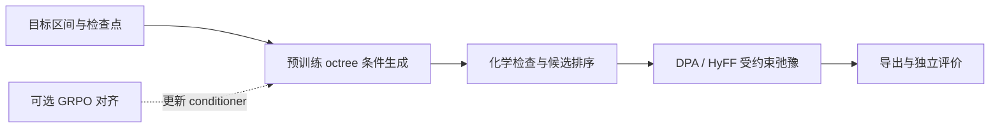

# 当前架构与下一轮调整

本文区分已经运行的实现与待验证的设计，供 Carbon、Opus 和项目作者讨论。实验定义见[实验方案](experiments.md)，结论见[结果汇总](results.md)。

## 当前可运行实现

| 部件 | 当前职责与边界 |
| --- | --- |
| 生成器 | Uni-3DAR octree 先验，加区间 conditioner 和结构自评头；配置、词表、空间映射及目标 scaler 随检查点保存 |
| 监督适配 | 支持只训练 conditioner/readout 或全骨干训练；已完成的 5000→20000 步研究使用全骨干续训 |
| GRPO | 对完整树、元素和 XYZ 决策计算策略目标；当前实现冻结骨干，只更新 conditioner；默认关闭 |
| 分子对象与验证 | 保留元素、图、键级、电荷、指定立体信息和坐标；新坐标提案需要推断并验证图；已知输入图直接保留 |
| 性质模型 | DPA/HyFF 冻结描述符＋三个 bootstrap 性质适配器；指纹模型作为另外训练的图级对照 |
| 力场与弛豫 | DPA 或 HyFF 提供能量和原始力；固定图与骨架，在可动坐标空间提出步长，再做逐目标及能量接受检查 |
| 独立验证 | 不改变候选坐标的其他模型复评，以及单独的 PySCF/GPU4PySCF 量化计算 |

默认以 FP32、独立候选随机流和 concat KV 存储运行。GRPO、不确定性奖励、KV buffer 均不是已证实必需的收益来源。性质自评头使用无条件结构表征训练，避免仅复述输入区间；其排序收益仍需实验判断。

标准预训练表示为 12 层、宽度 768、12 个注意力头，叶格 0.24 Å、细坐标分箱 0.01 Å。广元素适配显式迁移至深度 7，空间边长 30.72 Å，使用最多 80 个显式原子的训练结构。元素、电子态和空间范围属于检查点能力，不由力场支持范围自动扩展。

当前还有两条明确区分的图路径：

- **固定骨架生长**：显式选择开放端点、片段、键级，维护氢替换与位点容量，固定输入世界坐标。它不是已训练的 octree 骨架补全。
- **BRICS 对照**：从训练结构构建单切片段库，随机选择兼容片段对，再生成构象。当前 BRICS 提案本身不使用性质条件；目标仅用于后续评价和筛选。

## 数据和几何的角色

MIM-Flow QM9s/MR-TADF 包含源三维坐标，适配器直接使用这些坐标，另存原始光谱。QM9s 的 240 通道光谱和 MR-TADF 的 450 通道光谱没有被改称 HOMO/LUMO。

OCELOT CSV 提供 SMILES 和电子/光学性质标签，没有原始量子几何及逐分子 ω。已完成的最终性质模型使用统一的 ETKDGv3＋UFF 构象。标签为 HOMO、LUMO、垂直 S1 和 T1，单位均为 eV；8188 个可完整编码的训练构象用于生成器适配。

OCELOT 主要是中小型有机分子，重建构象足以继续开展受控模型比较。**不把全面重算 DFT 或解决全部构象误差作为主线工作的前置条件。** 当前重建方法、原子身份检查和固定划分保持可追溯；出现具体问题再定位。下一轮构象比较关注现有 DPA/HyFF 能否替代 UFF 做最终优化，并同步适配性质头。

## 建议的新主线：尚未实现

优先调整两个核心环节，保留现有图验证、力场、接受规则、数据划分、账本和重放能力。

**条件图提案。** 第一版可用训练分子的单键 BRICS 切分构造监督任务：输入已有片段、开放位点和性质区间，学习选择配对片段及合法连接动作。先验证一次连接，无须同时训练大型图模型和神经构象模型。输出图明确后，用已有构象工具处理三维。octree 保留为研究对照；未来图条件三维模型需要真正的配对训练，不能仅新增一个输入字段。

BRICS 的结果支持研究这一方向，但它更接近训练分布，也使用了更多实际 Oracle 调用。新模型需同时报告目标条件效应、计算成本、新颖性和多样性，不能只提高 Morgan 域内率。

**训练与推理的几何处理一致。** DPA/HyFF 需要初始坐标，但不需要 UFF 作为固定前置步骤。对相同 ETKDG 初始构象比较 UFF、DPA、HyFF 优化，再分别用得到的构象重训同规格性质头。确认收益后，训练、验证、推理统一采用选定流程；保留另外的模型用于独立复核。

图级标签预测和局部几何响应是不同任务。当前 CSV 模型可继续用于筛选；若需要可靠的坐标性质引导，再补充同图、同计算协议下的少量构象差分或梯度监督。可研究“参考性质＋几何修正”，但目前没有证据表明该模型已经有效，也不将它作为第一版条件片段实验的依赖。

## 讨论时需要作出的选择

| 问题 | 建议的当前选择 | 改变选择所需证据 |
| --- | --- | --- |
| 是否整体重写 | 保留基础设施，只增加条件图提案并比较几何处理 | 新后端在独立指标、成本及多样性上有可重复收益后再切换主线 |
| 是否继续延长 SFT | 暂不作为首要投入 | 学习曲线或新数据支持明确的收益假设 |
| 是否默认开启 GRPO | 保持关闭，先检查已有 rollout 信号 | 跨训练 seed 的独立收益，且收益不只是更容易通过域筛选 |
| 是否默认用 UFF 最终优化 | 保留已有实验，下一轮比较 DPA/HyFF 替代 | 同起点、重训性质头后的完整比较 |
| 是否全面重算 OCELOT | 不做 | 仅对实际失败或必要的物理验证选择小规模样本 |
| 是否扩展金属/开壳层 | 当前不作能力承诺 | 专门数据、电子态约定和独立验证 |

第一轮实验顺序和判别标准见[实验方案](experiments.md#下一轮最小实验)。
