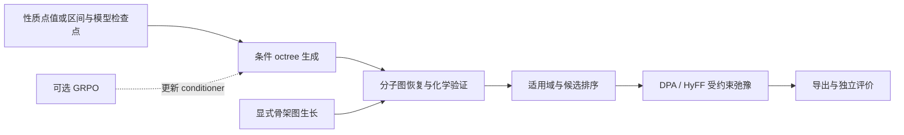

# ORBIT-3D 算法架构

本文描述当前源码实现的算法、数据流和配置语义。调整决策及实施状态见[方案调整](design_changes.md)，实验协议及执行状态见[实验设计](experiments.md)，验证证据见[实验结果](results.md)。参数以运行配置和检查点为准；本文不包含尚未实施的候选架构。

## 总体数据流



CLI 通过 `generator_config.backend` 分派至 `uni3dar_octree` 或 `scaffold_graph_growth`。BRICS 是独立实验脚本入口，不属于主 CLI 的第三个后端。共享评估器工厂支持 `internal_dpa4`、`internal_hyff`、`fingerprint`。[流水线分派](../src/orbit3d/pipeline/runner.py)、[评估器工厂](../src/orbit3d/pipeline/evaluators.py)

## 分子表示与目标定义

`Mol3DInstance` 维护元素、坐标、电荷、多重度及可用的分子图。图保留键级、原子身份与指定立体信息；已有输入图直接使用，新坐标提案才进行判键和验证。构象更新、导出与重载均检查身份。[分子状态](../src/orbit3d/generator/molecular_state.py)

目标按性质名称和物理单位给出区间，支持双侧、单侧及不激活目标。对于预测 `y_k` 和区间 `[l_k,u_k]`，违约量为：

```text
v_k(y) = max(l_k - y_k, 0) + max(y_k - u_k, 0)
```

未激活目标的违约为零。归一化使用检查点保存的训练均值/尺度，缺失边界通过 mask 表达。区间命中要求同一个候选的所有激活目标同时满足，不把各目标命中率相乘。[区间语义](../src/orbit3d/constraints.py)

OE62点值实验使用v4条件器：输入标准化单值和激活mask，目标与验收容差分离；排序按激活性质的连续目标距离。v1–v3区间检查点继续保留各自语义，不能仅更换输入格式冒充点值适配。已完成的单目标扫描与匹配GRPO重评见[最终结果](results.md#uni-mol2-最终交叉评价与采用决定)。

## 条件三维生成

生成器采用固定版本 Uni-3DAR，以 octree 空间 token、元素和细坐标决策自回归产生结构。标准模型为12层、宽度768、12个注意力头，叶格0.24 Å、细坐标分箱0.01 Å。当前广元素配置采用深度7，空间边长30.72 Å；元素表和空间映射属于检查点语义，不能仅凭力场支持范围扩展。

区间条件器编码每个目标的中心、半宽、上下界与边界 mask，经性质编码器和全局 MLP 汇合后，通过 root prefix 及逐层 AdaLN 注入。无激活目标时全局条件归零。当前逐层 scale/shift 为 `0.08*tanh`，输出层为 `0.15*tanh`。[条件模型](../src/orbit3d/generator/octree_model.py)

结构自评头使用无条件结构表征预测性质，用于生成后的初筛，避免把输入区间直接当成输出性质。自评值从模型归一化空间还原到物理单位后参与排序。

### 监督适配

SFT 支持只更新 conditioner/性质头或同时更新骨干。结构损失为：

```text
L_gen = CE_tree + CE_atom + 0.1 * mean(CE_x, CE_y, CE_z)
L = L_gen + lambda_property * L_property
```

该组合不是统一的逐 token NLL。v3 训练区间包含真实标签，但中心不必等于标签；归一化跨度按 LogUniform(0.2,2.0) 抽样，并有性质/边界 mask 随机丢弃。训练策略、目标顺序、单位、scaler、表示配置和迁移状态随检查点保存。[训练编排](../src/orbit3d/pipeline/octree_runner.py)、[检查点与编码](../src/orbit3d/generator/octree_backend.py)

### 可选 GRPO

GRPO 对树、元素及 XYZ 决策计算策略比率与裁剪目标，可叠加参考策略 KL 和监督 replay。当前冻结骨干，只更新 conditioner；奖励综合归一化区间违约、原始力惩罚和可选不确定性惩罚，组内标准化得到优势。当前配置默认关闭 GRPO，不确定性奖励权重默认为零。[对齐实现](../src/orbit3d/generator/octree_alignment.py)

## 性质模型与候选选择

DPA/HyFF 提供冻结的原子描述符，性质适配器在其上训练；已验证模型使用三个 bootstrap 成员输出均值与 spread。图指纹模型提供另一种图级预测。力场能量/力和性质头是不同输出，具有不同训练目标。共享同一 MLIP 时可复用描述符计算。

OE62研究评价采用三层证据：历史DPA为优化/选择模型A，同划分DPA用于公平源基线；开发集选中的Uni-Mol2 1.1B为冻结交叉评价器B；少量预先冻结候选由GPU4PySCF近似源协议裁决。B不参与本轮筛选、奖励或检查点选择。v2沿官方路径读取源重原子坐标，完整适配骨干和性质头；只换版本不保证生成几何上的准确性，源测试与生成几何量化误差分别报告。[v2模型](../src/orbit3d/oracles/unimol2_oracle.py)、[冻结重评](../scripts/reevaluate_dual_oracle.py)

适用域由训练元素覆盖和 Morgan 最近邻相似度判断，阈值来自对应模型的校准配置。候选先经过化学/适用域检查，再按自评得分初筛；`external` 模式在预算内调用外部性质头重排。当前排序主分数为：

```text
score = sum_k (v_k(prediction) / training_scale_k)^2
```

并列时使用归一化 spread 和候选 ID，随后按分子身份去重并限制保留数。`first_valid` 与自评排序用于其他配置/对照。模型 spread、校准区间和完整预测分布是不同对象；现有校准使用归一化残差分位数。[性质模型](../src/orbit3d/oracles/dpa4_oracle.py)、[适用域](../src/orbit3d/oracles/applicability.py)、[校准](../src/orbit3d/oracles/calibration.py)

## 受约束几何弛豫

固定图、元素和电子态，MLIP 给出能量 `E` 与原始力 `F`。性质区间损失为 `sum(v_k^2)`，坐标梯度记为 `g`；所有目标均已命中时 `g=0`。在可动自由度上去除使该损失增大的力分量，再加入降低违约的方向：

```text
F_projected = F - max(dot(F,g), 0) / ||g||^2 * g   # g=0 时保留 F
step_direction = F_projected - property_gradient_weight * g
```

固定骨架坐标通过可动 mask 排除。步长采用回溯，位移按分子统一缩放以限制最大原子位移。候选步必须重新通过图/立体/空间验证，并满足能量及各性质违约相对于当前点、初始点的容差；双重比较避免容差逐步累积。无可接受步时终止。串行与批量路径保留相同的接受语义。[串行弛豫](../src/orbit3d/physics/conformer_relaxer.py)、[批量弛豫](../src/orbit3d/physics/batched_relaxer.py)

验收使用未裁剪的 RMS 力 `sqrt(mean_i ||F_i||^2)`，并报告最大原子力。步数、初始步长、接受容差和力阈值由配置决定；函数默认值与具体实验配置不能混为一谈。性质可行、低 MLIP 力和 DFT 极小点分别判断。

## 显式图提案路径

**固定骨架生长**选择开放位点、片段和键级，维护氢替换与位点容量；新坐标构建时保留输入世界坐标，弛豫可冻结骨架原子。这是显式图操作后端。[骨架流程](../src/orbit3d/pipeline/scaffold_runner.py)

### BRICS 的作用与局限

BRICS 根据局部化学环境确定可切键和可连接端点。当前实现逐条作单键切分，建立带来源 ID 的单端口片段库，随机选取兼容片段对并连接，再产生构象，进入性质排序和弛豫。提案本身不使用性质标签；目标用于下游选择。[片段实现](../src/orbit3d/baselines/brics.py)、[实验入口](../scripts/evaluate_brics_baseline.py)

该路径作为简单结构提案基线，衡量已有片段重组能提供多少可用候选。它不在 octree 失败后补位；也不能独立选择三个部件、多步组装或创造新环核。规则兼容不保证可合成、可嵌入三维或评价域内。

## 数据接口、输出与重放

当前 MIM-Flow 适配器读取源坐标并单独保存光谱；OCELOT 读取 SMILES 与电子/光学标签，已验证的训练流程使用 ETKDGv3＋UFF 构象。轨道能量、垂直激发能与光谱字段不混用。数据来源和实际组成见[数据说明](../data/README.md)。

推理采用独立候选随机流；当前主配置为 FP32、concat KV。每次提案保留记录，输出原始轨迹、筛选原因、性质与力、弛豫记录和 SDF。模型/输入哈希、目标/scaler/表示配置用于整批重放。独立模型复评与量化验证由单独脚本执行；独立性取决于该评价器是否参与过本轮选择或优化。环境及运行入口见[运行说明](runtime.md)，实测范围见[结果](results.md)。
