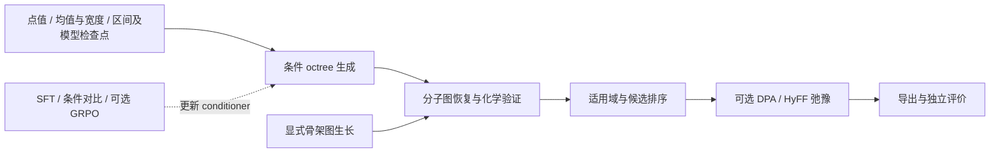

# ORBIT-3D 算法架构

本文描述当前源码实现的算法、数据流和配置语义。调整决策及实施状态见[方案调整](design_changes.md)，实验协议及执行状态见[实验设计](experiments.md)，验证证据见[实验结果](results.md)。参数以运行配置和检查点为准；本文不包含尚未实施的候选架构。

## 总体数据流



CLI 通过 `generator_config.backend` 分派至 `uni3dar_octree` 或 `scaffold_graph_growth`。BRICS 是独立实验脚本入口，不属于主 CLI 的第三个后端。共享评估器工厂支持 `internal_dpa4`、`internal_hyff`、`fingerprint`。[流水线分派](../src/orbit3d/pipeline/runner.py)、[评估器工厂](../src/orbit3d/pipeline/evaluators.py)

## 分子表示与目标定义

`Mol3DInstance` 维护元素、坐标、电荷、多重度及可用的分子图。图保留键级、原子身份与指定立体信息；已有输入图直接使用，新坐标提案才进行判键和验证。构象更新、导出与重载均检查身份；提供原图时，坐标重新推断的连接边必须与该图一致。无输入图的判键结果先清理不受支持的推断立体标记；不清除用户提供图的指定立体信息。 无输入图时，RDKit 从坐标推断连键和键级，并允许按价态分配局部形式电荷；随后检查单连通、总电荷、电子奇偶/自由基和键长。当前表示没有显式生成键级或局部电荷 token，因此通过这些检查不等于已验证局部电子态或稳定性。[分子状态](../src/orbit3d/generator/molecular_state.py)

目标按性质名称和物理单位给出区间，支持双侧、单侧及不激活目标。对于预测 `y_k` 和区间 `[l_k,u_k]`，违约量为：

```text
v_k(y) = max(l_k - y_k, 0) + max(y_k - u_k, 0)
```

未激活目标的违约为零。归一化使用检查点保存的训练均值/尺度，缺失边界通过 mask 表达。区间命中要求同一个候选的所有激活目标同时满足，不把各目标命中率相乘。[区间语义](../src/orbit3d/constraints.py)

点值模式使用 `TargetPoints`：`target_point` 给出条件，`target_tolerance` 只定义评价尺度与验收半径，未激活性质不参与条件或评分。条件和容差分别保存，不能通过改变容差改变点值输入。

OE62 适配直接读取源 XYZ 和 PBE0 轨道列表，在原 XYZ 原子顺序上匹配源图键级并验证立体身份；训练坐标不经 ETKDG 或弛豫。骨架划分、筛选、训练分位数及文件哈希由 `prepare_oe62.py` 固定。

## 条件三维生成

生成器采用固定版本 Uni-3DAR，以 octree 空间 token、元素和细坐标决策自回归产生结构。标准模型为12层、宽度768、12个注意力头，叶格0.24 Å、细坐标分箱0.01 Å。当前广元素配置采用深度7，空间边长30.72 Å；元素表和空间映射属于检查点语义，不能仅凭力场支持范围扩展。

区间条件器编码每个目标的中心、半宽、上下界与边界 mask，经性质编码器和全局 MLP 汇合后，通过 root prefix 及逐层 AdaLN 注入。无激活目标时全局条件归零。当前逐层 scale/shift 为 `0.08*tanh`，输出层为 `0.15*tanh`。[条件模型](../src/orbit3d/generator/octree_model.py)

v4 点值条件器对标准化标量和性质 ID 编码，使用显式激活 mask，复用 root prefix/AdaLN。它不编码上下界或宽度；与 v3 区间检查点分别加载。推理支持正确条件、全关闭及替换输入点的打乱对照，后两者仍按原任务目标评价。

v5 高斯偏好条件器输入标准化均值与`log(sigma/scale)`，`sigma`通过`preference_sigma_eV`显式传入；验收仍由`target_tolerance`独立指定。宽度表达请求偏好，不是预测不确定性。v4迁移保留均值输入权重、宽度新增列置零，迁移时行为与原点值条件器一致；适配完成后按v5合同加载。[迁移](../scripts/migrate_gaussian_conditioner.py)

结构自评头使用无条件结构表征预测性质，用于生成后的初筛，避免把输入区间直接当成输出性质。自评值从模型归一化空间还原到物理单位后参与排序。

### 监督适配

SFT 支持只更新 conditioner/性质头或同时更新骨干。结构损失为：

```text
L_gen = CE_tree + CE_atom + 0.1 * mean(CE_x, CE_y, CE_z)
L = L_gen + lambda_property * L_property
```

该组合不是统一的逐 token NLL。v3 训练区间包含真实标签，但中心不必等于标签；归一化跨度按 LogUniform(0.2,2.0) 抽样，并有性质/边界 mask 随机丢弃。训练策略、目标顺序、单位、scaler、表示配置和迁移状态随检查点保存。[训练编排](../src/orbit3d/pipeline/octree_runner.py)、[检查点与编码](../src/orbit3d/generator/octree_backend.py)

v4 SFT 输入真实激活标签，并以 10% 概率关闭整个条件向量。`active_targets` 指定单目标；继续 SFT 可单独冻结骨干和自评头，只更新 conditioner。

v5 SFT按源标签`y`构造`mu=y+sigma*epsilon`，批内共用从声明范围对数均匀抽取的物理宽度，10%整请求关闭。v4/v5均可启用双向条件margin：按激活标签反序配对，只对两个方向的高斯兼容性都更高的配对，比较同一结构在自身/交叉请求下的逐分子生成损失；逐分子损失仍按树、元素、坐标决策分别归一化。v4使用精确标签作为请求，配对尺度通过`contrast_pairing_sigma_eV`指定，仅决定负例间距，不进入点值条件器。保留普通SFT项，记录配对覆盖。[条件采样](../src/orbit3d/generator/gaussian_conditions.py)

纯高斯加噪SFT的经验条件标签分布为`p_train(y | mu,sigma) ∝ p_train(y)*exp(-(y-mu)^2/(2*sigma^2))`；源标签密度因此影响其均值和宽度。对比项或Hindsight会改变目标或经验数据分布，不能直接沿用这一分布作为它们的预测结论。

Hindsight通过独立SDF输入追加生成结构；batch一半源数据、一半生成数据，scaler沿用源检查点。准备工具复用冻结原始池的A预测及对应坐标、按图去重并排除非训练源骨架，按性质分层取样。源标签和代理标签分别记录，不自动引入DFT验证候选。[数据准备](../scripts/prepare_hindsight_pool.py)

### 可选 GRPO

GRPO 对树、元素及 XYZ 决策计算策略比率与裁剪目标，可叠加参考策略 KL 和监督 replay。当前冻结骨干，只更新 conditioner；奖励综合归一化区间违约、原始力惩罚和可选不确定性惩罚，组内标准化得到优势。当前配置默认关闭 GRPO，不确定性奖励权重默认为零。[对齐实现](../src/orbit3d/generator/octree_alignment.py)

点值对齐使用 `r=1/(1+D)`，其中 `D=mean_active(((prediction-target)/tolerance)^2)`；无效、域外或评价失败为 -1。每组共享一个目标，组间按固定目标池轮换；该模式要求关闭 physics/uncertainty，replay 由配置控制。`point_reward_type=eligibility_only`提供消融模式：同样执行性质/力评价，但可评价候选统一奖励+1，失败仍为−1；默认保持点值距离奖励。记录组内可评价数、性质距离、逐提案优势、奖励标准差、更新次数、KL、梯度与参数变化，并保存对齐中间检查点；奖励类型写入恢复合同，禁止恢复时切换。

`point_advantage_mode=conditional_property_v1`复用同一标量性质奖励，分开计算两个优势通道。令组大小为`K`、可评价数为`m`：有效性通道为±1二值奖励的组内标准化；性质通道仅在`m>=2`时为`(K/m)*(q-mean_evaluable(q))/max(std_evaluable(q),0.1)`，其余候选为0。两通道等权相加，再除以`max(std_all(sum),1)`，只缩小总尺度、不放大小差异。默认模式为`joint`；分离优势通过上述配置显式启用。模式进入恢复合同，逐候选保存两个优势分量。[优势实现](../src/orbit3d/generator/octree_alignment.py)

对齐训练支持完整断点恢复：当前策略、AdamW 状态、Torch/NumPy 随机状态和累计组序号一起保存；KL 参考仍从原始 SFT 检查点加载并核对哈希。固定预算检查点外，使用原子替换写入一个滚动恢复文件，执行分段不会重新初始化优化器或重复目标/随机流。

终态反馈由`terminal_feedback_level=structure/physical/property`显式选择，保持原始octree轨迹的概率比。结构通道比较初始化学准入；物理通道在初始合格子集内比较DPA纯能量LBFGS的收敛/保图结果；性质通道在物理合格且性质可评价的子集内比较末端点值质量。各条件通道不足两个成员时为零；合并优势只缩小到标准差不超过1，不额外放大。终态流程最多148次优化调用加两次端点性质测量，最大原子力0.1 eV/Å、最大步长0.2 Å。适用域独立记录，不作为此实验路径的物理或性质准入门；域外预测须单列，不作为已验证真值。默认旧对齐路径不变。[终态评价](../src/orbit3d/physics/terminal_evaluation.py)、[分通道优势](../src/orbit3d/generator/terminal_feedback.py)。终态策略的实验推理先保存全部原始提案，再由`diagnose_terminal_pool.py`调用与训练相同的终态函数；末端性质用于目标评分，原始失败保留在分母中。

## 性质模型与候选选择

DPA/HyFF 提供冻结的原子描述符，性质适配器在其上训练；已验证模型使用三个 bootstrap 成员输出均值与 spread。图指纹模型提供另一种图级预测。 新建指纹模型和Morgan域共用官能团标准化及规范异构SMILES特征表示，输入图与三维坐标保持原状；转换必须守恒总电荷。逐候选进行特征准入，合格特征一次批预测，失败保留原因与原始分母。模型和域文件保存特征契约，加载v1文件仍使用原图预处理，不将旧参数静默配到新特征上。力场能量/力和性质头是不同输出，具有不同训练目标。共享同一 MLIP 时可复用描述符计算。

OE62研究评价采用三层证据：历史DPA为优化/选择模型A，同划分DPA用于公平源基线；开发集选中的Uni-Mol2 1.1B为冻结交叉评价器B；少量预先冻结候选由PySCF/GPU4PySCF近似源协议裁决。B不参与逐候选筛选、训练奖励或检查点步数选择；方法比较与后续实验设计已查看B的聚合结果，因此后续试验中的B属于冻结交叉模型开发证据，不能称完全未接触的最终测试。量化队列另按预先固定规则选择。v2沿官方路径读取源重原子坐标，完整适配骨干和性质头；只换版本不保证生成几何上的准确性，源测试与生成几何量化误差分别报告。[v2模型](../src/orbit3d/oracles/unimol2_oracle.py)、[冻结重评](../scripts/reevaluate_dual_oracle.py)

适用域由训练元素覆盖和 Morgan 最近邻相似度判断，阈值来自对应模型的校准配置。候选先经过化学/适用域检查，再按自评得分初筛；`external` 模式在预算内调用外部性质头重排。当前排序主分数为：

```text
score = sum_k (v_k(prediction) / training_scale_k)^2
```

点值模式改按上述连续距离 `D` 排序，命中容差内仍区分距离。

并列时使用归一化 spread 和候选 ID，随后按分子身份去重并限制保留数。`first_valid` 与自评排序用于其他配置/对照。模型 spread、校准区间和完整预测分布是不同对象；现有校准使用归一化残差分位数。[性质模型](../src/orbit3d/oracles/dpa4_oracle.py)、[适用域](../src/orbit3d/oracles/applicability.py)、[校准](../src/orbit3d/oracles/calibration.py)

## 受约束几何弛豫

固定图、元素和电子态，MLIP 给出能量 `E` 与原始力 `F`。性质区间损失为 `sum(v_k^2)`，坐标梯度记为 `g`；所有目标均已命中时 `g=0`。在可动自由度上去除使该损失增大的力分量，再加入降低违约的方向：

```text
F_projected = F - max(dot(F,g), 0) / ||g||^2 * g   # g=0 时保留 F
step_direction = F_projected - property_gradient_weight * g
```

已有图的坐标检查共用一个验证器：元素顺序、键长、坐标推断连接关系和指定立体均需一致；接受候选步与末端准入使用同一规则，不覆盖给定图。固定骨架坐标通过可动 mask 排除。步长采用回溯，位移按分子统一缩放以限制最大原子位移。候选步必须重新通过图/立体/空间验证，并满足能量及各性质违约相对于当前点、初始点的容差；双重比较避免容差逐步累积。无可接受步时终止。串行与批量路径保留相同的接受语义。[串行弛豫](../src/orbit3d/physics/conformer_relaxer.py)、[批量弛豫](../src/orbit3d/physics/batched_relaxer.py)

验收使用未裁剪的 RMS 力 `sqrt(mean_i ||F_i||^2)`，并报告最大原子力。步数、初始步长、接受容差和力阈值由配置决定；函数默认值与具体实验配置不能混为一谈。性质可行、低 MLIP 力和 DFT 几何收敛分别判断。独立PySCF复核使用DFT自身的梯度/几何收敛与共享保图验收；DPA/HyFF在同一量子几何上的力单列为势面一致性诊断。

实验工具另提供ASE LBFGS/FIRE纯能量优化，使用原始力、显式评价调用上限和最大原子力停止判据；输出最后一次实际评价的坐标，保图/连接关系单独验收。该路径尚未替换生产流水线的受约束弛豫。[标准优化器](../src/orbit3d/physics/standard_relaxer.py)

## 显式图提案路径

**固定骨架生长**选择开放位点、片段和键级，维护氢替换与位点容量；新坐标构建时保留输入世界坐标，弛豫可冻结骨架原子。这是显式图操作后端。[骨架流程](../src/orbit3d/pipeline/scaffold_runner.py)


### BRICS 的作用与局限

BRICS 根据局部化学环境确定可切键和可连接端点。当前实现逐条作单键切分，建立带来源 ID 的单端口片段库，随机选取兼容片段对并连接，再产生构象，进入性质排序和弛豫。提案本身不使用性质标签；目标用于下游选择。[片段实现](../src/orbit3d/baselines/brics.py)、[实验入口](../scripts/evaluate_brics_baseline.py)

新统一评价通路由 `diagnose_brics_terminal.py` 读取冻结原图与原坐标，调用与octree相同的终态函数；全部提案与失败保留，Morgan仅记录分层。在同一末端坐标上进行Uni-Mol2复评和PBE0单点；指纹仅保留二维诊断，不能据其排名判定BRICS/octree优劣。

该路径作为简单结构提案基线，衡量已有片段重组能提供多少可用候选。它不在 octree 失败后补位；也不能独立选择三个部件、多步组装或创造新环核。规则兼容不保证可合成、可嵌入三维或评价域内。

## 数据接口、输出与重放

当前 MIM-Flow 适配器读取源坐标并单独保存光谱；OCELOT 读取 SMILES 与电子/光学标签，已验证的训练流程使用 ETKDGv3＋UFF 构象。轨道能量、垂直激发能与光谱字段不混用。数据来源和实际组成见[数据说明](../data/README.md)。

推理采用独立候选随机流；当前主配置为 FP32、concat KV。每次提案保留记录，输出原始轨迹、筛选原因、性质与力、弛豫记录和 SDF。模型/输入哈希、目标/scaler/表示配置用于整批重放。独立模型复评与量化验证由单独脚本执行；独立性取决于该评价器是否参与过本轮选择或优化。环境及运行入口见[运行说明](runtime.md)，实测范围见[结果](results.md)。
