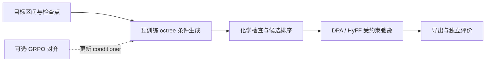
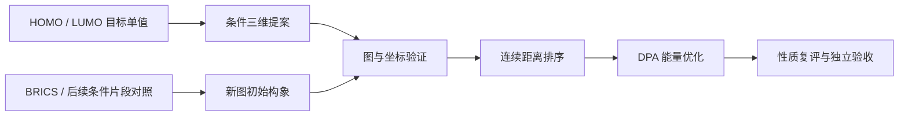

# 当前架构与下一轮调整

本文汇总源码、实验记录与 Opus / Carbon 两轮讨论，区分已实现能力与待验证设计。项目是个人探索，优先用小实验判断下一步投入，不以补齐论文章节为目标。实验定义见[实验方案](experiments.md)，数值见[结果汇总](results.md)。

## 汇总判断

保留现有基础设施，下一轮采用**源三维坐标与同协议标签、HOMO/LUMO 单值条件、连续距离排序、能量优先优化和容差验收**。先判断条件能否控制原始生成分布，再决定是否切换生成器。BRICS 保留为简单对照，可学习片段策略为有针对性的后续分支。当前证据没有证明 octree 路线必然失败。

| 讨论项 | 核验后的判断 | 采用的行动 |
| --- | --- | --- |
| QM9 → OCELOT 分布跨度 | 尺寸、元素和化学空间确有差异；低域内率是已观察到的瓶颈。尚未通过先验消融证明它是唯一根因 | 在新主数据上做 `qm9.pt` / `drug.pt` 的小规模匹配对照 |
| 条件值学习偏弱 | 正确条件相对打乱条件的 loss 优势小；Opus 的 51 batch 统计重复计入了三行均值，三个检查点还共用同一批分子 | 按检查点报告；增加不兼容条件和实际生成分布对照，不沿用显著性或“17.4% 信息量”解释 |
| 距离判键与内部电荷 | 生成结构内部形式电荷较多；`allowChargedFragments=True` 是事实，但不能单凭相关性认定它造成全部域外输出 | 保留形式电荷诊断，比较明确图提案；不把所有带形式电荷分子或三元环直接过滤 |
| BRICS 优势 | Central 明显改善，Original 的 FP 联合命中持平；简单图提案能改善当前候选供给 | 保留作无条件基线；进一步检验学到目标条件的收益 |
| 片段覆盖限制 | 单切规则确有覆盖限制；Carbon 的 42.65% 来自旧 CSV 排序后的前 2000 行，不是正式训练集占比 | 先统计真实训练图与核心覆盖，再决定是否增加端口/切分规则 |
| Full 弛豫停滞 | 固定起点对照中确有拒步停滞，纯能量残余力更低；FP 不读坐标，不能裁决量子性质质量 | 优先比较标准能量优化器＋末端性质验收，保留 Full 作对照 |
| 校准与命中概率 | 测试集平均区间较宽，不等于所有候选均不可认证；现有分位数校准不是完整概率分布 | 逐候选检查区间；安全裕度可作排序实验，不能把 MAE 当高斯 σ 或直接相乘为联合概率 |
| OCELOT 与内部量化差异 | 同图也有明显偏差，原始几何和逐分子 ω 仍缺失；CSV 的 IP 残差不能唯一确定调参方案 | 保留内部统一协议；不以盲扫基组/ω 或拟合五点偏移作为主线前置任务 |
| GRPO、扩大数据与多构象 | 都是可研究的扩展，现有结果不足以保证收益 | 先解决可测的条件响应；不同时堆入多步策略、Boltzmann 平均和四目标 |

核验的逐检查点统计与片段覆盖见[结果](results.md#条件响应与片段覆盖核验)。不把“未观察到稳定收益”写成“已证明没有收益”；也不把图模型误差、预训练差异和数据量差异统称为纯 3D 增益。

## 当前可运行实现



| 部件 | 当前职责与边界 |
| --- | --- |
| 生成器 | Uni-3DAR octree 先验，加区间 conditioner 和结构自评头；配置、词表、空间映射及目标 scaler 随检查点保存 |
| 监督适配 | 支持只训练 conditioner/readout 或全骨干训练；已完成的 5000→20000 步研究使用全骨干续训 |
| GRPO | 对完整树、元素和 XYZ 决策计算策略目标；当前实现冻结骨干，只更新 conditioner；默认关闭 |
| 分子对象与验证 | 保留元素、图、键级、电荷、指定立体信息和坐标；新坐标提案需要推断并验证图；已知输入图直接保留 |
| 性质模型 | DPA/HyFF 冻结描述符＋三个 bootstrap 性质适配器；指纹模型作为另外训练的图级对照 |
| 力场与弛豫 | DPA 或 HyFF 提供能量和原始力；固定图与骨架，在可动坐标空间提出步长，再做逐目标及能量接受检查 |
| 独立验证 | 不改变候选坐标的其他模型复评，以及单独的 PySCF/GPU4PySCF 量化计算 |

默认以 FP32、独立候选随机流和 concat KV 存储运行。GRPO、不确定性奖励、KV buffer 均不是已证实必需的收益来源。性质自评头使用无条件结构表征训练，避免仅复述输入区间；其排序收益仍需实验判断。

标准预训练表示为 12 层、宽度 768、12 个注意力头，叶格 0.24 Å、细坐标分箱 0.01 Å。广元素适配显式迁移至深度 7，空间边长 30.72 Å，使用最多 80 个显式原子的训练结构。元素、电子态和空间范围属于检查点能力，不由力场支持范围自动扩展。

当前还有两条明确区分的图路径：

- **固定骨架生长**：显式选择开放端点、片段、键级，维护氢替换与位点容量，固定输入世界坐标。它不是已训练的 octree 骨架补全。
- **BRICS 对照**：从训练结构构建单切片段库，随机选择兼容片段对，再生成构象。当前 BRICS 提案本身不使用性质条件；目标仅用于后续评价和筛选。

### 为什么加入 BRICS

BRICS 按局部化学环境规定哪些键可以切开、哪些片段端点可以连接。本项目每次只切一条允许的键，保存两侧的单端口片段；从相同的 8188 个生成器训练结构得到 9903 个不同片段，再随机选择兼容的两个端点连接。它回答的是：**不训练复杂生成模型，只重组已有化学片段，能给下游提供多少可用候选？**

```text
训练图 → 规则单切 → 带类型的片段库 → 随机兼容拼接 → 新分子图
                                                    ↓
                            初始三维构象 → 性质排序 → DPA 弛豫 → 独立评价
```

因此 BRICS 与 DPA/HyFF 分工不同：前者提出分子连接关系，后两者处理已有坐标的能量/力与性质。当前它是独立实验入口 `scripts/evaluate_brics_baseline.py`，没有作为 octree 失败后的补位逻辑，也没有学过“怎样拼接才能命中 HOMO/LUMO”。它的后续筛选和弛豫仍然使用目标条件。[实现](../src/orbit3d/baselines/brics.py)

单切库会遗漏不能直接切分的源分子，但这不等于它们的所有环核都从库中消失：别的可切分分子仍可能携带同一环核。一个大块片段也可包含供体、桥或受体，当前算法并非完全不能生成 D–π–A；实际限制是不能独立选择三个部件、多步装配，或自主创造新环核。规则兼容也不保证可合成、可嵌入三维或 Oracle 域内。[RDKit BRICS 定义](https://www.rdkit.org/docs/source/rdkit.Chem.BRICS.html)

## 数据和几何的角色

MIM-Flow QM9s/MR-TADF 包含源三维坐标，适配器直接使用这些坐标，另存原始光谱。QM9s 的 240 通道光谱和 MR-TADF 的 450 通道光谱没有被改称 HOMO/LUMO。

OCELOT CSV 提供 SMILES 和电子/光学性质标签，没有原始量子几何及逐分子 ω。已完成的最终性质模型使用统一的 ETKDGv3＋UFF 构象。标签为 HOMO、LUMO、垂直 S1 和 T1，单位均为 eV；8188 个可完整编码的训练构象用于生成器适配。

OCELOT 的既有结果保留，不把重建构象问题解释为全部失败的原因，也不全面重算原 CSV。按项目作者的最新偏好，**新主训练集直接使用发布方提供的量化优化坐标与对应性质标签**；不再优先投入 OCELOT 的 ETKDG/UFF/DPA/HyFF 重建构象全量比较。

主数据优先接入 OE62 的气相 PBE0 轨道标签及对应 PBE＋vdW 源几何；原始 QM9 的 B3LYP 源几何和轨道标签作小分子控制。两套数据分别训练性质头、scaler 和目标方案，不混用能量刻度。OE62 尚未完成本地适配，其基组/求解器复算条件见[实验方案](experiments.md#e0-源三维数据与目标冻结)。QMugs、GEOM 作为后续扩展；MIM-Flow 目前提供的光谱不能替代轨道标签。

## 建议的新主线：尚未实现



这张图是下一轮待比较的方案，不改变当前 CLI 默认行为。保留图验证、力场接口、数据身份、独立随机流、账本和重放能力；当前 Full 接受规则保留作对照。新训练坐标不重新展开；图提案产生的是新分子，推理时仍需初始构象，随后直接交给 MLIP 优化，UFF 不作必经步骤。

**单值条件。** 新条件器读取标准化的目标数值和目标激活 mask，复用现有 root prefix/AdaLN 接口；首版不用随机区间宽度或独立上下界 dropout。训练标签是点值，目标容差只参与排序/验收。SFT 仍用结构 token 损失，自评头继续读取无条件结构表征；不能把离散采样的预测距离误当成已有可微训练目标。单值模式需要新训练和检查点语义，不能只把旧区间设成零宽便称为新模型。

**连续评价。** 候选按标准化目标距离排序，最终同时报告连续误差、容差内联合命中、化学/物理合格与成本。首轮 HOMO/LUMO 的验收容差均预设为 ±0.25 eV，附报 ±0.10/±0.50 eV 敏感性结果；它们是实验定义，不是模型精度承诺。期望区间概率只作为同一候选池的排序消融。现有校准区间不是完整概率分布；联合残差重采样可作为轻量估计，但要留出数据检验，不能称为逐候选认证。

**片段分支。** 无条件 BRICS 用来测简单候选供给。若新数据和先验下的条件三维模型仍无法产生足够的可用候选，再用训练图构建“已有片段＋目标单值→配对片段”的一次连接监督任务。先报告可切分子、环核及元素覆盖，再决定是否需要多端口；不把它同时扩成大型图模型、构象模型和 RL。它与三维模型共用下游预算和评价，只有独立指标与多样性支持时才切换主线。

**结构先验对照。** 已核实上游正式发布 [`drug.pt`](https://huggingface.co/dptech/Uni-3DAR/tree/main)，并有 [DRUG 推理配置](https://github.com/dptech-corp/Uni-3DAR/blob/main/scripts/inference_drug.sh)。其默认深度为 7、叶格 0.24 Å、细坐标分箱 0.01 Å；允许元素包含 B/Si/As，但不含 Se/Te，不能直接宣称覆盖本项目全部 15 元素。先核对权重的词表和表示，再在同一主数据上做相同适配预算的对照；不预设域内率提升倍数。原始 QM9 用作小分子控制，需要独立接入其轨道标签；现有 QM9s 光谱适配不能替代这一步。

**几何优化。** 自由分子优先比较“标准能量优化、末端验收性质”和当前 Full。DPA 做首轮优化器，HyFF 用于后续独立复评；低 MLIP 力不是同级 DFT 极小点证明。源三维标签也不自动成为所有扰动几何上的真值，因此先做小规模同图量化检查，再考虑坐标性质梯度引导。新任务不默认加入多构象 Boltzmann 平均。固定外部锚点的约束优化继续保留。

### 实现调整范围

以下均待实验阶段实施，本轮只整理设计：

| 位置 | 必要调整 |
| --- | --- |
| 数据工具与 `utils/` | 增加 OE62 / 原始 QM9 源坐标与轨道标签适配；保持源 ID、几何、计算等级和单位对应，不走训练构象展开 |
| `constraints.py`、`generator/octree_model.py` | 明确区分目标点与验收半径，新增简洁点值条件编码；保留区间模型作匹配对照 |
| `generator/octree_backend.py`、`pipeline/octree_runner.py` | 保存条件模式与标签协议，训练/加载一致；增加点值训练与连续距离排序 |
| `oracles/` | 在新数据重训已有头，保存独立校准残差；概率评分先只作为实验选项 |
| `physics/` | 将标准纯能量优化与 Full 分开选择，统一输出真实力、性质变化、调用次数和停止原因 |
| 评价脚本 | 分开原始池、排序池和优化结果，记录训练支持、目标响应及实际成本；源数据/算法变动不重标旧结果 |

## 讨论时需要作出的选择

| 问题 | 建议的当前选择 | 改变选择所需证据 |
| --- | --- | --- |
| 是否整体重写 | 保留基础设施，先接源三维数据与单值条件 | 先验/条件小实验后决定是否开发条件片段后端 |
| 是否继续延长 SFT | 先做新先验/条件响应的小对照，不盲目延长旧配置 | 学习曲线或新数据支持明确的收益假设 |
| 是否默认开启 GRPO | 保持关闭，先检查已有 rollout 信号 | 跨训练 seed 的独立收益，且收益不只是更容易通过域筛选 |
| 是否默认用 UFF 最终优化 | 源训练坐标直接使用；新生成坐标比较 DPA 能量优化 | 固定起点的收敛、性质误差和量化结果 |
| 是否只报告二值命中 | 连续目标距离和固定容差命中并报 | 概率评分需额外证明校准和排序收益 |
| 是否继续四目标 | 首轮只做 HOMO/LUMO；旧四目标训练交集仅 0.57% | 具有一致源几何/激发标签、明确双目标控制和足够联合支持 |
| 是否全面重算 OCELOT | 不做 | 仅对实际失败或必要的物理验证选择小规模样本 |
| 是否扩展金属/开壳层 | 当前不作能力承诺 | 专门数据、电子态约定和独立验证 |

第一轮实验顺序和判别标准见[实验方案](experiments.md#下一轮最小实验)。
