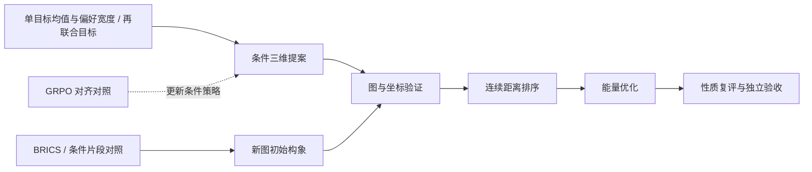

# 方案调整与实施状态

本页记录尚未落地的算法调整、取舍及实施状态；当前算法以[架构](architecture.md)为准，控制变量/预算以[实验设计](experiments.md)为准，证据归入[结果](results.md)。最近核对：2026-11-13。

## 研究主线与范围

研究主线是**OE62源三维结构上的可操作目标控制**，按独立评价与量化收益选择方法，不预设GRPO为论文核心。点值是当前主接口；已实现的均值/偏好宽度接口保留，但暂不扩大实验。宽度不是预测不确定性，也不保证输出性质服从指定高斯分布。暂不迁移蛋白口袋。

E8已确认主要GRPO收益来自候选供给；E10当前高斯适配与代理Hindsight不扩大。E11两性质三seed显示平均点值响应改善，但24例量化仅对比4/12、等时SFT3/12，尚未确立普遍优势。下一阶段保留Uni-3DAR自回归结构，重点学习完整分子的终态验收：先结构，再有限预算内的DPA几何/身份合格，再比较合格末端的target。384次诊断、首轮五臂及18例量化均完成。物理臂保留为待独立重复的候选；完整性质反馈不扩大，下一轮先复核物理反馈，再决定是否分阶段加入target。

DPA/HyFF继续用于快速性质/几何处理，PySCF用于独立复核。受力差异保留为方法边界，不另立研究主线，也不阻塞训练。原始结构、标签来源和对应坐标保持绑定；代理重标注不是DFT真值。

E11与E12本轮任务均已完成；实现保留在architecture.md，已完成验证从活动表移除。后续方向按跨模型、量化和跨seed证据选择，不自动恢复旧增强矩阵。

## 状态与更新约定

- **待实施**：方向已采纳，代码/数据接入尚未完成；**进行中**：正在实施；**待验证**：实现已具备，实验尚未给出结论；**已验证**：有明确证据，结论须注明采用或不采用；**暂缓**：保留方向，前置证据未齐。
- 状态变化原位更新该行日期、当前进展和证据链接。写完方案不算实现完成，测试通过不自动代表算法收益成立。
- 验证并采用后同步 `architecture.md` 和 `results.md`，将该项从活动表移除；未采用的方案只保留必要负结果。既有版本由 Git 追溯，不积累已完成 TODO、逐日记录或重复 review。
- 实验执行状态只在 `experiments.md` 的状态表维护，本页通过实验编号关联。收益判断使用对应实验结果，不从代码完成推定。源三维适配已通过坐标/标签/编码审计；先验小对照支持选用 drug 适配检查点。源适配、先验选择、点值条件、分层评价和GRPO增益对照均已完成并移出活动表，证据见 `results.md`。

## 活动调整

| 编号 | 调整方向 | 状态 | 当前进展 / 完成依据 | 验证入口 | 更新日期 |
| --- | --- | --- | --- | --- | --- |
| D06 | 优化后排序辅助对照 | 暂缓 | 保留既定协议，在条件控制对照之后按末端收益解释需要执行 | [E7](experiments.md#e7-优化和排序的顺序对照) | 2026-11-13 |
| D11 | 分离优势GRPO候选 | 暂缓 | 奖励归因已完成；v1尚未训练，保留候选，优先E12终态反馈 | [E8](experiments.md#e8-点值grpo奖励归因) | 2026-11-13 |
| D13 | 均值与偏好宽度条件SFT | 暂缓 | E10完成；当前低预算适配未建立稳定宽度响应或超过点值起点的收益 | [E10](experiments.md#e10-均值宽度与条件学习小实验) | 2026-11-13 |
| D12 | 点值接口的响应校正与置信度 | 待验证 | 点值为主接口；已有GP平均收益不稳定，策略冻结后在新目标/seed上验证上下游接口价值 | [E9](experiments.md#e9-点值接口的上下游扩展) | 2026-11-13 |
| D08 | 可学习的一次连接片段策略 | 暂缓 | 若新先验和点值模型仍缺可用候选，再实施；当前 BRICS 继续作无条件基线 | [架构取舍](#后续决策条件) | 2026-11-12 |

已完成的三训练seed对照表明，当前GRPO增加供给和平均代理命中，但目标MAE未优于等时SFT。E8消融已确认仅有效性解释主要供给收益，额外性质收益有限且随目标变化；后续按条件学习实测选择方法。概率/高斯筛选、GP校正的既有结果保持原结论；不通过更换评价口径制造收益。

力阈值分歧、19个源量化参照和两套24候选裁决保留为实验范围说明；下一阶段不再扩展受力差异诊断。

E12终态反馈已完成实现与首轮验证：保持原始采样轨迹，训练/推理共用终态算子；原始化学有效率没有提升，物理反馈主要改善合格起点的可弛豫率。额外性质通道已有实质学习信号，但尚无额外收益证据。物理臂需要独立训练seed复核；完整性质通道宜在可靠末端标签或分阶段对照后再评估。

E11点值对比已完成验证：保留为可选条件学习方法，未升级为默认策略，也不自动扩大训练矩阵。具体收益与分歧见results.md；从活动任务表移除。

## 调整依据

已核实的主要问题是候选供给不足、值特异条件响应偏弱、Full 弛豫停滞，以及代理与量化参照差异。它们支持做匹配对照，不能推成某一先验或算法已经被证明必然失败。[已核实结果](results.md)

旧 OCELOT 的 Original/Optical 联合训练支持分别为17.72%/29.52%，四目标交集仅0.57%。单值是条件形式，单/双/四目标是激活维数；点值不会自动消除联合稀疏性。采用“单目标主实验、双目标核心扩展、四目标挑战”的层次，不把各种失效混入一个末端命中数。[训练支持](../data/ocelot_target_coverage.json)

OCELOT 既有重建构象实验保留，不全面重算或盲扫量化参数拟合 CSV。新主训练优先采用发布方源几何及对应标签；不同数据集分别维护性质头、scaler 和计算等级。OE62量化使用已核验的PySCF PBE0/def2-TZVP协议，保留与原Tier2/tight的源样本差异；无需安装FHI-aims。详细数据范围与协议属于 E0。

## 保留的调整方向

该图保留后续比较方向；当前已实现的点值条件与分层评价以 `architecture.md` 为准，能量优先和可学习片段策略尚未替换默认流程。保留图验证、力场接口、身份记录、独立随机流、账本与重放；现有 Full 留作优化对照。新训练几何直接使用源坐标，新图提案仍需要初始构象，随后交给 MLIP，UFF 不设为必经步骤。

点值编码复用 root prefix/AdaLN 接口，输入标准化目标和激活 mask；不携带随机区间宽度或独立上下界 dropout。未激活性质不参与条件、距离和性质约束。单目标先独立训练，共享模型必须训练过相应 mask。训练仍用结构 token 损失，无条件结构自评头负责辅助预测；点值模式需要显式检查点语义和重新训练。

固定池排序未见概率评分一致收益，保留连续距离，容差用于验收。已测经验残差概率与距离的选择近似，没有一致独立收益；若后续扩展多目标，仍须保留联合残差的相关性。现有分位数校准不直接等于可积分的预测分布。

当前GRPO作为已实现的基线继续保留。E8完成奖励归因；后续预算优先用于E10条件学习对照，GRPO不享有方法优先权。主要指标预先固定，命中产率与可评价子集误差分别报告；是否启用新配置由实测决定。

48个同起点比较已完成：标准能量优化显著改善力收敛，但独立性质误差和保图没有同时改善，暂不替换Full默认路径；实现作为显式实验对照保留。低 MLIP 力不等于 DFT 极小点；源标签也不会自动成为任意扰动几何的真值，局部性质梯度需要单独证据。

BRICS保留为简单基线；可学习片段策略优先级低于条件学习对照，只在候选供给对照支持时开发：先学“已有片段＋目标点→配对片段”的一次连接，统计覆盖再决定多端口扩展。它与三维模型共享下游评价，不能仅凭域内率替换主线。

## 实施位置

| 调整 | 主要位置 |
| --- | --- |
| D11 | `generator/octree_alignment.py`、`run_point_comparison.py`及独立评价汇总：奖励消融与点值GRPO增强 |
| D12 | 条件输入校正、校准和固定池筛选工具：按不同统计对象分别验证 |
| D08 | 片段选择器；前置实验完成前不扩展实现 |

## 后续决策条件

| 观察结果 | 调整决定 |
| --- | --- |
| 新先验＋Point 原始池有跨 seed 条件响应，且结构质量保持 | 沿用 octree，扩大源数据训练 |
| 单目标有效，联合组合随支持减少而退化 | 按联合密度解释结果，扩大有针对性的数据支持 |
| 原始池不响应，只有重排改善 | 检查条件训练与 rollout 信号，用 E3-G 小对照判断 RL 能否补强；不直接扩大预算 |
| GRPO 跨 seed 优于冻结及继续 SFT，独立指标改善且代价可接受 | 采用已验证的对齐配置；按目标支持范围报告收益 |
| GRPO 仅训练奖励上升，或改善不足以覆盖结构/多样性与成本损失 | 不设为默认，保留结论并定位代理或奖励信号问题 |
| 可用候选仍不足，BRICS 在独立指标上更好 | 启动 D08，一次连接先于多步策略 |
| 纯能量优化收敛更好且独立性质不受损 | 采用能量优先，更新当前架构；否则保留有证据的规则 |
| 概率评分没有独立收益 | 保留距离排序，D07 不并入常驻路径 |
| 代理改善但同级量化不改善 | 改性质模型或补针对性标签，不继续叠加生成奖励 |

四目标等待同协议的源三维/激发标签及单/双目标证据；密集/稀疏组合均需对照。图动作 GRPO、多构象 Boltzmann、多端口大模型、金属/开壳层和大规模性能优化暂缓。以后如研究 TADF，另定义激发态/能隙目标，不将旧四窗口等同于小 S1−T1 任务。
