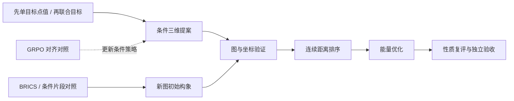

# 方案调整与实施状态

本页记录尚未落地的算法调整、取舍及实施状态；当前算法以[架构](architecture.md)为准，控制变量/预算以[实验设计](experiments.md)为准，证据归入[结果](results.md)。最近核对：2026-11-13。

## 状态与更新约定

- **待实施**：方向已采纳，代码/数据接入尚未完成；**进行中**：正在实施；**待验证**：实现已具备，实验尚未给出结论；**已验证**：有明确证据，结论须注明采用或不采用；**暂缓**：保留方向，前置证据未齐。
- 状态变化原位更新该行日期、当前进展和证据链接。写完方案不算实现完成，测试通过不自动代表算法收益成立。
- 验证并采用后同步 `architecture.md` 和 `results.md`，将该项从活动表移除；未采用的方案只保留必要负结果。既有版本由 Git 追溯，不积累已完成 TODO、逐日记录或重复 review。
- 实验执行状态只在 `experiments.md` 的状态表维护，本页通过实验编号关联。收益判断使用对应实验结果，不从代码完成推定。源三维适配已通过坐标/标签/编码审计；先验小对照支持选用 drug 适配检查点。这两项移出活动表，证据见 `results.md`。

## 活动调整

| 编号 | 调整方向 | 状态 | 当前进展 / 完成依据 | 验证入口 | 更新日期 |
| --- | --- | --- | --- | --- | --- |
| D02 | 单值条件与显式激活 mask | 进行中 | 初试LUMO优于关闭/打乱条件，HOMO未优于关闭；独立训练seed重复运行中 | [E3](experiments.md#e3-从单目标到联合控制) | 2026-11-13 |
| D03 | 条件、结构、物理分层评价 | 进行中 | 初试原始池、规范图独立复评及图/物理分层完成；正式重复继续汇总 | [分层指标](experiments.md#条件结构物理三层结果) | 2026-11-13 |
| D08 | 可学习的一次连接片段策略 | 暂缓 | 若新先验和点值模型仍缺可用候选，再实施；当前 BRICS 继续作无条件基线 | [架构取舍](#根据实验作出的取舍) | 2026-11-12 |
| D09 | 点值条件 GRPO 与增益验证 | 进行中 | 两组99池初试完成：GRPO覆盖/代理命中增加，MAE未优于等时SFT；seed43/44正式重复运行中 | [E3-G](experiments.md#e3-g-grpo-的增益与成本) | 2026-11-13 |

## 调整依据

已核实的主要问题是候选供给不足、值特异条件响应偏弱、Full 弛豫停滞，以及代理与量化参照差异。它们支持做匹配对照，不能推成某一先验或算法已经被证明必然失败。[已核实结果](results.md)

旧 OCELOT 的 Original/Optical 联合训练支持分别为17.72%/29.52%，四目标交集仅0.57%。单值是条件形式，单/双/四目标是激活维数；点值不会自动消除联合稀疏性。采用“单目标主实验、双目标核心扩展、四目标挑战”的层次，不把各种失效混入一个末端命中数。[训练支持](../data/ocelot_target_coverage.json)

OCELOT 既有重建构象实验保留，不全面重算或盲扫量化参数拟合 CSV。新主训练优先采用发布方源几何及对应标签；不同数据集分别维护性质头、scaler 和计算等级。OE62 同级复算需核对 FHI-aims Tier2/tight，不能由现有 PySCF/def2-SVP 代替。详细数据范围与协议属于 E0。

## 候选算法调整

该图为待验证方案，尚未替换当前实现。保留图验证、力场接口、身份记录、独立随机流、账本与重放；现有 Full 留作优化对照。新训练几何直接使用源坐标，新图提案仍需要初始构象，随后交给 MLIP，UFF 不设为必经步骤。

点值编码复用 root prefix/AdaLN 接口，输入标准化目标和激活 mask；不携带随机区间宽度或独立上下界 dropout。未激活性质不参与条件、距离和性质约束。单目标先独立训练，共享模型必须训练过相应 mask。训练仍用结构 token 损失，无条件结构自评头负责辅助预测；点值模式需要显式检查点语义和重新训练。

固定池排序未见概率评分一致收益，保留连续距离，容差用于验收。概率排序作为后续同池消融，用完整联合残差保留误差相关性；是否采用取决于独立误差/命中与成本。现有分位数校准不直接等于可积分的预测分布。

GRPO 列为单目标主实验后的必做增益对照：共享 SFT 起点，比较不更新、继续监督训练和 GRPO，固定评价器和推理流程。先使用连续点值性质 reward，验证原始池和独立评价是否改善，再决定物理奖励、KL 或更新容量的扩展。实施须支持点值/激活 mask，保留全部 rollout 与训练成本；当前架构和默认关闭设置在验证前不改。参数与验收口径统一见 E3-G。

48个同起点比较已完成：标准能量优化显著改善力收敛，但独立性质误差和保图没有同时改善，暂不替换Full默认路径；实现作为显式实验对照保留。低 MLIP 力不等于 DFT 极小点；源标签也不会自动成为任意扰动几何的真值，局部性质梯度需要单独证据。

片段策略只在候选供给对照支持时开发：先学“已有片段＋目标点→配对片段”的一次连接，统计覆盖再决定多端口扩展。它与三维模型共享下游评价，不能仅凭域内率替换主线。

## 实施位置

| 调整 | 主要位置 |
| --- | --- |
| D02、D04 | `constraints.py`、`generator/octree_model.py`、`generator/octree_backend.py`、`pipeline/octree_runner.py`：点值/半径分离、训练与检查点、排名 |
| D03 | 评价脚本及流水线结果：分层判据、覆盖率、原始池/排序池/优化结果与成本 |
| D06 | `physics/`：标准优化器与 Full 分开选择，统一真实力、属性和调用记录 |
| D09 | `generator/octree_alignment.py` 与实验编排/汇总：点值奖励、匹配续训、组信号和成本诊断 |
| D07、D08 | 后续 `oracles/` 概率评分、片段选择器；前置实验完成前不扩展实现 |

## 根据实验作出的取舍

| 观察结果 | 调整决定 |
| --- | --- |
| 新先验＋Point 原始池有跨 seed 条件响应，且结构质量保持 | 沿用 octree，扩大源数据训练 |
| 单目标有效，联合组合随支持减少而退化 | 按联合密度解释结果，扩大有针对性的数据支持 |
| 原始池不响应，只有重排改善 | 检查条件训练与 rollout 信号，用 E3-G 小对照判断 RL 能否补强；不直接扩大预算 |
| GRPO 跨 seed 优于冻结及继续 SFT，独立指标改善且代价可接受 | 采用已验证的对齐配置；按目标支持范围报告收益 |
| GRPO 仅训练奖励上升，或改善不足以覆盖结构/多样性与成本损失 | 不设为默认，保留结论并定位代理或奖励信号问题 |
| 可用候选仍不足，BRICS 在独立指标上更好 | 启动 D08，一次连接先于多步策略 |
| 纯能量优化收敛更好且独立性质不受损 | 采用能量优先，更新当前架构；否则保留有证据的规则 |
| 概率评分没有独立收益 | 保留距离排序，D07 不并入常驻路径 |
| 代理改善但同级量化不改善 | 改性质模型或补针对性标签，不继续叠加生成奖励 |

四目标等待同协议的源三维/激发标签及单/双目标证据；密集/稀疏组合均需对照。图动作 GRPO、多构象 Boltzmann、多端口大模型、金属/开壳层和大规模性能优化暂缓。以后如研究 TADF，另定义激发态/能隙目标，不将旧四窗口等同于小 S1−T1 任务。
