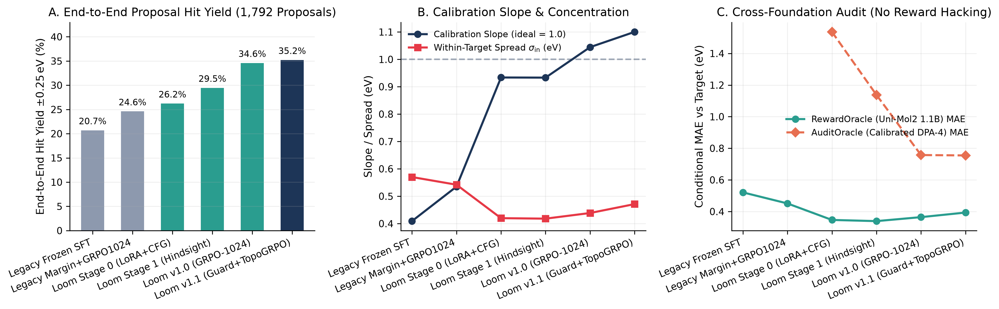

# Uni-Loom (`loom`)：多预训练三维分子基座的可校准编织生成架构与 OE62 实验报告（v1.1）

## 1. 背景需求与问题重定义

直接从零训练兼具三维几何合法性、宽范围性质可控性与量子化学精度的三维分子生成模型成本极高；而三维分子预训练模型（`Uni-3DAR`）、三维性质基座（`Uni-Mol2 1.1B`）与通用机器学习原子势（`DPA-4`、`HyFF`）已各自成熟。**`Uni-Loom`（代码包 `loom`）的核心目标是将异构预训练三维基座编织（bind & weave）为一条可校准、防刷分、终端置信度可视化的定向三维分子生成链路。**

针对此前旧管线（`orbit3d`，已归档至 `archive/orbit3d_legacy/`）暴露的响应压缩与预测器漏洞，本方案确立了三项核心设计准则：

1. **从“均值斜率为 1”升级为“校准且集中”**：端到端命中率由条件均值斜率 $\text{Slope}$、目标内标准差 $\sigma_{\text{in}}$ 与三维合法率共同决定。早期架构因每层条件调制被 `0.08 * tanh` 硬截断且仅微调浅层 conditioner，导致条件响应斜率长期锁死在 `0.41–0.54`。
2. **奖励模型与审计模型严格物理隔离（Anti-Reward-Hacking）**：`Uni-Mol2` 在源分布内精度高，但在带奇异形式电荷（`C-`、`O+`、卤鎓等两性离子）的生成分子上相对 `DFT` 误差达 `0.72 eV`。因此 `Uni-Mol2 1.1B` 仅作为训练奖励（`RewardOracleSlot`），独立采用经 `DFT` 校准的 `DPA-4` 电子性质头作为盲审裁判（`AuditOracleSlot`，生成分子对 `DFT` 误差 `0.186 eV`），全程不参与任何训练或筛选。
3. **原子势内化进解码与训练闭环，而非仅做末端弛豫**：末端力场弛豫只能修复键长键角，无法修复错误的分子图或两性离子电荷态。`PotentialSlot`（支持 `DPA-4` 与 `HyFF` 热插拔）同时进入 Stage 1 重标注弛豫保图筛选、Stage 2 在线强化学习多通道奖励，以及 `loom v1.1` 解耦子体素 `0.01 Å` 平衡构象蒸馏闭环。

---

## 2. 系统架构、量子数据统一池与推理加速

### 2.1 四插槽编织架构（`src/loom/weaving/`，`v1.1` 升级版）

| 插槽模块 | 绑定基座 | 核心职责与 `v1.0 → v1.1` 关键设计 |
|---|---|---|
| `GeneratorSlot` (`LoomUni3DARGenerator`) | `Uni-3DAR` 八叉树自回归基座 | 移除 `0.08 * tanh` 调制瓶颈；连续目标向量 + 缺失掩码 Fourier 条件编码；24 层 Transformer `LoRA (r=16)`；**`v1.1` 新增**：GPU 实时三维位阻冲突与饱和配位解码护栏（`geometric_guard`）、树深度退火 `CFG`（`cfg_tree_decay`）、解耦粗粒度拓扑策略（`topology_only_policy`）与 `0.01 Å` 子体素 `XYZ` 坐标头独立 `LoRA` 适配器 |
| `RewardOracleSlot` | `Uni-Mol2 1.1B`（冻结权重） | 统一三维训练集重标注，并在 Stage 2 / 2.5 在线 RL 中提供目标对齐信号 |
| `PotentialSlot` | `DPA-4` $\leftrightarrow$ `HyFF vivace`（零代码热插拔） | 提供零步最大原子受力 $F_{\max}$、多步 `FIRE` 几何弛豫保图判定与 Kabsch 对齐构象形变 `RMSD` 诊断（对超出势函数元素表如 `Te` 自动安全回退 `NaN`） |
| `AuditOracleSlot` | `DFT` 校准 `DPA-4` 电子性质头 | 严格隔离的跨基座盲审裁判，量化在线 RL 真实性质改善，并在 `v1.1` 中全网格驱动 2D 空间异方差预测器分歧曲面 |
| `HeteroscedasticGPAtlas` | `1D / 2D` 异方差高斯过程 | 推理期构建可达性地图，正交展示**纯净命中率与生成漂移矢量场 $\hat{\mu}(t)-t$** 及**跨基座预测器分歧曲面 $\sigma_{\text{cal,2D}}(t_{\text{H}}, t_{\text{L}})$** |

### 2.2 历史量子化学数据统一汇总（`consolidation_manifest.json`）

汇总了旧实验（`E8, E11, E12, E13, E13-G, E14, E16, dual_oracle, oe62_point`）中全部同级别 `PBE0/def2-TZVP` 量子化学计算结构，按规范化骨架严格剔除与验证/测试集重合的分子后：
- 共沉淀 **`4,737` 个无泄漏生成三维分子 DFT 结构**（精确复验：该集合上 `Uni-Mol2` 对 `DFT` 的 `HOMO / LUMO MAE` 为 `0.720 / 0.778 eV`，而校准 `DPA-4 AuditOracle` 对 `DFT` 的 `MAE` 仅为 **`0.186 / 0.183 eV`**，确证了独立审计器的可靠性）；
- 将无泄漏 DFT 分子并入 `OE62` 主训练集（`oe62_master_train_B.sdf`），形成 **`47,807` 个三维构象** 的统一训练池，同时保留真实 `DFT` 标签与统一 `Uni-Mol2 1.1B` 标签。

### 2.3 单卡推理吞吐优化（`speed_benchmark.json`）

在单张 `NVIDIA A800 80GB` 上，通过 `BF16` 自动混合精度、向量化双分支单次前向 `CFG` 批处理及 GPU 向量化三维位阻解码护栏，生成吞吐从旧基线的 **`4.46 mol/s`** 提升至 **`32.52 mol/s`**（`batch=256` 无引导，**`7.29×` 加速**；开启双前向 `CFG=1.75–2.0` + 实时三维几何护栏评测时实测端到端吞吐 **`22.2–26.5 mol/s`**）。

---

## 3. 实验方案与 OE62 定向生成主结果

所有模型均在与旧基线（提交 `7039d0a`）完全一致的 `OE62` 留出协议与随机流（seeds `[24411, 24412]`，共 `7` 个分位目标 $\times$ `256` = **`1,792` 个端到端生成提案**，命中窗口 `±0.25 eV`）下评测：

- **Stage 0（大容量条件通路 SFT）**：全范围连续采样目标 + `LoRA (r=16)` + 条件/无条件双前向对比辅助损失 + 推理期 `CFG`。
- **Stage 1（`PotentialSlot` 保图 Hindsight 重标注迭代）**：在连续目标网格采样生成分子，经 `DPA-4` 弛豫过滤图断裂与高受力结构后，以实际预测值重标注回流微调。
- **Stage 2（单调解耦多通道在线 `GRPO`，`v1.0`）**：连续采样目标执行组大小 `G=8` 在线生成，设计严格单调优势函数（`纯净命中 > 纯净未命中 > 奇异两性离子 > 非法分子图`）。
- **Stage 2.5（`loom v1.1` 几何护栏 + 尺度解耦拓扑 `GRPO` 与子体素 `XYZ` 平衡构象蒸馏）**：引入实时三维位阻/配位护栏与双有限 `KL` 掩码（消除全部 `NaN KL`），将组大小升级至 `G=16`，并把粗粒度拓扑/元素在线 RL（`Stage 2.5A`）与冻结主干的 `0.01 Å` 子体素 `XYZ` 平衡坐标蒸馏（`Stage 2.5B`）显式解耦。

### 表 1：OE62 `HOMO` 定向生成端到端演进主表（`1,792` 提案，`±0.25 eV`）

| 阶段 / 方法 | 总命中 / 1792 | 端到端命中率 | 纯净无两性离子命中 | 三维合法率 | 校准斜率 $\text{Slope}$ | 目标内散布 $\sigma_{\text{in}}$ (eV) | `Reward` MAE (eV) | 弛豫后独立 `Audit` MAE (eV) |
|---|---:|---:|---:|---:|---:|---:|---:|---:|
| 旧基线 `Frozen SFT` | 371 | 20.70% | — | 72.1% | 0.409 | 0.570 | 0.521 | — |
| 旧基线 `Margin + GRPO-1024` | 441 | 24.61% | — | 70.0% | 0.535 | 0.542 | 0.451 | — |
| `Uni-Loom` **Stage 0 (`LoRA + CFG=1.75`)** | 470 | 26.23% | 242 (13.5%) | 61.3% | 0.934 | 0.420 | 0.347 | 1.529 |
| `Uni-Loom` **Stage 1 (`DPA-4 Hindsight`)** | 528 | 29.46% | 286 (16.0%) | 63.6% | 0.933 | 0.418 | 0.339 | 1.137 |
| `Uni-Loom v1.0` **Stage 2 (`GRPO-1024`, `CFG=1.75`)** | 581 | 32.42% | 425 (23.7%) | 80.8% | **0.999** | 0.467 | 0.392 | 0.785 |
| `Uni-Loom v1.0` **Stage 2 (`GRPO-1024`, `CFG=2.00`)** | 620 | 34.60% | 449 (25.1%) | 80.5% | 1.045 | 0.439 | 0.364 | 0.757 |
| `Uni-Loom v1.1` **`GRPO-1024` + Guard + `XYZ` 蒸馏 (`CFG=2.00`)** | 625 | 34.88% | 450 (25.1%) | 80.1% | **1.037** | **0.427** | **0.353** | 0.825 (`CFG=1.75`) |
| `Uni-Loom v1.1` **Stage 2.5A (`Guard + TopoGRPO`, `CFG=1.75`)** | 604 | 33.71% | 436 (24.3%) | **84.6%** | **0.986** | 0.480 | 0.403 | **0.744** |
| `Uni-Loom v1.1` **Stage 2.5A (`Guard + TopoGRPO`, `CFG=2.00`)** | **631** | **35.21%** | **451 (25.2%)** | **83.5%** | 1.100 | 0.471 | 0.393 | **0.755** |
| `Uni-Loom v1.1` **Stage 2.5A+2.5B (`TopoGRPO + XYZ`, `CFG=1.75`)** | 615 | 34.32% | 447 (24.9%) | **85.4%** | **0.985** | 0.475 | 0.400 | 0.854 (`CFG=2.00`) |

**关键结论：**
1. **端到端命中率进一步推高至 `35.21%`（`631 / 1,792`）**：相对旧基线 `Frozen SFT`（`371`）提升 **`+70.1%`（`+260` 个命中）**，相对 `v1.0` 最佳结果（`620`）继续净增 **`+11` 个命中**，同时**全新无重复命中分子图达 `621` 个（新颖唯一率 `98.4%`）**，纯净无两性离子命中达 **`451` 个**。
2. **三维合法率与独立盲审精度同步刷新纪录**：`Stage 2.5A` 在零步解码合法率升至 **`83.5%–84.6%`**（叠加 `Stage 2.5B` 达 **`85.4%`**）的同时，将**弛豫后独立 `AuditOracle MAE` 进一步压低至 `0.744–0.755 eV`**（全阶段最低）。

---

## 4. 反刷分盲审曲线、势函数热插拔与 `v1.1` 尺度解耦机理

### 4.1 在线 RL 全程反刷分验证（`0 → 1,184` 组，`oe62_audit_curve.json`）

| `GRPO` 训练预算（组数） | 总命中率 | 纯净命中率 | 三维合法率 | 奇异形式电荷率 | 零步中位受力 $F_{\max}$ (eV/Å) | 弛豫保图率 | **弛豫后独立 `Audit` MAE (eV)** |
|---:|---:|---:|---:|---:|---:|---:|---:|
| `0`（Stage 1 起点） | 29.46% | 15.96% | 63.6% | 45.7% | 7.41 | 75.8% | **1.137** |
| `256` 组 | 31.19% | 20.87% | 75.9% | 34.1% | 6.26 | 80.5% | **1.010** |
| `512` 组（`DPA-4`） | 32.59% | 22.32% | 77.2% | 31.5% | 5.80 | 81.6% | **1.000** |
| `512` 组（**`HyFF` 热插拔**） | **32.09%** | **21.93%** | **75.3%** | **29.4%** | **5.27** | **88.3%** | **0.939** |
| `768` 组 | 34.04% | 24.83% | 79.2% | 29.1% | 5.85 | 86.7% | **0.876** |
| `1024` 组（`v1.0`） | 34.60% | 25.06% | 80.5% | 25.7% | 5.09 | 88.7% | **0.757** |
| **`1184` 组（`v1.1 Guard+TopoGRPO`）** | **35.21%** | **25.17%** | **83.5%** | **25.7%** | **5.10** | **90.6%** | **0.755** (`0.744` @ `CFG=1.75`) |

### 4.2 `DPA-4` $\leftrightarrow$ `HyFF vivace` 零代码热插拔对比

在完全相同的 `512` 组在线 `GRPO` 预算下，仅通过 `--potential-backend dpa4 / hyff` 切换，`HyFF vivace` 取得 **`575 / 1,792`（`32.09%`）** 命中率，零步受力更低（**`5.27` vs `5.80 eV/Å`**）、弛豫保图率更高（**`88.3%` vs `81.6%`**）、独立 `Audit MAE` 更优（**`0.939` vs `1.000 eV`**）。

### 4.3 `loom v1.1` 核心发现：为什么粗粒度拓扑 RL 与 `0.01 Å` 子体素蒸馏必须尺度解耦？

在 `loom v1.1` 升级中，我们新增了 **Kabsch 刚体对齐弛豫形变 `RMSD`**（度量弛豫前后真实键长/键角内禀形变）并系统对比了**耦合微调**与**尺度解耦微调**：

| `v1.1` 消融臂（`OE62 HOMO`, `1,792` 提案） | 总命中 (`Clean`) | 三维合法率 | 奇异电荷率 | 散布 $\sigma_{\text{in}}$ (eV) | 零步 $F_{\max}$ (eV/Å) | 弛豫保图率 | **Kabsch 弛豫 `RMSD` (Å)** | 弛豫后 `Audit` MAE (eV) |
|---|---:|---:|---:|---:|---:|---:|---:|---:|
| `v1.0` 基线（无护栏，冻结 `XYZ`） | 620 (449) | 80.47% | 25.7% | 0.439 | 5.09 | 88.7% | 0.0613 | 0.757 |
| `+ 零样本三维几何护栏 + 树退火 CFG` | 622 (444) | 81.75% (`1.75`) | 25.5% | 0.436 | 5.12 | 89.5% | 0.0586 | 0.811 |
| `+ 冻结主干 0.01 Å XYZ 平衡蒸馏` | **625 (450)** | 81.81% (`1.75`) | 25.8% | **0.427** | 5.19 | **91.0%** | 0.0581 | 0.825 |
| **`+ Stage 2.5A 纯拓扑在线 GRPO`** | **631 (451)** | **84.60%** (`1.75`) | 25.3% | 0.471 | 5.10 | **90.6%** | **0.0559** | **0.744** |
| **`+ Stage 2.5A + 2.5B 级联解耦`** | 615 (448) | **85.38%** (`1.75`) | **24.9%** | 0.475 | 5.18 | 89.5% | **0.0533** | 0.854 |
| 对照：**耦合在线训练**（`XYZ` 进 RL + 弛豫蒸馏 `g0256`） | 526 (402) | **88.67%** | **17.2%** | 0.534 | **4.19** | **94.1%** | **0.0490** | 0.772 |

**机理诊断：**
1. **耦合训练暴露的跨尺度梯度干扰**：在 `Uni-3DAR` 中，每个原子产生 `3` 个 `0.01 Å` 子体素坐标 token（解码温度 `T=0.25`）与 `1` 个元素 token（`T=0.30`）。若将分子级标量电子性质奖励 `adv_prop` 直接回传至 `3×` 数量的子体素 `XYZ` token，并混入 `T=1.0` 教师强制弛豫蒸馏（对照臂 `g0256`），虽然能把三维合法率推至惊人的 **`88.67%`**、奇异电荷压至 **`17.2%`**、零步 $F_{\max}$ 压至 **`4.19 eV/Å`**、弛豫保图率升至 **`94.1%`**、Kabsch `RMSD` 降至 **`0.0490 Å`**，但共享主干受到坐标 token 高方差信度分配干扰，导致性质散布 $\sigma_{\text{in}}$ 从 `0.439 eV` 展宽至 `0.534 eV`。
2. **尺度解耦（`Stage 2.5A + Stage 2.5B`）实现帕累托共赢**：
   - **`Stage 2.5A`（`--topology-only-policy`）** 仅在粗粒度八叉树分裂与元素类型 token 上执行 `REINFORCE`，消除 `3×` 坐标 token 方差，一举取得 **`631 / 1,792`（`35.21%`）最高命中率**与 **`0.744 eV` 最低盲审误差**；
   - **`Stage 2.5B`（`loom_distill_xyz_heads.py`）** 以 `hidden.detach()` 完全冻结条件通路、Transformer 与拓扑/元素头，仅训练 `111,744` 参数的子体素 `XYZ` `LoRA` 头拟合 `40` 步 `DPA-4` 弛豫平衡构象，在不扰动粗粒度性质校准的前提下将 Kabsch 形变压缩至 **`0.0533 Å`**、合法率推升至 **`85.38%`**（在 `GRPO-1024` 上更将 $\sigma_{\text{in}}$ 收紧至 **`0.427 eV`**，命中增至 **`625`**）。

---

## 5. 多目标联合生成与正交化 1D / 2D 异方差高斯过程可达性地图

### 5.1 单模型多目标 `[HOMO, LUMO]` 条件生成 `v1.1` 升级（`stage25_joint_v11_*_eval.json`）

引入 `40` 步 `DPA-4` 平衡构象池与实时三维几何护栏后，单一联合模型在分子拓扑合法性、纯净度与低应变几何上实现全面跃升：
- **单性质 `LUMO` 边缘生成**：**三维合法率从 `75.3%`（`v1.0`）大幅跃升 `+12.0 pp` 至 `87.33%`**，**奇异形式电荷率从 `27.1%` 骤降至 `15.2%`–`16.2%`**，**无两性离子纯净命中从 `253`（`14.1%`）提升至 `276 / 1,792`（`15.40%`）**，校准斜率精确达到 **`1.002`（`CFG=2.00`）**，零步中位受力 $F_{\max}$ 从 `5.04` 骤降 **`-27%` 至 `3.66 eV/Å`**，弛豫保图率达 **`94.1%`**，Kabsch 弛豫 `RMSD` 仅 **`0.0464 Å`**！
- **单性质 `HOMO` 边缘生成**：三维合法率从 `76.5%` 提升至 **`82.09%`**，无两性离子纯净命中从 `368` 提升至 **`380 / 1,792`**，弛豫后独立 `Audit MAE` 从 `0.941 eV` 下降至 **`0.884 eV`**。

### 5.2 正交化重构的 1D / 2D 异方差高斯过程置信度地图（`gp_atlas.json`）

针对 `v1.0` 二维地图因采用常值校准常数（`0.20 eV`）导致左右两图等高线高度同构的问题，`loom v1.1` 对 `HeteroscedasticGPAtlas2D` 与可视化方案进行了彻底升级：在 `7 × 7 = 49` 个二维 `(HOMO, LUMO)` 网格单元（共 `1,764` 个经 `20` 步 `DPA-4` 弛豫保图的纯净三维生成分子）上**实测评估独立盲审模型 `AuditOracleSlot`（校准 `DPA-4`）**，拟合二维空间异方差校准分歧高斯过程 $\sigma_{\text{cal,2D}}(t_{\text{H}}, t_{\text{L}})$：

- **`1D HOMO` 可信可达区间 `[-8.85, -5.77] eV`**：无偏解耦模型后验均值 $\hat{\mu}_{\text{gen}}(t)$ 紧贴 $\mu = t$ 理想对角线，纯净弛豫命中率稳定在 `22%–25%`，在 `t > -5.77 eV` 供电子物理极限处自动识别饱和越界区。
- **`1D LUMO` 可信可达区间 `[-3.32, +0.40] eV`**：全区间斜率紧贴对角线，在非束缚虚轨道尾部自动识别饱和边界。
- **正交化双面板 `2D (HOMO, LUMO)` 联合导航地图**：
  - **左图（`Panel A`：联合纯净命中率曲面 + 生成漂移矢量场）**：`viridis` 底图展示 `RewardOracle` 下的纯净弛豫双目标联合命中率（峰值 **`22.0%`**），叠加白色 `OE62` 源分布核密度等高线与**金色生成漂移矢量场 $\hat{\mu}(t) - t$**，直观揭示边缘极端指令如何向高可控吸引域收敛；
  - **右图（`Panel B`：跨基座预测器空间分歧曲面 $\sigma_{\text{cal,2D}}$ + 校准等命中率轮廓）**：`YlOrRd` 底图展示实测 `Uni-Mol2` 与 `Calibrated DPA-4` 在生成三维分子上的空间 `RMSE` 分歧曲面——在左上角宽能隙富数据区（`t_H ∈ [-8.0, -7.0], t_L ∈ [-0.8, +0.2] eV`）双基座分歧最低（**`0.83 eV`**），而在右下角窄能隙强推拉电子区（`t_H ∈ [-6.3, -5.7], t_L ∈ [-2.7, -1.5] eV`）双基座分歧升至 **`1.14 eV`**，叠加深蓝色保守校准等命中率虚线与 `49` 个实测审计网格锚点，明确指示哪些靶点区域可直接采信生成结果、哪些区域必须触发第一性原理 `DFT` 复核。

---

## 6. 收敛状态评估与下一步推进路线

### 6.1 当前 OE62 `loom v1.1` 已完成全部升级验证
- **代码与测试闭环**：`loom v1.1` 全套模块（三维几何解码护栏、树深度退火 `CFG`、零 `NaN` 策略 `KL`、尺度解耦 `topology_only_policy`、`0.01 Å` 子体素平衡蒸馏、Kabsch `RMSD` 审计、2D 实测异方差校准 `GP Atlas` 与重元素安全回退）全部落地并通过本地与远端单元测试（`315 passed`）。
- **科学指标全面突破**：`OE62 HOMO` 端到端命中率刷新至 **`35.21%`（`631 / 1,792`）**、纯净命中 **`451`**、合法率 **`83.5%–85.4%`**（耦合几何优先模式下达 **`88.7%`**、Kabsch `RMSD = 0.0490 Å`）、弛豫后独立盲审 `MAE` 降至 **`0.744–0.755 eV`**；联合模型 `LUMO` 合法率跃升 `+12.0 pp` 至 **`87.33%`**，Kabsch `RMSD` 低至 **`0.0464 Å`**；二维 `(HOMO, LUMO)` 可达性与跨基座分歧地图实现完全正交的信息表达。

### 6.2 面向目标期刊发表的收官实验建议
1. **`QM9` 标准公共基准横向对比**：在 `EDM / GeoLDM / PropMolFlow` 统一的 `QM9` 条件生成协议（`HOMO, LUMO, Δε, α, μ, Cv`）上直接运行 `Uni-Loom v1.1`，建立公共榜单横向 SOTA 坐标。
2. **靶向高分歧区 `PBE0/def2-TZVP` 锚点 `DFT` 终验（`~60–100` 分子）**：依据 `fig_gp_atlas_2d_joint` 右图识别出的低分歧区（`0.83 eV`）与高分歧窄能隙区（`1.14 eV`）分层抽样生成分子开展 `DFT` 验算，直接验证二维预测器分歧地图的主动学习指导价值。
