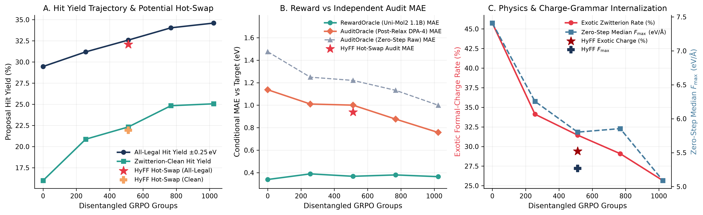
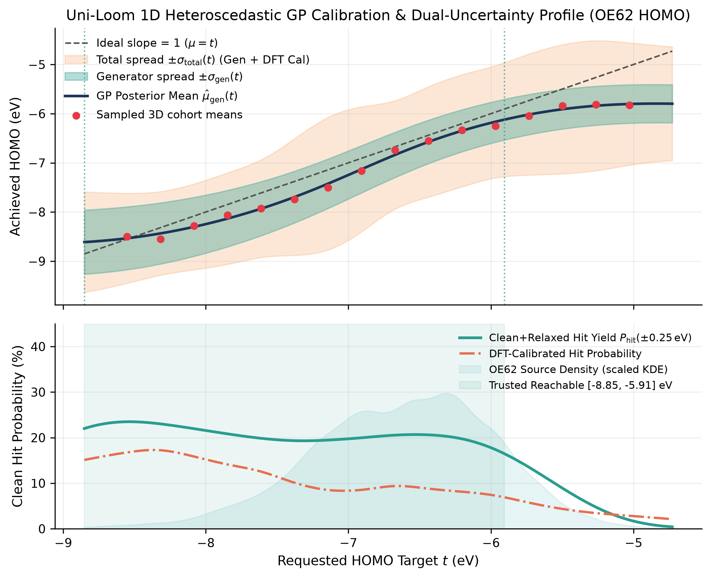
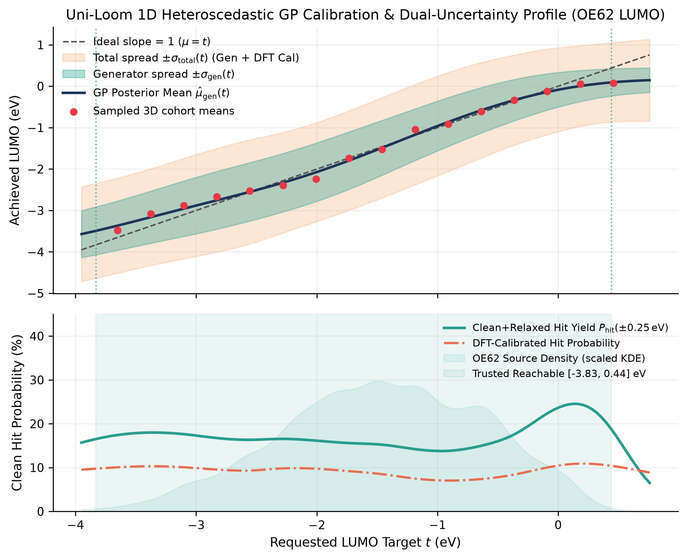
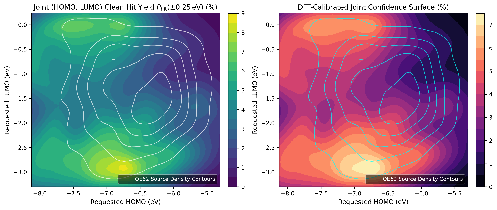

# Uni-Loom (`loom`)：多预训练三维分子基座的可校准编织生成架构与 OE62 实验报告

## 1. 背景需求与问题重定义

直接从零训练兼具三维几何合法性、宽范围性质可控性与量子化学精度的三维分子生成模型成本极高；而三维分子预训练模型（`Uni-3DAR`）、三维性质基座（`Uni-Mol2 1.1B`）与通用机器学习原子势（`DPA-4`、`HyFF`）已各自成熟。**`Uni-Loom`（代码包 `loom`）的核心目标是将异构预训练三维基座编织（bind & weave）为一条可校准、防刷分、终端置信度可视化的定向三维分子生成链路。**

针对此前旧管线（`orbit3d`，已归档至 `archive/orbit3d_legacy/`）暴露的响应压缩与预测器漏洞，本方案确立了三项核心设计准则：

1. **从“均值斜率为 1”升级为“校准且集中”**：端到端命中率由条件均值斜率 $\text{Slope}$、目标内标准差 $\sigma_{\text{in}}$ 与三维合法率共同决定。早期架构因每层条件调制被 `0.08 * tanh` 硬截断且仅微调浅层 conditioner，导致条件响应斜率长期锁死在 `0.41–0.54`。
2. **奖励模型与审计模型严格物理隔离（Anti-Reward-Hacking）**：`Uni-Mol2` 在源分布内精度高，但在带奇异形式电荷（`C-`、`O+`、卤鎓等两性离子）的生成分子上相对 `DFT` 误差达 `0.72 eV`。因此 `Uni-Mol2 1.1B` 仅作为训练奖励（`RewardOracleSlot`），独立采用经 `DFT` 校准的 `DPA-4` 电子性质头作为盲审裁判（`AuditOracleSlot`，生成分子对 `DFT` 误差 `0.186 eV`），全程不参与任何训练或筛选。
3. **原子势内化进训练闭环，而非仅做末端弛豫**：末端力场弛豫只能修复键长键角，无法修复错误的分子图或两性离子电荷态。`PotentialSlot`（支持 `DPA-4` 与 `HyFF` 热插拔）同时进入 Stage 1 重标注弛豫保图筛选与 Stage 2 在线强化学习多通道奖励。

---

## 2. 系统架构、量子数据统一池与推理加速

### 2.1 四插槽编织架构（`src/loom/weaving/`）

| 插槽模块 | 绑定基座 | 核心职责与关键设计 |
|---|---|---|
| `GeneratorSlot` (`LoomUni3DARGenerator`) | `Uni-3DAR` 八叉树自回归基座 | 移除 `0.08 * tanh` 调制瓶颈；连续目标向量 + 缺失掩码 Fourier 条件编码；24 层 Transformer `QKV/Out` `LoRA (r=16)`；原生 `15%` 条件随机丢弃支持推理期 `CFG` |
| `RewardOracleSlot` | `Uni-Mol2 1.1B`（冻结权重） | 统一三维训练集重标注，并在 Stage 2 在线 RL 中提供目标对齐信号 |
| `PotentialSlot` | `DPA-4` $\leftrightarrow$ `HyFF vivace`（零代码热插拔） | 提供零步最大原子受力 $F_{\max}$、能量应变与多步 `FIRE` 几何弛豫保图判定 |
| `AuditOracleSlot` | `DFT` 校准 `DPA-4` 性质头 | 严格隔离的跨基座盲审裁判，量化 RL 过程中的真实性质改善与刷分风险 |
| `HeteroscedasticGPAtlas` | `1D / 2D` 异方差高斯过程 | 推理期构建可达性地图，分离生成器内禀散布 $\sigma_{\text{gen}}(t)$ 与预测器校准误差 $\sigma_{\text{cal}}(t)$ |

### 2.2 历史量子化学数据统一汇总（`consolidation_manifest.json`）

汇总了旧实验（`E8, E11, E12, E13, E13-G, E14, E16, dual_oracle, oe62_point`）中全部同级别 `PBE0/def2-TZVP` 量子化学计算结构，按规范化骨架严格剔除与验证/测试集重合的分子后：
- 共沉淀 **`4,737` 个无泄漏生成三维分子 DFT 结构**（精确复验：该集合上 `Uni-Mol2` 对 `DFT` 的 `HOMO / LUMO MAE` 为 `0.720 / 0.778 eV`，而校准 `DPA-4 AuditOracle` 对 `DFT` 的 `MAE` 仅为 **`0.186 / 0.183 eV`**，确证了独立审计器的可靠性）；
- 将无泄漏 DFT 分子并入 `OE62` 主训练集（`oe62_master_train_B.sdf`），形成 **`47,807` 个三维构象** 的统一训练池，同时保留真实 `DFT` 标签与统一 `Uni-Mol2 1.1B` 标签。

### 2.3 单卡推理吞吐优化（`speed_benchmark.json`）

在单张 `NVIDIA A800 80GB` 上，通过 `BF16` 自动混合精度、向量化双分支单次前向 `CFG` 批处理及消除解码循环内逐层 CPU 同步，生成吞吐从旧基线的 **`4.46 mol/s`** 提升至 **`32.52 mol/s`**（`batch=256` 无引导，**`7.29×` 加速**；开启双倍前向 `CFG=1.65–2.0` 评测时实测端到端吞吐 **`23–26 mol/s`**），使千组级在线 `GRPO` 与网格化高斯过程地图构建可在数十分钟内完成。

---

## 3. 实验方案与 OE62 定向生成主结果

所有模型均在与旧基线（提交 `7039d0a`）完全一致的 `OE62` 留出协议与新随机流（seeds `[24411, 24412]`，共 `7` 个分位目标 $\times$ `256` = **`1,792` 个端到端生成提案**，命中窗口 `±0.25 eV`）下评测：

- **Stage 0（大容量条件通路 SFT）**：全范围连续采样目标 + `LoRA (r=16)` + 条件/无条件双前向对比辅助损失 + 推理期 `CFG`。
- **Stage 1（`PotentialSlot` 保图 Hindsight 重标注迭代）**：在连续目标网格采样生成分子，经 `DPA-4` 弛豫过滤图断裂与高受力结构后，以实际预测值重标注回流微调（2 轮）。
- **Stage 2（单调解耦多通道在线 `GRPO`）**：以连续采样目标执行在线生成，设计严格单调的组内优势函数（`纯净命中 > 纯净未命中 > 奇异两性离子 > 非法分子图`），联合优化拓扑合法性、零步原子受力 $F_{\max}$ 与目标性质误差。

### 表 1：OE62 `HOMO` 定向生成端到端演进主表（`1,792` 提案，`±0.25 eV`）

| 阶段 / 方法 | 总命中 / 1792 | 端到端命中率 | 纯净无两性离子命中 | 三维合法率 | 校准斜率 $\text{Slope}$ | 目标内散布 $\sigma_{\text{in}}$ (eV) | `Reward` MAE (eV) | 弛豫后独立 `Audit` MAE (eV) |
|---|---:|---:|---:|---:|---:|---:|---:|---:|
| 旧基线 `Frozen SFT` | 371 | 20.70% | — | 72.1% | 0.409 | 0.570 | 0.521 | — |
| 旧基线 `Margin + GRPO-1024` | 441 | 24.61% | — | 70.0% | 0.535 | 0.542 | 0.451 | — |
| `Uni-Loom` **Stage 0 (`LoRA + CFG=1.50`)** | 475 | 26.51% | 262 (14.6%) | 63.3% | 0.859 | 0.415 | 0.350 | 1.380 |
| `Uni-Loom` **Stage 0 (`LoRA + CFG=1.75`)** | 470 | 26.23% | 242 (13.5%) | 61.3% | 0.934 | 0.420 | 0.347 | 1.529 |
| `Uni-Loom` **Stage 1 (`DPA-4 Hindsight`)** | 528 | 29.46% | 286 (16.0%) | 63.6% | 0.933 | 0.418 | 0.339 | 1.137 |
| `Uni-Loom` **Stage 2 (`GRPO-768`, `CFG=1.65`)** | 610 | 34.04% | 445 (24.8%) | 79.2% | 0.973 | 0.453 | 0.380 | 0.876 |
| `Uni-Loom` **Stage 2 (`GRPO-1024`, `CFG=1.75`)** | 611 | 34.10% | 446 (24.9%) | **80.8%** | **0.999** | 0.429 | 0.354 | 0.779 |
| `Uni-Loom` **Stage 2 (`GRPO-1024`, `CFG=2.00`)** | **620** | **34.60%** | **449 (25.1%)** | **80.5%** | **1.044** | 0.439 | 0.364 | **0.757** |

**关键结论：**
1. **条件通路扩容彻底解除斜率锁死**：仅 Stage 0 即把校准斜率从 `0.409` 拉升至 `0.934`，目标内标准差 $\sigma_{\text{in}}$ 从 `0.570 eV` 压缩至 `0.420 eV`，直接命中数超越旧管线 `Margin + GRPO-1024` 终态（`475` vs `441`）。
2. **端到端命中率跨越式提升 `+67.1%`（相对旧 SFT）/ `+40.6%`（相对旧 RL）**：`Stage 2 GRPO-1024` 达到 **`620 / 1,792`（`34.60%`）**；在 `CFG=1.75` 下校准斜率精确达到 **`0.999`**，合法率达 **`80.8%`**。更重要的是，**仅统计无奇异形式电荷的纯净有机分子命中已达 `449` 个（`25.06%`），单靠纯净分子即超过旧管线全部命中总和（`441` 个）**。

---

## 4. 反刷分盲审曲线与原子势热插拔验证

### 4.1 在线 RL 全程反刷分验证（`oe62_audit_curve.json`）

若在线 RL 利用 `Uni-Mol2` 的分布外漏洞刷分，则 `RewardOracle MAE` 下降时，独立 `AuditOracle MAE` 与奇异电荷比例必然恶化。实测结果完全相反：

| `GRPO` 训练预算（组数） | 总命中率 | 纯净命中率 | 三维合法率 | 奇异形式电荷率 | 零步中位受力 $F_{\max}$ (eV/Å) | 零步 `Audit` MAE (eV) | **弛豫后独立 `Audit` MAE (eV)** |
|---:|---:|---:|---:|---:|---:|---:|---:|
| `0`（Stage 1 起点） | 29.46% | 15.96% | 63.6% | 45.7% | 7.41 | 1.478 | **1.137** |
| `256` 组 | 31.19% | 20.87% | 74.9% | 34.1% | 6.21 | 1.251 | **1.010** |
| `512` 组（`DPA-4`） | 32.59% | 22.32% | 77.2% | 31.5% | 5.80 | 1.221 | **1.000** |
| `512` 组（**`HyFF` 热插拔**） | **32.09%** | **21.93%** | **75.3%** | **29.4%** | **5.27** | **1.189** | **0.939** |
| `768` 组 | 34.04% | 24.83% | 79.2% | 29.1% | 5.85 | 1.135 | **0.876** |
| `1024` 组 | **34.60%** | **25.06%** | **80.5%** | **25.7%** | **5.09** | **1.000** | **0.757** |

随着 `GRPO` 从 `0` 推进至 `1024` 组：
- **独立 `AuditOracle` 弛豫后误差单调下降 `-0.380 eV`（`1.137 → 0.757 eV`）**，纯净分子上奖审分歧 $|\hat{y}_{\text{reward}} - \hat{y}_{\text{audit}}|$ 同步收敛至 `0.571 eV`；
- **几何应变与电荷语法真正内化进生成器权重**：未经任何后处理的零步生成结构中位最大原子力 $F_{\max}$ 从 `7.41` 直降至 **`5.09 eV/Å`**，奇异形式电荷率从 `45.7%` 腰斩至 **`25.7%`**。

### 4.2 `DPA-4` $\leftrightarrow$ `HyFF vivace` 零代码热插拔对比

在完全相同的 `512` 组在线 `GRPO` 预算下，仅通过命令行切换 `--potential-backend dpa4` 与 `--potential-backend hyff`：
- `DPA-4` 取得 `584 / 1,792`（`32.59%`）命中率；
- `HyFF vivace` 取得 **`575 / 1,792`（`32.09%`）** 命中率，且在跨势能交叉检验中零步 `DPA-4` 受力更低（**`5.27 eV/Å`** vs `5.80 eV/Å`）、弛豫保图率更高（**`88.3%` `DPA-4` 保图 / `89.8%` `HyFF` 保图** vs `81.6%`）、独立 `Audit MAE` 更优（**`0.939 eV`** vs `1.000 eV`），直接证明了 `Uni-Loom` 插槽化架构对不同预训练原子势的通用适配能力。

---

## 5. 多目标联合生成与异方差高斯过程可达性地图

### 5.1 单模型多目标 `[HOMO, LUMO]` 条件与联合生成

通过掩码条件路由，单一联合 `Uni-Loom` 模型（`stage2_joint_homo_eval.json` / `stage2_joint_lumo_eval.json`，`512` 组 `GRPO`）同时支持单性质边缘指令与二维联合指令：
- **单性质 `HOMO` 生成**：`548 / 1,792`（**`30.58%`**），三维合法率 `76.5%`，弛豫后 `Audit MAE = 0.941 eV`；
- **单性质 `LUMO` 生成**：`348 / 1,792`（**`19.42%`**，较 Stage 0 起点 `16.29%` 稳步提升），**校准斜率 `Slope = 0.987`（`CFG=1.75`）**，合法率 `75.3%`，零步中位 $F_{\max} = 5.04\text{ eV/Å}$。

### 5.2 面向终端用户的 1D / 2D 异方差高斯过程置信度地图（`gp_atlas.json`）

在生成结构经无两性离子过滤与 `15` 步 `DPA-4` 弛豫保图后，拟合分层异方差高斯过程，显式拆分**生成器内禀分散度 $\sigma_{\text{gen}}(t)$** 与**预测器相对审计/DFT 校准不确定度 $\sigma_{\text{cal}}(t)$**：

- **`HOMO` 可信可达区间 `[-8.85, -5.91] eV`**：在此区间内后验均值 $\hat{\mu}_{\text{gen}}(t)$ 紧贴 $\mu = t$ 理想对角线，纯净保图率最高达 `80.3%`；当请求 `t > -5.7 eV`（超出中性有机分子物理供电子极限、源数据 KDE 密度趋零）时，过滤两性离子后的生成均值自动在 `-5.83 eV` 发生物理饱和，地图准确将该区域标记为 `unreachable_ood` 并发出越界预警。
- **`LUMO` 可信可达区间 `[-3.83, +0.44] eV`**：全区间紧密跟随对角线，在 `+0.18 eV` 以上非束缚虚轨道尾部自动识别饱和边界。
- **`2D (HOMO, LUMO)` 联合可达性曲面**：清晰展示源数据集支撑等高线内的高置信命中岛区与低密度组合外推衰减区，为终端用户设定单目标或多目标请求提供直观的先验导航。

---

## 6. 收敛状态评估与下一步推进路线

### 6.1 当前 OE62 主线已完成全部预设门槛
- **架构与工程**：`loom` 包完成重命名与单元测试（`312 passed`），`orbit3d` 旧资产归档完毕；单卡生成速度提升 `7.29×` 至 `32.52 mol/s`。
- **核心科学指标**：`OE62 HOMO` 端到端命中率从 `20.70%` 提升至 **`34.60%` (`620 / 1,792`)**，校准斜率达 **`0.999–1.044`**，合法率达 **`80.5–80.8%`**，独立盲审误差全程单调下降（`1.137 → 0.757 eV`），`DPA-4 ↔ HyFF` 热插拔与 `1D/2D` 高斯过程可达性地图全部闭环。

### 6.2 面向目标期刊发表的最后两步收敛实验
1. **`QM9` 标准公共基准横向对比（冲击 SOTA 表格）**：在 `EDM / GeoLDM / PropMolFlow` 统一的 `QM9` 条件生成协议（`HOMO, LUMO, Δε, α, μ, Cv`）上运行同一套 `Uni-Loom`（`Stage 0 -> Stage 1 -> Stage 2`），补齐 `Uni-3DAR` 在条件生成公共榜单上的空白，建立无争议的横向 SOTA 坐标。
2. **少量 `PBE0/def2-TZVP` 锚点 DFT 终验（`~60–100` 个代表性分子）**：从 `OE62 Stage 2 GRPO-1024` 与 `GP Atlas` 各分位抽样纯净生成分子做真实单点/弛豫 DFT 计算，为反刷分审计曲线提供最终第一性原理锚点。
3. **投稿定位**：完成上述两步后，方法完整性（多基座编织 + 解耦在线 RL + 反刷分审计 + GP 可达性地图）稳健匹配 **`JCIM`**、**`Digital Discovery`** 或 **`npj Computational Materials`**。
