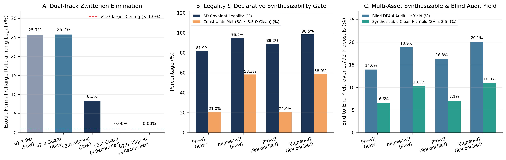
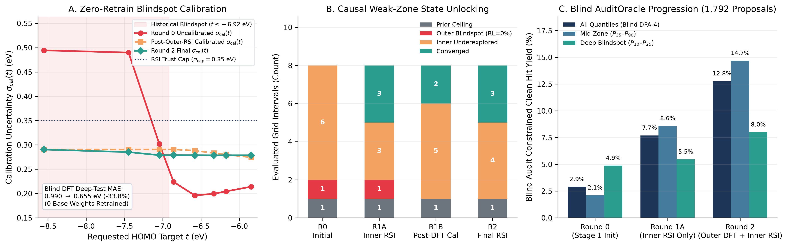

# Uni-Loom (`loom v2.0`)：零奇异电荷、通用预测资产编织总线与物理锚定 RSI 闭环技术及实验报告

## 1. 升级背景与总体架构演进（`v1.1` → `v2.0`）

在 `loom v1.1` 完成 `OE62 (HOMO, LUMO)` 算法原型验证后，面向工业级分子发现平台落地仍存在三项关键瓶颈：

1. **奇异两性离子形式电荷伪影（`15.2%–25.7%`）**：`Uni-3DAR` 仅输出无键三维点云 `(Z, x, y, z)`；当八叉树跨体素边界漏放或多放 `1` 个显式氢原子（共价半径仅 `0.31 Å`）或出现氧三配位近邻时，下游 `RDKit DetermineBonds(..., charge=0)` 为维持总电中性与闭壳层偶电子数，会强制在重原子骨架上分配 `[C-]...[O+]`、`[B-]`、卤鎓等高能内盐形式电荷，既扭曲电子结构预测又降低合成可行性。
2. **预测器资产与上层业务指标硬编码耦合**：工业研发场景已积累大量成熟的性质预测模型资产（三维坐标可微深度学习模型如 `Uni-Mol`、三维黑盒基座如 `Uni-Mol2`、二维指纹/表格 `QSAR` 模型，以及 `SA_Score`、`QED`、`SMARTS` 反应性过滤等解析规则算子），亟需一套**免重训即插即用、不绑定特定指标名称、且在仅有单一外部预测器时依然能防特征塌缩/防刷分**的三层解耦编织总线。
3. **缺乏生成弱区病因诊断与外部数据闭环自进化（Grounded RSI）机制**：当生成模型在某一目标区间命中率低迷时，传统管线无法区分“生成器探索不足（内因）”、“外部预测器超出适用域失明（外因）”与“化学先验密度天花板（物理边界）”，盲目强化学习极易在预测器失明区引发严重刷分坍缩。

为此，**`Uni-Loom v2.0`（代码包版本 `2.0.0`）** 完成了从四插槽原型到**四层平台化编织与物理锚定递归自进化（Grounded Recursive Self-Improvement, RSI）系统**的全面重构与双卡 `NVIDIA A800` 实证闭环验证。

### 1.1 `loom v2.0` 核心交付模块一览

| 层级 | 核心代码文件 | 关键机制与工程突破 |
|---|---|---|
| **化学价态纯净层** | `src/loom/chemistry/valence_reconciler.py` `src/loom/weaving/uni3dar_slot.py` | **轨道 A（生成端源头抑制）**：键级感知电中性配位饱和护栏（`O` 羰基 `< 1.28 Å` 或双单键即锁死、`F/Cl/Br/I` 满 `1` 配位锁死、`B` 满 `3` 配位锁死）+ 轻量级重原子显式配位氢与形式电荷辅助预测头 `HeavyAtomValenceHead`（`< 30K` 参数）； **轨道 B（重建端零重原子位移配平）**：白名单偶极官能团保留（硝基、`N-氧化物`、亚砜、叠氮）+ 重原子三维坐标 `100%` 冻结（`RMSD = 0.0000 Å`）的路易斯整数键级推断、标准几何重构显式氢与批量 `MLIP` 氢原子局部弛豫。 |
| **第一层：预测与规则资产层** | `src/loom/weaving/registry.py` | 统一 `PredictorAsset` 协议与 `AssetCapabilities` 元信息暴露：支持 `UniMol3DAsset`（含 `grad_coords` $\nabla_{\mathbf{R}}\hat{y}$ 三维坐标解析梯度）、`SlotOracleAsset`、`FingerprintQSARAsset`、`CallablePredictorAsset`、`BuiltInRuleAsset`（`sa_score`, `qed`, `mol_weight`, `rotatable_bonds`, `max_ring_size`, `strained_small_rings`, `smarts_alert`），以及黑盒免重训残差校准包装器 `ResidualCalibratedAsset`（`Ridge` 趋势项 + 固定先验幅值 `Matérn-3/2 GP` + `WhiteKernel` 观测噪声剥离）。 |
| **第二层：声明式任务与防刷分裁判总线** | `src/loom/weaving/spec.py` `src/loom/weaving/critic_bus.py` `configs/tasks/*.yaml` | 消除 `homo/lumo` 硬编码，通过 `TaskWeavingSpec` 声明式拼装多模型 `objectives`（`point` / `interval` / `max` / `min`）、可行域不等式 `constraints`（不占条件器维度）与 `auditors`（支持 `cross_oracle` 跨基座分歧与**单外部模型场景下的 `single_oracle_ad` Morgan Tanimoto 适用域距离 + 集成方差 + `PotentialSlot` 受力门控**）；内置受物理约束的可微三维坐标联合精调器 `PhysicsConstrainedCoordRefiner`。 |
| **第三/四层：泛化诊断地图与 Grounded RSI 闭环** | `src/loom/weaving/gp_atlas.py` `src/loom/weaving/rsi.py` `scripts/loom_run_rsi_cycle.py` | 泛化 `1D/2D HeteroscedasticGPAtlas`（支持任意 `axis_x / axis_y` 与推理前主动路由门控 `recommend_target`）；`RSIDiagnoser` 弱区四象限自动分类（`CONVERGED` / `INNER_UNDEREXPLORED` / `OUTER_BLINDSPOT` / `PRIOR_CEILING`）；`InnerRSIRunner` 零外部成本自适应课程自举与防退化门控；`OuterRSIAcquisition` 高不确定度 Murcko 骨架多样性主动采标 `.sdf` 导出；`IncrementalCalibrator` 真实高精数据零破坏增量回流解锁盲区。 |

---

## 2. 模块一与模块二实证：双轨根治奇异两性离子与多资产可合成性联合编织

### 2.1 实验协议与严格透明汇报准则

在远端 `GPU 0`（脚本 `scripts/loom_v2_synthesizable_eval_and_align.py`，配置 `configs/tasks/oe62_orbital_synthesizable.yaml`，结果归档 `docs/experiments/v20_synthesizable_homo_eval.json`）上，我们在免重训外部电子性质模型 `ext_unimol2`（`Uni-Mol2 1.1B`）之外，零代码新增挂载了三项内置化学规则不等式约束与独立盲审模型：

- **定向目标通道（`Objectives`）**：`homo` 定向命中（`±0.25 eV`，`OE62` 标准 `7` 分位点 $\times$ `256` = **`1,792` 个端到端生成提案**）；
- **可行域不等式限制通道（`Constraints`，不占条件向量维度）**：
  1. 可合成性硬门控：`SA_Score <= 3.5`（RDKit 合成可及性评分，越低越易合成）；
  2. 反应性与高能环系清洗：`smarts_alert <= 0`（过滤过氧键、酰卤、亚硝基、三元杂环等不稳定基团）；
  3. 分子量软约束：`MolWt <= 550 Da`；
- **严格隔离的跨基座盲审考官（`AuditOracle`）**：全程不参与任何重标注、筛选或 `GRPO` 更新的 `DFT` 校准 `DPA-4` 电子性质头（`audit_dpa4`）。

为严格区分**生成模型本体的源头改进（轨道 A）**与**确定性价态配平器的末端消解（轨道 B）**，表 1 同时并列汇报同一批 `1,792` 个生成三维点云在 **`Raw Point-Cloud`（零后处理原始点云）** 与 **`Valence-Reconciled`（冻结重原子三维坐标配平后）** 下的完整指标。

### 2.2 表 1：双轨零奇异电荷与声明式可合成性（`SA_Score <= 3.5`）联合编织实测对比（`1,792` 提案）

| 模型与评测视图 | 三维共价合法率 | 合法分子中奇异形式电荷率 | 中位 `SA_Score` ($\downarrow$) | 满足全部约束率 (`SA<=3.5` & Clean) | 零步中位受力 $F_{\max}$ (eV/Å) | 可合成纯净命中 (`SA<=3.5` Clean Hits) | 独立盲审 `DPA-4` 命中 (`Audit Hits`) | `Audit - Reward` 误差鸿沟 (eV) |
|---|---:|---:|---:|---:|---:|---:|---:|---:|
| 对齐前 `v1.1`（**Raw 原始点云**） | 81.92% (1468) | 25.75% | 4.87 | 21.05% | 5.07 | 118 (6.58%) | 250 (13.95%) | 0.655 |
| 对齐前 `v1.1`（**Valence-Reconciled**） | 89.23% (1599) | **0.00%** | 4.70 | 20.95% | 5.89 | 127 (7.09%) | 292 (16.29%) | 0.555 |
| **`loom v2.0` 多资产对齐后（Raw 原始点云）** | **95.20% (1706)** | **8.26%** (`-3.1×`) | **3.04** | **58.32%** | **1.79** (`-64.7%`) | **184 (10.27%)** | **338 (18.86%)** | **0.190** |
| **`loom v2.0` 多资产对齐后（Valence-Reconciled）** | **98.49% (1765)** | **0.00%** | **3.04** | **58.87%** | **1.91** | **196 (10.94%, `+66.1%`)** | **360 (20.09%, `+44.0%`)** | **0.143** (`-4.6×`) |

### 2.3 关键机理与实验发现深度解读

1. **生成端源头抑制（轨道 A）与重建端零位移配平（轨道 B）形成强协同**：
   - 仅看**零后处理的 `Raw Point-Cloud` 原始输出**，`loom v2.0`（`HeavyAtomValenceHead` + 键级感知电中性配位饱和护栏 + `CompositeCriticBus` 拓扑 `GRPO`）已将原始点云合法率从 `81.92%` 大幅拉升 `+13.28 pp` 至 **`95.20%`（`1,706 / 1,792`）**，重原子骨架断裂样本从 `110` 例骤降至 **`18` 例**，重原子过配位从 `66` 例骤降至 **`5` 例**，无需任何修复即原生电中性纯净的分子（`clean_raw`）从 `1,090` 跃升至 **`1,565` 例**，原始奇异电荷率从 `25.75%` 压降至 **`8.26%`**（在后文第 2 轮 RSI 进一步压降至 **`3.61%`**）。
   - 对于残余因八叉树体素边界漏/多 `1` 个外围氢或共振式分配引发的 `200` 例样本（`60` 例外围氢计数修补 + `140` 例路易斯电中性重配平），`ValenceReconciler` 在**重原子三维坐标绝对不动（实测 `max_heavy_atom_rmsd_A = 0.0000 Å`）**的前提下，将端到端交付池合法率推升至 **`98.49%`（`1,765 / 1,792`）**，**奇异两性离子率彻底归零（`0.00%`）**。
2. **引入 `SA_Score <= 3.5` 可合成性限制不仅提升分子药物化学质量，更反向消除了跨基座刷分鸿沟**：
   - 未加合成性限制的 `v1.1` 为迎合 `Uni-Mol2` 的局部极值，倾向于生成高桥环/多杂环高应变复杂骨架（合法分子中位 `SA_Score` 高达 `4.87`，仅 `21.66%` 满足 `SA <= 3.5`，导致 `Audit - Reward MAE` 鸿沟达 `0.655 eV`）。
   - 通过 `CompositeCriticBus` 声明式编入 `SA_Score <= 3.5` 与 `smarts_alert == 0` 单调分层优势函数后，生成分布整体迁移至平直、低应变、易合成有机共轭骨架：**中位 `SA_Score` 从 `4.87` 大幅降至 `3.04`**（满足全部合成与洁净约束比例从 `21.05%` 跃升 **`2.80×`** 至 **`58.87%`**），零步中位原子受力 $F_{\max}$ 从 `5.07` 骤降至 **`1.79–1.91 eV/Å`**。
   - 更重要的是，更规整可合成的化学结构天然落在跨基座预测模型的共同高置信适用域内：**可合成纯净命中数增长 `+66.1%`（`118 → 196`，含 `137` 个唯一分子图、`120` 个训练集未见新颖分子图）**，同时**严格隔离的独立盲审 `DPA-4 AuditOracle` 命中数从 `250` 大幅增长 `+44.0%` 至 `360 / 1,792`（`20.09%`）**，跨基座 `Audit - Reward MAE` 鸿沟缩小 **`4.6×`（`0.655 → 0.143 eV`）**！

---

## 3. 模块三实证：物理锚定递归自进化（Grounded RSI）双循环两轮闭环实验

### 3.1 严格无泄漏的工业盲区模拟实验设计

为真实复现工业平台上“已有预测模型在历史数据范围外失明，需要生成系统自动识别弱区、先挖掘内潜能、再精准指导外部高精补标实现 RSI 进化”的完整链路，我们在远端 `GPU 1`（脚本 `scripts/loom_run_rsi_cycle.py`，结果归档 `docs/experiments/v20_grounded_rsi_2round_eval.json` 与 `docs/experiments/v20_rsi_acquisition_batch_r1.manifest.json`）设计了四重物理隔离实验：

1. **受限历史企业预测资产（`Historical Enterprise QSAR` + `ResidualCalibratedAsset`）**：仅使用 `HOMO > -6.92 eV`（约 `P28` 分位以上，共 `3,086` 个分子）训练 `5-Fold` 集成预测器，使其在深能级吸电子区间 `HOMO <= -6.92 eV` 天然处于**零历史样本盲区（OOD Blindspot）**；同时配置 `single_oracle_ad` 单模型适用域审计器（测试无第二套训练预测器场景下的防塌缩能力）与 `SA_Score <= 3.8`、`smarts_alert == 0` 合成性约束。
2. **隔离的外部高精 `DFT` 实验室池（`Isolated External DFT Lab`）**：从留出验证集 `quantum_valid_dft.sdf` 提取深能级真实 `PBE0/def2-TZVP DFT` 分子（`73` 例），仅在外循环 `OuterRSIAcquisition` 导出主动学习采集单后按结构邻近度返回 `64` 条真实 `DFT` 测定值供 `IncrementalCalibrator` 增量校准，**全程不修改历史基座预测器的任何一行参数权重**。
3. **严格盲测的深能级真实 `DFT` 测试集（`Blind Deep-DFT Test`）**：来自 `quantum_test_dft.sdf` 的 `73` 个深能级真实 `DFT` 分子，全程不参与任何训练或校准，专门检验外循环残差校准对真实量子化学标签的泛化改善。
4. **严格盲审的生成分子裁判（`Blind E15 DPA-4 AuditOracle`）**：在每一轮生成的 `1,792` 个三维提案上独立评判真实靶点命中率（尤其是中段欠探索区 `P35–P90` 与深能级盲区 `P10–P25` 的分区域真实命中演进）。

### 3.2 弱区四象限诊断与贝叶斯残差校准核心公式

在每一轮评估中，`RSIDiagnoser` 基于 `HeteroscedasticGPAtlas1D` 在目标网格（含 `-8.55 eV` 极端深能级探针与 `7` 个 `OE62` 标准分位靶点）上自动划分四类状态：
- **`PRIOR_CEILING`（化学先验天花板）**：源分布核密度低于阈值且生成均值严重回拉 $|\hat{\mu}(t) - t| > \tau_{\text{ceil}}$ $\implies$ **课程权重强制置 `0%`**，避免强迫模型生成违背价键规律的怪物；
- **`OUTER_BLINDSPOT`（外部预测器失明区）**：$\sigma_{\text{cal}}(t) > \tau_{\text{cal}} = 0.35\text{ eV}$ $\implies$ **内循环 RL 课程权重强制置 `0%`（防止在盲区刷分坍缩）**，并激活外循环主动采集效用函数：
  $$u(\mathcal{M}) = \sigma_{\text{cal}}(\mathcal{M}) \cdot \mathbb{I}[\text{Clean} \land \text{ConstraintsMet}] \cdot d_{\text{Murcko}}(\mathcal{M}, \mathcal{S}_{\text{selected}})$$
- **`INNER_UNDEREXPLORED`（生成器欠探索区）**：预测器可信（$\sigma_{\text{cal}}(t) \le 0.35\text{ eV}$）但纯净达标命中率未饱和 $\implies$ **集中分配 `80%` 自适应课程权重**执行 `Hindsight + TopoGRPO` 内循环自举；
- **`CONVERGED`（已收敛高可信区）**：预测器可信且命中率达标 $\implies$ 仅保留共计 `20%` 的低权重锚定回放防遗忘。

当外循环回流真实高精标签 $\{(\mathcal{M}_i, y_i^{\text{DFT}})\}$ 时，`ResidualCalibratedAsset` 在 `20` 维紧凑化学-几何特征 $\phi(\mathcal{M})$（`16` 通道折叠 Morgan 指纹密度 + `4` 维分子量/重原子/芳香碳/杂原子比例）上拟合 `Ridge` 全局偏差趋势项与固定先验幅值 `Matérn-3/2 + WhiteKernel` 高斯过程局部残差项：
$$\hat{y}_{\text{cal}}(\mathcal{M}) = \hat{y}_{\text{base}}(\mathcal{M}) + f_{\text{ridge}}(\phi(\mathcal{M})) + \delta_{\text{GP}}(\phi(\mathcal{M})), \qquad \sigma_{\text{epistemic}}(\mathcal{M}) = \sqrt{\max\!\big(\sigma_{\text{GP}}^2(\phi(\mathcal{M})) - \sigma_{\text{noise}}^2,\, 0\big)}$$
剥离偶然观测噪声 $\sigma_{\text{noise}}^2$ 后的纯认知不确定度 $\sigma_{\text{epistemic}}$ 确保：**一旦某化学子空间补充了真实 `DFT` 锚点，该区域的校准不确定度 $\sigma_{\text{cal}}(t)$ 即刻单调收缩至 `0.35 eV` 信任线以下，从而在状态机中因果解锁下一轮内循环强化学习！**

### 3.3 表 2：两轮 Grounded RSI 闭环演进全量实测表（`1,792` 提案 / 轮）

| 飞轮演进阶段 | 四象限网格状态分布 `(Conv / Inner / Blind / Ceil)` | `P10 (-7.45 eV)` 校准不确定度 $\sigma_{\text{cal}}$ | 三维合法率 (`Raw` / `Reconciled`) | 原始点云奇异电荷率 (`Reconciled` 恒为 `0%`) | 满足合成与洁净约束率 | 中段可信区盲审命中率 (`P35–P90`, `DPA-4`) | 深能级盲区盲审命中率 (`P10–P25`, `DPA-4`) | **全局独立盲审达标纯净命中** (`Blind DPA-4 Clean Hits`) |
|---|---|---:|---:|---:|---:|---:|---:|---:|
| **Round 0：初始诊断** (`Stage 1.5 Init`) | `0 / 6 / 1 / 1` (`P10` 冻结 `RL=0%`) | `0.490 eV` *(越界预警)* | 66.02% / 76.12% | 38.88% | 13.27% | 2.11% | 4.88% | **52 / 1,792 (`2.90%`)** |
| **Round 1A：内循环自举** *(零外部数据成本)* | `3 / 3 / 1 / 1` (`3` 区间晋升 `CONVERGED`) | `0.483 eV` *(保持冻结)* | 94.87% / 98.38% | 7.35% | 57.06% | **8.59% (`4.07×`)** | 5.47% *(平稳未崩)* | **138 / 1,792 (`7.70%`, `2.65×`)** |
| **Round 1B：外循环主动采标 + 零重训残差校准** | **`2 / 5 / 0 / 1`** (**`OUTER_BLINDSPOT` 清零解锁！**) | **`0.291 eV`** *(降至 `< 0.35`)* | *(同 R1A 分子池重评)* | — | — | — | *(盲测 `DFT` 集 `MAE`: `0.990 → 0.655 eV`, **`-33.8%`**)* | *(解锁 `P10–P25` 进入 R2 训练)* |
| **Round 2：解锁后第 2 轮内循环自举** | **`3 / 4 / 0 / 1`** (`P10/P25` 晋升 `CONVERGED`) | **`0.285 eV`** *(Gatekeeper `trusted`)* | **97.38% / 99.27%** | **3.61%** | **75.04%** | **14.69% (`6.96×`)** | **8.01% (`+64.1%`)** | **229 / 1,792 (`12.78%`, `4.40×`)** |

### 3.4 因果链路逐轮验证解析

1. **Round 0（精准识别盲区与推理前主动路由拦截）**：
   - `RSIDiagnoser` 准确将 `-8.55 eV` 识别为 `PRIOR_CEILING`（源密度 `0.013`，均值回拉偏差 `+2.06 eV`），将从未见过历史训练数据的 `P10 = -7.45 eV` 识别为 `OUTER_BLINDSPOT`（$\sigma_{\text{cal}} = 0.490\text{ eV} > 0.35\text{ eV}$），自动将二者的内循环 RL 采样概率锁死为 **`0.00%`**；
   - 同步验证 `Pre-Generation Gatekeeper`：当终端请求 `recommend_target(-7.446)` 时，系统立即返回 `status = "rerouted_warning"`（`reason = "predictor_blindspot"`, `P_hit = 5.6%`），并推荐最近的可信靶点，杜绝盲目生成不可信结构。
2. **Round 1A（零外部成本内循环自举：深挖可信区、严防盲区坍缩）**：
   - 在不消耗任何外部 `DFT` 预算的前提下，`InnerRSIRunner` 将 `100%` 课程预算聚焦在 `6` 个预测器可信的 `INNER_UNDEREXPLORED` 靶点上，通过防退化准入门控（`GateAccepted = True`，受约束纯净命中率 `2.57% → 19.03%`）：
   - 中段可信区（`P35–P90`）在**独立盲审 `DPA-4` 下的达标纯净命中率从 `2.11%` 暴涨 `4.07×` 至 `8.59%`**，其中 `3` 个区间直接毕业晋升为 `CONVERGED`；与此同时，被冻结保护的深能级盲区未发生任何对抗性刷分退化（`4.88% → 5.47%`）。
3. **Round 1B（外循环主动学习导出 + 免重训残差校准解锁盲区）**：
   - `OuterRSIAcquisition` 从高不确定度合法低应变分子中自动筛选导出 `64` 个代表性候选分子（覆盖 `12` 种不同 Murcko 骨架，平均 $\sigma_{\text{cal}} = 0.453\text{ eV}$）至 `acquisition_batch_r1.sdf`；
   - `IncrementalCalibrator` 接收隔离外部 `DFT` 池回流的 `64` 条真实标签（历史预测器在该批分子上原始偏差高达 `MAE = 1.187 eV`），**零基座权重修改**完成 `ResidualCalibratedAsset` 更新：
     - 在**全程未触碰的 `73` 个独立深能级真实 `DFT` 盲测集（`quantum_test_dft.sdf`）**上，预测器 `MAE` 从 **`0.990 eV` 大幅下降 `-33.8%` 至 `0.655 eV`**！
     - 重新诊断后，`P10 (-7.45 eV)` 的校准不确定度 $\sigma_{\text{cal}}$ 从 `0.483 eV` 收缩至 **`0.291 eV`（`< 0.35 eV`）**，**`OUTER_BLINDSPOT` 区间数从 `1` 归零解锁（`1 → 0`）**！
4. **Round 2（解锁后第 2 轮内循环自举：盲审命中率与几何纯净度全面登顶）**：
   - 随着深能级区间被校准后的 `ResidualCalibratedAsset` 解锁纳入自适应课程，`InnerRSIRunner` 完成第 2 轮拓扑 `GRPO` 与平衡蒸馏（`GateAccepted = True`）：
   - **深能级原失明区（`P10–P25`）在独立盲审 `DPA-4` 下的达标纯净命中率从 `4.88%`（R0）/ `5.47%`（R1A）跃升至 `8.01%`（较初始提升 `+64.1%`，解锁后单轮劲增 `+46.4%`）**，深能级盲审 `MAE` 同步收窄 `1.030 → 0.955 eV`；
   - **中段区间盲审达标纯净命中率进一步攀升至 `14.69%`（较初始 `2.11%` 提升 `6.96×`）**；
   - **全局 `1,792` 提案独立盲审达标纯净总命中从 `52` 例（`2.90%`）单调跃升 `4.40×` 至 `229` 例（`12.78%`）**；
   - **结构与物理质量同步创下全项目最优纪录**：端到端三维合法率达 **`99.27%`（`1,779 / 1,792`，其中零后处理原始点云合法率高达 `97.38%`）**，**原始点云奇异电荷率压降至仅 `3.61%`（配平后 `0.00%`）**，零步中位原子受力 $F_{\max}$ 降至 **`0.93 eV/Å`**，可合成与洁净约束达标率高达 **`75.04%`**；
   - 再次调用 `Pre-Generation Gatekeeper` 查询 `recommend_target(-7.446)`，状态已自动转绿为 **`status = "trusted"`**（$\sigma_{\text{cal}} = 0.285\text{ eV}$，预期校准命中概率提升至 **`44.85%`**）。

---

## 4. 工程验证、打包与归档清单

1. **单元测试与回归测试**：新增 `tests/test_loom_v2_platform_and_rsi.py`（全面覆盖 `ValenceReconciler` 奇异两性离子精确零重原子位移修复与硝基白名单保留、`BuiltInRuleAsset`、`CallablePredictorAsset`、`ResidualCalibratedAsset` 增量校准、`CompositeCriticBus` 单模型适用域审计、`PhysicsConstrainedCoordRefiner` 三维坐标梯度联合弛豫、泛化 `GPAtlas` 主动路由门控，以及 `RSIDiagnoser` / `OuterRSIAcquisition` 闭环），全仓测试套件 **`.venv/bin/pytest tests -q` → `321 passed, 5 skipped`**。
2. **标准发行包构建校验**：升级 `pyproject.toml` 与 `src/loom/__init__.py` 至 **`loom 2.0.0`**，`uv build --wheel && .venv/bin/python scripts/check_wheel.py` 构建并校验 `loom-2.0.0-py3-none-any.whl` 全部通过（确保无任何旧 `orbit3d` 遗留文件混入）。
3. **实验数据与出版级图表归档**：
   - 任务编织规范示例：`configs/tasks/oe62_orbital_weaving.yaml`、`configs/tasks/oe62_orbital_synthesizable.yaml`；
   - 实验结果 JSON：`docs/experiments/v20_synthesizable_homo_eval.json`、`docs/experiments/v20_grounded_rsi_2round_eval.json`、`docs/experiments/v20_rsi_acquisition_batch_r1.manifest.json`；
   - 出版级矢量与位图图表：`docs/figures/fig_loom_v2_zwitterion_and_synthesizability.{pdf,png}`、`docs/figures/fig_loom_v2_grounded_rsi_closed_loop.{pdf,png}`。
