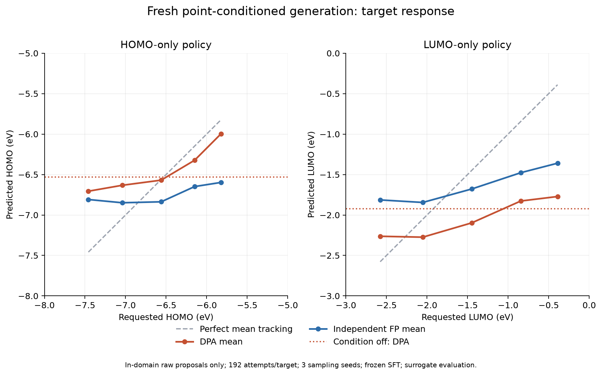
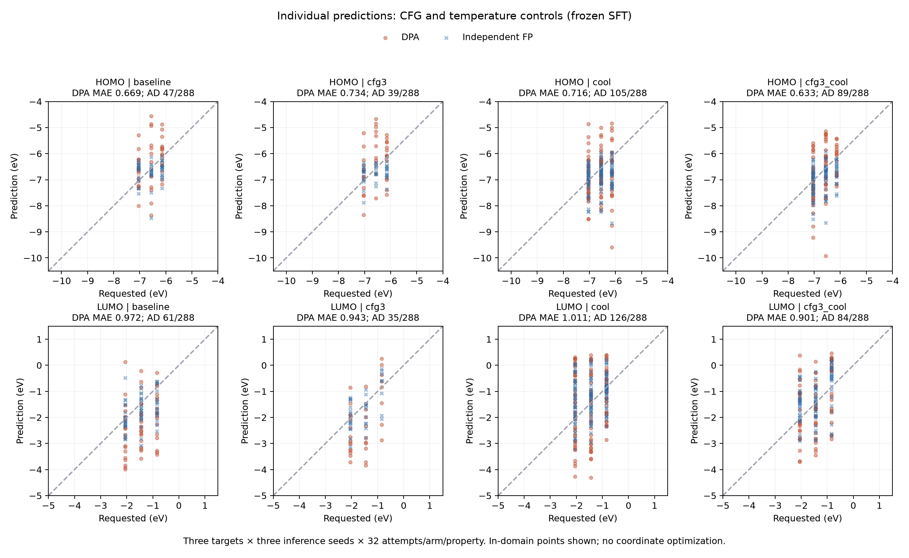

# 实验结果与当前结论

所有表格保留原始尝试数，模型预测成功与量子验证成功分别报告。实验设置见[实验方案](experiments.md)，当前算法见[架构说明](architecture.md)，调整决策见[方案调整](design_changes.md)。下列链接指向保存模型/输入哈希及逐样本证据的最终汇总。

## 核心判断

当前实现可以稳定执行、完整重放，并产生少量在内部量子协议下保图且目标达标的结构。尚无证据证明五阶段组合普遍优于简单基线。最明显的瓶颈是提案的域内覆盖、条件学习效果，以及代理性质与量子参照的一致性。继续增加 SFT 步数或 reward 项没有表现出稳定收益。

OCELOT 重建构象的既有结果保留；没有证据把构象误差归为全部问题的原因。后续方向及实施状态见[方案调整](design_changes.md)，不将计划计入本页已完成结果。

## 数据规模与性质预测

最终 DPA/HyFF 使用同一批 8192/512/512 训练/验证/测试构象；指纹模型用 20356 个训练图，在相同 512 个测试 ID 上进行匹配比较。测试集包含 H/C/N/O/F/B/Si/P/S/Cl/Br/I/Se/As/Te。它们是骨架留出的中性闭壳层有机结构，不覆盖金属配位与开放壳层专项能力。

实际 512 个测试分子的显式总原子数（含氢）为 13–79，平均 34.35、中位数 32；重原子数为 9–58、中位数 21。总原子数分布如下，约 71% 位于 21–40：

| 总原子数 | ≤20 | 21–30 | 31–40 | 41–50 | 51–60 | 61–70 | 71–80 |
| --- | ---: | ---: | ---: | ---: | ---: | ---: | ---: |
| 测试分子数 | 40 | 168 | 195 | 70 | 19 | 8 | 12 |

含 B/Si/Se/As/Te 的测试分子分别只有 13/7/1/1/4 个。各元素计数可重叠，稀有元素数量不足以支持可靠的广元素精度结论。[元素和原子数清单](../data/ocelot_matched_atom_inventory.json)

| 性质 MAE / eV | DPA | HyFF-presto | 指纹 |
| --- | ---: | ---: | ---: |
| HOMO | 0.2895 | 0.3077 | 0.3593 |
| LUMO | 0.2326 | 0.2502 | 0.3354 |
| 垂直 S1 | 0.2314 | 0.2475 | 0.2968 |
| 垂直 T1 | 0.1381 | 0.1661 | 0.2616 |
| 逐分子垂直 S1−T1 差 | 0.2226 | 0.2176 | 0.2546 |

DPA 的四个单目标误差较低，HyFF 的配对垂直能隙略低；这只是一组下游训练 seed，且预训练和架构不同，不能认定稳定的架构排名。以上均为对 OCELOT CSV 标签的误差，不是原始 DFT 几何的复现精度，也不是绝热能隙 MAE。[匹配测试](experiments/optical_matched512_20261112.json)

DPA/HyFF 校准后的联合覆盖率为 89.06%/90.43%，但平均区间宽度分别约 1.58–2.06/1.90–2.27 eV，ensemble spread 对误差的排序较弱。因此不确定性奖励保持关闭。这是 512 个测试样本的经验覆盖与平均宽度，不能推出每个生成候选都不可认证，也不是候选的条件命中概率。是否完全落入目标窗口须逐候选检查；现有残差分位数校准没有给出可直接积分的高斯分布。[DPA 校准](experiments/optical_calibration_20261112.json)、[HyFF 校准](experiments/hyff_optical_calibration_20261112.json)

## OE62 点条件重新生成：三轮目标扫描

使用主线程已完成的 HOMO-only / LUMO-only 点条件 SFT 检查点（各5000步、8192个源三维训练图、训练seed42），在采样修复版运行时 `1fcd1bd` 上重新生成。每个性质取训练标签P10/P25/P50/P75/P90，每点用2026/2027/2028三个采样seed、每次64提案；另为每个模型和seed生成一组关闭条件的原始池。正式提案共2304次，其中正确条件1920次、关闭条件384次。关闭条件池重评分、错配目标重评分和同轨迹速度重放不冒充新增效果样本。

每轮固定随机流，目标条件在生成阶段输入。两个模型分别只激活其训练过的单性质mask。性质值属于OE62气相PBE0标签体系，不沿用OCELOT旧中心；三轮是采样重复，不是三个独立训练模型。

| 点目标 / eV | P10 | P25 | P50 | P75 | P90 |
| --- | ---: | ---: | ---: | ---: | ---: |
| HOMO | -7.45834 | -7.04077 | -6.56081 | -6.14809 | -5.82362 |
| LUMO | -2.57750 | -2.05243 | -1.44879 | -0.84373 | -0.39031 |

**方向响应。** 域内原始池的均值响应斜率为 DPA：HOMO 0.405、LUMO 0.258；独立指纹：0.146、0.229。两个评价器在三个采样seed上的斜率均为正，观察到了可重复的预测方向响应，但幅度低于理想均值跟随斜率1。这不是命中率或量子真实性能。图指纹也有响应，说明变化并非仅来自末端坐标微调。全体可评价候选的诊断曲线也同向，但域外预测不作为可靠设计验收。

**连续误差和命中。** 每行分母均为192次正式提案；MAE仅在成功评价的域内有效候选上计算，无效/域外/优化失败仍留在命中分母。命中为该行唯一激活性质距点目标≤0.25 eV，后处理联合还要求原始RMS力≤0.10 eV/Å。DPA/FP分别列出，均为代理评价。

| 模型 / 分位点 | 有效 / 域内 | 原始MAE DPA / FP，eV | 原始命中 DPA / FP | 排序并优化后联合 DPA / FP |
| --- | ---: | ---: | ---: | ---: |
| HOMO / P10 | 126 / 37 | 0.876 / 0.714 | 6 / 5 | 7 / 3 |
| HOMO / P25 | 123 / 37 | 0.607 / 0.478 | 11 / 8 | 9 / 5 |
| HOMO / P50 | 120 / 34 | 0.734 / 0.366 | 7 / 16 | 8 / 12 |
| HOMO / P75 | 122 / 37 | 0.553 / 0.504 | 9 / 7 | 8 / 4 |
| HOMO / P90 | 108 / 42 | 0.555 / 0.774 | 10 / 2 | 11 / 0 |
| LUMO / P10 | 135 / 45 | 0.737 / 0.805 | 10 / 7 | 9 / 3 |
| LUMO / P25 | 141 / 52 | 0.782 / 0.450 | 9 / 21 | 11 / 12 |
| LUMO / P50 | 128 / 41 | 0.854 / 0.498 | 7 / 10 | 5 / 6 |
| LUMO / P75 | 111 / 37 | 1.126 / 0.736 | 5 / 11 | 5 / 10 |
| LUMO / P90 | 97 / 24 | 1.521 / 1.041 | 1 / 1 | 0 / 1 |

正确条件的域内原始MAE相对关闭条件，在HOMO的5点中DPA改善4点、FP改善3点；LUMO两模型均改善5点。错配目标对照由相同seed下另一个已生成目标池重评分实现，每个模型的正确条件DPA MAE在4/5点更低。这支持有限的条件效应，不支持所有点均已准确受控。

固定±0.25 eV容差下，五个任务的原始域内命中得分合计如下。正确条件各有960次生成；关闭条件各只有192次生成，在五个请求目标上重复评分得到960次任务评价，不能将这些复用评分视为独立生成样本或据此做朴素显著性检验。

| 模型 | DPA：正确 / 关闭条件 | FP：正确 / 关闭条件 |
| --- | ---: | ---: |
| HOMO | 43 / 41 | 38 / 47 |
| LUMO | 32 / 17 | 50 / 24 |

因此LUMO在两种评价器下均表现出更明确的命中改善，绝对成功率仍低；HOMO虽有均值方向响应，独立FP命中尚未改善。不能只看响应曲线便宣布精准控制成功。

HOMO P50的DPA预测均值为−6.5694 eV，几乎等于目标−6.56081，但逐分子MAE仍为0.7338 eV：均值跟随不等于分布足够集中。LUMO P90请求−0.39031，DPA/FP均值仍为−1.7717/−1.3598，属于明显控制不足。HOMO P90后处理DPA联合命中11个而FP为0，独立评价仍有明显分歧，不能将DPA命中当作量子确认。

后处理每个正确条件池最多保留8个不重复的域内候选，使用相同L-BFGS纯能量优化。HOMO选117个、完成105个；LUMO选118个、完成106个；24个失败均保留原因且没有补样。同图优化前后FP预测完全不变，FP联合计数变化来自选择、优化失败和力门槛，不代表FP验证了几何性质变化。结果JSON同时提供完成样本的配对优化前后误差，避免把失败样本退出MAE计算误解为优化收益。

**速度。** 仅使用GPU2、3，两张A800分别承担一条模型扫描；GPU0、1留给主线程。先预热，GPU阶段前后显式同步，模型加载不计入阶段耗时。10秒间隔的129个监控样本未观察到GPU2/3上多个计算进程同卡占用，宿主机仍与其他任务共享。

| 计时项 | HOMO | LUMO |
| --- | ---: | ---: |
| 64次正确条件提案，跨目标/seed中位数 | 44.36 秒 | 45.67 秒 |
| 该批全部有效结构的DPA评价中位数 | 1.67 秒 | 1.71 秒 |
| 该批至多8个精选候选的优化中位数 | 22.17 秒 | 20.33 秒 |
| 同P50、同seed的3次生成中位数，64次提案 | 48.13 秒 | 50.51 秒 |

同P50的三次重放token序列完全一致；不同目标及关闭条件生成的分子/轨迹长度不同，不将时间差直接解释为条件编码开销，也没有进行点值/区间生成架构的等条件速度对照。正式两卡任务墙钟约21.6分钟，包含预热和计时重放，不含开发、预检和下载。

[完整指标、原始提案结果、阶段计时和输入哈希](experiments/oe62_point_generation_scan_20261112.json)；[生成扫描脚本](../scripts/experiment_point_generation_scan.py)、[两卡启动器](../scripts/run_generation_scan.py)、[汇总与绘图](../scripts/summarize_point_generation_scan.py)。原始坐标/token、导出SDF、冻结源码和日志保存在JSON声明的远程目录。以上是冻结SFT控制实验，不替代主线程的GRPO匹配对照，也尚无同级量化复核。

## OE62 固定 SFT：CFG、温度与筛选的集中度对照

**结论：降低 token 温度提高了可用候选产率，但没有稳定降低原始池逐分子误差；增强 CFG 也没有跨目标、跨评价器一致的收益。** 不据此修改主线默认采样配置。更直接的近期方法是保留候选池并按目标距离筛选，明确以吞吐量换取保留分子的精度；这不代表原始生成分布已经集中。

固定与上一轮相同的两份 SFT 权重和 `1fcd1bd` 运行时，P25/P50/P75 三个单值目标 × 三个采样 seed × 每格 32 提案，四组共 2,304 次正式尝试。全程只使用 GPU 2、3，不训练、不运行 GRPO、不做坐标优化。具体参数见[实验方案](experiments.md#固定-sft-的推理集中度对照独立于-grpo)，[逐候选结果、哈希及统计](experiments/oe62_concentration_scan_20261112.json)包含全部失败和域外候选。

下表每行分母都是 288 次提案。MAE 是三个目标的域内 MAE 等权平均，单位 eV；不同设置的域内覆盖不同，不能只看 MAE。命中为域内 DPA 预测距单值目标 ≤0.25 eV，尚未增加物理收敛门槛。FP 是独立指纹模型，两个模型都不是新分子的量化真值。

| 性质 | 采样组 | 有效 / 域内 | DPA MAE | FP MAE | DPA 命中 / 288 | 生成秒数 |
| --- | --- | ---: | ---: | ---: | ---: | ---: |
| HOMO | 原始 | 180 / 47 | 0.669 | 0.418 | 10 | 203.0 |
| HOMO | CFG=3 | 147 / 39 | 0.734 | 0.375 | 9 | 344.0 |
| HOMO | 低温 | 215 / 105 | 0.716 | 0.493 | 24 | 153.5 |
| HOMO | CFG=3＋低温 | 209 / 89 | 0.633 | 0.474 | 19 | 261.6 |
| LUMO | 原始 | 190 / 61 | 0.972 | 0.545 | 10 | 204.7 |
| LUMO | CFG=3 | 141 / 35 | 0.943 | 0.528 | 8 | 350.4 |
| LUMO | 低温 | 244 / 126 | 1.011 | 0.655 | 21 | 159.6 |
| LUMO | CFG=3＋低温 | 218 / 84 | 0.901 | 0.635 | 14 | 261.6 |

所有子图正方形、横纵轴同范围同单位长度；同一图内各面板也使用相同单位长度。点图保留全部域内离群预测，不只画均值。橙色为 DPA，蓝色为独立 FP。

**为什么命中更多，却不能说分布更集中？** 低温组的域内覆盖分别约增至 2.23 倍和 2.07 倍；DPA 原始池的平均标准差却从 HOMO 0.779 增至 0.861 eV、LUMO 0.931 增至 1.163 eV。FP 原始池 MAE 也变差。低温新增的是更多可筛选候选，而非普遍更准确的候选。HOMO/LUMO 低温组的有效图几乎没有重复（按目标分别去重后为 214/215、243/244），唯一图的平均两两 Morgan 距离约 0.934/0.935；没有出现靠重复同一结构收窄分布的现象。

**低温同时改变了分子分布，不能只归因于坐标更精细。** 有效分子的平均总原子数（三目标等权，含 H）由 32.21/31.94 降至 25.53/24.34。域内 RMS 力的逐目标中位数均值从 1.375/1.498 降至 0.825/1.037 eV/Å，仍远高于最终物理验收阈值。较小、更低应变的候选可解释部分覆盖和速度收益，但这里仅是相关观察，没有拆开 tree、atom、xyz 温度作因果归因。CFG=3 的有效率下降、该受力统计上升至 2.103/1.892 eV/Å，也提示加强条件可能损害几何质量。

**组合组的小幅 DPA 改善不够支持换默认配置。** CFG＋低温的 DPA MAE 比原始组低约 5.4%/7.3%，但 FP MAE 反而高约 13.3%/16.5%。LUMO 的三个 seed 中有两个 DPA MAE 变差；HOMO 也不是三个 seed 全部改善。三次采样重复还不能替代独立训练重复。这一轮未证明任何组稳定降低真实分子性质误差。

**筛选可以降低交付分子的代理误差，但有明确代价。** 同一原始池分别取前 8/16/32 个尝试，再按域内 DPA 距离选至多 1 或 4 个唯一图；不补样、未新增生成。下面列每池 32 次尝试的结果，MAE 仍按三个目标等权；每个性质共九池：

| 策略 | HOMO DPA / FP MAE | LUMO DPA / FP MAE | HOMO / LUMO 保留数 |
| --- | ---: | ---: | ---: |
| 原采样，全部域内 | 0.669 / 0.418 | 0.972 / 0.545 | 47 / 61 |
| 原采样，每池 top4 | 0.484 / 0.354 | 0.538 / 0.366 | 34 / 35（最多各36） |
| 原采样，每池 top1 | 0.200 / 0.285 | 0.107 / 0.240 | 9 / 9 |
| 低温，每池 top4 | 0.233 / 0.403 | 0.275 / 0.341 | 36 / 36 |
| 低温，每池 top1 | 0.104 / 0.350 | 0.089 / 0.317 | 9 / 9 |

原采样 top1 同时改善 DPA 与 FP，是本批次最清楚的保留分子精度收益；每个性质只输出 9/288 个分子，不能当作高命中率生成。低温 top1 的 DPA 更好，FP 却比原采样 top1 更差，提示仅按一个代理排序会出现模型偏好。完整 8/16/32 预算曲线在 JSON 中；小预算可能没有域内候选，缺额明确保留。不将按 DPA 排名后 DPA 变好作为独立验证。

**速度与复现。** 四组双 GPU 队列总墙钟约 20.4 分钟，包括加载、哈希、64 次额外预热及评价；表中只列正式生成耗时。低温的正式生成耗时约降 22%–24%，CFG=3 在原温度下约增加 69%–71%；分子大小和序列长度也改变，不能解释为纯算子加速。两个模型各 288 个新基线的 token 与有效性均逐项复现上一轮对应前缀，DPA 批量评价最大差异分别仅 3.10e-6/3.58e-6 eV。122 次 GPU 监测未观察到 GPU 2、3 同卡额外进程；八组均正常退出，GPU 0、1 的主线程任务未操作。

**下一步的非 GRPO 优先项。** 第一，冻结“原采样＋有限候选池筛选”，用未参与本次对照的种子检查 top1/top4 是否仍有双模型收益；物理弛豫后必须重新评价再决定交付。第二，拆开拓扑采样温度与坐标温度，验证低温改善覆盖究竟来自分子大小/拓扑还是几何，避免把偏向小分子的策略当作更准确的条件生成。第三，对固定图做原始几何与纯能量弛豫后的配对评价，检查 DPA/FP 分歧是否随受力下降而缩小。单纯把输入目标再偏移一些只能尝试纠正均值偏差，无法解决 HOMO 中位目标已经对齐、单分子仍分散的问题。这些后续项尚未执行；不重复主线程的训练与 GRPO。

## 生成与训练

### 旧目标窗口的训练支持

在完整 20356 个训练分子上重算标签分位数和逐分子交集；8192 子集是实际性质训练集、也是生成器 8188 个可编码结构的上游集合。本表不是生成成功率，且没有使用测试标签。[输入哈希、逐目标分位数及计数](../data/ocelot_target_coverage.json)

| 旧任务 | 中心单值 / eV | 完整训练集同时满足原区间 | 8192 子集同时满足原区间 |
| --- | --- | ---: | ---: |
| Original | H=-7.70，L=+0.10 | 3607 / 20356（17.72%） | 1444 / 8192（17.63%） |
| Central | H=-7.25，L=-0.63 | 7081（34.79%） | 2828（34.52%） |
| lower_gap | H=-6.86，L=-1.06 | 3555（17.46%） | 1469（17.93%） |
| Optical | S1=3.00，T1=2.00 | 6009（29.52%） | 2463（30.07%） |
| Four-target | H=-7.70，L=+0.10，S1=3.00，T1=2.00 | 116（0.57%） | 46（0.56%） |

Central 的两个中心都约为边际 P50；Original 中心分别约为 HOMO P25、LUMO P85，属于有偏向但仍有较多训练支持的任务。光学窗口偏向较低激发能。四目标在数据支持上的困难体现在交集非常稀少，不能从各目标边际覆盖率推断联合支持，也不据此把低支持认定为生成失败的唯一原因。表中单值只是原区间中心，尚未作为单值模型实验运行；lower_gap 来自较早的窗口研究，不与不同检查点的生成结果合并为匹配对照。

### 结构提案对照

下表每行都是 192 次尝试，BRICS 与 octree 共享训练结构和候选/排序/弛豫上限。FP 与 HyFF 在不改变导出坐标的条件下独立复评，表中联合指标均使用源 DPA 的力阈值。

| 方法 / 窗口 | 化学有效 | 域内 | DPA 联合 | FP 联合 | HyFF 联合 |
| --- | ---: | ---: | ---: | ---: | ---: |
| Octree 5000 / Original | 113 | 9 | 4 | 4 | 3 |
| BRICS / Original | 173 | 173 | 10 | 4 | 13 |
| Octree 5000 / Central | 108 | 13 | 3 | 2 | 2 |
| BRICS / Central | 173 | 173 | 45 | 45 | 44 |

Central 的 BRICS 优势在三个代理下成立；Original 的指纹结果持平。BRICS 每个窗口实际用了 96 次外部排序评价，octree 只有 9/13 次；不是等实际算力优越性结论。BRICS 从8188个训练结构构建了9903个不同单端口片段；两个窗口重用了同一组192个无条件图，48 个保留结构相对适配训练集均新颖，但没有证明对预训练语料新颖或能够合成。[完整对照与成本](experiments/brics_comparison_20261112.json)

这些分窗口结果说明优势随任务变化，并未证明 BRICS 学会了目标条件。窗口已经在表内分层，不是同一窗口方法比较中的混淆变量；需要另外控制原始提案条件和下游筛选，才能定位定向能力。

### 条件响应与片段覆盖核验

以下均为现有记录和原始 CSV 的本地重算，没有新增模型训练或生成。[计算定义、输入哈希与统计](experiments/proposal_diagnostics_20261112.json)

条件诊断的三个检查点使用同一组 64 个 held-out 分子，各 16 个 batch（每批 4 个）：

| 检查点 | 正确条件 loss | 打乱条件 loss | 无条件 loss | 正确优于打乱的 batch |
| --- | ---: | ---: | ---: | ---: |
| initial | 1.273051 | 1.281740 | 1.331317 | 8/16 |
| control | 1.275415 | 1.285949 | 1.331317 | 10/16 |
| paired | 1.275005 | 1.285505 | 1.331317 | 10/16 |

每臂正确条件均在 16/16 个 batch 优于无条件；正确相对打乱的平均优势较小。原 JSON 有 48 行 batch 和 3 行均值，不能把它们当成 51 个独立样本；三个检查点之间还是重复测量。`loss_gen` 为 tree CE＋atom CE＋0.1×三轴坐标 CE 均值，其差值比例不是互信息，也不能转换成 eV 可控范围。诊断的随机打乱还未剔除相互兼容的区间。当前结果支持继续检查值特异响应，不支持断言完全没有学习条件数值。

BRICS 覆盖在 RDKit 2026.09.1 下按 `FindBRICSBonds` 计数：

| 范围 | 分子数 | 无切点 | 无切点占比 |
| --- | ---: | ---: | ---: |
| 正式完整训练划分 | 20356 | 5971 | 29.33% |
| 正式性质训练 ID | 8192 | 2463 | 30.07% |
| Carbon 抽查的旧 CSV 前 2000 行 | 2000 | 853 | 42.65% |

完整训练 CSV 从原始数据按现有清洗/划分代码重建，字节 SHA 与正式 manifest 一致。旧 CSV 实际共 19902 行，并按 canonical SMILES 排序，前 2000 行不是随机抽样。8192 是生成器 8188 个可编码结构的上游集合；本次没有将其冒充精确的 8188 SDF 统计。零切点表示这些源分子不能直接贡献单切片段，不能解释为同样比例的稠环核心完全不可达。

### 36 组 SFT 时长评估

三个续训 seed 共享同一已训练 5000 步起点，每个检查点、窗口包含三个推理 seed。每行 576 次尝试：

| 总步数 / 窗口 | 有效 | 域内 | DPA 联合 | FP 联合 |
| --- | ---: | ---: | ---: | ---: |
| 10000 / Original | 393 | 51 | 9 | 15 |
| 10000 / Central | 376 | 41 | 9 | 8 |
| 20000 / Original | 370 | 54 | 12 | 11 |
| 20000 / Central | 349 | 41 | 10 | 10 |

合并两个窗口，10000→20000 步的有效数为 769→719/1152，域内 92→95，DPA 联合命中 18→22，FP 联合命中 23→21。改进方向因 seed 和窗口而异，没有稳定设计收益。

元素学习确有进展：三个最终模型在 511 个固定验证结构中均正确预测 8/12 个 B、27/28 个 Si 决策，5000 步起点两者均为零。有效输出中的 B/Si 出现次数分别由 16/67 增至 67/74（每个检查点 1152 次尝试）。只有一个有效 Te 输出，Se/As 未出现。[完整矩阵、各 seed 和元素诊断](experiments/sft_duration_20261112.json)

### 45 组 GRPO 消融

每个目标组合包含三个训练 seed、各三个推理 seed，共 576 次尝试。所有策略共享一个 SFT 初始化。

| 目标 | 有效 | DPA 联合 | FP 联合 |
| --- | ---: | ---: | ---: |
| Full | 482 | 20 | 20 |
| 去 KL | 483 | 14 | 17 |
| 去 physics | 482 | 14 | 17 |
| 去 replay | 484 | 16 | 19 |
| 开 uncertainty | 489 | 17 | 20 |

Full 聚合结果较高，但 no-KL 的 seed 44 在两种评价下均超过 Full。增加 uncertainty 没有提高独立总命中数。当前实验只更新 conditioner，不能据此否定全骨干或图动作策略学习；也没有证明应默认开启 GRPO。[完整矩阵](experiments/grpo_factorial_20261112.json)

四性质生成适配后，HOMO/LUMO、S1/T1、全部四个目标的 DPA/FP 联合结果分别为 1/192、1/192、0/192；HyFF 对全部 25 个保留结构复评得到相同总数。接口训练成功不等于实现了有效四目标设计。[生成记录](experiments/optical_generation_20261112.json)、[HyFF 复评](experiments/optical_hyff_independent_20261112.json)

其他干预同样未形成稳定改进：提高元素采样温度增加稀有元素但降低有效率；元素加权使 DPA 联合命中从 7/384 降至 3/384，独立结果均为 6/384；配对条件目标及其对照均为 DPA 3、FP 4 /384。[温度](experiments/element_temperature_20261112.json)、[元素加权](experiments/element_balance_20261112.json)、[条件对比](experiments/condition_contrast_20261112.json)

## 弛豫与几何响应

固定 192 个提案中的同一批 34 个起点：

| 规则 | DPA 联合 /192 | FP 联合 /192 | 平均最终 RMS 力 / eV·Å⁻¹ |
| --- | ---: | ---: | ---: |
| 无弛豫 | 0 | 0 | 2.5858 |
| 纯能量 | 7 | 17 | 0.1709 |
| 仅投影 | 7 | 8 | 1.0572 |
| 完整接受规则 | 8 | 8 | 1.3537 |

完整规则保住了全部六个初始性质可行结构；纯能量和仅投影各失去一个，但纯能量的残余力最低。指纹模型对同图坐标变化不敏感，其 17 个性质命中在各规则间不变，所以 17 对 8 不能裁决真实几何性质优劣。[逐分子对照](experiments/refinement_matched_20261112.json)

Full 的 34 条轨迹中，22 条以拒步结束，其中 6 条从未接受一步；12 条跑满 30 步，平均执行 17.62 步。纯能量的 34 条均跑满 30 步。停滞真实存在，但日志没有区分各接受约束的拒绝贡献。代码检查的是区间违约量，区间内部的小幅性质变化不会仅因数值变化被拒绝；所有目标均在区间内时，性质梯度为零。[轨迹重算](experiments/proposal_diagnostics_20261112.json)

含硼队列五个完成案例的 S1/T1 梯度平均余弦：DPA 为 0.630/0.658，HyFF 为 0.422/0.573，所有单性质方向均为正。但一例 DPA S1=3.5425 eV、量子 S1=2.2770 eV，位于目标 [2.5,3.5] 的两侧，使性质梯度余弦 +0.819 对应区间损失梯度余弦 −0.819。标量偏差可反转优化目标方向；这五个案例全部域外，不能写成域内失效率。[梯度与逐样本后验区间诊断](experiments/excitation_gradient_comparison_20261112.json)

## 补充：固定 34 起点的四臂几何诊断

复用旧 OCELOT 双目标队列的全部 34 个预弛豫起点，来源仍为 192 次提案，目标为 HOMO [-8.2,-7.2]、LUMO [-0.6,0.8] eV。冻结原 DPA 势能和性质模型，不训练新生成器，也不计作 OE62 单值实验。四臂全部 34/34 完成并通过图/立体检查；Full 和旧纯能量臂的逐样本预测与原记录完全一致，最大 RMS 力重放差小于 1e-6 eV/Å。

| 规则 | 性质同时命中 | 命中且 RMS≤0.5 | 命中且 RMS≤0.1 | 平均 RMS / eV·Å⁻¹ | RMS≤0.1 的结构数 |
| --- | ---: | ---: | ---: | ---: | ---: |
| 原 Full，30 步 | 8 | 8 | 2 | 1.35366 | 2 |
| 原纯能量，30 步 | 7 | 7 | 2 | 0.17090 | 4 |
| L-BFGS 纯能量 | 7 | 7 | 7 | 0.07340 | 34 |
| L-BFGS → 反转投影 → 再次 L-BFGS | 7 | 7 | 7 | 0.06048 | 34 |

表中为固定队列计数；总体联合成功的分母仍为192，不是34。L-BFGS 每阶段最多150步，最大单原子位移0.025 Å，RMS≤0.1且最大原子力≤0.15时终止。反转投影最多20步，能量相对第一阶段终点预算0.05 eV、RMS上限0.2；每步必须改善区间违约平方和，且保图。新旧优化预算/停止规则不同，不将差异单独归因于某一个算子。

**反转投影没有带来新增命中。** 三阶段的命中变化是7个 true→true→true、27个 false→false→false，既没有暂时新增后丢失的命中，也没有新增后存活的命中。实际接受253个引导步骤，平均区间距离由0.500124降到0.493182 eV，二次松弛后回到0.498006 eV，最终只比纯能量改善约0.00212 eV。这里的距离是两个区间违约量的欧氏范数，不是对量子真值的MAE。

Full 相比 L-BFGS 多的唯一命中为 seed2027/candidate3：Full 的 HOMO/LUMO 为 -7.20135/-0.56096 eV、RMS=0.15021；L-BFGS 后为 -7.15388/-0.63442 eV、RMS=0.05524。它说明保留代理边界命中与进一步降低受力存在取舍，尚无同级量化证据判定哪组性质更接近真值。

四臂评价调用数分别为1083/1122/938/1616，额外性质梯度调用为387/0/0/272。两张A800同时运行其他任务，因此不报告加速倍数，也不将两类调用简单相加作为等算力。该实验支持将标准纯能量优化作为后续几何处理的候选；未支持把反转投影升为默认策略，亦未证明定向生成能力提高。源三维新数据的性质模型仍需另行检验。[完整统计、哈希及逐样本结果](experiments/relaxation_priority_20261112.json)

实现为 [独立实验脚本](../scripts/experiment_relaxation_priority.py)，[汇总脚本](../scripts/summarize_relaxation_priority.py)检查136条终态与历史基线重放；原始阶段轨迹、源快照和SDF保存在结果JSON声明的远程独立目录。

### 点值误差评价与匹配的点值引导

继续使用上述34个结构的 L-BFGS 终点，冻结几何、模型与优化参数，比较区间违约平方和与点值偏差平方和两种引导。两臂均允许20个引导步，再进行纯能量松弛。辅助验收统一为两个性质各自距目标≤0.25 eV；主评价为逐性质及平均绝对目标偏差。它们是代理预测相对请求点的偏差，不是相对量子真值的预测MAE。本实验未重新训练或采样生成器。

**目标支持度与模型口径。** 原窗口中心 (-7.70,+0.10) 在8192训练标签中的边际位置约为P24/P85；它有支持但较稀疏，因此主目标选用中心 (-7.25,-0.63)，旧中心保留为较低支持对照。进一步核对确认：本轮及上一节34起点使用的是早期 `ocelot_3d_4096_v2` 双性质头（4096训练、256验证），不是后期8192性质头。其模型哈希与原冻结记录一致，没有中途切换模型。

| 训练标签集合 | 旧中心±0.25 eV联合样本 | 中心点±0.25 eV联合样本 |
| --- | ---: | ---: |
| 后期8192性质训练集合（选点依据） | 239 / 8192，2.92% | 885 / 8192，10.80% |
| 本轮冻结评价器的实际4096训练集合 | 138 / 4096，3.37% | 477 / 4096，11.65% |

两套统计结论一致，但不能混为同一训练集；完整源哈希与±0.10/0.25/0.50邻域计数见[支持度记录](../data/point_refinement_target_support.json)。两个目标在运行前固定，没有根据最终结果调整。候选池原先由旧区间条件生成及筛选，因此不是两个点值条件生成模型的公平对照池。

下表为34个样本、两个性质的平均绝对偏差（eV），两目标×两臂共136次处理全部完成并保图：

| 目标 / 引导损失 | 相同初始值 | 引导后 | 再次松弛后 | 最终±0.25联合命中 |
| --- | ---: | ---: | ---: | ---: |
| 中心 / 区间 | 0.738453 | 0.730895 | 0.738151 | 2 |
| 中心 / 点值 | 0.738453 | 0.727484 | 0.737985 | 2 |
| 旧中心 / 区间 | 0.747202 | 0.740928 | 0.746993 | 1 |
| 旧中心 / 点值 | 0.747202 | 0.738517 | 0.747663 | 1 |

点值损失在引导结束时比区间损失分别少3.41/2.41 meV平均偏差；再次松弛后，中心任务只少0.166 meV，旧中心反而多0.669 meV，各推理seed的方向也不一致。所有阶段的联合命中数均未变化，最终136个结构全部达到RMS≤0.1 eV/Å。连续误差揭示了二值命中看不见的短暂改善和随后回退，但没有证据支持当前点值坐标引导具有稳定的最终优势。

对上一节旧Full终态重评分，8个原宽窗口命中中，没有一个满足距旧中心两个性质各≤0.25 eV。宽区间合格与接近指定中心是不同任务，不能把更严格验收造成的命中下降直接称为模型退化，也不能将修改评价指标本身称为训练改进。

当前结论支持主线程用点值条件与连续误差研究目标控制；不能期待只替换末端几何损失就弥补约0.7 eV的候选偏差。点条件生成的收益仍由新源三维数据上的训练、原始候选池和打乱条件对照检验。[逐性质、逐样本、配对差值及哈希](experiments/point_refinement_20261112.json)；[实验脚本](../scripts/experiment_point_refinement.py)、[汇总脚本](../scripts/summarize_point_refinement.py)。

## 独立量化结果

| 队列 | 选择与分母 | 结果 | 能支持的结论 |
| --- | --- | --- | --- |
| 含硼结构 | 64 次结构提案中的全部十个 B 输出 | 5 个完成优化、保图及 TDDFT；5 个因 SCF、几何或图/立体检查失败 | 局部结构及激发态诊断；五个完成案例均域外，没有验证含 B 的条件设计 |
| 合格设计 | 384 次提案中八个代理合格，按预定规则选五个，三个未计算 | 5/5 完成且保图；2/5 同时命中 HOMO/LUMO，其余三个均因 HOMO 偏离 | 在内部计算协议下找到两个达标实例；不是 40% 总体生成成功率 |

[含硼完整队列](experiments/boron_quantum_cohort_20261112.json)、[合格设计结果](experiments/qualified20k_quantum_20261112.json)、[量化输入与选择](experiments/qualified20k_selection_20261112.json)

对五个合格设计的相同量子几何，DPA 的 HOMO/LUMO 平均绝对分歧为 0.4689/0.2846 eV，指纹为 0.3906/0.4082 eV。全部图都在声明的适用域内。一例与训练图 `csd_RASWEO` 相同，CSV 标签为 −7.7901/−0.4019 eV，量子值为 −8.6653/+0.1991 eV；DPA 更接近 CSV。该差异不能简单归为新图泛化错误，也未证明本次协议精确复现了原 OCELOT。[同几何比较](experiments/qualified20k_same_geometry_20261112.json)、[标签重叠检查](experiments/qualified20k_label_overlap_20261112.json)

原始 25251 行 CSV 的 `abs(vie+homo)` 中位数为 0.2755 eV、95% 分位数为 0.6124 eV，`csd_RASWEO` 为 0.6673 eV。这个残差不能唯一识别 Jh/J2/Jn2、溶剂或基组设置；少量样本拟合偏移也不等于复现原计算协议。五个量化样本与四性质 512 分子测试的模型、样本和参照不同，不能把误差相除当作同任务泛化退化。[CSV 重算](experiments/proposal_diagnostics_20261112.json)

## 性能、空间与交付

| 检查 | 实测结果 | 边界 |
| --- | --- | --- |
| KV buffer | 24 条生成轨迹与 concat 完全一致；中位耗时 11.8772→11.8761 秒，峰值分配 639.4→689.5 MB | 没有可测加速，默认仍 concat；full-prefix 的 2e-4 logits 阈值在两种模式均未通过，最大 2.3651e-4 |
| 去除恒等 KV 行拷贝 | 八条轨迹保持不变，三次共享 GPU 计时中位数 8.96→7.94 秒 | 局部优化，不是普遍 10–12 倍承诺 |
| 串行/批量流水线 | 32 个原始候选、8 个保留；tokens/决策一致，原始力最大差 1.29e-5 eV/Å | 跨路径力容差为 1e-4，与相同路径重放分开 |
| 混合尺寸弛豫 | 8.34→8.39 秒 | 批处理没有普遍加速保证 |
| 固定骨架 CLI | 24/24 有效且域内；8 个保留、零联合命中；图与固定坐标重放一致 | 显式图操作可用，非学习式 octree 补全 |
| 大空间审计 | 960 个已有提案中 515 有效；六个有效结构超旧训练跨度，最大直径 22.30 Å | 六个都有内部形式电荷，不能宣称高质量长发色团生成 |
| EFS 模型包 | 四目标/双目标包分别完整重放 64 个候选及 6/9 个导出；各 23 个文件哈希通过 | 使用已验证 GPU 依赖，不是新 Docker 镜像验收 |

[KV](experiments/kv_buffer_20261112.json)、[拷贝优化](experiments/sampling_compaction_20261112.json)、[批量流水线](experiments/batched_pipeline_comparison_20261111.json)、[混合尺寸](experiments/batched_refinement_mixed_20261111.json)、[骨架](experiments/scaffold_cli_20261112.json)、[空间](experiments/wide_spatial_audit_20261112.json)、[四目标包](experiments/relocated_artifact_verification_20261112.json)、[双目标包](experiments/orbital20k_artifact_verification_20261112.json)

上述结果完成了当前研究的证据闭环。未验证的可选环境、缺少完整材料的原始 OCELOT 量子复现、以及金属/开壳层专项能力，继续作为能力边界陈述，不把它们包装成已完成实验。
