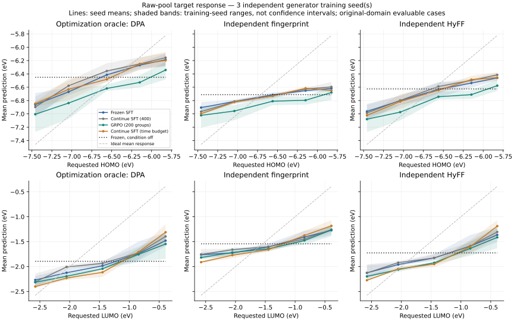
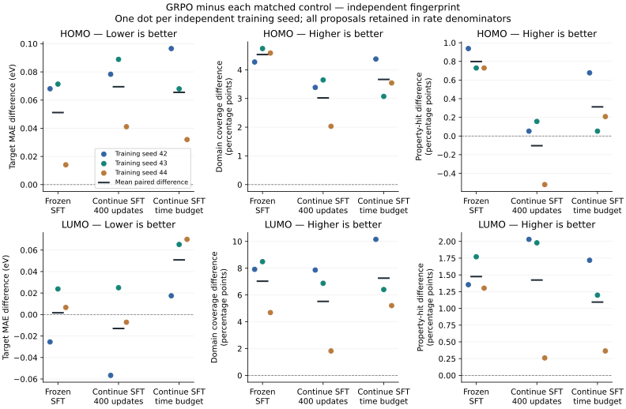
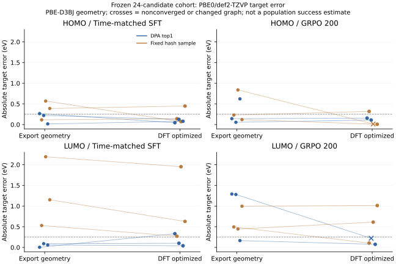
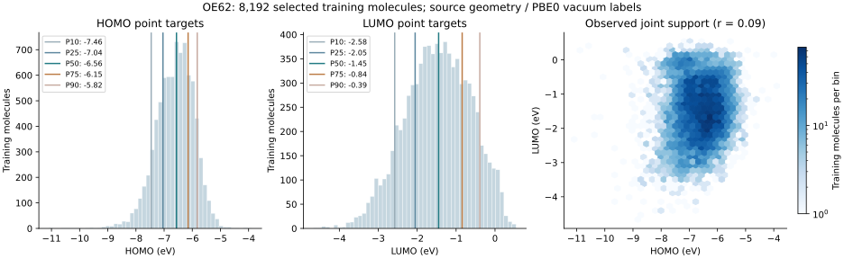
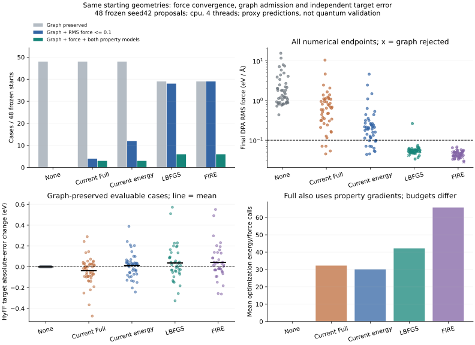

# 实验结果与当前结论

所有表格保留原始尝试数，模型预测成功与量子验证成功分别报告。实验设置见[实验方案](experiments.md)，当前算法见[架构说明](architecture.md)，调整决策见[方案调整](design_changes.md)。下列链接指向保存模型/输入哈希及逐样本证据的最终汇总。

## 核心判断

既有OCELOT实验完成了重放，并产生少量在内部量子协议下保图且目标达标的结构。OE62源三维三训练seed正式对照确认GRPO提高域内覆盖和独立代理命中产率；同等额外训练时间下，两个性质在两个独立评价器上的目标MAE均更差。尚无证据证明五阶段组合普遍优于简单基线。新增PySCF固定队列有12/24在优化收敛、保图后命中目标，但未显示GRPO优于等时SFT；MLIP力阈值与DFT收敛有明显分歧。条件控制、图/几何质量和代理与量子参照的一致性仍须分别判断。

OCELOT 重建构象的既有结果保留；没有证据把构象误差归为全部问题的原因。后续方向及实施状态见[方案调整](design_changes.md)，不将计划计入本页已完成结果。

## OE62 三训练种子的正式对照

三次独立先验适配及HOMO/LUMO训练均完成。每个性质/臂使用五个目标、三个推理seed、每池128提案；每个训练seed为1920次，三个训练seed合计5760次。全矩阵378个池、48384次提案，包含条件关闭池；64提案初试没有混入正式分母。性质头固定，不将三个bootstrap成员当作生成器训练重复。

| 性质 | 对照臂 | 域内率 | 指纹目标MAE / eV | HyFF目标MAE / eV | 指纹性质命中率 | HyFF性质命中率 |
| --- | --- | ---: | ---: | ---: | ---: | ---: |
| HOMO | 冻结SFT | 18.42% | 0.5432 | 0.5725 | 4.44% | 4.86% |
| HOMO | 继续SFT 400步 | 19.93% | 0.5249 | 0.5513 | 5.35% | 5.54% |
| HOMO | GRPO 200组 | 22.95% | 0.5944 | 0.6160 | 5.24% | 6.13% |
| HOMO | 等时继续SFT | 19.29% | 0.5289 | 0.5604 | 4.93% | 5.40% |
| LUMO | 冻结SFT | 19.15% | 0.7118 | 0.8302 | 3.99% | 3.39% |
| LUMO | 继续SFT 400步 | 20.66% | 0.7264 | 0.8227 | 4.05% | 4.11% |
| LUMO | GRPO 200组 | 26.18% | 0.7134 | 0.8568 | 5.47% | 4.84% |
| LUMO | 等时继续SFT | 18.92% | 0.6625 | 0.8018 | 4.38% | 3.80% |

MAE先在每个目标的域内可评价结构中计算，再对五目标和三个训练seed等权。命中率以全部提案为分母，容差±0.25 eV；这些是代理性质命中，不是量子或物理联合成功。逐seed数值、范围和样本标准差保存在下面的结果文件。

**GRPO的稳定收益是供给和命中产率。** 相对冻结SFT，HOMO域内率由18.42%增至22.95%，LUMO由19.15%增至26.18%；两种独立评价器的性质命中率都提高。相对等时继续SFT，HOMO/LUMO在两个评价器、三个训练seed的12个配对中，GRPO的命中率均更高，目标MAE也均更大。HOMO相对400步继续SFT的指纹命中率略低，不能概括为全面优于监督续训。

这澄清了初试：LUMO的MAE改善没有在跨训练seed上稳定重现，命中产率收益更稳。连续奖励1/(1+D)强调目标附近的概率质量，且不合格提案为−1，并不等价于最小化可评价子集的MAE。六组奖励方差中，可评价/不合格类别之间的分量占94.78%–95.48%；这是奖励信号的描述，不是策略梯度的因果分解。

**点值控制存在，但增益有限。** 冻结SFT在两种独立模型、两个性质、三个训练seed上均优于错配目标。LUMO正确条件也在两种模型的三个seed上均优于关闭；HOMO的指纹评价三次均改善，HyFF仅两次改善。GRPO没有跨seed一致增强目标特异性；中央三个已参与GRPO轮换的目标，也没有在平均MAE上普遍改善，不能把问题全部归于P10/P90未轮换。

等时继续SFT实际执行HOMO 8280/8683/8393步，LUMO 8729/8418/8357步；相应GRPO额外训练预算约1503–1569秒。400步对照只匹配优化器更新数，等时对照另匹配实际训练时间，不称为相同token预算。全矩阵9964个域内可评价提案的最小RMS力为0.2712 eV/Å，没有一个达到0.1阈值，因此DPA/指纹/HyFF的原始物理联合命中均为零（[力审计](experiments/oe62_formal_raw_force_audit_20261113.json)）；几何优化结果另列，不能用原始性质命中替代完整成功。

[HOMO指纹配对](experiments/oe62_formal_homo_repeats_20261113.json)、[LUMO指纹配对](experiments/oe62_formal_lumo_repeats_20261113.json)、[HOMO HyFF配对](experiments/oe62_formal_homo_hyff_repeats_20261113.json)、[LUMO HyFF配对](experiments/oe62_formal_lumo_hyff_repeats_20261113.json)、[HyFF配对图](experiments/oe62_formal_paired_hyff_20261113.svg)。三个训练seed提供描述性重复，不作显著性保证。

### 交付代码重放

最终wheel在既有原生GPU依赖环境中隔离加载，229个包文件逐字节核对；HOMO/LUMO冻结SFT P50各重放128次提案，256条token、元素和三维坐标均与正式原始池完全一致。准入数量、域内数量及导出结果一致；共同导出的性质最大差异9.54e-7 eV、力差3.58e-7 eV/Å。此项验证包内容与完整推理，不是全新操作系统/CUDA安装。

[HOMO重放](experiments/oe62_wheel_replay_homo_20261113.json)、[LUMO重放](experiments/oe62_wheel_replay_lumo_20261113.json)。轮次中的回归检查为192通过、3项按环境跳过；回归夹具覆盖实际推断立体标记与坐标连接漂移问题。

## OE62 PySCF量化参照

直接复用已有GPU4PySCF 1.9.1/PySCF 2.12.1复算：13个OE62开发源结构、源坐标不变，PBE0/def2-TZVP、def2-universal-jkfit密度拟合、grid level 3、SCF容差1e-8，全部收敛。HOMO/LUMO对发布标签的MAE为0.0282/0.0433 eV，最大绝对差0.0414/0.0706 eV；这13例偏差均向上，未做经验平移。样本按目标和原子数分层并补B/P，覆盖B/C/H/N/O/P，不能将该小样本误差外推为所有生成结构的误差界。

该结果支持直接使用现有PySCF继续独立裁决，无需安装FHI-aims；保留与源Tier2/原子ZORA设置的差别。原始计算只读复用，逐例来源和哈希保存在[参照结果](experiments/oe62_pyscf_source_reference_20261113.json)，[源参照几何](experiments/oe62_pyscf_source_reference_20261113.sdf)可直接重放。下面的量化队列直接来自本轮正式GRPO200/等时SFT，候选在计算前冻结。

补充6个源结构覆盖本轮生成队列新增的Br/Cl/F/S/Se/Si，全部收敛。合计19例HOMO/LUMO MAE为 **0.0251/0.0524 eV**，最大差为0.0414/0.2847 eV。较大LUMO差来自FOPCAO01：源值−0.13355，TZVP为+0.15114 eV。固定相同几何和PBE0泛函，QZVP得到−0.05542、TZVPD得到−0.23444 eV，偏差降至0.0781/0.1009 eV；含硫对照FOWVOD的QZVP偏差仅0.0015 eV。这支持接近零的虚轨道具有较强基组敏感性，不能把19例平均误差当作逐分子误差上限。[补充参照](experiments/oe62_pyscf_extra_reference_20261113.json)、[固定几何基组诊断](experiments/oe62_pyscf_basis_diagnostic_20261113.json)。主对照统一保留TZVP结果。

### 正式策略的24候选量化队列

HOMO/LUMO各三个中央目标，GRPO200与等时SFT各取DPA排序首位和一位固定哈希抽样候选。P25/P50/P75分别使用train42/infer2026、train43/infer2027、train44/infer2028，两臂匹配。共24次原始PBE0单点均收敛；随后PBE-D3BJ/def2-TZVP优化，21例数值收敛，20例同时保图。两例优化途中SCF失败、一例达到80步仍未收敛并出现长键、一例收敛后出现新增连接；四例都来自这批GRPO子集，保留在分母中。

| 性质 / 方法 | 原始量化目标MAE | 原始命中 / 6 | 优化收敛且保图 / 6 | 优化后目标MAE | 优化后命中 / 6 |
| --- | ---: | ---: | ---: | ---: | ---: |
| HOMO / 等时SFT | 0.2628 | 3 | 6 | 0.1521 | 5 |
| HOMO / GRPO | 0.3352 | 4 | 4 | 0.1484 | 3 |
| LUMO / 等时SFT | 0.6710 | 3 | 6 | 0.5542 | 2 |
| LUMO / GRPO | 0.7787 | 1 | 4 | 0.4507 | 2 |

MAE单位eV、命中容差±0.25 eV；优化后MAE只在收敛且保图的子集上计算，命中分母仍为每组6例。整个队列原始命中11/24，优化后12/24。共同20个成功子集的量化目标MAE从0.4128降至0.3317 eV；不能用全部24例的0.5119与20例直接作配对改善。优化后等时SFT命中7/12、GRPO命中5/12；此小队列不支持GRPO的量化优势，也不能估计全生成分布的成功率。目标与seed未完全交叉，结论限于这组预选结构。

[固定队列与来源](experiments/oe62_point_quantum_cohort_20261113.json)、[完整量化结果与失败](experiments/oe62_point_quantum_20261113.json)、[输入SDF](experiments/oe62_point_quantum_input_20261113.sdf)。几何采用PBE-D3BJ而源数据为PBE-TS，保留计算协议差异，不将优化结构重标为发布方数据。

### DFT几何与MLIP力判据的实测分歧

20个收敛且保图的DFT末端，PBE-D3BJ原子RMS力中位0.00215、最大0.00365 eV/Å；相同坐标上DPA/HyFF的RMS力中位为 **0.5171/0.5198 eV/Å**，两者在0.1阈值下均为0/20。这说明该MLIP力阈值衡量其自身势面的驻点，不能据此否定DFT几何收敛；原始池“物理联合零命中”也不能单独解释为全部结构不稳定。后续独立DFT验收用相应DFT梯度，MLIP力作为势面一致性诊断单列。

同一20例的模型对量化误差，DPA从0.2212降至0.1561 eV，HyFF从0.3608降至0.2710 eV，指纹从0.5217降至0.4103 eV。几何优化改善了这组结构上的性质评价，但DPA仍有分布外误差，独立模型之间也不能互相充当真值。[逐候选同几何性质、力及配对统计](experiments/oe62_point_quantum_oracles_20261113.json)。真实SCF失败案例重放同时验证了失败轨迹记录修复：原单点差小于1e-12 eV，失败仍保留，并保存失败前完成的梯度评价。

## OE62 源三维性质预测

官方 61489 条记录经源图/立体身份、电子态、大小和空间范围检查后保留 53470 条；本轮共用 8192 个训练 ID、512 个开发 ID、512 个校准 ID。9216 个 SDF 的坐标和轨道标签逐条与官方 JSON 相等，两组训练旋转的 octree 编码均保留全部原子。冻结性质模型后的完整测试结果见下表。

| 开发集 MAE / eV | DPA 源三维 | 同 ID 指纹 |
| --- | ---: | ---: |
| HOMO | 0.0990 | 0.3346 |
| LUMO | 0.0999 | 0.3632 |

DPA 在独立校准集上的 HOMO/LUMO MAE 为 0.1011/0.1060 eV；完整重载参数逐位相等，重复 GPU 前向最大差异小于 5e-6 eV。该结果支持开展点值控制试验，但不代表生成几何上也有相同误差。指纹误差高于主验收半径 0.25 eV，独立复评必须结合连续误差、覆盖率与后续同级量化。OE62 与旧 OCELOT 的数据、计算等级和任务不同，不能将误差差额全部归因于源几何。

[冻结数据清单](../data/oe62_split_manifest.json)、[审计、误差分位数与模型哈希](experiments/oe62_source_properties_20261112.json)。上述为单个数据划分/训练 seed 的开发结果，三个 bootstrap 成员不是三个独立数据实验；这一步未使用测试集；随后冻结全部四个模型，单独执行下述最终测试。

分布图只使用生成器实际训练的8192个ID，没有把完整43951条训练划分混入；精确目标邻域计数及输入哈希见[支持统计](experiments/oe62_training_targets_20261112.json)。

### 冻结模型的完整源三维测试集

四个模型及各自校准器冻结后，一次性评价完整4762个骨架隔离的测试结构，四者全部可评价；没有在测试集上调参或选择模型。

| 模型 | HOMO MAE / eV | LUMO MAE / eV | 既定90%联合校准区间的实测覆盖 |
| --- | ---: | ---: | ---: |
| DPA | 0.1000 | 0.1029 | 91.83% |
| 原指纹v1 | 0.3301 | 0.3459 | 87.90% |
| 规范图指纹 | 0.3300 | 0.3468 | 88.70% |
| HyFF | 0.1596 | 0.1648 | 90.93% |

开发集结论在这批源结构上保持：DPA和HyFF头能预测发布的轨道标签，图指纹误差较大。校准覆盖是骨架隔离测试中的经验结果，不作为任意生成结构的覆盖保证。本次下游训练ID骨架隔离，上游预训练数据与测试集的完整重叠尚未审计。所有模型训练ID相同；差异不能全部归因于是否使用3D，因为描述符和模型容量也不同。[全量指标、原子数/元素/目标邻域分层及冻结哈希](experiments/oe62_source_holdout_20261113.json)

### HyFF 独立三维性质头

相同8192训练ID和源坐标/标签，HyFF Presto描述符冻结，三个bootstrap头各35轮；开发集HOMO/LUMO MAE为 **0.1462/0.1638 eV**，校准集为 **0.1615/0.1684 eV**。完整重载与重复原生CPU前向逐位一致，训练及评价约688秒。训练/选模不使用测试集，HyFF不参与生成策略奖励或候选选择；它补充对几何变化的独立响应评价，不能当作量子真值。[模型、输入哈希及指标](experiments/oe62_hyff_source_20261113.json)

### 固定候选池的距离与概率排序

在seed42的四臂及关闭条件池上，固定相同域内候选，比较目标距离与512个独立校准残差形成的经验区间概率，输出上限分别为1/4/8/16。不增加生成、不重新选模型；独立评分使用标准化图指纹。每个性质300组同池配对，概率只改变HOMO的12组、LUMO的13组输出集合；这些配对复用候选，并非独立训练重复。

按性质、策略、输出上限汇总，两种排序的独立MAE差异绝对值均小于0.011 eV，命中数差异最多1个，没有一致收益。主上限16时，HOMO GRPO的命中数从58增至59，其余九个性质/策略组合不变。暂不将概率排序并入默认流程。

源校准集按骨架做两折交叉拟合，HOMO/LUMO Brier分数0.0569/0.0515，五箱ECE为0.0093/0.0111；这是512源分子在五个目标上的相关查询，不能外推为生成结构上的概率校准。当前残差概率与距离高度相近，后续若要研究不确定性收益，需要能区分候选误差的证据，而不是仅换一个分数名称。[逐池排序与校准结果](experiments/oe62_ranking_20261113.json)

### 源几何与 DPA 优化响应

固定开发集前32个ID，复用现有纯能量优化器，最多10步、步长0.004；32个均完成，并保持源连接关系。平均 RMS 力从0.4796降至0.0996 eV/Å，满足0.10阈值的数量从0增至18，满足0.50阈值的数量从21增至32。共384次实际评价调用。

HOMO/LUMO 预测的平均绝对变化为0.0352/0.0749 eV，最大为0.1084/0.1680 eV；LUMO预测在这32个案例中均上移。这里测到的是代理对几何变化的响应，优化后没有同级量子标签，不能据此报告优化后“真值误差改善”。源DFT几何与DPA平衡点不同，原始池的低力交集应独立于条件控制判断。导出的优化结构移除了原 `homo/lumo` 标签，仅保存显式命名的源参考值。[逐结构结果](experiments/oe62_geometry_response_20261112.json)

### OE62训练图的无条件BRICS基线

仅用相同8192个训练图构成18422个单端口片段，三个推理seed各64次单对片段提案。一次ETKDGv3嵌入，不做UFF/MMFF后优化、不补样：192次中141个有效且在原域内，141个图按规范SMILES均唯一且未见于本次训练集；43次超80原子、3次所选片段对没有产物、2次嵌入失败、3次未通过统一坐标连接检查。全部144个成功嵌入构象（含3个准入失败）均保存原始坐标；与首次运行的图提案及中心化坐标逐位一致。有效分子的原子数min/P25/P50/P75/max为18/49/58/69/80，分布与octree提案不同。

同一192提案按五个HOMO和五个LUMO点重评分。下表MAE对五个目标等权；命中数的分母为每个性质960个“目标任务×提案”对，并非生成了960个独立分子。Top16每池按DPA距离选取，独立模型不参与选择。

| 独立评价 | HOMO原始池MAE | HOMO top16 MAE / 命中数 | LUMO原始池MAE | LUMO top16 MAE / 命中数 |
| --- | ---: | ---: | ---: | ---: |
| 原指纹v1 | 0.5678 | 0.4406 / 76 | 0.8016 | 0.5140 / 70 |
| 规范图指纹 | 0.5701 | 0.4478 / 75 | 0.8001 | 0.5157 / 67 |
| HyFF | 0.6317 | 0.2981 / 122 | 0.8583 | 0.4039 / 100 |

单位均为eV；原始池/重排池全部物理联合命中为零。原始DPA RMS力最小0.985、中位1.853 eV/Å，规则图的有效性不能代替三维优化。CPU四线程建库约20秒、192次提案约34秒、四模型评价约12秒，不与A800训练/推理速度直接作等算力结论。

它证明当前任务存在较强的训练片段搜索基线，也把“更多域内候选＋排序”与“目标条件生成”分开；原子数、几何生成方式和搜索分布不同，不能单独归因于片段表示。该基线仍未接入octree补位。[逐候选、选择指标与输入哈希](experiments/oe62_brics_point_pools_20261113.json)

### 同一原始池的HyFF独立复评

在初试四臂及关闭条件的126个固定池中，5359个有效结构均完成HyFF原生评价；原域掩码、原始坐标及全部提案分母不变。下表每个性质/臂均为960次提案，MAE对五个目标等权，域内可评价结构内计算。

| 性质 | 冻结SFT | 继续SFT 400步 | GRPO 200组 | 等时继续SFT |
| --- | ---: | ---: | ---: | ---: |
| HOMO HyFF目标MAE / eV | 0.5576 | 0.5291 | 0.6282 | 0.5796 |
| HOMO HyFF命中数 | 56 | 46 | 65 | 47 |
| LUMO HyFF目标MAE / eV | 0.9208 | 0.8978 | 0.8596 | 0.8161 |
| LUMO HyFF命中数 | 33 | 32 | 55 | 42 |

HyFF同样未支持“GRPO的目标MAE全面优于额外SFT”，但支持更多代理命中提案。HOMO的条件响应结论依赖评价器：中央三个目标的HyFF MAE，正确/关闭/打乱条件为0.4977/0.5781/0.6546 eV，而指纹未显示正确条件优于关闭。LUMO在两类独立模型上都显示条件响应；HyFF对应0.8215/0.9358/1.0589 eV。评价器之间的绝对差异不能当作量子误差；生成结构的量化裁决按既定PySCF协议执行。

本次复评还核对了立体图清理：全部198个初试池的8393个有效提案，清理无效推断立体标记后图身份均相同、均可重复验证，仅4个SMILES字符串因显式氢表示而改变。原正式训练/评价快照保持固定，没有用修复后的图特征悄悄替换主对照。[独立复评与输入哈希](experiments/oe62_hyff_pools_20261113.json)

### 覆盖增益与局部电荷状态的关系

按同一规范图表示，8192源训练图中的带电状态包括N⁺、O⁻及S⁺；不能简单排除所有形式电荷。固定池分层显示，原域内且所有“元素/形式电荷”组合在训练中出现过的数量，HOMO冻结/GRPO为150/208，LUMO为168/243；包含未见组合的数量反而从36降至25、31降至26。

因此初试GRPO的覆盖增益没有只来自这些未见电荷状态。限定在已见状态子集，HOMO HyFF目标MAE仍从0.5764增至0.6359 eV，LUMO从0.8935降至0.8372 eV，取舍仍在。该统计仅描述训练支持，不证明化学稳定性，也未新增筛选门槛或修改原结果分母。[分层指标与来源](experiments/oe62_charge_support_20261113.json)

### 48个固定生成起点的几何对照

HOMO/LUMO P50 × frozen/GRPO × 三个推理seed，每池取候选ID最小的四个域内结构；不按独立性质挑选。统一保图验收含原图/立体和坐标重新推断的连接关系。所有方法均保留48个起点作分母。

| 方法 | 保图 | 保图且RMS力≤0.1 | 保图、力、DPA与HyFF目标均达标 | 实际优化能量/力调用 | 性质梯度调用 |
| --- | ---: | ---: | ---: | ---: | ---: |
| 不优化 | 48 | 0 | 0 | 0 | 0 |
| 当前Full，30步 | 48 | 4 | 3 | 1548 | 557 |
| 当前纯能量，30步 | 48 | 12 | 3 | 1444 | 0 |
| LBFGS，最多150调用 | 39 | 38 | 6 | 2026 | 0 |
| FIRE，最多150调用 | 39 | 39 | 6 | 3156 | 0 |

标准优化器解决了多数案例的力收敛，但没有同时解决性质保持：在各自保图可评价子集上，HyFF目标绝对误差相对同一起点的平均变化为Full −0.0377 eV、当前纯能量 +0.0127 eV、LBFGS +0.0368 eV、FIRE +0.0429 eV。仅比较同时通过Full和标准优化器的39个案例，LBFGS/FIRE相对Full的HyFF误差仍高0.0709/0.0852 eV。

LBFGS/FIRE的六个联合命中是相同六个起点，均包含Full的三个，新增三个均来自frozen策略；该小队列不足以证明GRPO与优化器的交互收益。接受步和末端共用连接关系/键长/立体验证器，Full及当前纯能量的48个输出均保图；9216个既定源结构也全部通过统一连接规则。标准优化器的键长越界、立体变化或连接关系变化不因力低而变成成功。

这支持保留标准优化作为显式对照，但暂不无条件替换Full：力收敛、性质误差和化学准入存在实测取舍。不同方法的目标、步长和预算不同；上表列实际调用，不能把全部差额归因于算法。均为远程CPU四线程，耗时约Full140秒、当前纯能量80秒、LBFGS111秒、FIRE170秒（含末端评价）；不是GPU吞吐比较，也未做同级量子验证。

[逐案例、实际评价轨迹与输入哈希](experiments/oe62_geometry_comparison_20261113.json)。轨迹含Full/当前纯能量的被拒绝试探点，不能直接把每次评价画成已接受构象的收敛轨迹。

### 坐标到分子图的恢复诊断

在固定512个开发结构上移除输入图，再用推理中的默认判键流程恢复：源坐标482个恢复严格图身份、20个键级/电荷等图表示不一致、10个未通过检查。经过真实depth-7 octree编码的两个固定旋转，精确恢复分别为487/493个，严格图表示不一致20/16个，其余未通过检查。带形式电荷的恢复图分别为33/38/36个；源训练集中574/8192个含形式电荷，类型仅为N⁺、O⁻。

源坐标的20个严格图差异中，13个经RDKit官能团标准化后图相同；两组编码坐标分别有13/9个。因此标准化图匹配数为495/500/502，不能把严格图差异全部解释为不同化学物种。

这些结果表明判键有独立误差，但0.01 Å编码量化在这组源结构上没有造成大量电荷分离。生成池的异常电荷现象需结合提案几何和键级推断解释，不能一概归因于源构象或坐标精度。训练适配保留发布方图的键级，没有用这次无图恢复结果替换训练标签。完整生成统计随E3矩阵汇总。[逐结构诊断及输入哈希](experiments/oe62_source_bond_recovery_20261112.json)

### OE62 结构先验对照

相同源训练集、深度7与15元素配置，seed42、全骨干结构适配2000步，各用三个推理 seed×64次无条件提案：

| 指标 | QM9 先验 | drug 先验 |
| --- | ---: | ---: |
| 化学有效 / 192 | 45（23.4%） | 109（56.8%） |
| 域内有效 / 192 | 3（1.6%） | 37（19.3%） |
| 验证结构 loss | 1.3144 | 0.9851 |
| 有效分子总原子数中位数 | 23 | 31 |

三个推理 seed 上 drug 的域内有效数均更高（12/8/17，对照2/1/0）；按预声明规则，单目标训练使用 drug 适配检查点。训练源结构的总原子数中位数为38，新先验使大小分布更接近目标数据，但仍未完全匹配。这里只验证了一个短适配预算，尚未证明性质控制或GRPO收益，也未排除上游预训练数据重叠。[完整候选、检查点哈希及分 seed 证据](experiments/oe62_prior_comparison_20261112.json)

## OE62 单目标与 GRPO 初试

初试使用一个独立训练 seed42；每臂五个固定分位数目标，每目标三个推理 seed×64提案，共960次。这里的“图检查通过”是当前RDKit图/坐标检查口径，域内是冻结的指纹相似度判据，不代表量子稳定性。主统计保留未排序、未弛豫的完整原始池；指纹与域判断使用最初冻结的v1图特征，后续规范化对照不混入本表。

| 性质 | 策略 | 图检查通过 / 960 | 域内 / 960 | 独立目标MAE / eV | 独立容差命中 / 960 |
| --- | --- | ---: | ---: | ---: | ---: |
| HOMO | 冻结SFT | 599 | 187 | 0.5671 | 38 |
| HOMO | 继续SFT 400更新 | 623 | 175 | 0.5404 | 49 |
| HOMO | GRPO 200组 / 400更新 | 669 | 233 | 0.6176 | 61 |
| HOMO | 继续SFT，匹配时间 | 631 | 176 | 0.5127 | 42 |
| LUMO | 冻结SFT | 612 | 199 | 0.7061 | 50 |
| LUMO | 继续SFT 400更新 | 631 | 183 | 0.7682 | 32 |
| LUMO | GRPO 200组 / 400更新 | 690 | 269 | 0.6955 | 57 |
| LUMO | 继续SFT，匹配时间 | 642 | 188 | 0.6737 | 42 |

MAE先在每个目标的域内可评价分子上计算，再对五个目标等权平均；容差固定±0.25 eV，命中分母始终为全部960次提案。GRPO增加了域内候选和全提案命中数，但没有在目标MAE上同时优于两个继续SFT对照，不能总结为全面提升。两性质的时间匹配SFT分别实际完成8280/8729次更新，训练时间1503.18/1547.30秒；对应GRPO预算为1503.05/1547.24秒。400次继续SFT约104秒，等更新不等算力。

条件关闭与打乱对照也区分了两项任务：P25/P50/P75的独立MAE等权平均，LUMO正确条件为0.5615、关闭0.7589、打乱0.7758 eV；HOMO正确0.4493、关闭0.4247、打乱0.5092 eV。因此LUMO已有点值条件响应证据，HOMO尚未优于关闭条件。关闭条件共享同一组192个提案复评三个目标，打乱组重用预定错误输入的候选池，不计为新增独立重复。

两组GRPO各有3200个训练提案、400次实际更新；至少两个可评价候选的组分别为181/200、174/200。组内奖励方差中，可评价与不可评价类别之间的差异占95.48%/95.17%，可评价候选内部的性质差异只占较小部分。这是奖励信号的描述性分解，不是梯度因果证明，但与覆盖增益较明显的现象一致。

八个主臂原始池在叠加RMS力≤0.10 eV/Å后，独立属性联合命中均为零。LUMO冻结/400步继续/GRPO的域内RMS力中位数为1.491/1.242/1.368 eV/Å；DPA与指纹的平均预测差约0.6 eV。因此源数据上的性质精度不能直接当成生成几何上的精度。

初试每个性质的99个原始池均完成，包含中间预算检查点、关闭条件和时间匹配对照。正式seed42/43/44重复已完成，见本页首节；这些初试推理种子不是三个独立训练重复，也不与正式128池重复累加。[HOMO全部指标与成本](experiments/oe62_point_homo_seed42_20261112.json)、[LUMO全部指标与成本](experiments/oe62_point_lumo_seed42_20261112.json)。

固定P50、每性质64候选的批量实测中，batch8→64使HOMO生成时间44.21→8.68秒、LUMO47.19→9.68秒；已测候选token/坐标与batch8逐位一致。正式重复统一batch64；这只是本次固定候选的等价与吞吐证据。[实测明细](experiments/oe62_sampling_batch_profile_20261112.json)

### 图特征修复的独立复评

指纹模型与Morgan域现在以相同的官能团标准化及规范异构SMILES构建新特征，旧v1模型仍按原契约加载。13对标准化后相同的源图表示，旧指纹预测平均相差HOMO 0.2862、LUMO 0.1603 eV，最大0.6438/0.4561 eV；规范图模型的对应差异为零。旧模型512个开发预测及90个原始候选预测/域判断保持原结果，全部9216个源数据特征通过电荷守恒检查。

新模型开发MAE为0.3340/0.3666 eV，没有整体优于原指纹模型；这是表示一致性修复，不是预测精度提升的证据。两个已完成初试的候选与策略全部固定，先保留原域掩码，只更换独立图预测器：

| 独立目标MAE / eV | 冻结SFT | 继续400更新 | GRPO200组 | 时间匹配SFT |
| --- | ---: | ---: | ---: | ---: |
| HOMO，规范图预测器 | 0.5694 | 0.5352 | 0.6191 | 0.5115 |
| LUMO，规范图预测器 | 0.7079 | 0.7688 | 0.6994 | 0.6685 |

主要取舍保持不变：GRPO增加可评价/命中提案，但没有在目标MAE上优于时间匹配SFT。新域判据的结果单独保存在JSON，不能将域掩码变化混同于策略提升。每性质6336次原始提案的复评中，HOMO有3个、LUMO有1个无法完成规范图特征准入；保留原结构、失败原因和分母，未替换为另一种电子态的预测。

[特征契约、模型/数据哈希及源结构验证](experiments/oe62_graph_feature_contract_20261112.json)、[HOMO固定池复评](experiments/oe62_point_homo_canonical_20261112.json)、[LUMO固定池复评](experiments/oe62_point_lumo_canonical_20261112.json)。这些结果没有用于选择GRPO检查点或改变正式主对照。

## OCELOT 数据规模与性质预测

最终 DPA/HyFF 使用同一批 8192/512/512 训练/验证/测试构象；指纹模型用 20356 个训练图，在相同 512 个测试 ID 上进行匹配比较。测试集包含 H/C/N/O/F/B/Si/P/S/Cl/Br/I/Se/As/Te。它们是骨架留出的中性闭壳层有机结构，不覆盖金属配位与开放壳层专项能力。

实际 512 个测试分子的显式总原子数（含氢）为 13–79，平均 34.35、中位数 32；重原子数为 9–58、中位数 21。总原子数分布如下，约 71% 位于 21–40：

| 总原子数 | ≤20 | 21–30 | 31–40 | 41–50 | 51–60 | 61–70 | 71–80 |
| --- | ---: | ---: | ---: | ---: | ---: | ---: | ---: |
| 测试分子数 | 40 | 168 | 195 | 70 | 19 | 8 | 12 |

含 B/Si/Se/As/Te 的测试分子分别只有 13/7/1/1/4 个。各元素计数可重叠，稀有元素数量不足以支持可靠的广元素精度结论。[元素和原子数清单](../data/ocelot_matched_atom_inventory.json)

| 性质 MAE / eV | DPA | HyFF-presto | 指纹 |
| --- | ---: | ---: | ---: |
| HOMO | 0.2895 | 0.3077 | 0.3593 |
| LUMO | 0.2326 | 0.2502 | 0.3354 |
| 垂直 S1 | 0.2314 | 0.2475 | 0.2968 |
| 垂直 T1 | 0.1381 | 0.1661 | 0.2616 |
| 逐分子垂直 S1−T1 差 | 0.2226 | 0.2176 | 0.2546 |

DPA 的四个单目标误差较低，HyFF 的配对垂直能隙略低；这只是一组下游训练 seed，且预训练和架构不同，不能认定稳定的架构排名。以上均为对 OCELOT CSV 标签的误差，不是原始 DFT 几何的复现精度，也不是绝热能隙 MAE。[匹配测试](experiments/optical_matched512_20261112.json)

DPA/HyFF 校准后的联合覆盖率为 89.06%/90.43%，但平均区间宽度分别约 1.58–2.06/1.90–2.27 eV，ensemble spread 对误差的排序较弱。因此不确定性奖励保持关闭。这是 512 个测试样本的经验覆盖与平均宽度，不能推出每个生成候选都不可认证，也不是候选的条件命中概率。是否完全落入目标窗口须逐候选检查；现有残差分位数校准没有给出可直接积分的高斯分布。[DPA 校准](experiments/optical_calibration_20261112.json)、[HyFF 校准](experiments/hyff_optical_calibration_20261112.json)

## 生成与训练

### 旧目标窗口的训练支持

在完整 20356 个训练分子上重算标签分位数和逐分子交集；8192 子集是实际性质训练集、也是生成器 8188 个可编码结构的上游集合。本表不是生成成功率，且没有使用测试标签。[输入哈希、逐目标分位数及计数](../data/ocelot_target_coverage.json)

| 旧任务 | 中心单值 / eV | 完整训练集同时满足原区间 | 8192 子集同时满足原区间 |
| --- | --- | ---: | ---: |
| Original | H=-7.70，L=+0.10 | 3607 / 20356（17.72%） | 1444 / 8192（17.63%） |
| Central | H=-7.25，L=-0.63 | 7081（34.79%） | 2828（34.52%） |
| lower_gap | H=-6.86，L=-1.06 | 3555（17.46%） | 1469（17.93%） |
| Optical | S1=3.00，T1=2.00 | 6009（29.52%） | 2463（30.07%） |
| Four-target | H=-7.70，L=+0.10，S1=3.00，T1=2.00 | 116（0.57%） | 46（0.56%） |

Central 的两个中心都约为边际 P50；Original 中心分别约为 HOMO P25、LUMO P85，属于有偏向但仍有较多训练支持的任务。光学窗口偏向较低激发能。四目标在数据支持上的困难体现在交集非常稀少，不能从各目标边际覆盖率推断联合支持，也不据此把低支持认定为生成失败的唯一原因。表中单值只是原区间中心，尚未作为单值模型实验运行；lower_gap 来自较早的窗口研究，不与不同检查点的生成结果合并为匹配对照。

### 结构提案对照

下表每行都是 192 次尝试，BRICS 与 octree 共享训练结构和候选/排序/弛豫上限。FP 与 HyFF 在不改变导出坐标的条件下独立复评，表中联合指标均使用源 DPA 的力阈值。

| 方法 / 窗口 | 化学有效 | 域内 | DPA 联合 | FP 联合 | HyFF 联合 |
| --- | ---: | ---: | ---: | ---: | ---: |
| Octree 5000 / Original | 113 | 9 | 4 | 4 | 3 |
| BRICS / Original | 173 | 173 | 10 | 4 | 13 |
| Octree 5000 / Central | 108 | 13 | 3 | 2 | 2 |
| BRICS / Central | 173 | 173 | 45 | 45 | 44 |

Central 的 BRICS 优势在三个代理下成立；Original 的指纹结果持平。BRICS 每个窗口实际用了 96 次外部排序评价，octree 只有 9/13 次；不是等实际算力优越性结论。BRICS 从8188个训练结构构建了9903个不同单端口片段；两个窗口重用了同一组192个无条件图，48 个保留结构相对适配训练集均新颖，但没有证明对预训练语料新颖或能够合成。[完整对照与成本](experiments/brics_comparison_20261112.json)

这些分窗口结果说明优势随任务变化，并未证明 BRICS 学会了目标条件。窗口已经在表内分层，不是同一窗口方法比较中的混淆变量；需要另外控制原始提案条件和下游筛选，才能定位定向能力。

### 条件响应与片段覆盖核验

以下均为现有记录和原始 CSV 的本地重算，没有新增模型训练或生成。[计算定义、输入哈希与统计](experiments/proposal_diagnostics_20261112.json)

条件诊断的三个检查点使用同一组 64 个 held-out 分子，各 16 个 batch（每批 4 个）：

| 检查点 | 正确条件 loss | 打乱条件 loss | 无条件 loss | 正确优于打乱的 batch |
| --- | ---: | ---: | ---: | ---: |
| initial | 1.273051 | 1.281740 | 1.331317 | 8/16 |
| control | 1.275415 | 1.285949 | 1.331317 | 10/16 |
| paired | 1.275005 | 1.285505 | 1.331317 | 10/16 |

每臂正确条件均在 16/16 个 batch 优于无条件；正确相对打乱的平均优势较小。原 JSON 有 48 行 batch 和 3 行均值，不能把它们当成 51 个独立样本；三个检查点之间还是重复测量。`loss_gen` 为 tree CE＋atom CE＋0.1×三轴坐标 CE 均值，其差值比例不是互信息，也不能转换成 eV 可控范围。诊断的随机打乱还未剔除相互兼容的区间。当前结果支持继续检查值特异响应，不支持断言完全没有学习条件数值。

BRICS 覆盖在 RDKit 2026.09.1 下按 `FindBRICSBonds` 计数：

| 范围 | 分子数 | 无切点 | 无切点占比 |
| --- | ---: | ---: | ---: |
| 正式完整训练划分 | 20356 | 5971 | 29.33% |
| 正式性质训练 ID | 8192 | 2463 | 30.07% |
| Carbon 抽查的旧 CSV 前 2000 行 | 2000 | 853 | 42.65% |

完整训练 CSV 从原始数据按现有清洗/划分代码重建，字节 SHA 与正式 manifest 一致。旧 CSV 实际共 19902 行，并按 canonical SMILES 排序，前 2000 行不是随机抽样。8192 是生成器 8188 个可编码结构的上游集合；本次没有将其冒充精确的 8188 SDF 统计。零切点表示这些源分子不能直接贡献单切片段，不能解释为同样比例的稠环核心完全不可达。

### 36 组 SFT 时长评估

三个续训 seed 共享同一已训练 5000 步起点，每个检查点、窗口包含三个推理 seed。每行 576 次尝试：

| 总步数 / 窗口 | 有效 | 域内 | DPA 联合 | FP 联合 |
| --- | ---: | ---: | ---: | ---: |
| 10000 / Original | 393 | 51 | 9 | 15 |
| 10000 / Central | 376 | 41 | 9 | 8 |
| 20000 / Original | 370 | 54 | 12 | 11 |
| 20000 / Central | 349 | 41 | 10 | 10 |

合并两个窗口，10000→20000 步的有效数为 769→719/1152，域内 92→95，DPA 联合命中 18→22，FP 联合命中 23→21。改进方向因 seed 和窗口而异，没有稳定设计收益。

元素学习确有进展：三个最终模型在 511 个固定验证结构中均正确预测 8/12 个 B、27/28 个 Si 决策，5000 步起点两者均为零。有效输出中的 B/Si 出现次数分别由 16/67 增至 67/74（每个检查点 1152 次尝试）。只有一个有效 Te 输出，Se/As 未出现。[完整矩阵、各 seed 和元素诊断](experiments/sft_duration_20261112.json)

### 45 组 GRPO 消融

每个目标组合包含三个训练 seed、各三个推理 seed，共 576 次尝试。所有策略共享一个 SFT 初始化。

| 目标 | 有效 | DPA 联合 | FP 联合 |
| --- | ---: | ---: | ---: |
| Full | 482 | 20 | 20 |
| 去 KL | 483 | 14 | 17 |
| 去 physics | 482 | 14 | 17 |
| 去 replay | 484 | 16 | 19 |
| 开 uncertainty | 489 | 17 | 20 |

Full 聚合结果较高，但 no-KL 的 seed 44 在两种评价下均超过 Full。增加 uncertainty 没有提高独立总命中数。当前实验只更新 conditioner，不能据此否定全骨干或图动作策略学习；也没有证明应默认开启 GRPO。[完整矩阵](experiments/grpo_factorial_20261112.json)

四性质生成适配后，HOMO/LUMO、S1/T1、全部四个目标的 DPA/FP 联合结果分别为 1/192、1/192、0/192；HyFF 对全部 25 个保留结构复评得到相同总数。接口训练成功不等于实现了有效四目标设计。[生成记录](experiments/optical_generation_20261112.json)、[HyFF 复评](experiments/optical_hyff_independent_20261112.json)

其他干预同样未形成稳定改进：提高元素采样温度增加稀有元素但降低有效率；元素加权使 DPA 联合命中从 7/384 降至 3/384，独立结果均为 6/384；配对条件目标及其对照均为 DPA 3、FP 4 /384。[温度](experiments/element_temperature_20261112.json)、[元素加权](experiments/element_balance_20261112.json)、[条件对比](experiments/condition_contrast_20261112.json)

## 弛豫与几何响应

固定 192 个提案中的同一批 34 个起点：

| 规则 | DPA 联合 /192 | FP 联合 /192 | 平均最终 RMS 力 / eV·Å⁻¹ |
| --- | ---: | ---: | ---: |
| 无弛豫 | 0 | 0 | 2.5858 |
| 纯能量 | 7 | 17 | 0.1709 |
| 仅投影 | 7 | 8 | 1.0572 |
| 完整接受规则 | 8 | 8 | 1.3537 |

完整规则保住了全部六个初始性质可行结构；纯能量和仅投影各失去一个，但纯能量的残余力最低。指纹模型对同图坐标变化不敏感，其 17 个性质命中在各规则间不变，所以 17 对 8 不能裁决真实几何性质优劣。[逐分子对照](experiments/refinement_matched_20261112.json)

Full 的 34 条轨迹中，22 条以拒步结束，其中 6 条从未接受一步；12 条跑满 30 步，平均执行 17.62 步。纯能量的 34 条均跑满 30 步。停滞真实存在，但日志没有区分各接受约束的拒绝贡献。代码检查的是区间违约量，区间内部的小幅性质变化不会仅因数值变化被拒绝；所有目标均在区间内时，性质梯度为零。[轨迹重算](experiments/proposal_diagnostics_20261112.json)

含硼队列五个完成案例的 S1/T1 梯度平均余弦：DPA 为 0.630/0.658，HyFF 为 0.422/0.573，所有单性质方向均为正。但一例 DPA S1=3.5425 eV、量子 S1=2.2770 eV，位于目标 [2.5,3.5] 的两侧，使性质梯度余弦 +0.819 对应区间损失梯度余弦 −0.819。标量偏差可反转优化目标方向；这五个案例全部域外，不能写成域内失效率。[梯度与逐样本后验区间诊断](experiments/excitation_gradient_comparison_20261112.json)

## 独立量化结果

| 队列 | 选择与分母 | 结果 | 能支持的结论 |
| --- | --- | --- | --- |
| 含硼结构 | 64 次结构提案中的全部十个 B 输出 | 5 个完成优化、保图及 TDDFT；5 个因 SCF、几何或图/立体检查失败 | 局部结构及激发态诊断；五个完成案例均域外，没有验证含 B 的条件设计 |
| 合格设计 | 384 次提案中八个代理合格，按预定规则选五个，三个未计算 | 5/5 完成且保图；2/5 同时命中 HOMO/LUMO，其余三个均因 HOMO 偏离 | 在内部计算协议下找到两个达标实例；不是 40% 总体生成成功率 |

[含硼完整队列](experiments/boron_quantum_cohort_20261112.json)、[合格设计结果](experiments/qualified20k_quantum_20261112.json)、[量化输入与选择](experiments/qualified20k_selection_20261112.json)

对五个合格设计的相同量子几何，DPA 的 HOMO/LUMO 平均绝对分歧为 0.4689/0.2846 eV，指纹为 0.3906/0.4082 eV。全部图都在声明的适用域内。一例与训练图 `csd_RASWEO` 相同，CSV 标签为 −7.7901/−0.4019 eV，量子值为 −8.6653/+0.1991 eV；DPA 更接近 CSV。该差异不能简单归为新图泛化错误，也未证明本次协议精确复现了原 OCELOT。[同几何比较](experiments/qualified20k_same_geometry_20261112.json)、[标签重叠检查](experiments/qualified20k_label_overlap_20261112.json)

原始 25251 行 CSV 的 `abs(vie+homo)` 中位数为 0.2755 eV、95% 分位数为 0.6124 eV，`csd_RASWEO` 为 0.6673 eV。这个残差不能唯一识别 Jh/J2/Jn2、溶剂或基组设置；少量样本拟合偏移也不等于复现原计算协议。五个量化样本与四性质 512 分子测试的模型、样本和参照不同，不能把误差相除当作同任务泛化退化。[CSV 重算](experiments/proposal_diagnostics_20261112.json)

## 性能、空间与交付

| 检查 | 实测结果 | 边界 |
| --- | --- | --- |
| KV buffer | 24 条生成轨迹与 concat 完全一致；中位耗时 11.8772→11.8761 秒，峰值分配 639.4→689.5 MB | 没有可测加速，默认仍 concat；full-prefix 的 2e-4 logits 阈值在两种模式均未通过，最大 2.3651e-4 |
| 去除恒等 KV 行拷贝 | 八条轨迹保持不变，三次共享 GPU 计时中位数 8.96→7.94 秒 | 局部优化，不是普遍 10–12 倍承诺 |
| 串行/批量流水线 | 32 个原始候选、8 个保留；tokens/决策一致，原始力最大差 1.29e-5 eV/Å | 跨路径力容差为 1e-4，与相同路径重放分开 |
| 混合尺寸弛豫 | 8.34→8.39 秒 | 批处理没有普遍加速保证 |
| 固定骨架 CLI | 24/24 有效且域内；8 个保留、零联合命中；图与固定坐标重放一致 | 显式图操作可用，非学习式 octree 补全 |
| 大空间审计 | 960 个已有提案中 515 有效；六个有效结构超旧训练跨度，最大直径 22.30 Å | 六个都有内部形式电荷，不能宣称高质量长发色团生成 |
| EFS 模型包 | 四目标/双目标包分别完整重放 64 个候选及 6/9 个导出；各 23 个文件哈希通过 | 使用已验证 GPU 依赖，不是新 Docker 镜像验收 |

[KV](experiments/kv_buffer_20261112.json)、[拷贝优化](experiments/sampling_compaction_20261112.json)、[批量流水线](experiments/batched_pipeline_comparison_20261111.json)、[混合尺寸](experiments/batched_refinement_mixed_20261111.json)、[骨架](experiments/scaffold_cli_20261112.json)、[空间](experiments/wide_spatial_audit_20261112.json)、[四目标包](experiments/relocated_artifact_verification_20261112.json)、[双目标包](experiments/orbital20k_artifact_verification_20261112.json)

上述结果完成了当前研究的证据闭环。未验证的可选环境、缺少完整材料的原始 OCELOT 量子复现、以及金属/开壳层专项能力，继续作为能力边界陈述，不把它们包装成已完成实验。
