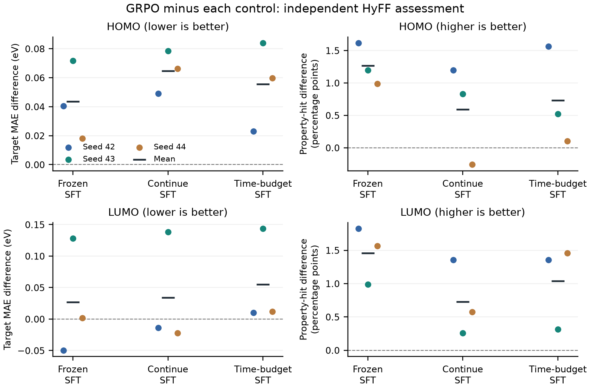

# ORBIT-3D: Interval-Targeted Molecular Generation with Constrained 3D Refinement

**Shangqian Chen, Guojiang Zhao, Zheng Cheng, Jiankun Wang, Hongshuai Wang, Zhifeng Gao**\
DP Technology, Beijing, China\
`{chensq, zhaogj, chengz, wangjk, wanghs, gaozf}@dp.tech`\
November 2026

## Abstract

Inverse molecular design often specifies acceptable property ranges, yet a candidate can leave those ranges during geometric relaxation. We present ORBIT-3D, a five-stage framework that separates discrete 3D proposal learning from constrained refinement. A pretrained octree autoregressive prior is adapted to property intervals and paired with a self-ranking head. Optional group-relative policy optimization uses property predictions, uncertainty estimates, and interatomic forces. A terminal relaxer accepts only finite, chemically admissible steps that satisfy explicit property and energy tests. The property evaluator may be differentiable or black-box. We give a conditional feasibility result for the acceptance rule and distinguish it from empirical molecular accuracy. Scaffold-held-out four-property OCELOT training, a five-objective GRPO matrix with three training seeds, matched refinement controls, and full-pipeline replay establish implementation behavior. Refinement gains depend on the evaluator: a separate fingerprint model favors energy-only relaxation over property-preserving acceptance. Independent model and quantum checks expose remaining failures in conditional generation. Three supervised continuations learn B/Si but do not consistently improve independent target success. A training-fragment baseline substantially exceeds the adapted octree on a central target window, identifying proposal quality as a bottleneck. A native-coordinate OE62 study further separates source-property prediction, conditional response, candidate coverage and geometry convergence. The resulting formulation separates implementation guarantees from molecular-design effectiveness and makes negative results reproducible.

## 1. Introduction

Many molecular design tasks seek a feasible region rather than an extreme property value. An emitter may require an orbital-energy window, while a multi-objective campaign may impose several simultaneous intervals. A useful candidate must also preserve its chemical identity and retain an acceptable geometry after refinement. Optimizing a predictor score alone does not establish any of these conditions.

ORBIT-3D organizes this problem into five stages: reuse a pretrained 3D prior, condition it on intervals, rank proposals, optionally align the policy with external feedback, and refine the selected structures. Uni-3DAR provides the octree autoregressive starting point [@lu2025uni3dar]. The central design choice is to apply continuous force-based refinement to completed molecular proposals, with an explicit acceptance rule that checks the same target properties used during policy alignment.

Our contributions are a modular formulation of interval-targeted generation, a reward construction that separates positive gated utility from invalidity penalties, and a finite-step acceptance rule for constrained refinement. We treat foundation generators, property predictors, and interatomic potentials as reusable components. The contribution is their coordinated use and evaluation, not a new claim about their underlying architectures.

**Scope of the numerical evidence.** The method sections specify the target architecture. Section 4 reports the unified-package experiments, and Appendix A retains supplementary representation and quantum diagnostics. The evidence includes controlled comparisons and negative results; it does not establish general superiority or DFT-level property accuracy.

### 1.1. Relation to existing methods

REINVENT 4 combines molecular sequence models with task-specific scoring and reinforcement learning [@loeffler2024reinvent4]. GenMol uses masked discrete diffusion over SAFE representations for de novo and fragment-constrained generation [@lee2025genmol]. These methods generate molecular strings or graphs; a conformer generator and a geometry evaluator can be attached when a task requires 3D information. Their representation should not be confused with an inability to use 3D scores or encode charged chemistry.

PropMolFlow generates property-conditioned 3D molecules using geometry-complete flow matching [@zeng2026propmolflow]. Gradient-guided extensions offer direct geometric control when a differentiable property model is available. Conflicting guidance directions are a practical optimization issue, but do not establish a fundamental impossibility of continuous generation. O2-GEN provides another 3D design route with global and local generation [@zhao2026o2gen]. A fair comparison must include conformer construction, filtering, property calls, and refinement in the computational budget.

Domain-specific components can serve complementary roles. OCNet predicts molecular properties and characterization signals, and OSCFF supplies a force field for organic semiconductors [@zhao2025ocnet; @zhao2025oscff]. They should be evaluated in those roles rather than placed in a single generator ranking. We make no quantitative comparison with these systems without a matched experimental run.

## 2. Five-stage architecture

{#fig:arch width=100%}

### 2.1. Molecular state and interval constraints

We represent a candidate as $\mathcal{M}=(G,\mathbf{z},\mathbf{X},Q,m)$, where $G$ stores connectivity, bond orders, and atomic formal charges; $\mathbf{z}$ contains atomic numbers; $\mathbf{X}\in\mathbb{R}^{N\times3}$ contains coordinates; $Q$ is total charge; and $m=2S+1$ is spin multiplicity. Stereochemical labels and atom identities must remain consistent across tokenization, oracle evaluation, and export.

For an active target set $\mathcal{K}$, let $\mathcal{I}=\{[a_k,b_k]:k\in\mathcal{K}\}$. With positive training-set scales $s_k$ and nonnegative weights $w_k$, define the normalized violation

$$
d_k(\mathcal{M})=\frac{\max(a_k-\hat y_k(\mathcal{M}),0)+\max(\hat y_k(\mathcal{M})-b_k,0)}{s_k},
\qquad L_{\mathrm{int}}=\sum_{k\in\mathcal{K}}w_k d_k^2.
$$

The chemical predicate $C(\mathcal{M})$ checks the task's requirements for connectivity, valence, formal charge, and electronic state. Closed-shell validity is required only for closed-shell tasks; radicals and triplets require their own explicit state checks. An even electron count is not sufficient evidence of a closed shell.

### 2.2. Stage 1: reuse a pretrained 3D proposal prior

The generator represents 3D structure through a coarse-to-fine octree and predicts the resulting token sequence autoregressively. The spatial range, quantization resolution, element vocabulary, and sequence limits belong to the model specification and are saved with its checkpoint. Inputs outside that specification are rejected or processed by an explicitly trained alternative representation; they are not silently clipped, truncated, or converted to another element.

Octree grammar constrains spatial tokenization. Chemical constraints require additional state, including connectivity and remaining valence, followed by validation of the completed structure. We distinguish these constraints because a syntactically valid spatial sequence need not describe a chemically valid molecule. Decoding must preserve atom identities and recover a graph consistent with the coordinates, rather than assigning every inferred bond as a single bond.

### 2.3. Stage 2: learn target conditioning

During supervised fine-tuning (SFT), intervals are sampled around observed properties, with independently varied widths and active-target masks. The current condition contains normalized interval bounds and target identities. The tested mainline is restricted to neutral closed-shell molecules; broad charge/spin-conditioned generation requires separate representation and training validation. A condition prefix and layer-wise adaptive normalization modulate the autoregressive policy. Any new input semantics, such as rescaled spatial bins or additional elements, require explicit checkpoint migration and validation.

The token likelihood is trained on the same admissible vocabulary used for sampling. All active property dimensions contribute to conditioning; missing targets are represented by masks, not by placeholder values that can be mistaken for measurements.

A separate point-conditioned variant encodes each active target value and its
property identity, with an explicit activity mask. It does not encode acceptance
widths. Target normalization is fitted only on the supervised training split;
10% of supervised examples close all conditions. Point and interval checkpoints
carry different condition-version identifiers. For active targets $A$, point
scoring uses

$$
D(\mathbf{x},\mathbf{t})=\frac{1}{|A|}\sum_{k\in A}
\left(\frac{\hat y_k(\mathbf{x})-t_k}{\tau_k}\right)^2,
$$

where $\tau_k$ is an evaluation tolerance, not a condition input. The OE62 study
below separates HOMO-only and LUMO-only training and keeps inactive properties
out of scoring and acceptance.

### 2.4. Stage 3: learn and use self-ranking

A structure-understanding head predicts properties from the generated structure representation and ranks a pool of candidates before expensive external evaluation. To avoid learning the interval midpoint as a shortcut, its regression training uses an unconditional or condition-masked pass. A joint objective is

$$
L_{\mathrm{gen}}=\overline{\mathrm{CE}}_{\mathrm{tree}}
+\overline{\mathrm{CE}}_{\mathrm{atom}}
+\frac{0.1}{3}\sum_{j\in\{x,y,z\}}\overline{\mathrm{CE}}_j,
\qquad
L_{\mathrm{SFT}}=L_{\mathrm{gen}}+
\lambda_{\mathrm{self}}\,\operatorname{SmoothL1}_{0.1}
(\hat{\mathbf y}_{\mathrm{self}},\mathbf y).
$$

Each cross entropy is averaged over its own decision type; the self loss uses training-normalized targets and $\lambda_{\mathrm{self}}=0.5$ in the reported SFT runs. Self-ranking reduces external oracle calls, but still has a computational cost and can introduce selection bias. The candidate-pool size, ranking criteria, rejected proposals, and retained count must therefore be reported. At deployment, the trained head is used without further SFT.

### 2.5. Stage 4: align with gated group-relative feedback

For each target condition, the policy samples a group of proposals. A property oracle returns predicted means and uncertainty estimates; a force field returns finite energies and unmodified forces. Ensemble disagreement is computed from individual fold predictions and calibrated on held-out structures. A shared backbone with several heads is not automatically a cross-validated ensemble.

Let $D(\mathcal M)$ indicate membership in the declared oracle applicability domain. The reward uses $V(\mathcal M)=C(\mathcal M)D(\mathcal M)\mathbf1\{\text{all evaluator outputs are finite}\}$. Rejected or out-of-domain proposals receive the same explicit failure reward.

Let $u(\mathcal M)=\exp[-L_{\mathrm{int}}(\mathcal M)]$ be a nonnegative interval utility, and let $G_{\mathrm{unc}},G_{\mathrm{phys}}\in[0,1]$ decrease with uncertainty and physical strain. We use

$$
R(\mathcal M)=V(\mathcal M)\,G_{\mathrm{unc}}(\mathcal M)\,G_{\mathrm{phys}}(\mathcal M)\,u(\mathcal M)
-\lambda_{\mathrm{invalid}}[1-V(\mathcal M)].
$$

In the reported runs, $G_{\mathrm{phys}}=\exp[-\lambda_F\max(0,F_{\mathrm{rms}}-0.5)]$ with forces in eV/Å, and $G_{\mathrm{unc}}=\exp[-\lambda_U\operatorname{mean}_k(\sigma_k/s_k)]$. The 0.5 threshold is an experimental setting, not a universal stability criterion. The default $\lambda_U=0$ reflects weak held-out error ranking. This construction avoids multiplying a negative penalty by a gate that would make a worse proposal less penalized. Group-relative advantages are $A_g=(R_g-\bar R)/\max(\sigma_R,\epsilon)$. Following GRPO [@shao2024grpo], the policy objective combines a clipped likelihood-ratio surrogate with a reference-policy KL term and SFT replay:

$$
\begin{aligned}
L_{\mathrm{policy}}={}&-\frac1G\sum_{g=1}^{G}\frac1{T_g}\sum_{t=1}^{T_g}
\min\!\left(r_{g,t}A_g,\operatorname{clip}(r_{g,t},1-\varepsilon,1+\varepsilon)A_g\right)\\
&+\beta D_{\mathrm{KL}}(\pi_\theta\Vert\pi_{\mathrm{ref}})+\lambda_{\mathrm{anchor}}L_{\mathrm{gen}}.
\end{aligned}
$$

Replay updates the conditioner using the generation loss only. The KL is averaged over the same per-molecule decision counts as the policy term. Here $r_{g,t}$ is the new-policy to rollout-policy probability ratio under the same token constraints. The reference is frozen; the current-policy KL contribution must retain gradients. Physics and uncertainty gates are risk controls, not proofs that reward exploitation has been eliminated. Independent property validation remains necessary.

The point-controlled experiment isolates a simpler reward: an admissible,
in-domain, successfully evaluated proposal receives $1/(1+D)$ and an ineligible
proposal receives $-1$. Physics, uncertainty and supervised replay weights are
zero in this experiment. This bounded reward emphasizes target-neighborhood mass
and eligibility; it is not equivalent to minimizing mean absolute error over the
changing evaluable subset. Both quantities must therefore be reported. The
reference remains the original frozen SFT policy across resumed training segments.

### 2.6. Stage 5: refine with explicit acceptance

For a completed proposal, refinement holds its chemical graph, charge, multiplicity, and any fixed scaffold atoms constant. Let $\mathbf F=-\nabla_{\mathbf X}E$ and $\mathbf g=\nabla_{\mathbf X}L_{\mathrm{geom}}$, restricted to movable coordinates. The current relaxer uses $L_{\mathrm{geom}}=\sum_k v_k^2$, where $v_k=s_kd_k$ is the violation in physical property units; the reported HOMO/LUMO targets both use eV. When gradients are available, a regularized projection damps the force component that increases interval violation:

$$
\mathbf F_{\perp}=\mathbf F-\frac{\max(0,\langle\mathbf F,\mathbf g\rangle)}{\|\mathbf g\|_F^2+\epsilon}\mathbf g,
\qquad \widetilde{\mathbf X}=\mathbf X+\operatorname{clip}_{\delta}\!\left[\eta(\mathbf F_{\perp}-\alpha\mathbf g)\right].
$$

The norm and inner product are taken over the full movable molecular coordinate vector. The operator $\operatorname{clip}_{\delta}$ multiplies the entire proposed displacement by $\min(1,\delta/\max_j\|\Delta\mathbf X_j\|)$, preserving its direction while bounding every atom displacement. For a black-box oracle, the candidate direction can use the force alone. In either case, projection is only a proposal mechanism: a finite step, clipping, or a locally flat hinge loss can still violate an interval.

The candidate is accepted only if evaluations are finite, chemical constraints remain satisfied, and

$$
\begin{aligned}
E(\widetilde{\mathbf X})&\leq E(\mathbf X)+\epsilon_E,\\
v_k(\widetilde{\mathbf X})&\leq v_k(\mathbf X)+\epsilon_k \quad\text{for every active }k.
\end{aligned}
$$

The implementation also anchors energy and each violation to their initial values: $E(\widetilde{\mathbf X})\leq E(\mathbf X_0)+\epsilon_E$ and $v_k(\widetilde{\mathbf X})\leq v_k(\mathbf X_0)+\epsilon_k$. Thus an initially feasible constraint remains within its fixed tolerance band; tolerances do not accumulate at each step. Rejected steps leave the state unchanged and reduce the step size. The accepted coordinates are re-evaluated before export, using the full oracle ensemble, including any non-differentiable stacking model.

**Proposition 1 (conditional feasibility preservation).** Assume fixed deterministic evaluators, exact acceptance tests with $\epsilon_E=\epsilon_k=0$, and an initially chemically valid candidate satisfying all active intervals. Then every accepted or retained iterate remains feasible, and its evaluated potential energy is nonincreasing.

**Proof.** The initial iterate satisfies the conditions by assumption. An accepted iterate satisfies the chemical and per-target tests and cannot increase energy. A rejected step retains the previous iterate. Induction establishes both statements. This result does not imply convergence to a stationary point, discovery of a feasible molecule from an infeasible start, or agreement of surrogate properties and energies with DFT. The implemented initial-state tests bound drift when tolerances are nonzero; they do not guarantee progress from an infeasible start.

## 3. Evaluator interfaces and implementation requirements

A property oracle exposes predictions, uncertainty information, supported targets, and optional coordinate gradients. Uni-Mol [@zhou2023unimol], task-specific heads on frozen representations, and Uni-QSAR ensembles can implement this interface. Every path must return the same physical-unit prediction for the same structure. Replacing nonlinear stacking with a mean is not a valid differentiation strategy.

A force-field backend exposes energy, forces, supported elements and states, and a failure indicator. DPA-4 [@deepmodeling2026dpa4] and HyFF [@hyra2026hyff] are alternative backends; their precise capabilities depend on the selected version and checkpoint. OMol25 provides broad molecular, elemental, charge, and spin coverage [@levine2025omol25], but dataset coverage alone does not certify a generator or a downstream adapter for each regime.

The two evaluators may share a backbone to reduce memory use, but remain distinct logical interfaces. One scalar per molecule limits the largest atom displacement while preserving the projected direction; physical diagnostics use raw finite forces. Element mappings, bond orders, formal charges, coordinate units, target scales, and electronic-state conventions must be preserved across both interfaces.

The five stages describe a learning-and-refinement workflow. They are not five models retrained for each requested molecule. Deployment uses a saved, aligned policy and ranking head, followed by Stage 5. Specialist online adaptation is an optional separate operation with its own budget and checkpoint.

## 4. Experimental evaluation

### 4.1. Data, protocol and success criterion

The executable package uses a vendored pretrained Uni-3DAR octree, an explicit
multi-target conditioner, independent bootstrap property adapters, and DPA4-Mini
physical evaluation. MIM-Flow QM9s [@cheng2026mimdata] supplies structures and its original 240-channel spectra;
HOMO/LUMO predictions on QM9s are clearly marked pseudo-labels. OCELOT [@bhat2023ocelot] supplies
reference HOMO/LUMO labels in eV. Its available official archive has no original
DFT geometries or per-molecule range parameters, so the 3D property model uses
ETKDG/MMFF reconstructions and fixed scaffold-separated splits in the initial experiments. A separate expanded-element experiment explicitly uses ETKDG/UFF for every input.

The primary success metric is a per-sample conjunction over all generated proposals:

$$
S=\frac1{N_{\mathrm{attempted}}}\sum_i
\mathbf1\{C(\mathcal M_i)=1, D(\mathcal M_i)=1\}\,
\prod_{k\in\mathcal K}\mathbf1\{\hat y_k(\mathcal M_i)\in[a_k,b_k]\}\,
\mathbf1\{F_{\mathrm{rms}}(\mathcal M_i)\leq F_{\max}\}.
$$

The force statistic is $F_{\mathrm{rms}}=\sqrt{N^{-1}\sum_j\|\mathbf F_j\|_2^2}$. The wide and optical generation comparisons use a 0.5 eV/Å DPA-force threshold. Marginal validity and hit rates are not multiplied to estimate the joint metric. We additionally report raw and retained counts, connected validity, graph/coordinate consistency, novelty, diversity, per-target violations, maximum force, and numerical-failure rates. Closed-shell statistics apply only to the corresponding target states.

The original HOMO/LUMO intervals are [-8.2, -7.2]/[-0.6, 0.8] eV. The central
window uses [-7.75, -6.75]/[-1.13, -0.13] eV, centered on training-label medians;
its width and frequency differ from the original task. The exploratory lower-gap
window is [-7.26, -6.46]/[-1.46, -0.66] eV. Optical experiments use S1 [2.5, 3.5]
and T1 [1.5, 2.5] eV; the four-target task combines these with the original orbital
window. Inactive targets are masked. The ancillary evidence retains the window
selection rules and values.

### 4.2. Held-out property prediction

<!-- BEGIN TABLE OPTICAL -->
| Shared optical test (512 molecules) | DPA MAE (eV) | HyFF MAE (eV) | Fingerprint MAE (eV) |
| :--- | ---: | ---: | ---: |
| HOMO | 0.2895 | 0.3077 | 0.3593 |
| LUMO | 0.2326 | 0.2502 | 0.3354 |
| Vertical S1 | 0.2314 | 0.2475 | 0.2968 |
| Vertical T1 | 0.1381 | 0.1661 | 0.2616 |
| Paired vertical S1–T1 | 0.2226 | 0.2176 | 0.2546 |

Table: Official OCELOT labels on the same 512 scaffold-held-out molecules. DPA and HyFF share 8192 training structures and exact downstream geometries; the fingerprint model uses 20356 structures. Architecture and pretraining differ.  The last row averages per-molecule absolute gap errors.
<!-- END TABLE OPTICAL -->

A separate 15-element OCELOT run uses 8192 uniform ETKDG/UFF training conformers,
three bootstrap adapters and 512 test structures, giving HOMO/LUMO MAEs of
0.2985/0.2382 eV. Test subgroups contain B 13, Si seven, Se one, As one and Te four
structures; the latter counts cannot support broad element-specific accuracy
claims. Geometry failures, including unsupported UFF Se types, remain exclusions.
The exact input graphs are preserved in property training. A coordinate-only
audit of 321 rare-element inputs recovers 295 exact identities, adds previously
unspecified stereo in 18, changes charge/bond assignments in seven and rejects
one. The same counts after 0.01 Å rounding implicate graph inference rather than
that rounding step.

The four-target property extension adds the official vertical S1 and T1 labels
while reusing the exact UFF conformers and splits. Its paired vertical S1–T1
MAE is 0.2226 eV; the absolute difference of means is 0.0537 eV and would hide
substantial molecule-level errors. These supervised CSV errors neither reproduce
the unavailable original DFT geometries nor establish an adiabatic gap error. The
512-record calibration has 89.06% joint test coverage, but mean widths are
1.58–2.06 eV and spread/error correlations remain weak.

HyFF-presto adapters trained on exactly the same 8192/512/512 conformers give
slightly higher individual-target errors and a slightly lower paired gap error.
These are single-training-seed comparisons; descriptor architectures and
pretraining differ. The HyFF calibration gives 90.43% joint coverage, but mean
interval widths are 1.90–2.27 eV and spread/error correlations are 0.035–0.221.
Neither model's spread supports enabling the uncertainty reward by default.

### 4.3. Proposal quality and target feasibility

<!-- BEGIN TABLE BRICS -->
| Proposal / target window | Valid / 192 | In domain / 192 | DPA joint / 192 | FP joint / 192 | HyFF joint / 192 |
| :--- | ---: | ---: | ---: | ---: | ---: |
| Octree / original | 113 | 9 | 4 | 4 | 3 |
| BRICS / original | 173 | 173 | 10 | 4 | 13 |
| Octree / central | 108 | 13 | 3 | 2 | 2 |
| BRICS / central | 173 | 173 | 45 | 45 | 44 |

Table: Same 8188 adaptation structures, target windows and proposal/ranking/refinement caps. Octree uses the 5000-step control; BRICS uses single-cut training fragments and ETKDG/UFF geometry. FP and HyFF independently rescore unchanged exports; all three joint columns use the source DPA force criterion. Actual evaluator calls and training compute differ.
<!-- END TABLE BRICS -->

The graph baseline uses BRICS rules [@degen2008brics] to cut one bond in each training molecule, retains the
resulting single-port fragments with their SourceIDs, and samples one compatible
pair per candidate. No property labels enter fragment choice. ETKDG/UFF generates
the conformer; over-size, failed and invalid candidates remain in the denominator.
The fragment library contains 9903 unique fragments and takes 17.16 seconds to
build. Every retained product is novel relative to the 8188 adaptation structures;
this does not establish novelty against the octree's pretraining corpus.

The central-window BRICS result is substantially better under all three
surrogates. In the original window, the fingerprint count ties the octree despite
higher DPA and HyFF counts. Domain coverage therefore identifies a proposal-quality
bottleneck, while evaluator disagreement prevents a universal ranking. The same
192 unconditional BRICS proposals are reused across windows: there are 384
condition-specific attempts, not 384 independent graph draws. Ranking uses 96
external calls per BRICS window versus 9/13 for octree; the matched caps do not
imply equal actual compute. Refinement evaluation/gradient calls are 1572/1071
and 1548/65 for BRICS, versus 235/90 and 462/148 for octree.

The duration experiment continues the common 5000-step model for 15000 further
full-backbone SFT updates on the same 8188 labelled conformers, using seeds 42–44.
Both total-10000 and total-20000 checkpoints are evaluated at the original and
central windows with inference seeds 2026–2028, retaining all 64 attempts per run.
The optimizer starts fresh; this is not a resumed optimizer trajectory. No
checkpoint or seed is selected by its evaluation result.

<!-- BEGIN TABLE SFT_DURATION -->
| Total steps / window | Valid / 576 | In domain / 576 | DPA joint / 576 | FP joint / 576 |
| :--- | ---: | ---: | ---: | ---: |
| 10000 / original | 393 | 51 | 9 | 15 |
| 10000 / central | 376 | 41 | 9 | 8 |
| 20000 / original | 370 | 54 | 12 | 11 |
| 20000 / central | 349 | 41 | 10 | 10 |

Table: Three stochastic SFT continuations from one common 5000-step checkpoint, with three inference seeds per window and fixed total-10000/20000 evaluations. Each continuation uses the same 8188 labelled structures and a fresh optimizer. This does not replicate the initial 5000-step training or upstream pretraining.
<!-- END TABLE SFT_DURATION -->

Across the two windows, validity decreases from 769/1152 at total 10000 steps
to 719/1152 at total 20000, while DPA joint hits increase from 18 to 22 and
fingerprint hits decrease from 23 to 21. At 20000 steps, DPA original/central
joint rates are 2.08%/1.74%, with across-continuation SDs of 0.52/1.08 percentage
points; fingerprint rates are 1.91%/1.74%, with SDs of 0.60/0.80 points. Three
continuations provide descriptive variation, not a significance test. The
original 5000-step control is a single trained model and is not counted as three
baseline training replicas.

All three final models recover 8/12 B and 27/28 Si teacher-forced decisions on
the same 511 validation structures, versus zero for both elements at 5000 steps.
Valid generated B/Si occurrences increase from 16/67 to 67/74 across 1152
attempts. Thus the longer run learns these elements, but this training budget
does not produce a consistent improvement in independent design success.

<!-- BEGIN TABLE OPTICAL_GENERATION -->
| Active targets | Valid / 192 | In domain / 192 | Optimizing joint / 192 | Independent joint / 192 |
| :--- | ---: | ---: | ---: | ---: |
| HOMO/LUMO | 111 | 9 | 1 | 1 |
| Vertical S1/T1 | 94 | 5 | 1 | 1 |
| All four | 111 | 11 | 0 | 0 |

Table: One four-target generator, three inference seeds per window and unchanged ranking/refinement limits. Inactive targets are masked. This experiment trains and reloads the expanded interface but does not establish useful joint four-property generation.
<!-- END TABLE OPTICAL_GENERATION -->

The expanded four-target generator is initialized from the 5000-step model and
receives 2000 conditioner/readout updates with its backbone frozen. Its four-target
window gives no joint hits. HyFF rescoring of all 25 retained structures gives
the same per-window totals as the DPA and fingerprint models: 1/192 for orbitals,
1/192 for vertical excitations and 0/192 for all four. Original DPA and independent
HyFF force criteria also give equal totals. These remain surrogate checks sharing
OCELOT labels, not independent quantum accuracy measurements.

### 4.4. Ranking, policy alignment and refinement controls

<!-- BEGIN TABLE RANKING -->
| Candidate ranking | Mean joint success (%) | Across-seed SD (percentage points) |
| :--- | ---: | ---: |
| first valid | 11.46 | 1.80 |
| self | 11.46 | 1.80 |
| external | 20.83 | 1.80 |

Table: Three inference seeds and identical proposal pools, before applying the later applicability-domain filter. Joint success uses the optimizing surrogate and includes all 32 attempts in its denominator.
<!-- END TABLE RANKING -->

The three ranking runs use identical proposal tokens for each seed, with a fixed
32-proposal/8-retained budget. External ranking consumes additional property-model
calls, so its gain is a selection result, not an equal-oracle-budget superiority
claim. Self-ranking does not improve the measured joint success over first-valid.

<!-- BEGIN TABLE STAGES -->
| Policy stage | Attempts | Optimizing joint hits | Independent joint hits |
| :--- | ---: | ---: | ---: |
| Unconditional prior | 192 | 1 | 2 |
| Interval SFT | 192 | 4 | 4 |
| SFT + full GRPO | 576 | 20 | 20 |

Table: Three inference seeds per policy. GRPO additionally uses three training seeds (42-44), all initialized from one SFT checkpoint. The prior-to-SFT comparison changes both conditioning and the self-shortlist.
<!-- END TABLE STAGES -->

The full-policy matrix starts from the same SFT checkpoint. This separates GRPO
training-seed variation from variation in SFT initialization; it is not a replicated
SFT study. The stage table also changes conditioning and selection together, so
its prior-to-SFT difference is not a single-factor causal effect.

<!-- BEGIN TABLE GRPO -->
| GRPO objective | Valid / 576 | Optimizing joint / 576 | Independent joint / 576 |
| :--- | ---: | ---: | ---: |
| full | 482 | 20 | 20 |
| no kl | 483 | 14 | 17 |
| no physics | 482 | 14 | 17 |
| no replay | 484 | 16 | 19 |
| uncertainty on | 489 | 17 | 20 |

Table: Five objectives, three GRPO training seeds and three inference seeds. Each policy uses fifty rollout iterations with two optimizer passes per group and a common SFT initialization. The independent fingerprint evaluator is not DFT truth.
<!-- END TABLE GRPO -->

The initial BF16 policy comparison failed behavior/recomputed-probability checks;
GRPO now uses FP32 throughout. The completed five-objective matrix contains
45 evaluation runs: three training seeds and three inference seeds per objective.
Full GRPO gives 20/576 joint hits under each evaluator; no-KL and no-physics give
14 optimizing and 17 independent hits each. Yet no-KL training seed 44 outperforms
Full under both evaluators. Nonzero uncertainty weighting gives 17 optimizing
and 20 independent hits. Aggregate differences therefore do not establish a
uniform or statistically reliable component ranking. Each group receives two
optimizer passes, updating the interval conditioner only.

{#fig:grposeeds width=100%}

For Full, training-seed optimizing counts are 8/7/5 and independent counts are
8/5/7, each out of 192. Both aggregate to 3.47%, with an across-training-seed
standard deviation of 0.80 percentage points. Source records include all seed
counts and descriptive cluster-bootstrap intervals; only three training clusters
are available, so these intervals do not justify significance claims.

<!-- BEGIN TABLE REFINEMENT -->
| Refinement rule | Optimizing joint hits / 192 | Independent joint hits / 192 | Mean RMS force (eV/Å) |
| :--- | ---: | ---: | ---: |
| None | 0 | 0 | 2.5858 |
| Energy only | 7 | 17 | 0.1709 |
| Projection only | 7 | 8 | 1.0572 |
| Full acceptance | 8 | 8 | 1.3537 |

Table: Identical 34 selected starting structures from 192 proposals; 30-step budget and production step size 0.004. Selection is fixed, but backtracking changes evaluator cost. The independent fingerprint surrogate favors energy-only refinement.
<!-- END TABLE REFINEMENT -->

Matched refinement exposes evaluator dependence. Full acceptance preserves all
six initially property-feasible molecules and reaches eight optimizing joint
hits; energy-only and projection-only each lose one and reach seven. Yet the
independent fingerprint surrogate gives energy-only 17 joint hits versus eight
for full acceptance. Its 17 property hits are unchanged across rules because
it is insensitive to geometry. The lowest mean residual force also comes from
energy-only refinement. These results support the acceptance invariant but do
not establish superior physical or independent property quality.

### 4.5. Same-level quantum diagnostics

Quantum calculations use PySCF 2.12.1 [@sun2020pyscf] and GPU4PySCF 1.9.1
[@li2024gpu4pyscf]. The internally specified level is IP-tuned LC-wPBE
(Libxc 478)/def2-SVP, with $J_h=|\epsilon_H+E(N-1)-E(N)|$, a 99/590
integration grid and 1e-9 Hartree SCF tolerance. No density fitting or TDA is
substituted. S1/T1 refer to full linear-response TDDFT at the same S0 geometry
and S0-tuned omega. These settings define an internal diagnostic; they have not
reproduced the released OCELOT reference protocol.

The seed-42 total-20000 SFT checkpoint yields eight surrogate-qualified outputs
from 384 attempts. Before quantum evaluation, select the lowest original candidate
ID in each nonempty window/inference-seed stratum: five structures, with no
replacement for the empty sixth stratum. All five complete graph-preserving S0
optimization; two retain both original orbital intervals and three miss HOMO.
All five LUMOs remain in their target windows. Quantum RMS forces are
0.00117–0.00176 eV/Å, but no vibrational-minimum test is included. The remaining
three qualified outputs have unknown quantum outcomes.

<!-- BEGIN TABLE QUALIFIED_QUANTUM -->
| Case / window | Source DPA H / L (eV) | Quantum H / L (eV) | Target check |
| :--- | ---: | ---: | :--- |
| 0 / original | -7.5762 / -0.0745 | -7.8003 / 0.1750 | Hit |
| 1 / original | -7.9748 / -0.3420 | -8.6653 / 0.1991 | HOMO miss |
| 2 / central | -6.9484 / -0.5410 | -7.4414 / -0.4153 | Hit |
| 3 / central | -7.7398 / -0.6621 | -7.8836 / -0.6121 | HOMO miss |
| 4 / central | -7.7032 / -0.8856 | -8.1364 / -0.5140 | HOMO miss |

Table: Preselected subset of eight surrogate-qualified designs from 384 attempts. One lowest-ID candidate is selected per nonempty window/inference-seed stratum before quantum calculation. All five preserve the source graph after S0 optimization; the three unselected qualified designs have unknown quantum outcomes. H/L denote HOMO/LUMO.
<!-- END TABLE QUALIFIED_QUANTUM -->

\FloatBarrier

On these unchanged quantum geometries, the frozen two-target DPA and fingerprint
models give mean absolute HOMO/LUMO disagreements of 0.4689/0.2846 and
0.3906/0.4082 eV, respectively. All five remain inside the graph applicability
domain. A post-hoc exact-graph check finds that case 1 matches training record
`csd_RASWEO`, whose released labels are -7.7901/-0.4019 eV. Its quantum values
differ by -0.8752/+0.6011 eV, whereas DPA at the quantum geometry predicts
-7.8780/-0.4530 eV. This is not an unseen graph; the absent original quantum
geometry and omega prevent separating reference-protocol and conformer effects.
No correction is fitted to this selected cohort. The two observed hits establish
feasibility under the internal quantum protocol, not an all-proposal quantum
success rate or an OCELOT reference-accuracy claim.

A separate structural-only adaptation adds B using 512 MIM-Flow structures
without validating a B property conditioner. All ten B-containing outputs from
its 64 proposals were selected for the same nominal
quantum protocol before inspecting their quantum results. Five complete S0
optimization, graph-preservation checks and full TDDFT; the other five fail SCF,
geometry convergence, graph or specified-stereo checks. The successful cases
have vertical S1–T1 separations of 0.4944–1.2712 eV. Longer-budget retries resolve
the SCF/geometry iteration limits for two cases but both then fail graph/stereo
checks. These failures remain part of the original cohort. Recovered final
geometries include new bonding and hydrogen transfer despite low DFT residual
forces, illustrating why force alone is insufficient to certify identity.
No vibrational-minimum claim is made for this ten-molecule cohort.

All five completed structures lie outside the wide-OCELOT applicability domain.
At their same quantum geometries, mean absolute disagreements of the four-target
DPA adapter are 0.4355/0.3303/0.5212/0.2120 eV for HOMO/LUMO/S1/T1; its paired
vertical-gap disagreement is 0.4104 eV. The fingerprint counterpart is 0.3451 eV
for that gap. The matched HyFF adapter gives 0.4171/0.2614/0.4009/0.1879 eV
for the four targets and 0.2693 eV for the paired gap. The same five geometries
and quantum reference scalars are used throughout. These are five-case
extrapolation diagnostics, not OCELOT test MAEs or evidence of B-conditioned design.

Fixed-omega excitation gradients provide a separate check of the local geometric
response. All five completed cases reproduce their stored ground and excitation
energies within predeclared thresholds. DPA's mean S1/T1 gradient cosines against
TDDFT are 0.630/0.658; HyFF's are 0.422/0.573. Every individual-property cosine
is positive, but DPA gradient norms are only 0.31–0.73 times their quantum
counterparts. This supports directional information on this cohort, not calibrated
magnitudes or accuracy beyond it.

A post-hoc interval-loss check uses the previously defined S1 [2.5, 3.5] and T1
[1.5, 2.5] eV window. For cohort case 2, DPA predicts S1 = 3.5425 eV while TDDFT
gives 2.2770 eV. Their property-gradient cosine is +0.819, but their interval-loss
gradient cosine is -0.819 because the predictions violate opposite bounds. DPA
also assigns zero interval loss to two quantum-infeasible cases. Scalar prediction
bias can therefore reverse the desired interval correction despite a correctly
computed, positively aligned property derivative. These cases are already excluded
by the applicability-domain filter; the diagnostic is not an observed in-domain
failure rate.

A separate single-molecule diagnostic verifies two excited-state minima; its
vertical and adiabatic energies are kept distinct in Appendix A.

### 4.6. Runtime and reproducibility

Each run must identify the code revision, environment, input/split versions, tokenizer specification, full target intervals, model and oracle checkpoint hashes, electronic states, seed policy, sampling budget, and filtering rules. Reload checks compare every molecule's tokens, graph, coordinates, and predictions under declared tolerances. Independent random streams do not by themselves guarantee bitwise agreement across batching strategies or attention kernels.

Tables are generated from checksum-bound evidence. The manuscript archive includes selected per-candidate records, quantum geometries and raw gradient arrays; model weights and training datasets are distributed separately. Each experiment saves its source snapshot, environment, input and checkpoint hashes, complete raw proposals and failure ledger. Numerical comparisons use declared coordinate/property tolerances, distinct from exact token and graph comparisons.

Separate four-target and fixed-20000-step two-target inference bundles contain
the adapted generator, evaluators, scalers, applicability domain, project wheel,
dependency lock and original replay cohort. After isolated wheel installation
and model relocation, all 64 raw proposals in each bundle and six/nine exports,
respectively, replay under the original 1e-5 coordinate/property tolerances.
All 23 files in each bundle pass their SHA-256 checks.
This uses the validated remote dependencies, not a newly built operating-system
image. An optional geometric-growth KV buffer matches the reference storage on
24 sampled trajectories, but shows no meaningful timing gain and higher peak
allocation. The full-prefix absolute-logit check fails its predeclared 2e-4 bound
for both storage modes (maximum 2.3651e-4); that failure is retained.

### 4.7. Native-coordinate OE62 point-control study

**Source geometry and prediction.** To separate input reconstruction from the
proposal and alignment problems, we use the published OE62 coordinates and
vacuum PBE0 HOMO/LUMO labels [@stuke2020oe62]. Coordinates come from PBE with
Tkatchenko-Scheffler dispersion; the orbital calculations use FHI-aims Tier2/tight
settings. Source coordinates are never replaced by RDKit embeddings. Restricting
our implemented representation to neutral closed-shell, connected structures of
at most 80 explicit atoms, with graph/stereo and spatial checks, leaves 53,470
records from 61,489. A scaffold split contains 43,951/2,447/2,310/4,762
train/development/calibration/test structures. We freeze 8,192 training, 512
development and 512 calibration IDs. After all heads and calibration parameters
are fixed, the complete 4,762-structure test set is evaluated once; none of these
test results selects a model or tunes a hyperparameter. This separation applies
to downstream adaptation; overlap with upstream pretraining has not been audited.

<!-- BEGIN TABLE OE62_HOLDOUT -->
| Frozen model | HOMO MAE (eV) | LUMO MAE (eV) | Joint coverage (%) |
| :--- | ---: | ---: | ---: |
| DPA | 0.1000 | 0.1029 | 91.83 |
| Original fingerprint | 0.3301 | 0.3459 | 87.90 |
| Canonical fingerprint | 0.3300 | 0.3468 | 88.70 |
| HyFF | 0.1596 | 0.1648 | 90.93 |

Table: Frozen predictors on all 4,762 source-coordinate scaffold-test molecules. The last column is empirical coverage of the previously fitted nominal 90% joint intervals; it is not a guarantee for generated structures.
<!-- END TABLE OE62_HOLDOUT -->

The source-coordinate errors remain close to development errors. They do not
establish accuracy on generated geometries. The graph predictor's larger error
also limits interpretation of narrow proxy hit windows. Fingerprint features
use an explicit normalization contract: new models canonicalize functional-group
and stereo annotations without changing molecular charge; original models keep
their original feature contract. Original-policy comparisons and standardized
feature diagnostics are reported separately.

**Matched policy protocol.** Each property receives a 5,000-step SFT adaptation,
batch eight, followed by frozen SFT, 400 additional SFT updates, and 200 GRPO
groups of 16 proposals with two updates per group. The two updated arms change
only the conditioner; the structure backbone and self-ranking head are frozen.
A fourth arm continues SFT for the measured GRPO training wall time on the same
GPU class. GRPO uses the training-label P25/P50/P75 point values, $\tau=0.25$ eV,
learning rate $2\times10^{-5}$ and KL weight 0.02. Evaluation includes
P10/P25/P50/P75/P90, three inference seeds and all proposal failures. Independent
training seeds restart adaptation from the common upstream structural weights.
The original domain masks and raw-coordinate pools are retained for independent
fingerprint and HyFF evaluation. Re-scoring a fixed pool at a shuffled goal is
not an additional independent repeat.

**Three-seed results.** The formal experiment uses generator training seeds
42/43/44, five targets, three inference seeds and 128 proposals per pool: 5,760
attempts per property/arm, and 48,384 overall including condition-off controls.
The 64-proposal pilot is excluded from these denominators. The five HOMO points
are -7.458340, -7.040765, -6.560810, -6.148085 and -5.823620 eV; LUMO points are
-2.577495, -2.0524325, -1.448790, -0.8437325 and -0.390311 eV.

<!-- BEGIN TABLE OE62_FORMAL -->
| Target / arm | Domain (%) | FP MAE | HyFF MAE | FP hit (%) | HyFF hit (%) |
| :------------------- | ----------: | --------: | ---------: | ----------: | -----------: |
| HOMO / Frozen | 18.42 | 0.5432 | 0.5725 | 4.44 | 4.86 |
| HOMO / SFT 400 | 19.93 | 0.5249 | 0.5513 | 5.35 | 5.54 |
| HOMO / GRPO | 22.95 | 0.5944 | 0.6160 | 5.24 | 6.13 |
| HOMO / Time SFT | 19.29 | 0.5289 | 0.5604 | 4.93 | 5.40 |
| LUMO / Frozen | 19.15 | 0.7118 | 0.8302 | 3.99 | 3.39 |
| LUMO / SFT 400 | 20.66 | 0.7264 | 0.8227 | 4.05 | 4.11 |
| LUMO / GRPO | 26.18 | 0.7134 | 0.8568 | 5.47 | 4.84 |
| LUMO / Time SFT | 18.92 | 0.6625 | 0.8018 | 4.38 | 3.80 |

Table: Formal OE62 raw-pool comparison, 5,760 attempts per row. MAE (eV) averages eligible structures within each target, then equally weights five targets and three training seeds. Property hits use tolerance 0.25 eV and all attempts as denominator. FP is the original frozen fingerprint model.
<!-- END TABLE OE62_FORMAL -->

GRPO consistently increases eligible supply and near-target yield. Relative to
time-matched SFT, all twelve paired comparisons (two properties, two independent
evaluators, three training seeds) have both higher property-hit rate and worse
target MAE. Relative to the 400-update SFT control, the mean HOMO fingerprint
hit rate is slightly lower. Thus neither universal GRPO superiority nor failure
is supported. The seed-42 pilot's LUMO MAE improvement over frozen SFT is not
stable across training repeats. Bounded reward $1/(1+D)$ emphasizes near-target
mass and is not equivalent to minimizing MAE over eligible structures. The
between-eligibility component accounts for 94.78--95.48% of observed reward
variance across the six runs; this is descriptive, not a causal gradient
attribution.

{width=100%}

Correct frozen-SFT conditions outperform shuffled goals for both properties,
both independent models and all three seeds. They also outperform condition-off
for LUMO throughout; for HOMO, the fingerprint assessment improves in all three
seeds but HyFF improves in only two. GRPO does not consistently strengthen
goal specificity. Time-matched SFT performs 8,280/8,683/8,393 extra HOMO updates
and 8,729/8,418/8,357 LUMO updates; GRPO takes 1,503--1,569 s. The 400-update
control matches optimizer updates, not token count. Three training seeds support
descriptive replication, not a significance guarantee.

None of the 9,964 domain-evaluable raw proposals across the full matrix reaches
RMS force 0.1 eV/Angstrom (minimum 0.2712). All raw physical joint-hit counts
are therefore zero, regardless of the independent property evaluator. Geometry
optimization is assessed separately below. The final wheel reproduces all 256
tokens/coordinate trajectories in two complete frozen-SFT P50 pools exactly;
common exported property differences are below $10^{-6}$ eV on the existing
validated GPU runtime.

**Ranking and physical controls.** On fixed pilot pools, distance ranking and
an empirical interval probability fitted from held-out source residuals differ
in only 25 of 600 paired output selections. No consistent independent gain is
observed; distance remains the baseline. The residual probability uses whole
residual observations rather than an independent-Gaussian approximation.

A frozen 48-start cohort spans both properties, frozen/GRPO policies and all three
inference seeds, taking the first four domain-evaluable IDs per stratum without
independent-model selection. Full and current energy descent use 30 steps;
standard LBFGS/FIRE use at most 150 energy/force evaluations. These differ in
objective and step policy, so observed gains are not attributed solely to the
optimizer. Every endpoint receives the same graph, stereo, coordinate-connectivity
and property checks.

<!-- BEGIN TABLE OE62_GEOMETRY -->
| Method | Graph / 48 | Graph + force / 48 | Joint proxy / 48 | E/F calls |
| :--- | ---: | ---: | ---: | ---: |
| None | 48 | 0 | 0 | 0 |
| Full | 48 | 4 | 3 | 1548 |
| Current energy | 48 | 12 | 3 | 1444 |
| LBFGS | 39 | 38 | 6 | 2026 |
| FIRE | 39 | 39 | 6 | 3156 |

Table: Identical 48 generated starting structures. Force means DPA RMS force at most 0.1 eV/Angstrom; joint proxy success additionally requires both DPA and HyFF within 0.25 eV of the requested point. Full also uses 557 property-gradient calls. Optimizer budgets differ and all graph failures remain in the denominator.
<!-- END TABLE OE62_GEOMETRY -->

The standard optimizers greatly improve force convergence, but their nine rejected
graphs and independent property drift remain in the report. On paired evaluable
starts, mean HyFF absolute-error changes are -0.0377 eV for Full, +0.0368 for
LBFGS and +0.0429 for FIRE. The standard methods' six joint proxy hits include
Full's three hits; they do not establish a quantum-validated improvement.
The pretrained potential's stationary points need not match the source DFT
geometry convention.

An unconditional BRICS baseline uses only the same 8,192 training graphs and
one fragment pair plus one ETKDGv3 attempt per proposal, with no UFF/MMFF
post-optimization or replacement of failures. It yields 141 unique, training-novel,
in-domain graphs from 192 attempts. The same three pools are scored against ten
point tasks, rather than counted as 1,920 independent generated molecules.
DPA top-16 ranking reduces HyFF target MAE from 0.6317 to 0.2981 eV for HOMO and
from 0.8583 to 0.4039 for LUMO. All raw force-qualified joint counts remain zero.
Its atom-count median is 58 and proposal distribution differs from the octree;
this is a strong search baseline, not an isolated representation comparison.

OE62 quantum adjudication requires the source FHI-aims calculation level. The
existing LC-wPBE/def2-SVP calculations are not relabelled as OE62 validation.

## 5. Limitations and scope

First, acceptance guarantees are relative to fixed surrogate evaluators. Correlated errors between property models and force fields can survive both uncertainty and physical gates. Multiple MLIP evaluators provide a useful diagnostic, but are not substitutes for quantum-chemical validation.

Second, explicit electronic-state inputs do not establish accuracy for all elements, charges, or multiplicities. The generator vocabulary, training distribution, graph representation, and selected checkpoint must all support the requested chemistry. Open-shell and organometallic design require dedicated validation rather than extrapolation from closed-shell QM9 results.

Third, constrained refinement can stagnate when no step simultaneously improves energy and preserves the required properties. Such a result should be reported as a failed or unresolved candidate. The method does not guarantee thermodynamic stability, synthetic accessibility, excited-state accuracy, or global optimality.

Finally, autoregressive decoding, candidate selection, ensemble evaluation, and refinement can be expensive. KV caching and batching are engineering opportunities, but their speed and output-quality effects require measurement. Scaffold-conditioned generation additionally requires preservation of the input graph, explicit attachment constraints, and projection in the movable coordinate subspace.

## 6. Conclusion

ORBIT-3D formulates point- and interval-targeted molecular design as discrete proposal learning followed by explicitly constrained refinement. Its five stages give distinct roles to the generative prior, target conditioning, self-ranking, externally scored policy alignment, and terminal relaxation. A common evaluator interface supports differentiable and black-box properties, while an acceptance test makes the conditions for retaining a refinement step explicit.

The corrected implementation has matched-budget controls, three GRPO training seeds, three SFT continuations from a common trained initialization, independent surrogate checks and a ten-molecule quantum cohort with five failures retained. A separate preselected check of five delivered designs preserves every graph and retains two orbital-window hits under the internal quantum protocol. A fragment-recombination baseline is markedly stronger on one target regime, and refinement preferences change with the evaluator. The separate native-coordinate OE62 study replicates all adaptation stages across three seeds: GRPO increases independent proxy hit yield but worsens target MAE relative to time-matched SFT, while raw force-qualified yield remains zero. These results identify proposal quality, objective choice, geometry convergence and evaluator reliability as remaining limitations. Broader quantum validation with reproducible reference settings is needed before claiming general design effectiveness.

## Appendix A. Supplementary experiments

### Element learning and explicit molecular graphs

Three matched interventions test alternatives to longer supervised adaptation.
Raising atom temperature from 0.3 to 1.0 introduces B/Si/Se/As/Te into valid
outputs, but lowers validity from 110/192 to 89/192 and optimizing joint hits
from two to zero. A paired-condition hinge objective and its unpaired control
both obtain 3 optimizing and 4 independent joint hits in 384 proposals. Inverse-
square-root element-frequency weighting increases valid B/Si occurrence to two
and six molecules, but reduces optimizing hits from 7/384 to 3/384 while
independent hits remain 6/384. Each training intervention uses one matched seed;
none establishes improved conditional design. Default temperature and objective
are unchanged.

The depth-seven representation retains 0.24 Angstrom leaf cells and covers a
30.72 Angstrom box. An audit of 960 saved proposals finds 515 chemically valid
outputs, ten above 40 atoms and six beyond the earlier 14.80 Angstrom rotation-safe
span. The largest valid diameter is 22.30 Angstrom. All six extended structures
pass the same graph and bond-geometry checks but contain internally charged atoms;
spatial capacity alone does not establish useful long-chromophore generation.

An explicit fragment-attachment workflow preserves designated sites and fixed
world-frame coordinates for benzene, naphthalene, pyridine and a B-containing
scaffold. All 24 proposals are valid, 16 receive external ranking and eight are
refined; none reaches joint success in the eight-step diagnostic. Whole-cohort
replay preserves attachment decisions, graphs and fixed coordinates. This is
explicit graph growth, not learned octree scaffold completion.

A fixed-coordinate comparison of RDKit's connect-the-dots, van der Waals and
extended Hueckel connectivity [@rdkit2026bonds] separates generation quality from
perception sensitivity. On 511 known validation structures, the default and
Hueckel each preserve 505 constitutions. Among 384 generated coordinates, valid
graphs without atomic formal charges number 89 and 91, while 29 paired valid
graphs change constitution. This does not support changing the production
perception method. Identity comparison includes hydrogen count, isotopes and
specified stereo; an unspecified source stereocenter may acquire a compatible
specification without changing the molecular constitution.

### Structural boron adaptation and excited-state minima

A structural-only adaptation uses 512 closed-shell MIM-Flow B-containing
structures. Of 64 attempts, 33 are valid and ten contain B; all ten are novel
relative to the adaptation structures. Energy-only refinement preserves their
graphs and lowers mean RMS force from 4.29 to 0.41 eV/Angstrom, with nine below
0.5. This model has no validated B property conditioner. Its original 450-channel
spectra are preserved separately from the OCELOT electronic labels. The subsequent
ten-case quantum cohort and its five failures are reported in Section 4.5.

A separate single-molecule diagnostic distinguishes vertical and adiabatic
excitation energies. At the internal IP-tuned LC-wPBE/def2-SVP level, the source
graph is preserved and the S0 DFT RMS force is 0.00255 eV/Angstrom. HOMO/LUMO are
-8.81566/-0.00179 eV, missing the original HOMO interval. Full spin-adapted TDDFT
gives vertical S1/T1 energies of 4.03502/3.08312 eV. State-specific optimizations
at the same S0-tuned range parameter give adiabatic excitations of
3.63105/2.51208 eV and an S1-T1 difference of 1.11897 eV, without zero-point
corrections. Central differences of all 51 gradient coordinates yield 45 positive
vibrational modes in each state (lowest 47.46/23.90 inverse centimeters); both
preserve the graph. This is a one-case internal-protocol validation, not an
OCELOT accuracy benchmark or a demonstrated general design capability.

## References

Bibliographic metadata and primary-source links are maintained in [references.bib](references.bib). Citations in this Markdown source use Pandoc keys; the generated LaTeX resolves them to numbered references.
