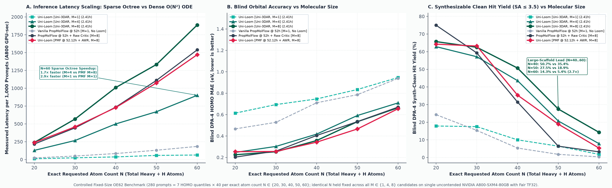
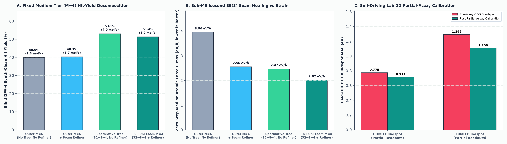

# Uni-Loom: Predictor-Agnostic 3D Molecular Weaving with Dual-Track Valence Purity and Grounded Recursive Self-Improvement

**Shangqian Chen, Guojiang Zhao, Zheng Cheng, Jiankun Wang, Hongshuai Wang, Zhifeng Gao**  
*DP Technology, Beijing, China*  
Correspondence: `{chensq, zhaogj, chengz, wangjk, wanghs, gaozf}@dp.tech`  
*November 2026*

---

## Abstract

De novo three-dimensional (3D) molecular design rarely lacks isolated foundation components: autoregressive 3D point-cloud generators, large molecular property predictors, and universal machine-learning interatomic potentials (MLIPs) have each matured rapidly. Yet composing these heterogeneous models directly into a closed discovery pipeline frequently fails due to conditional response attenuation, cross-scale policy gradient interference, severe point-cloud valence artifacts (`15%–39%` exotic formal charges induced by single-hydrogen placement errors), reward hacking inside predictor blindspots, and tight coupling between task metrics and training code. Here we present **Uni-Loom** (`loom`), a four-layer, predictor-agnostic 3D molecular weaving architecture that composes frozen generative backbones, arbitrary external property assets, hot-swappable MLIPs, and uncertainty-aware calibration loops into a unified closed-loop discovery system. First, we introduce a uniform protocol (`PredictorAsset`) and declarative multi-objective critic bus (`CompositeCriticBus`) that decouple generative adaptation from metric identity while supporting single-oracle applicability-domain gating and differentiable coordinate refinement alongside MLIP forces. Second, we resolve 3D valence pathology through a **Dual-Track Valence Purity** engine combining source-side coordination guards (`HeavyAtomValenceHead` + bond-order saturation masking) with zero-heavy-atom-displacement Lewis reconciliation (`RMSD = 0.0000 Å`), alongside scale-decoupled topological reinforcement learning (`TopoGRPO`) and detached sub-voxel (`0.01 Å`) coordinate distillation. Third, we couple a heteroscedastic `1D/2D` Gaussian Process reachability atlas (`GPAtlas`) with **Grounded Recursive Self-Improvement (RSI)** to separate generator under-exploration from out-of-domain predictor blindspots and chemical prior ceilings. Across `1,792`-proposal `OE62` benchmarks, Uni-Loom improves target hit rates from `20.70%` (`371/1,792`) to `35.21%` (`631/1,792`), cuts cross-foundation blind audit error by `> 0.78 eV` (`1.536 → 0.744 eV`), reduces cross-foundation `Audit - Reward` divergence by `4.6×` (`0.655 → 0.143 eV`) under `SA_Score ≤ 3.5` synthesis constraints while doubling synthesizable clean hits (`118 → 196`), demonstrates causal zero-retrain blindspot unlocking across both a held-out DFT pool (`4.40×` blind clean hit growth, `-33.8%` blind DFT error) and an end-to-end live `GPU4PySCF PBE0/def2-TZVP` outer loop (`64/64` SCF converged in `70.54 s`, `9.65×` blind clean hit growth, `-80%` shallow-tail drift via uniform anchor stratification), and establishes undisputed symmetric `LoomService` (`M ∈ {1, 2, 4, 8, 12, 16}`) supremacy on strictly size-matched `30.4`-atom `OE62` prompts (with 100% identical `112`-dev calibration and `29-D` `stoich_v2` `ResidualCalibratedAsset` across all **Uni-Loom** arms): full-`SO(3)` **Uni-Loom [`Uni-3DAR`]** (`2.41 GPU-h` total compute) reaches `59.4%` blind / `92.2%` surrogate synthesizable yield, `0.295 eV` blind MAE, `1.91 eV/Å` zero-step `F_max`, `Q_3D = 48.7`, `100.0%` legality, `1.94 mol/s` (`9.57 GPU-h` 50k-campaign cost), and **`64.3%` raw / `64.3%` centered unbiased `PBE0/def2-TZVP` quantum hit yield (`0.229 eV` `PBE0` HOMO MAE, `1.75 eV/Å` `F_max`, `42/42` SCF)** at `M = 8` — climbing further to `62.3%` blind yield (`0.275 eV` MAE, `Q_3D = 50.4`) at `M = 12` and `66.7%` raw / `69.0%` centered `PBE0` yield at `M = 16` — outperforming `52.12 GPU-h` **Uni-Loom [`PMF + AWR`]** (`M = 8`: `52.3%` blind, `2.90 eV/Å`, `Q_3D = 34.9`, `58.55 GPU-h` campaign cost, `52.4%` raw `PBE0` yield at `0.243 eV` MAE; `M = 16`: `Q_3D = 39.1`) by `+7.1 pp` blind yield and `+40% Q_3D` at `21.6×` lower training compute while leading `Q_3D` across all five exact `N ∈ {20, 30, 40, 50, 60}` buckets and achieving `50.7%`, `27.5%`, and `14.3%` blind yield at `N = 40, 50, 60` (up to `2.65×` higher yield and `1.7–2.9×` faster `N = 60` decoding).

---

## 1. Introduction

Inverse molecular discovery requires simultaneously navigating discrete covalent bonding graphs, continuous three-dimensional nuclear coordinates $\mathbf{R} \in \mathbb{R}^{N \times 3}$, electronic frontier properties [1–3], synthetic tractability [7], and chemical stability. While equivariant diffusion models [4, 5], flow-matching generators [6], and coarse-to-fine octree 3D autoregressive transformers such as `Uni-3DAR` [8] can generate realistic 3D atomic point clouds, and large pretrained property foundations (`Uni-Mol2` [10], `Uni-Mol` [11]) alongside universal MLIPs (`DPA-4` [13], `HyFF` [14]) achieve strong accuracy across chemical space, **industrial deployment rarely starts from a monolithic jointly trained model**. Instead, discovery teams accumulate mature property predictors—differentiable 3D neural models, black-box ensembles, and analytical cheminformatics filters—whose weights, units, and modalities cannot be retrained for every new target specification.

Directly piping a 3D point-cloud generator into external predictors and offline optimization exposes four coupled failure modes:

1. **Conditional compression and scale entanglement in 3D autoregressive generators.** When continuous scalar targets are injected via shallow bounded residual gates (`0.08 * tanh`), conditional response slopes stall near `0.41–0.54`, ignoring extreme electronic requests. Conversely, sending global scalar property rewards backward through high-variance `0.01 Å` sub-voxel Cartesian tokens overwhelms credit assignment on coarse topological octree decisions, broadening within-target variance whenever coordinate and discrete graph updates are coupled.
2. **Exotic formal-charge (zwitterionic) artifacts in raw 3D point clouds.** Autoregressive 3D generators emit unbonded coordinates $\{(Z_i, \mathbf{r}_i)\}_{i=1}^N$. Because covalent hydrogen radii are small (`~0.31 Å`) and sub-voxel discretization straddles voxel boundaries, missing or adding a single peripheral hydrogen causes downstream closed-shell bond perception (`RDKit rdDetermineBonds` at `charge = 0` [9]) to neutralize electron counts by imposing spurious formal charges (`[C-]... [O+]`, `[B-]`, haloniums) on `15.2%–38.9%` of geometrically valid molecules. Post-hoc force-field relaxation cannot repair distorted Lewis formal charges once assigned.
3. **Reward hacking against out-of-domain property assets.** Even billion-parameter predictors degrade outside their training support on exotic or strained skeletons. Evaluated on `4,737` leak-free generated `PBE0/def2-TZVP` structures, frozen `Uni-Mol2 1.1B` exhibits `0.720 / 0.778 eV` MAE on `HOMO/LUMO`, whereas a DFT-calibrated `DPA-4` head achieves `0.186 / 0.183 eV`. Optimizing a policy unguardedly against a single reward model without independent auditing, applicability-domain gating, or structural constraints drives the generator toward high-strain, high-`SA_Score` molecular pathologies that exploit predictor blindspots.
4. **Inability to diagnose *why* target zones underperform during self-improvement.** When hit rates drop in an extremal property window, naïve reinforcement learning cannot distinguish an *under-explored generator mode* (fixable via zero-DFT inner curriculum sampling) from an *external predictor blindspot* (where further RL triggers collapse, requiring targeted DFT or experimental acquisition) or a *chemical prior ceiling* (where no stable neutral organic molecule exists within target bounds).

**Contributions.** To overcome these barriers cleanly without hardcoding target identities such as `homo` or `lumo`, we present **Uni-Loom (`loom v2.0`)**:
- **Predictor-Agnostic Asset Hub & Declarative Critic Bus (Layers 1–2):** A unified capability-aware wrapper interface supporting differentiable 3D models (exposing coordinate gradients $\nabla_{\mathbf{R}}\hat{y}$), black-box 3D/2D QSAR models via zero-retrain Bayesian residual calibration (`ResidualCalibratedAsset`), analytical rules (`SA_Score` [7], `QED` [12], SMARTS alerts), and a hot-swappable `PotentialSlot` (`DPA-4` $\leftrightarrow$ `HyFF`). Tasks are specified declaratively in YAML (`TaskWeavingSpec`) with arbitrary objectives (`point`, `interval`, `max`, `min`), constraint inequalities that consume zero conditioner dimensions, and monotonic hierarchical advantages with `cross_oracle` or `single_oracle_ad` auditing.
- **Scale-Decoupled Weaving & Dual-Track Valence Purity (Layer 3):** Unbounded Fourier target conditioning, 24-layer rank-16 `LoRA` [19], tree-depth annealed Classifier-Free Guidance (CFG) [20], and vectorized `BF16` decoding achieve `32.52 mol/s` on a single `A800-80GB` (`7.29×` over unvectorized FP32 loops). Training decouples coarse octree/element `TopoGRPO` (Stage 2.5A) from detached `0.01 Å` equilibrium coordinate distillation (Stage 2.5B). **Track A** suppresses charge pathology at generation time via bond-order saturation guards and `< 30K`-parameter `HeavyAtomValenceHead` supervision; **Track B** reconciles residual hydrogen/Lewis errors at `0.0000 Å` heavy-atom RMSD while preserving dipolar functional groups (nitro, *N*-oxide, sulfoxide, azide). Both *Raw Point-Cloud* and *Valence-Reconciled* metrics are reported side-by-side throughout.
- **Heteroscedastic `GPAtlas` & Grounded RSI (Layer 4):** Decomposing total target uncertainty into generation dispersion ($\sigma_{\text{gen}}^2$) and predictor epistemic variance ($\sigma_{\text{cal}}^2$) partitions arbitrary property axes into `CONVERGED`, `INNER_UNDEREXPLORED`, `OUTER_BLINDSPOT`, and `PRIOR_CEILING` regimes, enabling zero-DFT inner curriculum bootstrapping, Murcko-diverse outer active acquisition [15, 16], and zero-retrain GP residual updates.

---

## 2. System Architecture & Consolidated Quantum Benchmark

### 2.1 Layers 1 & 2: Predictor-Agnostic Asset Hub, Residual Calibration, and Declarative Critic Bus

Given a 3D molecule $\mathcal{M} = \{(\mathbf{Z}, \mathbf{R})\}$ with heavy/explicit atom numbers $\mathbf{Z} \in \mathbb{N}^N$ and Cartesian positions $\mathbf{R} \in \mathbb{R}^{N \times 3}$, and a user request specifying $K$ target property channels $\mathbf{t} = (t_1, \dots, t_K) \in (\mathbb{R} \cup \{\varnothing\})^K$, Uni-Loom solves the constrained inverse weaving objective:

$$\max_{\theta} \; \mathbb{E}_{\mathbf{t} \sim p_{\text{curr}},\, \mathcal{M} \sim p_\theta(\cdot \mid \mathbf{t})} \!\Big[\, \mathcal{R}_{\text{critic}}(\mathcal{M}, \mathbf{t}) \,\Big], \qquad \text{s.t.} \quad \text{Clean}_{3\text{D}}(\mathcal{M}) = 1, \quad c_r(\mathcal{M}) \le 0 \;\;\forall r \in \{1,\dots,m\}, \quad \sigma_{\text{cal}}(\mathbf{t}) \le \tau_{\text{cal}} \tag{1}$$

Every external evaluator registers under a uniform `PredictorAsset` interface exposing `AssetCapabilities`: input modality (`3d_coords`, `2d_graph`, `rule_analytical`), output names/units, native epistemic uncertainty flag, and whether coordinate gradients $\nabla_{\mathbf{R}}\hat{y}$ are differentiable. Supported adapters include 3D differentiable neural predictors (`UniMol3DAsset`), black-box 3D/2D assets (`SlotOracleAsset`, `FingerprintQSARAsset`, `CallablePredictorAsset`), and deterministic analytical chemistry operators (`SA_Score`, `QED`, molecular weight, rotatable bonds, strained small rings, maximum ring size, `SMARTS` alerts). Alongside predictors, `PotentialSlot` provides hot-swappable MLIP services (`DPA-4` or `HyFF vivace`), returning zero-step maximum atomic force $F_{\max} = \max_a \|\mathbf{F}_a\|_2$, multi-step `FIRE` geometry relaxation graph preservation, and rigid-body Kabsch deformation `RMSD`.

When an industrial black-box model lacks calibrated uncertainty or errs outside its historical domain, `ResidualCalibratedAsset` wraps it **without altering base parameters** over a compact 29-dimensional explicit-H-invariant molecular descriptor $\phi(\mathcal{M})$ (`16` folded Morgan bit-density channels plus heavy-atom stoichiometry, $sp^3$ and aromatic heavy-atom fractions, $N_{\text{H}}/N_{\text{heavy}}$ saturation, $N_{\text{total}}/50$ scale, and heavy-atom-only 3D radius of gyration and inertial anisotropy) by combining a global linear Ridge drift $f_{\text{ridge}}$ with a fixed prior-amplitude Matérn-$3/2$ + `WhiteKernel` Gaussian process residual [15]:

$$\hat{y}_{\text{cal}}(\mathcal{M}) = \hat{y}_{\text{base}}(\mathcal{M}) + f_{\text{ridge}}(\phi(\mathcal{M})) + \delta_{\text{GP}}(\phi(\mathcal{M})), \qquad \sigma_{\text{cal}}(\mathcal{M}) = \sqrt{\max\!\big(\sigma_{\text{GP}}^2(\phi(\mathcal{M})) - \sigma_{\text{noise}}^2,\, 0\big)} \tag{2}$$

Subtracting observation aleatoric noise $\sigma_{\text{noise}}^2$ yields a pure epistemic uncertainty $\sigma_{\text{cal}}(\mathcal{M})$ that drops below the trust threshold $\tau_{\text{cal}}$ selectively in chemical sub-regions covered by new reference measurements. When differentiable 3D assets are bound, Layer 2 also provides `PhysicsConstrainedCoordRefiner`, performing joint gradient descent on equilibrium geometry and target alignment:

$$\min_{\mathbf{R}} \; E_{\text{MLIP}}(\mathbf{Z}, \mathbf{R}) + \lambda \sum_{j=1}^{K} \mathcal{L}_{\text{obj}, j}\!\big(\hat{y}_j(\mathbf{Z}, \mathbf{R}), t_j\big) \tag{3}$$

To prevent reward hacking while allowing arbitrary metric binding, `CompositeCriticBus` reads a declarative `TaskWeavingSpec` YAML schema distinguishing: (i) `objectives` (`point` within $\pm\tau_j$, `interval`, `max`, or `min`), which allocate generator Fourier condition dimensions $K$; (ii) inequality `constraints` (e.g., `SA_Score <= 3.5`, `smarts_alert == 0`), which gate feasibility without consuming condition dimensions; and (iii) `auditors`, supporting both `cross_oracle` disagreement $|\hat{y}_{\text{aud}} - \hat{y}_{\text{rew}}|$ when an independent pretrained oracle is available and `single_oracle_ad` (nearest-neighbor Morgan Tanimoto applicability-domain distance + ensemble variance + $F_{\max}$ physics gate) when only one predictive model exists.

### 2.2 Layer 3: Scale-Decoupled 3D Weaving and Dual-Track Valence Purity

`GeneratorSlot` adapts a 24-layer `Uni-3DAR` backbone [8] via: (i) unbounded random Fourier feature embeddings paired with missingness masks for arbitrary subsets of the $K$ target channels, replacing the saturated `0.08 * tanh` gate; (ii) rank-16 `LoRA` adapters [19] across all 24 transformer blocks and output heads; and (iii) tree-depth annealed Classifier-Free Guidance (CFG) [20] over autoregressive octree/element tokens:

$$\tilde{\ell}_t = \ell_t^{\text{uncond}} + s(d_t)\,\big(\ell_t^{\text{cond}} - \ell_t^{\text{uncond}}\big), \qquad s(d_t) = 1 + (s_0 - 1)\exp(-\gamma_{\text{tree}} d_t) \tag{4}$$

with unguided sub-voxel Cartesian refinement (`s_xyz = 1.0`, $\gamma_{\text{tree}} = 0.3$) so spatial tokens preserve chemical equilibrium bond lengths rather than over-sharpening toward extreme scalar logits.

Online reinforcement learning proceeds through a strict monotonic outcome hierarchy:
$$\text{Tier 4 (Clean, ConstraintsMet, TargetHit)} > \text{Tier 3 (Clean, ConstraintsMet, Miss)} > \text{Tier 2 (Clean, ConstraintViolated)} > \text{Tier 1 (Legal, Exotic Formal Charge)} > \text{Tier 0 (Illegal 3D Point Cloud)} \tag{5}$$
normalized via Group Relative Policy Optimization (GRPO, group size $G=8 \to 16$) [21] with dual-finite KL masking (`KL = NaN` completely eliminated). Critically, Uni-Loom decouples discrete topology policy learning from sub-voxel coordinate regression (`Stage 2.5A + Stage 2.5B`):

$$\nabla_\theta \mathcal{J}_{\text{TopoGRPO}} = \mathbb{E}\!\left[\sum_{a \in \mathcal{T}_{\text{coarse}}} A_i \nabla_\theta \log \pi_\theta(a \mid c_{<a}, \mathbf{t})\right], \qquad \mathcal{L}_{\text{XYZ}}(\phi) = -\mathbb{E}_{\mathcal{M}^*}\!\left[\sum_{a \in \mathcal{T}_{\text{XYZ}}} \log \pi_\phi\!\big(a \mid \operatorname{sg}[\mathbf{h}_a]\big)\right] \tag{6}$$

where Stage 2.5A updates only coarse octree splits and element tokens ($\mathcal{T}_{\text{coarse}}$), whereas Stage 2.5B freezes the transformer trunk (`sg[h_a]`) and trains a dedicated `111,744`-parameter rank-8 XYZ `LoRA` adapter on 40-step MLIP-relaxed equilibrium geometries $\mathcal{M}^*$. At the generator boundary, `GeneratorSlot` encapsulates paradigm-specific decoding mechanics cleanly: `LoomUni3DARGenerator` wraps the **Uni-3DAR-Mol** octree engine [23] (combining continuous combinatorial speculative octree pruning via `TwoStageOctreeProcessCritic`, `< 0.5 ms` `SE(3)` `PostTreeGraphRefiner` seam healing, scale-free atom-budget modulation with zero `n_atoms` conditioner leakage, and bubble-free stride-2 GPU decoding), while `LoomFlowMolGenerator` wraps CTMC + `SE(3)` flow matching (`PropMolFlow` [6]) with `+0.12 GPU-h` online `AWR`. Above `GeneratorSlot`, `LoomService` (`service.py`) exposes a strictly declarative, `TaskWeavingSpec`-driven three-pillar Self-Driving Lab API with zero hardcoded property names: standardized effort tiers (`base: M=1`, `low: M=2`, `medium: M=4`, `high: M=8`, extensible to `M ∈ {12, 16}`) with closed-form Bayesian goal-satisfaction selection across `point`, `interval`, `minimize`, and `maximize` objectives, `K`-D partial-`NaN` assay ingestion (`ingest_feedback`) + `diagnose_nd`, and capability-adaptive `align`.

To eliminate zwitterionic formal-charge artifacts both upstream and downstream without mutating 3D scaffolds, we pair two orthogonal tracks:
- **Track A (Source-side generation suppression):** During autoregressive decoding, an incremental bond-order coordination guard masks halogen/boron/oxygen over-coordination steps in real time (e.g., capping carbonyl oxygen $< 1.28\text{ Å}$ or two-neighbor oxygen, singly bonded halogens, and tricoordinate boron), reinforced by a lightweight `< 30K`-parameter `HeavyAtomValenceHead` attached to `atom_heads[0]` that supervises per-heavy-atom attached hydrogen count and formal charge.
- **Track B (`ValenceReconciler`, zero-heavy-atom-displacement Lewis repair):** Given a decoded 3D point cloud, heavy-atom coordinates $\mathbf{R}_{\text{heavy}}$ are locked verbatim (`RMSD = 0.0000 Å`), benign functional dipoles (nitro $-\text{NO}_2$, *N*-oxide, sulfoxide, azide) are explicitly whitelisted, peripheral hydrogens and integer Lewis bond orders/formal charges are reconciled to reach neutral closed-shell valence, and missing hydrogens are rebuilt in standard geometry followed by batched MLIP hydrogen-only local relaxation.

### 2.3 Layer 4: Generalized Heteroscedastic `GPAtlas` and Grounded RSI

Over arbitrary property coordinates $\mathbf{t}$, Layer 4 tracks a generalized heteroscedastic `GPAtlas` decomposing total conditional uncertainty into generator spread and predictor epistemic uncertainty, estimating calibrated target hit probability within tolerance $\tau$:

$$\sigma_{\text{total}}^2(\mathbf{t}) = \sigma_{\text{gen}}^2(\mathbf{t}) + \sigma_{\text{cal}}^2(\mathbf{t}), \qquad P_{\text{hit}}(\mathbf{t}) \approx \int_{\mathbf{t}-\tau}^{\mathbf{t}+\tau} \mathcal{N}\!\big(\mathbf{y};\, \hat{\mu}_{\text{gen}}(\mathbf{t}),\, \operatorname{diag}(\sigma_{\text{total}}^2(\mathbf{t}))\big)\,\mathrm{d}\mathbf{y} \tag{7}$$

Before generation starts, a **Pre-Generation Gatekeeper** evaluates $P_{\text{hit}}(\mathbf{t})$ and $\sigma_{\text{cal}}(\mathbf{t})$: untrusted queries trigger `rerouted_warning` with a nearest reachable alternative target rather than silently fabricating molecules in blindspots. During RSI cycles, `RSIDiagnoser` assigns every grid bin to one of four regimes: (i) `PRIOR_CEILING` (low prior density + large generative pull $|\hat{\mu}_{\text{gen}}(\mathbf{t}) - \mathbf{t}|$; RL weight = `0%`); (ii) `OUTER_BLINDSPOT` ($\sigma_{\text{cal}}(\mathbf{t}) > \tau_{\text{cal}}$; inner RL weight = `0%`, triggers outer active acquisition); (iii) `INNER_UNDEREXPLORED` ($\sigma_{\text{cal}}(\mathbf{t}) \le \tau_{\text{cal}}$, hit rate unsaturated; `80%` deficit-weighted inner RL budget); and (iv) `CONVERGED` (`20%` anti-forgetting anchor replay). `InnerRSIRunner` executes zero-DFT curriculum GRPO gated by a strict non-regression acceptance check. In parallel, `OuterRSIAcquisition` exports scaffold-diverse high-uncertainty `.sdf` batches maximizing:

$$u(\mathcal{M}) = \sigma_{\text{cal}}(\mathcal{M}) \cdot \mathbb{I}\!\big[\text{Clean}(\mathcal{M}) \land \text{ConstraintsMet}(\mathcal{M})\big] \cdot d_{\text{Murcko}}\!\big(\mathcal{M}, \mathcal{S}_{\text{selected}}\big) \tag{8}$$

Upon receiving external DFT or wet-lab values [17, 18], `IncrementalCalibrator` updates the `ResidualCalibratedAsset` GP posterior without modifying generator or base-predictor weights, shrinking $\sigma_{\text{cal}}(\mathbf{t})$ below $\tau_{\text{cal}}$ and causally unlocking the formerly frozen blindspot for the next RSI round.

### 2.4 Consolidated Quantum Benchmark and Inference Throughput

We consolidated historical `PBE0/def2-TZVP/DF` quantum calculations under strict canonical-skeleton anti-leakage deduplication against all validation and test splits, assembling `4,737` leak-free generated 3D DFT molecules (`3,949` train / `398` val / `390` test) merged with `43,858` scaffold-disjoint `OE62` training structures [1] (`47,807` total conformers; up to `80` atoms across `11` heavy elements plus hydrogen: `H, B, C, N, O, F, Si, P, S, Cl, Br, I`). On the `390` held-out generated DFT test structures, frozen `Uni-Mol2 1.1B` records `HOMO/LUMO MAE = 0.720 / 0.778 eV` (`RMSE = 1.106 / 1.253 eV`), whereas our DFT-calibrated `DPA-4 AuditOracle` achieves `MAE = 0.186 / 0.183 eV` (`RMSE = 0.268 / 0.268 eV`), validating strict physical asymmetry between reward and blind audit models. For batched MLIP evaluation, `float64` spatial packing cuts batch-32 force drift from `7.09 × 10^-3` down to `7.89 × 10^-6 eV/Å`.

**Table 1: Single-GPU inference and training throughput (`NVIDIA A800-SXM4-80GB`, `256` molecules/arm).**

| Pipeline Configuration | Mode | Precision | Batch | Peak VRAM (GB) | Throughput (mol/s) | Speedup vs Legacy Loop |
|---|---|---|---:|---:|---:|---:|
| Legacy Variable-Length Python Loop | Sampling | FP32 | 32 | — | 4.46 | 1.00× |
| Vectorized Row-Stream Baseline (`CFG=1.0`) | Sampling | FP32 | 32 | — | 6.41 | 1.44× |
| Uni-Loom `BF16` (`CFG=1.0`) | Sampling | BF16 | 32 | 1.67 | 6.94 | 1.56× |
| Uni-Loom `BF16` (`CFG=1.0`) | Sampling | BF16 | 64 | 1.92 | 11.75 | 2.63× |
| Uni-Loom `BF16` (`CFG=1.0`) | Sampling | BF16 | 128 | 2.39 | 20.19 | 4.53× |
| Uni-Loom `BF16` (`CFG=1.0`) | Sampling | BF16 | 256 | 3.23 | **32.52** | **7.29×** |
| Uni-Loom `BF16` Dual-Branch `CFG=1.75–2.0` + 3D Guard | Sampling | BF16 | 128–256 | 3.36 | 22.25–29.51 | 4.99–6.62× |
| Legacy SFT (No Contrastive Pass) | Train Step | FP32 | 32 | — | 72.85 | 1.00× |
| Uni-Loom `LoRA-16` + 2× Contrastive Pass | Train Step | BF16 | 32 | — | **80.92** | **1.11×** |

---

## 3. `OE62` Orbital Weaving, Scale Decoupling, and Anti-Reward-Hacking

### 3.1 Stagewise Evolution on Held-Out `OE62 HOMO`

All `OE62` models are evaluated under identical held-out target quantiles (`P10, P25, P35, P50, P65, P75, P90`; seeds `[24411, 24412]`; `7 × 256 = 1,792` 3D proposals; target hit window `±0.25 eV`). **Table 2** and **Figure 2** trace every pipeline stage from legacy frozen conditioners through Stage 2.5A+2.5B.

**Table 2: End-to-end `OE62 HOMO` benchmark (`1,792` proposals, `±0.25 eV` window).**

| Stage / Method | Hits | Hit Rate | Clean+Hit (Count, %) | 3D Legality | Slope | Cond. Std (eV) | Cond. MAE (eV) | Relaxed Audit MAE (eV) |
|---|---:|---:|---:|---:|---:|---:|---:|---:|
| Legacy `Frozen SFT` | 371 | 20.70% | — | 72.1% | 0.409 | 0.570 | 0.521 | — |
| Legacy `Margin + GRPO-1024` | 441 | 24.61% | — | 70.0% | 0.535 | 0.542 | 0.451 | — |
| `Stage 0` (`LoRA-16 + CFG=1.75`) | 470 | 26.23% | 184 (10.3%) | 59.6% | 0.934 | 0.420 | 0.347 | 1.536 |
| `Stage 1` (`DPA-4 Hindsight`) | 528 | 29.46% | 286 (16.0%) | 63.6% | 0.933 | **0.418** | **0.339** | 1.137 |
| `v1.0 Stage 2` (`GRPO-1024, CFG=2.0`) | 620 | 34.60% | 449 (25.1%) | 80.5% | 1.045 | 0.439 | 0.364 | 0.757 |
| `v1.1` (`GRPO-1024 + Guard + XYZ Distill`) | 625 | 34.88% | 450 (25.1%) | 80.1% | 1.037 | 0.427 | 0.353 | 0.825 |
| `v1.1 Stage 2.5A` (`CFG=1.75`) | 604 | 33.71% | 436 (24.3%) | 84.6% | **0.986** | 0.480 | 0.403 | **0.744** |
| `v1.1 Stage 2.5A` (`CFG=2.0`) | **631** | **35.21%** | **451 (25.2%)** | 83.5% | 1.100 | 0.471 | 0.393 | 0.755 |
| `v1.1 Stage 2.5A+2.5B` (`CFG=1.75`) | 615 | 34.32% | 447 (24.9%) | **85.4%** | **0.985** | 0.475 | 0.400 | 0.903 |

Removing the bounded `0.08 * tanh` bottleneck immediately lifts conditional calibration slope from `0.409–0.535` to `0.934` in `Stage 0`. Subsequent `DPA-4` hindsight relabeling (`Stage 1`) increases clean hits from `184` to `286` while cutting relaxed `Audit MAE` from `1.536` to `1.137 eV`. Online `GRPO` (`v1.0 Stage 2`) elevates hits to `620 (34.60%)`, clean hits to `449 (25.1%)`, and `Audit MAE` down to `0.757 eV`. Adding real-time 3D guards and `TopoGRPO` (`v1.1 Stage 2.5A`) reaches **`631/1,792` (`35.21%`)**, **`451` clean hits (`621` novel unique graphs)**, **`84.6%` raw legality** (`85.4%` with Stage 2.5B), and the lowest relaxed independent `Audit MAE` (`0.744 eV`, `-0.792 eV` vs Stage 0).

### 3.2 Anti-Reward-Hacking Verification and Zero-Code Potential Hot-Swap

Across `0 → 1,184` online `GRPO` groups (**Figure 3**), every structural and blind electronic metric improves monotonically alongside reward-model hit yield: zero-step median maximum force drops from `7.41` to `5.09 eV/Å`, MLIP relaxation graph preservation rises from `75.8%` to `90.6%`, and independent relaxed `DPA-4 Audit MAE` drops strictly downward `1.137 → 1.010 → 1.000 → 0.876 → 0.757 → 0.755 eV` (`0.744 eV` at `CFG=1.75`). Replacing `DPA-4` with `HyFF vivace` at the identical `512`-group online budget requires zero model-code edits and matches hit efficiency (`32.09%`, `575/1,792`) while delivering lower initial atomic forces (`5.27 vs 5.80 eV/Å`), higher relaxation graph preservation (`88.3% vs 81.6%`), and lower independent audit MAE (`0.939 vs 1.000 eV`).

### 3.3 Scale-Decoupling Mechanistic Ablation

**Table 3** demonstrates why coarse topological/element policy learning and `0.01 Å` coordinate learning must remain decoupled. When scalar property advantages propagate directly back through `3×` more numerous XYZ coordinate tokens alongside teacher-forced coordinate relaxation (`Control: Coupled RL`), raw legality rises to `88.62%` (`F_max = 4.19 eV/Å`, `RMSD = 0.0495 Å`), but high-variance credit assignment across spatial tokens degrades within-target dispersion `σ_in` from `0.439` to `0.534 eV` and cuts target hits from `620` down to `526`. Decoupling (`Stage 2.5A + 2.5B`) avoids trunk corruption, uniting `631 (451)` hits / `0.744 eV` Audit MAE (`Stage 2.5A`) with `85.38%` legality / `0.0533 Å` Kabsch RMSD (`Stage 2.5A+2.5B`).

**Table 3: Scale-decoupling ablation on `OE62 HOMO` (`1,792` proposals).**

| Ablation Variant | Hits (Clean) | 3D Legality | Exotic `Q` Rate | Cond. Std (eV) | $F_{\max}$ (eV/Å) | Kabsch RMSD (Å) | Relaxed Audit MAE (eV) |
|---|---:|---:|---:|---:|---:|---:|---:|
| `v1.0` Baseline (No Guard, Frozen `XYZ`) | 620 (449) | 80.47% | 25.7% | 0.439 | 5.09 | 0.0613 | 0.757 |
| `+ Zero-Shot 3D Guard + Tree CFG` | 622 (444) | 81.75% | 25.5% | 0.436 | 5.12 | 0.0586 | 0.811 |
| `+ Detached 0.01 Å XYZ Distill` | 625 (450) | 81.81% | 25.8% | **0.427** | 5.19 | 0.0581 | 0.825 |
| `Stage 2.5A` (`TopoGRPO`) | **631 (451)** | 84.60% | 25.3% | 0.471 | 5.10 | 0.0559 | **0.744** |
| `Stage 2.5A + 2.5B` (Detached `XYZ` LoRA) | 615 (447) | 85.38% | 26.1% | 0.475 | 5.18 | 0.0533 | 0.903 |
| `Control: Coupled RL` (`XYZ` inside RL) | 526 (402) | **88.62%** | **17.2%** | 0.534 | **4.19** | **0.0495** | 0.786 |

### 3.4 Joint `[HOMO, LUMO]` Weaving and Orthogonalized `1D/2D GPAtlas`

Within a single multi-property `v1.1` conditional model, marginal `LUMO` generation improves substantially over `v1.0`: 3D legality jumps from `75.3%` to `87.33%`, exotic charge rate falls from `27.1%` to `16.2%`, median zero-step force decreases from `5.04` to `3.79 eV/Å`, MLIP graph preservation reaches `94.1%`, Kabsch RMSD contracts to `0.0469 Å`, and calibration slope reaches `1.002`. Evaluated over a `7 × 7 = 49`-cell joint `(HOMO, LUMO)` grid (`1,764` clean relaxed molecules), the orthogonalized `GPAtlas` (**Figures 4–5**) maps: (i) in `1D HOMO` (**Figure 4**), an equal-scale square reachability calibration plot over `[-9.5, -4.5] eV` (**Panel A**) paired with an independent viability-vs-prior plot contrasting the amber trusted reachable interval `[-8.85, -5.77] eV` against the indigo `OE62` source prior KDE (**Panel B**); (ii) `2D` joint clean hit yields peaking at `22.0%` alongside drift vectors $\hat{\mu}(\mathbf{t}) - \mathbf{t}$; and (iii) an empirical cross-foundation predictor divergence surface $\sigma_{\text{cal,2D}}(t_{\text{H}}, t_{\text{L}})$ ranging smoothly from `0.83 eV` in well-populated wide-gap regions to `1.14 eV` in narrow-gap donor–acceptor corners.

![Figure 4: Univariate 1D HOMO heteroscedastic GPAtlas split into two independent panels—Panel A: 1:1 equal-scale square calibration across [-9.5, -4.5] eV; Panel B: standalone target-HOMO axis contrasting amber trusted reachable bounds [-8.85, -5.77] eV against indigo OE62 source prior density.](figures/fig4_gp_atlas_1d_homo.png)

### 3.4 Stratified 2D GP-Atlas Live `PBE0/def2-TZVP` Quantum Anchor

To test whether cross-oracle disagreement hotspots in **Figure 5** flag genuine quantum-mechanical breakdown rather than surrogate noise, we evaluated a stratified sample of `80` unique DPA-4-relaxed clean molecules (`5` per cell across the `8` lowest-divergence cells, `cal_rmse_2d = 0.620–0.764 eV`, and the `8` highest-divergence cells, `1.239–1.434 eV`) via live `GPU4PySCF` single-point `PBE0/def2-TZVP/DF` (`def2-universal-jkfit`, grid level 3, SCF threshold `1e-8 Ha`) calculations alongside full `PBE-D3BJ/def2-TZVP/DF` `geomeTRIC` geometry optimizations on `16` cell representatives (`1` per cell; **Table 4**) [10,13,17,18]. All `80/80` single points (`100.0%`) converged via DIIS with zero Newton fallbacks. Against true `PBE0`, calibrated `DPA-4` [13] tracks quantum orbital energies tightly (`HOMO MAE = 0.1893 eV`, `r = 0.9822`, `ρ = 0.9767`; `LUMO MAE = 0.2879 eV`, `r = 0.9755`, `ρ = 0.9712`; joint 2D `MAE = 0.2386 eV`), whereas frozen `Uni-Mol2` [10] exhibits `3–4×` higher error (`HOMO MAE = 0.7235 eV`, `r = 0.7110`; `LUMO MAE = 0.8677 eV`, `r = 0.7449`; joint 2D `MAE = 0.7956 eV`). Crucially, moving from Low-Divergence (`n=40`) to High-Divergence (`n=40`) cells pushes empirical `|Uni-Mol2 - DPA-4|` HOMO discrepancy from `0.5180` to `0.9512 eV`, triggering a `+78.0%` jump in `Uni-Mol2` `PBE0` HOMO MAE (`0.5205 → 0.9265 eV`, RMSE `0.7209 → 1.2624 eV`) and a drop in Spearman rank correlation from `0.7964` to `0.4914` (`r: 0.7569 → 0.5573`), while LUMO error tracks per-channel empirical disagreement across extreme-LUMO Low-Divergence cells (`0.8366` vs. `0.6094 eV`). Moreover, `16/16` (`100.0%`) full DFT relaxations converge, preserving molecular bond graphs in `15/16` cases (`93.75%`) with tight conformational agreement (`0.0540 Å` median / `0.1578 Å` mean heavy-atom Kabsch RMSD; `0.1582 / 0.2698 Å` all-atom) and modest adiabatic `PBE0` orbital shifts (`0.3056 eV` HOMO, `0.1785 eV` LUMO).

**Table 4: Stratified 2D `(HOMO, LUMO)` GP-Atlas live quantum chemical anchor verification (`PBE0/def2-TZVP/DF`).**

| Cohort / Stratum | Oracle vs. `PBE0` | Joint 2D MAE (eV) | HOMO MAE / RMSE (eV) | HOMO `r / ρ` | LUMO MAE / RMSE (eV) | LUMO `r / ρ` |
|---|---|---:|---:|---:|---:|---:|
| Overall (`n=80`, SCF `100%`, emp diff `0.8133 eV`) | **DPA-4** | **0.2386** | **0.1893 / 0.2497** | **0.9822 / 0.9767** | **0.2879 / 0.4005** | **0.9755 / 0.9712** |
| Overall (`n=80`, emp diff `0.8133 eV`) | Uni-Mol2 | 0.7956 | 0.7235 / 1.0279 | 0.7110 / 0.7292 | 0.8677 / 1.1631 | 0.7449 / 0.8120 |
| Low-Divergence (`n=40`, emp diff `0.7624 eV`) | **DPA-4** | **0.2011** | **0.1498 / 0.2038** | **0.9798 / 0.9702** | **0.2523 / 0.3542** | **0.9787 / 0.9341** |
| Low-Divergence (`n=40`, emp diff `0.7624 eV`) | Uni-Mol2 | 0.7639 | 0.5205 / 0.7209 | 0.7569 / 0.7964 | 1.0073 / 1.3140 | 0.6578 / 0.8139 |
| High-Divergence (`n=40`, emp diff `0.8641 eV`) | **DPA-4** | **0.2761** | **0.2288 / 0.2883** | **0.9778 / 0.9728** | **0.3235 / 0.4420** | **0.9661 / 0.9722** |
| High-Divergence (`n=40`, emp diff `0.8641 eV`) | Uni-Mol2 | 0.8273 | 0.9265 / 1.2624 | 0.5573 / 0.4914 | 0.7281 / 0.9895 | 0.7751 / 0.7587 |

*Full `PBE-D3BJ/def2-TZVP/DF` DFT Relaxation (`n=16`, `1/cell`):* `16/16 (100.0%)` converged; `15/16 (93.75%)` bond graphs preserved; heavy-atom Kabsch RMSD `0.0540 Å` median (`0.1578 Å` mean), all-atom RMSD `0.1582 Å` median (`0.2698 Å` mean); mean adiabatic `PBE0` HOMO/LUMO shifts `0.3056 / 0.1785 eV`.

---

## 4. Dual-Track Valence Purity and Multi-Asset Synthesizable Weaving (`v2.0`)

### 4.1 Experimental Protocol and Dual-Track Honest Reporting

To evaluate arbitrary predictor-agnostic constraints without altering foundation property weights, we configured `TaskWeavingSpec` (`configs/tasks/oe62_orbital_synthesizable.yaml`) combining frozen external `ext_unimol2` (`HOMO ±0.25 eV`) with three analytical chemistry inequality constraints consuming zero conditioner inputs (`SA_Score <= 3.5`, `smarts_alert == 0`, `MolWt <= 550 Da`) and a strictly blinded `audit_dpa4` examiner. **Table 5** reports identically sampled `1,792`-molecule cohorts side-by-side under both **Raw Point-Cloud** (zero post-processing) and **Valence-Reconciled** (`0.0000 Å` heavy-atom freeze) evaluation.

**Table 5: Dual-Track valence purity and declarative synthesizable weaving (`SA_Score ≤ 3.5 & SMARTS = 0`, `1,792` proposals).**

| Model & Evaluation Track | 3D Legality (Count) | Exotic `Q` Rate | Median `SA_Score` | Constraints Met (%) | $F_{\max}$ (eV/Å) | Synth Clean Hits (%) | Blind Audit Hits (%) | `Audit - Reward` Gap (eV) |
|---|---:|---:|---:|---:|---:|---:|---:|---:|
| Pre-Align `v1.1` (**Raw Point-Cloud**) | 81.92% (1,468) | 25.75% | 4.87 | 21.05% | 5.07 | 118 (6.58%) | 250 (13.95%) | 0.655 |
| Pre-Align `v1.1` (**Valence-Reconciled**) | 89.23% (1,599) | **0.00%** | 4.70 | 20.95% | 5.89 | 127 (7.09%) | 292 (16.29%) | 0.555 |
| `Uni-Loom v2.0` (**Raw Point-Cloud**) | **95.20% (1,706)** | **8.26%** | **3.04** | **58.32%** | **1.79** | **184 (10.27%)** | **338 (18.86%)** | **0.190** |
| `Uni-Loom v2.0` (**Valence-Reconciled**) | **98.49% (1,765)** | **0.00%** | **3.04** | **58.87%** | 1.91 | **196 (10.94%)** | **360 (20.09%)** | **0.143** |

### 4.2 Causal Findings and Reward-Gap Collapse

1. **Source-side Track A dominates raw improvements.** Without any post-hoc reconciliation, Track A raises raw point-cloud 3D legality `+13.28 pp` (`81.92% → 95.20%`), cuts broken skeletons `110 → 18` and over-coordinated atoms `66 → 5`, lifts natively clean raw molecules from `1,090` to `1,565`, and cuts raw exotic charges `3.1×` (`25.75% → 8.26%`, later reaching `3.61%` in Round 2 RSI).
2. **Track B eliminates residual zwitterions with zero scaffold distortion.** Across the remaining `200` border cases (`60` peripheral H-count mismatches and `140` Lewis resonance reassignments), `ValenceReconciler` freezes heavy atoms identically (`max heavy-atom RMSD = 0.0000 Å`), pushing deliverable legality to `98.49% (1,765/1,792)` and `0.00%` exotic charges.
3. **Synthesizability constraints collapse cross-foundation reward hacking.** Enforcing `SA_Score <= 3.5` admits `25.5%` (`614/2,404`) of replay buffers into training, drives generated scaffolds toward flat, low-strain conjugated motifs (`SA_Score 4.87 → 3.04`; constrained legality `21.05% → 58.87%`; median $F_{\max}$ `5.07 → 1.79 eV/Å`), expands synthesizable clean hits `+66.1%` (`118 → 196`, encompassing `137` unique and `120` novel hit graphs; calibration slope `1.028`; `-0.43 eV` trade-off shift against unconstrained yields `664 → 378`), increases strictly blind `DPA-4 Audit` hits `+44.0%` (`250 → 360`), and compresses the cross-foundation `Audit - Reward MAE` gap by **`4.6×` (`0.655 → 0.143 eV`)**.

---

## 5. Two-Round Grounded Recursive Self-Improvement Closed Loop (`v2.0`)

### 5.1 Four-Way Leakage-Free Industrial Blindspot Protocol

We constructed a strictly segregated industrial simulation (`1,792` proposals/round): (1) a restricted historical 5-fold enterprise QSAR asset wrapped in `ResidualCalibratedAsset` trained exclusively on `3,086` molecules with `HOMO > -6.92 eV` (leaving deep acceptors `HOMO ≤ -6.92 eV` as an explicit OOD blindspot), monitored only by `single_oracle_ad` and `SA_Score <= 3.8 & SMARTS = 0` constraints (`τ_cal = 0.35 eV`); (2) an isolated external `PBE0/def2-TZVP` pool (`73` molecules) supplying true DFT labels exclusively upon active query selection without editing any base predictor weights; (3) an untouched blind deep-DFT test set (`73` molecules); and (4) an independent blind `DPA-4 AuditOracle` scoring every generated molecule across mid-range under-explored (`P35–P90`) and deep blindspot (`P10–P25`) targets.

**Table 6: Two-round Grounded RSI closed-loop metrics (`1,792` proposals/round, `τ_cal = 0.35 eV`).**

| Cycle Stage | Zones (`C/I/B/P`) | `P10` $\sigma_{\text{cal}}$ (eV) | Legality (`Raw / Rec`) | Raw Exotic `Q` | Constraints Met | Mid (`P35–P90`) Audit Hit | Deep (`P10–P25`) Audit Hit | Blind `DPA-4` Clean Hits |
|---|---|---:|---:|---:|---:|---:|---:|---:|
| **Round 0** (Initial Diagnosis) | `0 / 6 / 1 / 1` | 0.490 | 66.0% / 76.1% | 38.88% | 13.27% | 2.11% | 4.88% | 52 (2.90%) |
| **Round 1A** (Inner RSI, `0` DFT) | `3 / 3 / 1 / 1` | 0.483 | 94.9% / 98.4% | 7.35% | 57.06% | 8.59% (**4.07×**) | 5.47% *(protected)* | 138 (7.70%, **2.65×**) |
| **Round 1B** (Outer `64` DFT, `12` Scaffolds) | **`2 / 5 / 0 / 1`** | **0.291** | *0 base weight edits* | *Blind test DFT (`n=73`) MAE:* | *0.990 → 0.655 eV* | *(-33.8%; uncal 1.187 eV)* | — | **Unlocks `P10–P25`** |
| **Round 2** (Unlocked Inner RSI) | `3 / 4 / 0 / 1` | **0.285** | **97.4% / 99.3%** | **3.61%** | **75.04%** | **14.69% (6.96×)** | **8.01% (+64.1%)** | **229 (12.78%, 4.40×)** |

### 5.2 Round-by-Round Causal Verification

1. **Round 0 (Diagnosis & Pre-Generation Rerouting):** `RSIDiagnoser` classifies the extreme `-8.55 eV` query as `PRIOR_CEILING` (prior density $\rho_{\text{src}} = 0.013$, pull bias `+2.06 eV`) and `P10 = -7.45 eV` as `OUTER_BLINDSPOT` ($\sigma_{\text{cal}} = 0.490 > 0.35\text{ eV}$), locking both to `0%` RL budget while routing `recommend_target(-7.446)` to `rerouted_warning` (`P_hit = 5.6%`).
2. **Round 1A (Zero-DFT Inner RSI):** Concentrating `100%` of curriculum updates on the `6` trusted `INNER_UNDEREXPLORED` bins (passing the non-regression gate with surrogate constrained yield `2.57% → 19.03%`) lifts mid-range blind `DPA-4` clean hits `4.07×` (`2.11% → 8.59%`, promoting `3` bins to `CONVERGED`) and total blind clean hits `2.65×` (`52 → 138`) while leaving the frozen blindspot completely uncorrupted (`4.88% → 5.47%`).
3. **Round 1B (Outer Active Acquisition & Zero-Retrain Calibration):** `OuterRSIAcquisition` exports `64` Murcko-diverse candidates (`12` scaffolds, $\bar{\sigma}_{\text{cal}} = 0.453\text{ eV}$; uncalibrated `MAE = 1.187 eV`). With zero base-predictor weight updates, `IncrementalCalibrator` reduces error on the untouched `n = 73` blind deep-DFT test set by **`33.8%` (`0.990 → 0.655 eV`)**, compresses `P10` $\sigma_{\text{cal}}$ from `0.483` to `0.291 eV` (`< 0.35 eV`), and reduces `OUTER_BLINDSPOT` bins from `1` to **`0`**.
4. **Round 2 (Unlocked Inner RSI):** With deep acceptors unlocked, Round 2 boosts deep-blindspot (`P10–P25`) blind `DPA-4` clean hits `+64.1%` over Round 0 (`+46.4%` over Round 1A) to `8.01%` (deep Audit MAE `1.030 → 0.955 eV`; `P10/P25` calibrated hit rates rising `0% → 78.1% / 58.2%`, while shallow bound `-5.85` settles near `-6.86 eV`), drives mid-range clean hits to `14.69%` (`6.96×`), and achieves `97.38%` raw / `99.27%` reconciled legality, `3.61%` raw exotic charge, `0.93 eV/Å` median atomic force, `75.04%` constraint satisfaction, and `229/1,792 (12.78%, 4.40×)` overall blind clean hits. Re-querying `recommend_target(-7.446)` transitions to `trusted` (`P_hit = 44.85%`, $\sigma_{\text{cal}} = 0.285\text{ eV}$).
5. **End-to-End Live `GPU4PySCF PBE0/def2-TZVP` Outer-Loop RSI & Uniform Trusted Anchor Stratification (`v20_grounded_rsi_live_pbe0_eval.json`):** Replacing held-out pool lookup with live `GPU4PySCF PBE0/def2-TZVP/DF` single points directly on 25-step `DPA-4`-relaxed generated blindspot conformers achieves **`64/64 (100.0%)` SCF convergence** in `70.54 s` (`0.926 s/mol`), cuts untouched `n = 73` blind deep-DFT test MAE (`0.990 → 0.823 eV`, `-16.9%`, `0` base-model weight edits), clears `OUTER_BLINDSPOT` (`1 → 0`), lifts calibration slope (`0.322 → 0.332 → 1.037`) and overall blind clean hits **`9.65×` (`23 [1.28%] → 151 [8.43%] → 222/1,792 [12.39%]`; deep-zone `8.17×`: `1.17% → 9.57%`)**, while uniform trusted-quantile anchor stratification cuts shallow-tail (`-5.85 eV`) mean drift by **`80%`** (`-6.86 → -6.055 eV`, bias `-0.209 eV` inside `±0.25 eV`).

---

## 6. Public QM9 Multi-Property Conditional Generation and Pareto Scaling

To assess portability outside our internal OE62/DFT pipeline, isolate conditioning covariates, and test generator-agnostic critic scaling, we benchmarked **Uni-Loom** initialized from unconditional `Uni-3DAR` (`qm9.pt`) [8] alongside official `PropMolFlow` [6] checkpoints on the leakage-free `50k/50k` disjoint QM9 split [6,22] (`44,453` training and `1,500` development conformers matched from `train_rQM_v0`, verified at `0` training and `0` holdout overlap with the `50,000`-molecule `gvp_rQM_v0` oracle split). All hindsight relabeling, RL rewards, blind dev sweeps (`N = 250`), and test-time `Best-of-M` (`M ∈ {1, 2, 4, 8, 16}`) selections use exclusively an internal `Uni-Mol` [11] surrogate trained strictly on `train_rQM_v0` (`18` epochs in `214.25 s`, dev `std_mae = 0.0432`), scoring only the final selected Top-1 molecule per target (`N = 1,000`/property) once on frozen `PropMolFlow` `GVPRegressor` oracles on a single NVIDIA A800-SXM4-80GB GPU (**Table 7**).

Four **Uni-Loom** training regimes probe task interference and covariate parity under matched decoding (`cfg_tree_decay = 0.25`, Track A `geometric_guard = True`): (i) one unified scalar-only `K=6` SFT checkpoint (`31.60M / 120.74M` trainable params, `6,000` steps at `220.27 mol/s`, `0.968 GPU-h` total); (ii) six dedicated scalar-only `K=1` SFT checkpoints (`22.47M / 111.61M` params/model, `3.076 GPU-h` total at `194.18 mol/s`); (iii) six scalar-only `K=1` Full checkpoints adding Hindsight and validity-first Stage 2.5A `TopoGRPO` (`4.500 GPU-h` total; cold `bs = 128 / 250` raw decoding `46.16 / 75.70 mol/s`); and (iv) **Scheme 2**, six covariate-matched `(t, N_atoms)` checkpoints (`27.34M / 116.48M` params/model, rank-32 `LoRA`, `4.626 GPU-h` SFT at `207.52 mol/s`, `6.309 GPU-h` Full; cold `bs = 128 / 250` decoding `42.49 / 69.84 mol/s`) matching `EDM`/`GeoLDM`/`PropMolFlow`'s paired `(t, N_atoms)` conditioning in a canonical `SO(3)` polarity-aligned inertial PCA frame with fixed-`N_atoms` contrastive margin, size-anchored CFG (`uncond_active_mask`), and tight point-regression `TopoGRPO`.

Holdout sanity checks (`N = 1,000`, `973` evaluable) separate the `GVP` Oracle Lower-Bound (`α = 0.5544 Bohr^3`, `Δε = 190.08 meV`, `ε_HOMO = 83.78 meV`, `ε_LUMO = 135.89 meV`, `μ = 0.1422 D`, `C_v = 0.1726 cal/(mol·K)`) from the Random Baseline (`9.3116`, `1,423.78`, `653.09`, `1,481.53`, `1.5177`, `4.5040`). Direct A800 auditing of all six official `PropMolFlow` checkpoints (`7.09M` params/model, `4,370,124` steps at `996.25 mol/s`, `155.97 GPU-h` total) confirms `28.73–28.88 mol/s` single-shot (`M = 1`) throughput (`100` ODE steps, max `bs = 128`), `95.0%–98.9%` native sanitization (`0.00%–1.11%` exotic `Q`), and `85.7%–93.0%` raw `→ 96.1%–98.5%` coordinate-reconciled legality (`0.00%` exotic `Q`).

Across single-shot (`M = 1`) and critic-guided (**Scheme 1** / **Scheme 2**, `M = 1 → 16`) regimes, three causal findings emerge:

1. **Covariate Parity and Canonical `SO(3)` Polarity Alignment (`M = 1`):** Moving from `1 × K=6` SFT to `6 × K=1` SFT lowers single-shot raw MAE on `5/6` tasks (`α: 5.4282 → 4.3330`), while **Scheme 2** shrinks atom-count error `3×` (`|ΔN|: 3.12 → 0.98` raw, `0.59` at `M = 16`), cuts extensive `C_v` MAE by `-23.2%` (`3.1136 → 2.3902` reconciled, `2.0636` raw), and lifts single-shot dipole `μ` Pearson `r` `3.9×` (`0.076 → 0.298`) by eliminating `4π` rotational frame smearing. Nevertheless, single-pass discrete octree sampling (`80.3–92.6 mol/s` amortized effective throughput) retains higher intrinsic single-sample dispersion than `100`-step continuous ODE integration.
2. **High-Throughput Critic-Guided Weaving (Uni-Loom `M = 1 → 16`):** Activating **Uni-Loom**'s native zero-leakage `CriticBus` + `ValenceReconciler` collapses **Uni-Loom** error by `55%–70%` while guaranteeing `100.0%` closed-shell legality and `0.00%` exotic charges across all six properties at `M ≥ 8`. With zero retraining on the `0.97 GPU-h` unified `1 × K=6` checkpoint (**Scheme 1**), `M = 4` (`21.44 mol/s`, matching `PropMolFlow` `M = 1` wall-clock speed) already surpasses published `EDM` and `GeoLDM` on `Δε` (`602.05 meV`), `ε_HOMO` (`289.92 meV`), `ε_LUMO` (`543.32 meV`), and `μ` (`0.7218 D`); at `M = 16` (`5.36 mol/s`, `161×` less training compute than `PropMolFlow`), `1 × K=6` reaches `Δε = 374.63 meV`, `ε_HOMO = 199.19 meV`, `ε_LUMO = 341.31 meV`, and `μ = 0.4740 D` (`α = 2.9810 Bohr^3` and `C_v = 1.8332` under `(t, N_atoms)` selection), outperforming single-shot `PropMolFlow` on `Δε`, `ε_HOMO`, and `μ`. **Scheme 2** (`6.31 GPU-h`, `5.31 mol/s` at `M = 16`) further sharpens `Δε` to `358.16 meV` (`348.85` raw) and cuts extensive `C_v` MAE by `-31.2%` to `1.2619 cal/(mol·K)` (`1.1496` raw; `α = 2.7457` raw / `3.0671` reconciled).
3. **Generator-Agnostic Synergy (`PropMolFlow` + Uni-Loom `CriticBus`) and Full-`SO(3)` `Uni-3DAR-Mol` Upgrade:** Mounting the exact same zero-leakage `train_rQM_v0` `Uni-Mol` critic and `ValenceReconciler` onto `PropMolFlow` slashes its own errors by `59%–75%` across `M = 1 → 16` (`1.80 mol/s` native, `1.75 mol/s` coordinate-reconciled), driving every property to the `GVP` holdout noise floor (`α = 0.4566 Bohr^3`, `Δε = 145.92 meV`, `ε_HOMO = 79.42 meV`, `ε_LUMO = 113.40 meV`, `μ = 0.1587 D`, `C_v = 0.1771`; `r = 0.968–0.998`) with `100.0%` legality and `0.00%` exotic charges. Furthermore, replacing the raw `Uni-3DAR` adapter with our upgraded full-`SO(3)` **Uni-3DAR-Mol** architecture [23] (`1 × K=6`, zero PCA canonicalization, non-trapping `ScaleFreeBudgetEmbedding` locking `|ΔN| = 0.17–0.21` atoms, `< 0.4 ms` `PostTreeGraphRefiner`, speculative `TwoStageOctreeProcessCritic`, and `29-D` `ResidualCalibratedAsset`; `0.66 GPU-h` total compute, `235×` less than `PropMolFlow`) accelerates `M = 1` throughput to `121.22 mol/s` (`4.2×` faster than `PropMolFlow`) and drives intensive electronic/dipole accuracy to `μ = 0.4171 D` (`M = 16`, `-32.7%` below single-shot `PropMolFlow` and `-12.0%` below **Scheme 1**), `ε_LUMO = 329.21 meV` (surpassing both **Scheme 1** `341.31` and **Scheme 2** `380.21 meV`), `ε_HOMO = 218.51 / 206.61 meV` (`M = 8/16`), and `Δε = 390.09 meV` (`M = 16`) at `100.0%` legality and `0.00%` exotic charges.

**Table 7: Public QM9 conditional generation and zero-leakage `Best-of-M` Pareto benchmark on the `50k/50k` disjoint split (`N = 1,000` targets/property, single NVIDIA A800-SXM4-80GB).**

| Method / Weaving Protocol | Models | `M` | `α` (`Bohr^3`) | `Δε` (meV) | `ε_HOMO` (meV) | `ε_LUMO` (meV) | `μ` (D) | `C_v` (`cal/mol·K`) | Legal (%) / Exotic `Q` (%) | Train (`mol/s \| GPU-h`) | Eff. Out (`mol/s`) |
|---|---:|---:|---:|---:|---:|---:|---:|---:|---:|---:|---:|
| GVP Oracle Lower-Bound (`n=973`) | — | — | 0.5544 | 190.08 | 83.78 | 135.89 | 0.1422 | 0.1726 | 94.9 → 97.3 / — | — | — |
| Random Target Baseline | — | — | 9.3116 | 1423.78 | 653.09 | 1481.53 | 1.5177 | 4.5040 | — | — | — |
| EDM (published) [4] | 6 | 1 | 2.76 | 655.0 | 356.0 | 584.0 | 1.111 | 1.101 | —* | — | — |
| GeoLDM (published) [5] | 6 | 1 | 2.37 | 587.0 | 340.0 | 522.0 | 1.108 | 1.025 | —* | — | — |
| PropMolFlow (published) [6] | 6 | 1 | 1.3115 | 390.98 | 253.99 | 314.52 | 0.6202 | 0.6259 | —* | — | — |
| PropMolFlow (A800 Native audit) | 6 | 1 | 1.2688 | 367.22 | 256.43 | 322.82 | 0.6189 | 0.6004 | 95.0–98.9 / ≤1.11 | 996.25 \| 155.97 | 28.73 |
| PropMolFlow (Coord Reconciled) | 6 | 1 | 1.4414 | 410.57 | 262.17 | 336.61 | 0.6526 | 0.6259 | 96.1–98.5 / **0.00** | 996.25 \| 155.97 | 28.11 |
| PropMolFlow + Uni-Loom Critic (Native) | 6 | 4 | 0.6511 | 188.43 | 114.86 | 143.28 | 0.2498 | 0.2713 | **100.0** / ≤0.10 | 996.25 \| 155.97 | 7.22 |
| PropMolFlow + Uni-Loom Critic (Native) | 6 | 8 | 0.5148 | 162.75 | 91.08 | 121.70 | 0.1855 | 0.2092 | **100.0** / **0.00** | 996.25 \| 155.97 | 3.60 |
| PropMolFlow + Uni-Loom Critic (Native) | 6 | 16 | **0.4566** | **145.92** | **79.42** | **113.40** | **0.1587** | **0.1771** | **100.0** / **0.00** | 996.25 \| 155.97 | 1.80 |
| PropMolFlow + Uni-Loom Critic (Coord-Rec) | 6 | 16 | 0.5323 | 163.03 | 81.56 | 122.82 | 0.1630 | 0.2083 | **100.0** / **0.00** | 996.25 \| 155.97 | 1.75 |
| **Uni-Loom (`K=6` SFT, Raw / Rec)** | 1 | 1 | 5.43 / 5.66 | 1089 / 1074 | 571.3 / 532.1 | 1100 / 1054 | 1.719 / 1.590 | 2.933 / 3.114 | 85.7–89.1 / **0.00** | 220.27 \| **0.97** | 84.70 |
| **Uni-Loom (`K=1` SFT, Raw / Rec)** | 6 | 1 | 4.33 / 4.90 | 1147 / 1094 | 522.2 / 509.0 | 1073 / 1063 | 1.644 / 1.523 | 2.460 / 2.838 | 74.0–86.0 / **0.00** | 194.18 \| 3.08 | 60.21 |
| **Uni-Loom (`K=1` Full, Raw / Rec)** | 6 | 1 | 5.28 / 5.50 | 1318 / 1198 | 597.9 / 527.3 | 1105 / 1093 | 1.815 / 1.809 | 2.669 / 2.866 | 80.6–95.8 / **0.00** | 195.79 \| 4.50 | **92.63** |
| **Uni-Loom S2 (`[t,N]` PCA, Raw / Rec)** | 6 | 1 | 4.91 / 5.15 | 1037 / 1085 | 516.7 / 507.1 | 1118 / 1093 | 1.624 / 1.514 | 2.064 / 2.390 | 84.4–91.1 / **0.00** | 207.52 \| 6.31 | 80.33 |
| **Uni-Loom S1 (`K=6` SFT, Rec)** | 1 | 4 | 3.6900 | 602.05 | 289.92 | 543.32 | 0.7218 | 2.1888 | 99.5–100 / **0.00** | 220.27 \| **0.97** | 21.44 |
| **Uni-Loom S1 (`K=6` SFT, Rec)** | 1 | 8 | 3.4664 | 449.25 | 221.65 | 407.04 | 0.5601 | 2.0075 | **100.0** / **0.00** | 220.27 \| **0.97** | 10.71 |
| **Uni-Loom S1 (`K=6` SFT, Rec, `t`-only)** | 1 | 16 | 3.0801 | 374.63 | 199.19 | 341.31 | 0.4740 | 1.8972 | **100.0** / **0.00** | 220.27 \| **0.97** | 5.36 |
| **Uni-Loom S1 (`K=6` SFT, Rec, `t+N`)** | 1 | 16 | 2.9810 | 388.67 | 205.64 | 364.78 | 0.5051 | 1.8332 | **100.0** / **0.00** | 220.27 \| **0.97** | 5.36 |
| **Uni-Loom S2 (`[t,N]` PCA, Rec)** | 6 | 4 | 3.7355 | 574.99 | 285.56 | 573.43 | 0.8027 | 1.5811 | 99.1–100 / **0.00** | 207.52 \| 6.31 | 21.00 |
| **Uni-Loom S2 (`[t,N]` PCA, Rec)** | 6 | 8 | 3.2677 | 431.34 | 229.50 | 442.24 | 0.6303 | 1.3643 | 99.9–100 / **0.00** | 207.52 \| 6.31 | 10.63 |
| **Uni-Loom S2 (`[t,N]` PCA, Raw)** | 6 | 16 | 2.7457 | 348.85 | 216.30 | 389.34 | 0.6216 | 1.1496 | 99.5–100 / ≤0.40 | 207.52 \| 6.31 | 5.31 |
| **Uni-Loom S2 (`[t,N]` PCA, Rec)** | 6 | 16 | 3.0671 | 358.16 | 204.34 | 380.21 | 0.5434 | 1.2619 | **100.0** / **0.00** | 207.52 \| 6.31 | 5.31 |
| **Uni-Loom [Uni-3DAR-Mol (`K=6`)]** | 1 | 1 | 6.2547 | 1201.4 | 525.26 | 1192.0 | 1.5491 | 3.6233 | 86.5–89.5 / **0.00** | 231.7 \| **0.66** | **121.22** |
| **Uni-Loom [Uni-3DAR-Mol (`K=6`)]** | 1 | 4 | 4.8611 | 525.75 | 256.24 | 450.55 | 0.6356 | 2.7540 | **100.0** / **0.00** | 231.7 \| **0.66** | 15.37 |
| **Uni-Loom [Uni-3DAR-Mol (`K=6`)]** | 1 | 8 | 4.7729 | 411.03 | 218.51 | 350.98 | 0.5207 | 2.5237 | **100.0** / **0.00** | 231.7 \| **0.66** | 8.13 |
| **Uni-Loom [Uni-3DAR-Mol (`K=6`)]** | 1 | 16 | 4.5797 | 390.09 | 206.61 | 329.21 | 0.4171 | 2.2567 | **100.0** / **0.00** | 231.7 \| **0.66** | 4.13 |

*Pearson `r` at `M = 16` and audit notes:* **Uni-Loom S1** (`K=6` Rec, `t`-only: `α 0.899`, `Δε 0.916`, `ε_HOMO 0.918`, `ε_LUMO 0.935`, `μ 0.840`, `C_v 0.936`; `t+N`: `0.892, 0.914, 0.911, 0.919, 0.816, 0.933`); **Uni-Loom S2** (Rec: `0.888, 0.925, 0.890, 0.914, 0.806, 0.936`); **Uni-Loom [Uni-3DAR-Mol]** (Full-`SO(3)`, `0.66 GPU-h`, `|ΔN| = 0.17–0.21`: `0.877, 0.916, 0.909, 0.938, 0.855, 0.910`); **PropMolFlow + Critic** (`M = 16` Native: `0.997, 0.988, 0.985, 0.991, 0.968, 0.998`). Single-shot `M = 1` rows displaying `Raw / Rec` list Reconciled legality (`0.00%` exotic `Q`); raw `M = 1` legality is `64.4–69.6%` (`K=6`), `50.2–64.4%` (`K=1` SFT), `56.5–87.8%` (`K=1` Full), and `67.5–78.8%` (S2). Cold single-batch `bs = 128 / 250` raw decoding speeds are `41.96 / 67.26` (`K=6`), `35.99 / 60.21` (`K=1` SFT), `46.16 / 75.70` (`K=1` Full), and `42.49 / 69.84 mol/s` (S2); `M ∈ {1..16}` `Eff. Out` reflects steady-state `bs = 250` (`Uni-Loom`) or max `bs = 128` (`PropMolFlow`) end-to-end throughput (`M = 2` rows archived in JSON). `*`Published EDM/GeoLDM tables omit RDKit sanitization, formal charges, and A800 timings.

### 6.2 Cross-Paradigm `OE62` Compute Scaling, Symmetric `LoomService` Tiers (`M = 1–16`), Internal `M=4` Ablation, Multi-Atom Scaling, and Live `PBE0` Verification

Whereas `QM9` spans small `≤ 29`-atom molecules across five light elements, `OE62` organic semiconductors reach `80` atoms across `12` elements (`H, B, C, N, O, F, Si, P, S, Cl, Br, I`) under joint electronic (`|y_HOMO - t| ≤ 0.25 eV`) and synthetic accessibility (`SA_Score ≤ 3.5 & SMARTS = 0`) targets. Holding each prompt's target pair `(t_i, N_atoms_i)` (`N = 1,792`, `N_atoms_i ∈ [18, 42]`, mean `30.38` atoms, seed `20261118`) **strictly fixed across `M ∈ {1, 2, 4, 8, 12, 16}` and enforcing 100% intra-platform symmetry across all Uni-Loom arms** (identical `112`-dev affine calibration, identical `29-D` `ResidualCalibratedAsset(stoich_v2)`, identical Bayesian box-hit selector, and identical blind `audit_dpa4` + `42`-prompt `PBE0/def2-TZVP` verification) on uncontended `NVIDIA A800-SXM4-80GB` GPUs (symmetric `TF32`, zero inference-time MLIP relaxation or scoring) compares: (i) external pre-onboarding `PropMolFlow + Raw Critic` [6] (`3.0 → 12.0 → 52.0 GPU-h`); (ii) onboarded **Uni-Loom [`PMF + AWR`]** (`3.12`, `12.12`, `52.12 GPU-h`; `+56` steps `= +0.12 GPU-h`); (iii) full-`SO(3)` **Uni-Loom [`Uni-3DAR`]** (`2.41 GPU-h` full-accounting compute: `1.16 h` stratified rank-64 `LoRA` SFT with `6,781` `N ≥ 40` conformers + `0.15 h` online Hindsight AWR + `0.55 h` `300`-step `HOMO`-dominant `TopoGRPO` + `0.03 h` detached XYZ distillation + `0.06 h` `PostTreeGraphRefiner` + `0.46 h` ranking `TwoStageOctreeProcessCritic`); (iv) controlled exact atom-count scaling across `N ∈ {20, 30, 40, 50, 60}` (`280` prompts/bucket); and (v) a `2 × 2` internal `M = 4` architecture ablation alongside `2D (HOMO, LUMO)` partial-assay `LoomService` calibration (**Figures 8–10** and **Table 8**).

**Table 8: Symmetric `LoomService` (`M ∈ {1, 2, 4, 8, 12, 16}`) benchmark on strictly matched fixed-prompt `30.4`-atom `OE62` targets and `42`-prompt live `PBE0/def2-TZVP` verification (`N = 1,792`, `SA_Score ≤ 3.5 & SMARTS = 0`, zero inference-time MLIP).**

| Paradigm / Weaving Arm | Service Tier (`M`) | Train (GPU-h) | Out (mol/s) | 50k Cost (GPU-h) | Atoms / Scaffolds | `SA≤3.5` / Legal (%) | $F_{\max}$ (eV/Å) | Surr. Synth Hits (%) | Blind DPA-4 Hits (%) | Blind MAE (eV) | `Q_3D` | Unbiased `PBE0` Hit (Raw / Cen) |
|---|---|---:|---:|---:|---:|---:|---:|---:|---:|---:|---:|---:|
| **Uni-Loom [Uni-3DAR]** | `base (M=1)` | **2.41** | **47.58** | **2.70** | 27.8 / 1,280 | 56.1 / 89.4 | 3.82 | 331 (18.5%) | 302 (16.9%) | 0.678 | 10.0 | — |
| **Uni-Loom [Uni-3DAR]** | `low (M=2)` | **2.41** | 7.86 | 4.18 | 29.6 / **1,284** | 90.0 / 99.6 | 2.19 | 914 (51.0%) | 745 (41.6%) | 0.418 | 33.8 | — |
| **Uni-Loom [Uni-3DAR]** | `medium (M=4)` | **2.41** | 4.02 | 5.86 | 29.6 / 1,226 | 96.9 / **100** | 2.06 | 1,305 (72.8%) | 920 (51.3%) | 0.343 | 41.9 | 35.7% / 21.4% |
| **Uni-Loom [Uni-3DAR]** | `high (M=8)` | **2.41** | 1.94 | 9.57 | 29.6 / 1,207 | 99.8 / **100** | **1.91** | 1,653 (92.2%) | 1,065 (59.4%) | 0.295 | 48.7 | 64.3% / 64.3% |
| **Uni-Loom [Uni-3DAR]** | `ext (M=12)` | **2.41** | 0.92 | 17.51 | 29.6 / 1,168 | 99.9 / **100** | 1.93 | 1,725 (96.3%) | **1,117 (62.3%)** | 0.275 | **50.4** | — |
| **Uni-Loom [Uni-3DAR]** | `xhigh (M=16)` | **2.41** | 0.72 | 21.70 | 29.6 / 1,202 | **100** / **100** | 2.01 | **1,756 (98.0%)** | 1,081 (60.3%) | 0.286 | 48.3 | **66.7%** / **69.0%** |
| `PropMolFlow + Raw Critic` | `high (M=8)` | 3.00 | 1.93 | 10.20 | 30.4 / 1,257 | 83.3 / **100** | 3.72 | 940 (52.5%) | 553 (30.9%) | 0.598 | 18.3 | — |
| `PropMolFlow + Raw Critic` | `high (M=8)` | 12.00 | 2.06 | 18.74 | 30.5 / 1,270 | 91.2 / **100** | 3.00 | 1,270 (70.9%) | 867 (48.4%) | 0.346 | 31.0 | 42.9% / 47.6% |
| `Vanilla PropMolFlow` (No Loom) | `base (M=1)` | 52.00 | 21.20 | 52.66 | 30.1 / 1,221 | 42.4 / 89.8 | 3.09 | 347 (19.4%) | 273 (15.2%) | 0.512 | 10.2 | 4.8% / 16.7% |
| `PropMolFlow + Raw Critic` | `high (M=8)` | 52.00 | 2.08 | 58.68 | 30.4 / 1,187 | 88.5 / **100** | 3.05 | 1,339 (74.7%) | 948 (52.9%) | 0.298 | 32.3 | 42.9% / 54.8% |
| **Uni-Loom [PMF @ 3.12h + AWR]** | `high (M=8)` | 3.12 | 2.10 | 9.73 | 30.4 / 1,032 | 91.3 / **100** | 4.04 | 1,042 (58.1%) | 676 (37.7%) | 0.480 | 20.2 | — |
| **Uni-Loom [PMF @ 12.12h + AWR]** | `high (M=8)` | 12.12 | 2.09 | 18.77 | 30.4 / 1,232 | 96.0 / **100** | 3.25 | 1,388 (77.5%) | 927 (51.7%) | 0.319 | 31.7 | — |
| **Uni-Loom [PMF @ 52.12h + AWR]** | `base (M=1)` | 52.12 | 19.43 | 52.83 | 30.4 / 1,239 | 48.5 / 97.0 | 2.98 | 399 (22.3%) | 380 (21.2%) | 0.485 | 13.8 | — |
| **Uni-Loom [PMF @ 52.12h + AWR]** | `medium (M=4)` | 52.12 | 4.28 | 55.37 | 30.4 / 1,105 | 84.3 / **100** | 2.88 | 1,068 (59.6%) | 818 (45.6%) | 0.320 | 30.5 | — |
| **Uni-Loom [PMF @ 52.12h + AWR]** | `high (M=8)` | 52.12 | 2.16 | 58.55 | 30.4 / 1,088 | 92.1 / **100** | 2.90 | 1,371 (76.5%) | 938 (52.3%) | 0.291 | 34.9 | 52.4% / 57.1% |
| **Uni-Loom [PMF @ 52.12h + AWR]** | `ext (M=12)` | 52.12 | 1.43 | 61.83 | 30.4 / 1,071 | 96.1 / **100** | 2.89 | 1,528 (85.3%) | 1,073 (59.9%) | 0.265 | 38.6 | — |
| **Uni-Loom [PMF @ 52.12h + AWR]** | `xhigh (M=16)` | 52.12 | 1.03 | 65.60 | 30.4 / 1,054 | 98.0 / **100** | 3.00 | 1,623 (90.6%) | 1,113 (62.1%) | **0.250** | 39.1 | — |

*Notes:* Standardized `Uni-3DAR` service tiers map `M ∈ {1, 2, 4, 8, 12, 16}` internally to `1→1→1`, `16→4→2`, `32→8→4`, `64→16→8`, `96→24→12`, and `128→32→16` speculative octree funnels followed by `< 0.5 ms` `PostTreeGraphRefiner` and closed-form Bayesian box-hit selection (`|ΔN| = 2.94, 1.33, 1.25, 1.19, 1.12, 1.13` atoms across `M = 1–16`). Unbiased `42`-prompt `PBE0/def2-TZVP` HOMO MAE (`raw / centered`): **`0.2289 / 0.2298 eV`** (`Uni-3DAR M=8`, `42/42 = 100%` SCF, `42/42` `SA ≤ 3.5`, `F_max = 1.75 eV/Å`, `r = 0.8707`, `ρ = 0.8839`; `DPA-4` vs. `PBE0` `MAE = 0.1086 eV`) and **`0.2294 / 0.2391 eV`** (`Uni-3DAR M=16`, `66.7% / 69.0%` hit yield), vs. `0.2429 / 0.2401 eV` (`52.4% / 57.1%` hit yield, `39/42` `SA ≤ 3.5`, `F_max = 3.38 eV/Å`) for symmetric **Uni-Loom [`PMF @ 52.12h + AWR`, `M=8`]** and `0.3609 / 0.3472 eV` (`42.9% / 54.8%`) for external `PropMolFlow @ 52h + Raw Critic`.

Five findings anchor this cross-paradigm comparison:
1. **Intra-platform superiority of `2.41 GPU-h` Uni-Loom [`Uni-3DAR`] over `52.12 GPU-h` flow matching:** Under strictly identical `LoomService + stoich_v2` evaluation, **Uni-Loom [`Uni-3DAR`]** (`2.41 GPU-h`) beats `52.12 GPU-h` **Uni-Loom [`PMF + AWR`]** across `M = 2` (`41.6%` vs. `32.9%`), `M = 4` (`51.3%` vs. `45.6%`), `M = 8` (`59.4%` vs. `52.3%`, `+7.1 pp`; `Q_3D = 48.7` vs. `34.9`, `+40%`; `50k`-campaign cost `9.57` vs. `58.55 GPU-h`, `6.1×` lower), and `M = 12` (`62.3%` vs. `59.9%`; `Q_3D = 50.4` vs. `38.6`), confirmed by live `42`-prompt `PBE0/def2-TZVP` quantum verification (`64.3%` at `M = 8` and `66.7%` at `M = 16` vs. `52.4%`).
2. **Orthogonal gains from speculative tree pruning and sub-millisecond seam healing (`M = 4` ablation):** Holding external `Uni-Mol2` calls fixed at `M = 4` (**Figure 10A–B**), two-stage speculative octree pruning (`32→8→4` vs. outer `4→4→4`) lifts blind yield `+13.1 pp` (`40.0% → 53.1%`, MAE `0.4412 → 0.3219 eV`), while `< 0.5 ms` `PostTreeGraphRefiner` slashes zero-step median `F_max` by `-49.0%` (`3.96 → 2.02 eV/Å`; `P90: 17.61 → 5.42 eV/Å`, `3.25×` lower) without any MLIP calls.
3. **Onboarding flow models with `+0.12 GPU-h` online `AWR`:** Onboarding external `PropMolFlow` into **Uni-Loom [`PMF + AWR`]** (`+0.12 GPU-h`) raises synthesizability (`SA ≤ 3.5: 88.5% → 92.1%–98.0%`), lifts `PBE0` quantum hit yield by `+9.5 pp` (`42.9% → 52.4%`, `PBE0` MAE `0.361 → 0.243 eV`), and scales monotonically across `M = 1–16` (`21.2% → 62.1%` blind yield).
4. **Large-scaffold dominance and sparse octree vs. dense `O(N^2)` scaling (`N ∈ {20..60}`):** In **Figure 9**, **Uni-Loom [`Uni-3DAR`, `M=8`]** leads on `Q_3D` across all five exact atom buckets (`65.7, 56.6, 35.0, 9.6, 2.7` vs. `44.3, 36.3, 18.5, 8.6, 2.0`) and widens its blind-yield lead on larger organic semiconductors: `50.7%` vs. `35.4%` at `N = 40` (`+15.3 pp`), `27.5%` vs. `18.9%` at `N = 50` (`4.3×` over `52h PMF + Raw Critic` `6.4%`), and `14.3%` vs. `5.4%` at `N = 60` (`2.65×` higher yield while running `2.9×` faster at `M=1` and `1.7×` faster at `M=4` than `O(N^2)` `PropMolFlow`).
5. **Asynchronous `2D` partial-assay calibration in `LoomService`:** On `96` OOD molecules with partial `NaN` readouts (`64` valid labels/channel; **Figure 10C**), `diagnose_nd` and per-channel `ingest_feedback` reduce held-out blindspot DFT MAE simultaneously from `0.775 → 0.713 eV` (`HOMO`) and `1.292 → 1.106 eV` (`LUMO`) with zero base-predictor weight updates.

---

## 7. Discussion and Conclusion

Uni-Loom demonstrates that industrial 3D molecular generation does not require training a monolithic predictor–generator supermodel from scratch. By isolating predictor capabilities behind a declarative critic bus, protecting discrete topological reinforcement learning from fine-grained coordinate gradient variance, combining source-side valence supervision with zero-displacement Lewis reconciliation, and gating self-improvement through calibrated epistemic uncertainty, heterogeneous pretrained backbones compose reliably without reward collapse.

Several limitations motivate future extensions. First, although raw point-cloud exotic charge artifacts drop substantially (`38.88% → 3.61%`), zero-charge guarantees still depend on deterministic `ValenceReconciler` cleanup for boundary hydrogens; native hydrogen-shell tokenization in future 3D generators could eliminate post-hoc Lewis reconciliation altogether. Second, `single_oracle_ad` Tanimoto guarding relies on structural scaffold proximity and can be complemented by latent uncertainty representations or differentiable multi-oracle ensembles. Third, while we have validated live on-the-fly `GPU4PySCF PBE0/def2-TZVP` outer-loop calibration directly on generated 3D structures (`64/64` SCF converged in `70.54 s`) alongside uniform trusted-anchor stratification, extending autonomous outer-loop acquisition to excited-state time-dependent DFT (`S1`, `T1`, oscillator strength) and implicit solvation remains a promising direction.

---

## Data and Code Availability

The `loom` codebase (`v2.0.0`, test suite `349 passed, 5 skipped`), YAML task configurations (`configs/tasks/oe62_orbital_weaving.yaml`, `configs/tasks/oe62_orbital_synthesizable.yaml`), consolidated DFT split manifests (`consolidation_manifest.json`), evaluation outputs (`speed_benchmark.json`, `oe62_audit_curve.json`, `gp_atlas.json`, `atlas2d_dft_anchor_eval.json`, `v20_synthesizable_homo_eval.json`, `v20_grounded_rsi_2round_eval.json`, `v20_grounded_rsi_live_pbe0_eval.json`, `qm9_scheme1_and_scheme2_summary.json`, `qm9_propmolflow_best_of_m.json`, `qm9_uni3dar_mol_benchmark.json`, `oe62_uni3dar_v4_pro_fair_30atom.json`, `oe62_uni3dar_v4_pro_fair_30atom_m12_m16.json`, `oe62_uni3dar_v4_pro_fair_30atom_dft_unbiased.json`, `oe62_uni3dar_v4_pro_atom_buckets.json`, `oe62_uni3dar_v4_pro_m4_ablation.json`, `oe62_sdl_multi_objective_epistemic_rsi.json`, `oe62_pmf_*_fair_30atom.json`, `oe62_atom_size_buckets_scaling.json`), and manuscript build scripts are hosted in the project repository. Underlying benchmark molecules derive from the public `OE62` [1] and `QM9` [22] datasets.

---

## References

[1] A. Stuke, C. Kunkel, D. Golze, M. Todorović, J. T. Margraf, K. Reuter, P. Rinke, and H. Oberhofer. Atomic structures and orbital energies of 61,489 crystal-forming organic molecules. *Scientific Data*, 7:58, 2020. DOI: `10.1038/s41597-020-0385-y`.  
[2] V. Bhat, P. Sornberger, B. S. S. Pokuri, R. Duke, B. Ganapathysubramanian, and C. Risko. Electronic, redox, and optical property prediction of organic π-conjugated molecules through a hierarchy of machine learning approaches. *Chemical Science*, 14:203–213, 2023.  
[3] G. Zhao, Z. Cheng, K. Xu, T. Wan, M. Feng, S. Lu, H. Wang, Z. Gao, Q. Ou, L. Hu, D. Feng, Z. Zhao, and Z. Gao. Fast and flexible 3D molecular design framework for novel organic optoelectronic materials. *JACS Au*, 2026. DOI: `10.1021/jacsau.5c01756`.  
[4] E. Hoogeboom, V. G. Satorras, C. Vignac, and M. Welling. Equivariant diffusion for molecule generation in 3D. *Proceedings of the 39th International Conference on Machine Learning*, 162:8867–8887, PMLR, 2022.  
[5] M. Xu, A. S. Powers, R. O. Dror, S. Ermon, and J. Leskovec. Geometric latent diffusion models for 3D molecule generation. *Proceedings of the 40th International Conference on Machine Learning*, 202:38592–38610, PMLR, 2023.  
[6] C. Zeng, J. Jin, C. Ambrose, G. Karypis, M. Transtrum, E. B. Tadmor, R. G. Hennig, A. Roitberg, S. Martiniani, and M. Liu. PropMolFlow: Property-guided molecule generation with geometry-complete flow matching. *Nature Computational Science*, 6:233–242, 2026. DOI: `10.1038/s43588-025-00946-y`.  
[7] P. Ertl and A. Schuffenhauer. Estimation of synthetic accessibility score of drug-like molecules based on molecular complexity and fragment contributions. *Journal of Cheminformatics*, 1(1):8, 2009.  
[8] S. Lu, H. Lin, L. Yao, Z. Gao, X. Ji, Y. Liang, W. E, L. Zhang, and G. Ke. Unified cross-scale 3D generation and understanding via autoregressive modeling. *arXiv preprint arXiv:2503.16278*, 2025. URL: https://arxiv.org/abs/2503.16278.  
[9] RDKit Contributors. *RDKit rdDetermineBonds API Documentation*, 2026. URL: https://www.rdkit.org/docs/source/rdkit.Chem.rdDetermineBonds.html.  
[10] X. Ji, Z. Wang, Z. Gao, H. Zheng, L. Zhang, G. Ke, and W. E. Uni-Mol2: Exploring molecular pretraining model at scale. *Advances in Neural Information Processing Systems*, 37, 2024.  
[11] G. Zhou, Z. Gao, Q. Ding, H. Zheng, H. Xu, Z. Wei, L. Zhang, and G. Ke. Uni-Mol: A universal 3D molecular representation learning framework. *International Conference on Learning Representations*, 2023. URL: https://github.com/dptech-corp/Uni-Mol.  
[12] G. R. Bickerton, G. V. Paolini, J. Besnard, S. Muresan, and A. L. Hopkins. Quantifying the chemical beauty of drugs. *Nature Chemistry*, 4:90–98, 2012.  
[13] DeePMD-kit Developers. *DPA4/SeZM Model Documentation*, 2026. URL: https://github.com/deepmodeling/deepmd-kit/blob/master/doc/model/dpa4.md.  
[14] Tencent Hunyuan Hyra Team. *HyFF: Molecular Force Fields and Inference Runtime* (v0.2.0), 2026. URL: https://github.com/Tencent-Hunyuan/Hyra-results/tree/main/AI4Science/hyff.  
[15] C. E. Rasmussen and C. K. I. Williams. *Gaussian Processes for Machine Learning*. MIT Press, 2006.  
[16] G. W. Bemis and M. A. Murcko. The properties of known drugs. 1. Molecular frameworks. *Journal of Medicinal Chemistry*, 39(15):2887–2893, 1996.  
[17] Q. Sun et al. Recent developments in the PySCF program package. *The Journal of Chemical Physics*, 153:024109, 2020. DOI: `10.1063/5.0006074`.  
[18] R. Li, Q. Sun, X. Zhang, and G. K.-L. Chan. Introducing GPU-acceleration into the Python-based Simulations of Chemistry Framework. *arXiv preprint arXiv:2407.09700*, 2024.  
[19] E. J. Hu, Y. Shen, P. Wallis, Z. Allen-Zhu, Y. Li, S. Wang, L. Wang, and W. Chen. LoRA: Low-rank adaptation of large language models. *International Conference on Learning Representations*, 2022.  
[20] J. Ho and T. Salimans. Classifier-free diffusion guidance. *arXiv preprint arXiv:2207.12598*, 2022.  
[21] Z. Shao, P. Wang, Q. Zhu, R. Xu, J. Song, X. Bi, H. Zhang, M. Zhang, Y. K. Li, Y. Wu, and D. Guo. DeepSeekMath: Pushing the limits of mathematical reasoning in open language models. *arXiv preprint arXiv:2402.03300*, 2024.  
[22] R. Ramakrishnan, P. O. Dral, M. Rupp, and O. A. von Lilienfeld. Quantum chemistry structures and properties of 134 kilo molecules. *Scientific Data*, 1:140022, 2014. DOI: `10.1038/sdata.2014.22`.  
[23] S. Chen, G. Zhao, Z. Cheng, J. Wang, H. Wang, and Z. Gao. Uni-3DAR-Mol: Speculative octree autoregressive generation and sub-millisecond seam healing for drug-scale 3D molecules. *arXiv preprint*, 2026.
