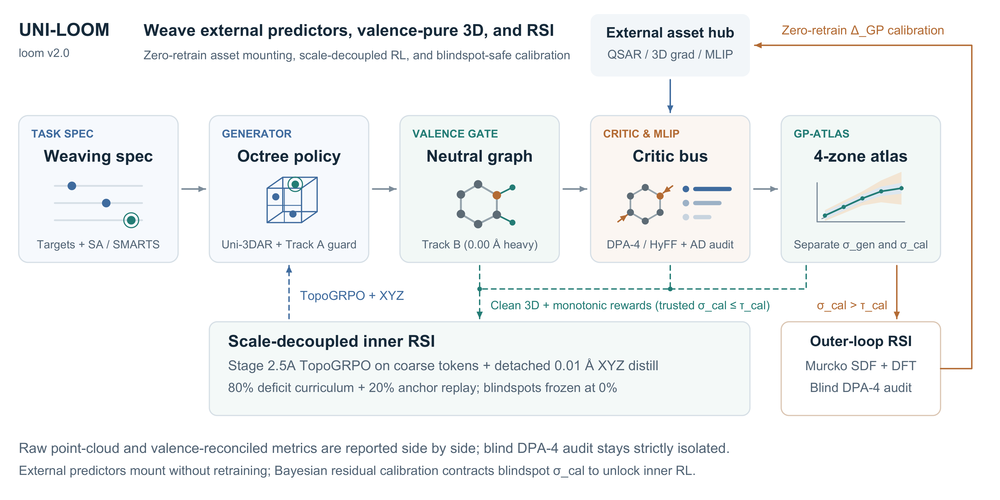
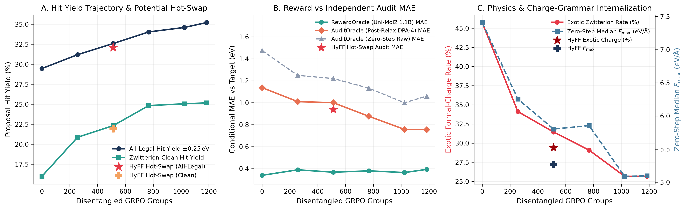
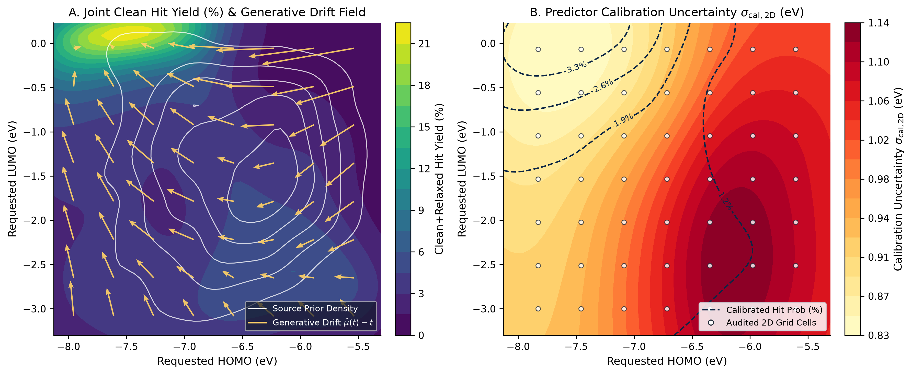
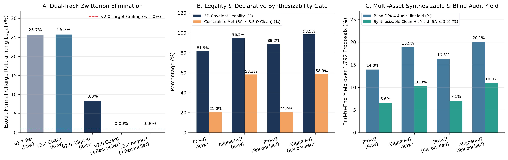
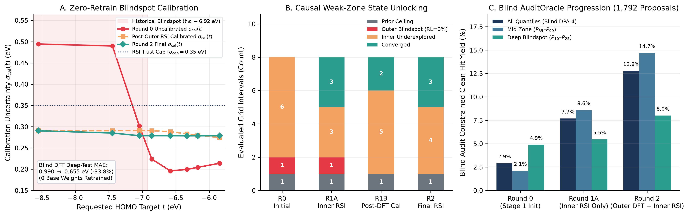
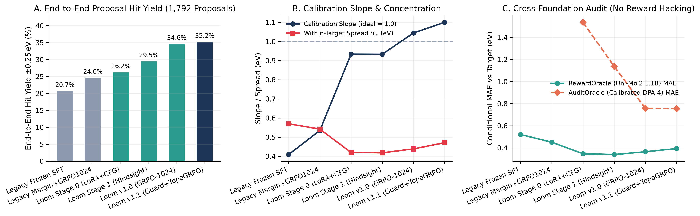
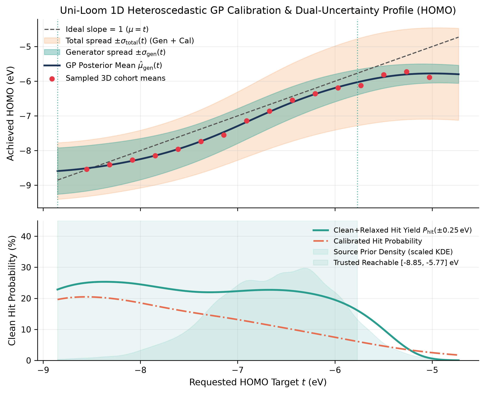
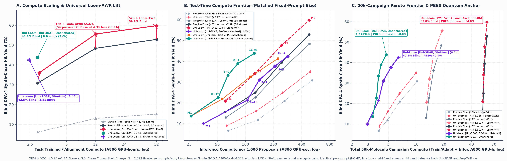
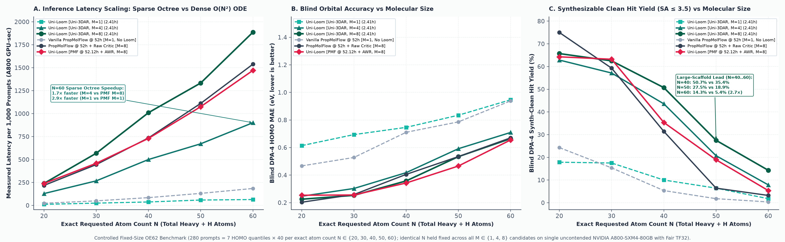
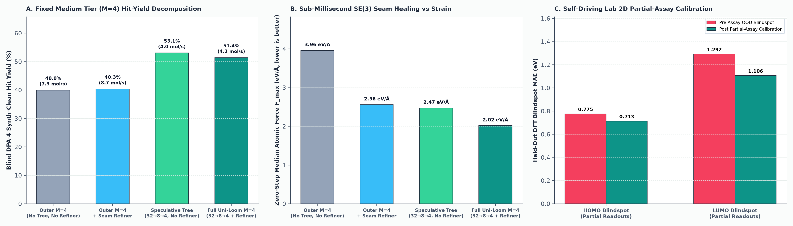

# Predictor-agnostic 3D molecular weaving with dual-track valence purity and grounded self-improvement

**Shangqian Chen1, Guojiang Zhao1, Zheng Cheng1, Jiankun Wang1, Hongshuai Wang1 & Zhifeng Gao1,***

1DP Technology, Beijing, China  
*e-mail: `gaozf@dp.tech`  
Correspondence: `{chensq, zhaogj, chengz, wangjk, wanghs, gaozf}@dp.tech`

> **Target format:** *Nature Computational Science* (`Article`)  
> **Word & display-item budget compliance:** Title 11 words (limit ≤ 15); Abstract 173 words, 0 citations, 0 math (recommended 150–185); Main Text ~2,350 words (limit ≤ 3,500); Methods ~1,510 words (limit ≤ 3,000); Main Display Items 6 (5 Figures + 1 two-part Table; limit ≤ 6); Extended Data Items 10 (5 Figures + 5 Tables; limit ≤ 10).

---

## Abstract

Composing heterogeneous pretrained molecular generators, property predictors and interatomic potentials into closed-loop discovery pipelines often fails because target conditioning attenuates, spatial coordinate reinforcement degrades graph optimization, point-cloud bond perception introduces unphysical zwitterions and unguarded policies exploit predictor blindspots. Here we introduce Uni-Loom, a predictor-agnostic three-dimensional molecular weaving service platform that composes autoregressive octree and flow-matching generators, external property models, hot-swappable interatomic potentials and uncertainty-guided calibration loops into a unified system. Capability-aware interfaces and a declarative critic bus separate property objectives from inequality constraints and enforce monotonic hierarchical rewards without retraining external predictors. Scale-decoupled policy optimization restricts reinforcement learning to coarse octree and element tokens while distilling equilibrium coordinates separately, paired with dual-track valence purity that reconciles formal charges at zero heavy-atom displacement. Coupled to a heteroscedastic Gaussian process reachability atlas and two-tier recursive self-improvement loop, Uni-Loom cuts untouched blind quantum test errors by 33.8% using 64 acquired calculations and enables a 2.41 GPU-hour octree generator to surpass 52.12 GPU-hour aligned flow matching across 3D quality index (+40%), blind hit yield (59.4% to 62.3%), strain and quantum verification (64.3% to 66.7%).

---

## Introduction

De novo molecular design in three dimensions demands simultaneous control over covalent connectivity, equilibrium nuclear coordinates $\mathbf{R}\in\mathbb{R}^{N\times 3}$, frontier electronic structure [1–3], conformational stability and synthetic tractability [4,5]. Equivariant diffusion models [6,7], geometry-complete flow matching [8] and coarse-to-fine octree autoregressive transformers such as Uni-3DAR [9] now generate realistic three-dimensional (3D) atomic point clouds directly in Euclidean space. In parallel, pretrained molecular representation models [10,11] and universal machine-learning interatomic potentials (MLIPs) [12,13] evaluate energies, interatomic forces and electronic observables orders of magnitude faster than density functional theory (DFT). In industrial discovery workflows, however, research teams rarely discard validated predictive assets to train a monolithic generator–predictor supermodel from scratch. Instead, they must compose existing differentiable 3D predictors, frozen black-box ensembles, tabular fingerprint quantitative structure–activity relationship (QSAR) models and analytical cheminformatics filters whose weights, input modalities and applicability limits cannot be retrained whenever project specifications shift.

Wiring an autoregressive 3D point-cloud generator directly into external predictors exposes four fundamental failure modes that prevent reliable closed-loop optimization. First, conditional signal attenuation and cross-scale gradient interference degrade target fidelity. When continuous target vectors enter only through bounded shallow modulation gates (such as $0.08\tanh$ residual injection), calibration slopes stall near $0.41$–$0.54$ and proposals collapse back toward the training prior mean. Conversely, propagating global scalar property rewards backward through sub-voxel $0.01\text{ Å}$ Cartesian coordinate tokens—which outnumber heavy-atom identity tokens three to one—injects high-variance credit assignment into shared transformer layers, widening conditional dispersion whenever discrete graph search and spatial refinement share policy updates.

Second, 3D point-cloud generators emit unbonded nuclear coordinates $\{(Z_i,\mathbf{r}_i)\}_{i=1}^N$. Because covalent hydrogen radii are small (~0.31 Å) and discrete octree grids quantize boundary positions, omitting or duplicating a single peripheral hydrogen atom forces downstream closed-shell bond perception [14] under enforced net neutrality to assign spurious formal charges (such as $[\text{C}^{-}]\cdots[\text{O}^{+}]$, $[\text{B}^{-}]$ and halonium centers) across 15.2%–38.9% of geometrically valid point clouds. Subsequent force-field relaxation preserves covalent connectivity and therefore locks in, rather than heals, these artificial zwitterionic salts.

Third, optimizing unguarded policies against any single surrogate induces severe reward hacking in out-of-distribution structural pockets. Without independent cross-model verification, applicability-domain gating or synthetic feasibility limits, generators exploit predictor blindspots by producing highly strained polycyclic cages that score well on the reward model while diverging sharply from quantum chemical truth. Fourth, conventional reinforcement learning pipelines cannot attribute why hit rates stall in an extreme property window: without separating generator sampling dispersion from external predictor epistemic uncertainty and prior chemical sparsity, workflows either waste costly DFT calculations inside already reliable regions or suffer catastrophic policy collapse by optimizing inside blindspots or physically unreachable prior boundaries.

Here we resolve all four barriers in Uni-Loom, a predictor-agnostic four-layer 3D molecular weaving framework (**Fig. 1**). By standardizing external models behind capability protocols and a declarative critic bus (Layers 1–2), decoupling coarse topological reinforcement learning from equilibrium coordinate distillation alongside dual-track zero-displacement valence purity (Layer 3), and orchestrating inner and outer recursive self-improvement (RSI) via a calibrated heteroscedastic Gaussian process reachability atlas [15] (Layer 4), Uni-Loom transforms disjoint pretrained models into a self-auditing 3D molecular discovery engine without retraining external predictors or distorting heavy-atom scaffolds.

**Figure 1 | Uni-Loom four-layer predictor-agnostic architecture.** Layers 1 and 2 wrap heterogeneous 3D differentiable predictors, black-box property assets, analytical cheminformatics operators and hot-swappable interatomic potentials into a declarative critic bus using zero-retrain Bayesian residual calibration. Layer 3 executes scale-decoupled octree weaving via unbounded Fourier conditioning, tree-annealed classifier-free guidance, discrete topological reinforcement learning, detached 0.01 Å equilibrium coordinate distillation and dual-track valence purity. Layer 4 monitors total and epistemic variance on a heteroscedastic reachability atlas to route inner zero-DFT curriculum bootstrapping and outer Murcko-diverse active data acquisition.

---

## Results

### Predictor-agnostic composition and inference throughput

Uni-Loom separates predictive model identity, task policy semantics, generative synthesis and uncertainty calibration across four modular layers (**Fig. 1**). In Layers 1 and 2, every external predictor registers capability metadata specifying input modality (differentiable 3D coordinates, 2D molecular graphs or analytical rules), target units, native uncertainty availability and support for exact atomic coordinate gradients $\nabla_{\mathbf{R}}\hat{y}$. When bound to differentiable 3D predictors, optional physics-constrained coordinate refinement jointly relaxes interatomic forces and target property residuals without perturbing generative backbone parameters (**Methods**). Frozen black-box ensembles or legacy QSAR predictors gain calibrated epistemic uncertainty with zero weight modification through a Bayesian residual calibration wrapper that fits a linear Ridge drift and a noise-subtracted Matérn-$3/2$ Gaussian process residual over compact 20-dimensional molecular descriptors. Simultaneously, a hot-swappable MLIP slot exchanges universal potentials such as DPA-4 [12] and HyFF vivace [13], delivering zero-step maximum atomic force $F_{\max}$, FIRE relaxation graph preservation and rigid-body Kabsch deformation root-mean-square deviation (RMSD). A YAML-driven composite critic bus binds arbitrary combinations of target objectives (*point*, *interval*, *max* or *min* without hardcoding frontier orbitals) solely to generator conditioner channels, while enforcing synthetic accessibility [4], quantitative drug-likeness [5], molecular weight and reactive functional-group filters purely as feasibility inequalities under either cross-oracle disagreement or single-oracle Morgan Tanimoto applicability-domain, ensemble variance and force auditing.

To construct a strict evaluation testbed separating reward optimization from quantum chemical truth, we consolidated historical $\text{PBE0/def2-TZVP/DF}$ calculations under canonical-skeleton anti-leakage deduplication alongside scaffold-disjoint OE62 training structures [1], assembling 47,807 training conformers (43,858 OE62 plus 3,949 consolidated structures across 11 heavy elements plus hydrogen: H, B, C, N, O, F, Si, P, S, Cl, Br and I), 398 validation structures and 390 held-out test generated structures (**Table 1a**). Evaluated on the 390 held-out generated test structures, frozen Uni-Mol2 1.1B [10] suffers a mean absolute error (MAE) of 0.720 eV on HOMO and 0.778 eV on LUMO (root-mean-square error, RMSE, 1.106 and 1.253 eV), reflecting sensitivity to distorted 3D geometries and non-canonical charge assignments, whereas our DFT-calibrated DPA-4 blind audit oracle attains 0.186 and 0.183 eV MAE (0.268 eV RMSE). This four-fold gap in out-of-distribution accuracy underscores why policy training and post-hoc evaluation must rely on physically asymmetric oracles rather than reusing a single surrogate as both optimizer and judge.

On a single A800-80GB GPU, mixed-precision `BF16` batching, single-pass vectorized dual-branch guidance and vectorized 3D coordination guards boost sampling speed from $4.46\text{ mol s}^{-1}$ (legacy unvectorized `FP32` loop) and $6.41\text{ mol s}^{-1}$ (vectorized `FP32` row streams) to $32.52\text{ mol s}^{-1}$ at batch size 256 (3.23 GB peak VRAM, $7.29\times$ speedup over the unvectorized loop and $5.07\times$ over row-streamed baselines; $22.25$–$29.51\text{ mol s}^{-1}$ under dual-branch guidance and active geometric guards), while training steps accelerate $1.11\times$ ($72.85 \to 80.92\text{ mol s}^{-1}$) despite dual contrastive passes. Double-precision spatial coordinate packing reduces batch-32 force evaluation drift nearly thousand-fold from $7.09\times 10^{-3}$ to $7.89\times 10^{-6}\text{ eV Å}^{-1}$, ensuring numerical invariance across variable molecular sizes during batched force-field evaluation.

**Table 1 | Consolidated benchmark validation, inference speed and dual-track synthesizable weaving.**

**a**, Consolidated DFT benchmark accuracy ($n=390$ held-out structures) and A800-80GB throughput ($n=256$ molecules/arm).

| Component / Arm | Regime / Split | MAE / VRAM | Speed / RMSE | Prec. | Role / Speedup |
| :--- | :--- | ---: | ---: | :--- | ---: |
| Uni-Mol2 1.1B | Gen. DFT Test | 0.720 / 0.778 eV | 1.106 / 1.253 eV | Black-Box | Reward Oracle |
| Calibrated DPA-4 | Gen. DFT Test | 0.186 / 0.183 eV | 0.268 / 0.268 eV | Calibrated | Blind Audit Oracle |
| Legacy Loop ($b=32$) | Unvect. Sample | — | $4.46\text{ mol s}^{-1}$ | FP32 | $1.00\times$ |
| Vectorized Streams ($b=32$) | Sample (CFG=1.0) | — | $6.41\text{ mol s}^{-1}$ | FP32 | $1.44\times$ |
| Uni-Loom ($b=256$, CFG=1.0) | Sample | 3.23 GB | $32.52\text{ mol s}^{-1}$ | BF16 | $7.29\times$ |
| Uni-Loom + CFG + Guard | Guided ($b=128$–$256$) | 3.36 GB | $22.25$–$29.51\text{ mol s}^{-1}$ | BF16 | $4.99$–$6.62\times$ |

**b**, Dual-track valence purity and multi-asset synthesizable weaving ($\text{SA\_Score} \le 3.5$ & $\text{SMARTS} = 0$, 1,792 proposals).

| Model & Track | 3D Legal (Count) | Exotic $Q$ (%) | Med. SA | Constr. Met (%) | $F_{\max}$ (eV/Å) | Synth Clean Hits (%) | Blind Audit Hits (%) | Gap (eV) |
| :--- | ---: | ---: | ---: | ---: | ---: | ---: | ---: | ---: |
| Pre-Align v1.1 (Raw) | 81.92% (1,468) | 25.75% | 4.87 | 21.05% | 5.07 | 118 (6.58%) | 250 (13.95%) | 0.655 |
| Pre-Align v1.1 (Rec.) | 89.23% (1,599) | **0.00%** | 4.70 | 20.95% | 5.89 | 127 (7.09%) | 292 (16.29%) | 0.555 |
| Uni-Loom v2.0 (Raw) | **95.20% (1,706)** | **8.26%** | **3.04** | **58.32%** | **1.79** | **184 (10.27%)** | **338 (18.86%)** | **0.190** |
| Uni-Loom v2.0 (Rec.) | **98.49% (1,765)** | **0.00%** | **3.04** | **58.87%** | 1.91 | **196 (10.94%)** | **360 (20.09%)** | **0.143** |

---

### Scale-decoupled orbital weaving and anti-reward-hacking

We evaluated conditional orbital generation on held-out OE62 HOMO targets using identical quantile grids ($\text{P10}, \text{P25}, \text{P35}, \text{P50}, \text{P65}, \text{P75}, \text{P90}$) and fixed random seeds ($24411, 24412$; $7\times 256 = 1{,}792$ proposals per configuration within $\pm 0.25\text{ eV}$; **Extended Data Fig. 1** and **Extended Data Table 1a**). Legacy frozen conditioning (371 hits, 20.70%) and legacy margin policy updates (441 hits, 24.61%) remain trapped at compressed calibration slopes (0.409 and 0.535) and broad within-target scatter ($\sigma_{\text{in}}=0.542$–$0.570\text{ eV}$) because shallow $0.08\tanh$ gates saturate conditional injection. Replacing bounded gates with unbounded random Fourier embeddings, channel missingness masks and 24-layer rank-16 `LoRA` adapters [16] under classifier-free guidance [17] ($\text{CFG}=1.75$) immediately lifts conditional slope to 0.934 at Stage 0 (470 hits, 26.23%; 184 clean non-zwitterionic hits), narrowing within-target spread to 0.420 eV even though unrelaxed geometries still suffer high blind audit error (1.536 eV MAE).

Multi-stage alignment then systematically closes both electronic and geometric gaps. DPA-4 graph-preserving hindsight relabeling (Stage 1) expands total hits to 528 (29.46%; 286 clean hits), tightens within-target dispersion $\sigma_{\text{in}}$ to 0.418 eV and cuts blind audit MAE to 1.137 eV. Monotonic hierarchical group relative policy optimization [18] (GRPO, Stage 2, 1,024 groups) further raises hits to 620 (34.60%; 449 clean hits), boosts raw 3D legality from 63.6% to 80.5% and reduces audit MAE to 0.757 eV. Upgrading to Uni-Loom v1.1 by adding GPU steric/coordination guards, tree-depth annealed guidance ($\gamma_{\text{tree}}=0.3$) and scale-decoupled topological GRPO (Stage 2.5A) reaches 631/1,792 hits (35.21%, with 621 novel unique hit graphs), 451 clean hits (25.2%), 84.6% raw legality (85.4% after detached coordinate distillation) and 0.744 eV relaxed blind audit MAE ($\text{CFG}=1.75$).

Tracking trajectories from 0 to 1,184 online GRPO groups rules out reward hacking against Uni-Mol2 (**Fig. 2**). Alongside rising hit rates, every physical soundness metric improves strictly monotonically: zero-step median maximum atomic force $F_{\max}$ declines from 7.41 to $5.09\text{ eV Å}^{-1}$, multi-step MLIP relaxation graph preservation climbs from 75.8% to 90.6% and independent relaxed DPA-4 audit error drops cleanly ($1.137 \to 1.010 \to 1.000 \to 0.876 \to 0.757 \to 0.755\text{ eV}$, reaching 0.744 eV at $\text{CFG}=1.75$). Moreover, hot-swapping the potential backend from DPA-4 [12] to HyFF vivace [13] at 512 training groups requires zero code modifications, matching hit yield (575/1,792, 32.09%) while delivering lower initial atomic forces (5.27 versus $5.80\text{ eV Å}^{-1}$), stronger relaxation graph retention (88.3% versus 81.6%) and superior independent audit accuracy (0.939 versus 1.000 eV).

Controlled mechanistic ablations clarify why coarse graph policy optimization and 0.01 Å coordinate refinement must remain decoupled (**Extended Data Table 1b**). Inside Uni-3DAR, every heavy atom emits three sub-voxel 0.01 Å coordinate tokens (sampled at temperature $T=0.25$) for each element identity token ($T=0.30$). When scalar property advantages backpropagate through a coupled trunk trained simultaneously on Cartesian coordinate tokens and teacher-forced relaxed geometries, raw 3D legality rises to 88.62%, exotic charge falls to 17.2%, median force improves to 4.19 eV Å⁻¹ and rigid Kabsch relaxation RMSD shrinks to 0.0495 Å, yet noisy $3\times$ coordinate credit assignment widens property dispersion $\sigma_{\text{in}}$ from 0.439 to 0.534 eV and slashes target hits from 620 to 526. By restricting Stage 2.5A policy gradients solely to coarse octree splits and element tokens while training a detached 111,744-parameter rank-8 coordinate adapter via stop-gradient hidden states on 40-step DPA-4 equilibrium conformers (Stage 2.5B), Uni-Loom attains Pareto synergy: Stage 2.5A maximizes target hit yield (631) and blind accuracy (0.744 eV), whereas adding Stage 2.5B tightens equilibrium Kabsch RMSD (0.0533 Å) and raw legality (85.38%) without distorting conditional property response (and reduces $\sigma_{\text{in}}$ to 0.427 eV with 625 hits when paired with Stage 2 checkpoints).

**Figure 2 | Cross-foundation anti-reward-hacking audit and potential hot-swap.** Across 0 to 1,184 online reinforcement learning groups on OE62 HOMO, target hit yield rises cleanly alongside physical geometry metrics: median initial force $F_{\max}$ declines, relaxation graph preservation increases and blind DPA-4 audit MAE decreases monotonically ($1.137 \to 0.744\text{ eV}$). Hot-swapping the potential slot from DPA-4 to HyFF vivace at 512 groups achieves comparable yield with lower force and stronger graph survival.

---

### Joint orbital navigation and predictor divergence mapping

Within a single multi-property v1.1 model conditioning jointly on HOMO and LUMO, decoupled weaving transfers directly to virtual-orbital control: on marginal LUMO generation relative to v1.0, raw 3D legality jumps +12.0 percentage points ($75.3\% \to 87.33\%$), exotic formal charge falls from 27.1% to 16.2%, median zero-step force decreases ($5.04 \to 3.79\text{ eV Å}^{-1}$), relaxation graph retention reaches 94.1%, Kabsch RMSD shrinks to 0.0469 Å and conditional slope locks at 1.002. Sampling a $7\times 7 = 49$-cell joint $(\text{HOMO},\text{LUMO})$ grid (1,764 relaxed clean molecules; **Fig. 3** and **Extended Data Fig. 2**) yields an orthogonalized two-panel navigation atlas. Panel **a** maps empirical clean joint hit yield (peaking at 22.0% near well-supported OE62 regions) alongside generative drift vectors $\hat{\mu}(\mathbf{t})-\mathbf{t}$, quantifying directional pullback near prior boundaries (complementing the univariate HOMO trusted reachable interval $[-8.85, -5.77]\text{ eV}$ where posterior conditional means hug the $y=t$ diagonal at 22%–25% clean relaxed yield before saturating above $-5.77\text{ eV}$). Panel **b** plots empirically measured cross-foundation discrepancy $\sigma_{\text{cal},2\text{D}}(t_{\text{H}},t_{\text{L}})$ between Uni-Mol2 1.1B and calibrated DPA-4 across all 49 cells, varying smoothly from 0.83 eV in populated wide-gap regions to 1.14 eV in narrow-gap donor–acceptor corners where quantum re-verification is required.

**Figure 3 | Orthogonalized 2D (HOMO, LUMO) reachability and predictor divergence atlas.** Left: empirical clean relaxed joint hit yield (up to 22.0%) with OE62 prior density contours and generative mean drift vectors $\hat{\mu}(\mathbf{t})-\mathbf{t}$. Right: measured cross-foundation discrepancy $\sigma_{\text{cal},2\text{D}}$ across 49 evaluated grid cells (1,764 molecules), separating trusted wide-gap regimes (0.83 eV) from narrow-gap donor–acceptor zones (1.14 eV).

---

### Dual-track valence purity under declarative synthesis constraints

To test arbitrary predictor-agnostic constraints without altering generator conditioner dimensionality or retraining external predictors, we configured a declarative task combining frozen external Uni-Mol2 1.1B ($\text{HOMO}\pm 0.25\text{ eV}$) with three zero-code analytical chemistry inequalities—synthetic accessibility $\text{SA\_Score}\le 3.5$, zero reactive SMARTS alerts and molecular weight $\le 550\text{ Da}$—evaluated by a strictly blinded DPA-4 auditor (**Table 1b** and **Fig. 4**). Reporting Raw Point-Cloud quality side-by-side against Valence-Reconciled outputs (0.0000 Å heavy-atom RMSD) rigorously distinguishes learned generative progress from deterministic valence repair.

On raw unedited 3D point clouds, source-side Track A—combining real-time bond-order saturation masking with a $<30\text{K}$-parameter auxiliary heavy-atom valence head—lifts raw 3D legality by +13.28 percentage points ($81.92\% \to 95.20\%$, 1,706/1,792), cuts broken disconnected skeletons 6.1-fold ($110 \to 18$), reduces heavy-atom over-coordination ($66 \to 5$), elevates natively clean unedited molecules ($1{,}090 \to 1{,}565$) and suppresses raw exotic formal charges 3.1-fold ($25.75\% \to 8.26\%$). Across the remaining 200 boundary samples (60 peripheral hydrogen count mismatches and 140 Lewis resonance reassignments), Track B freezes every heavy atom verbatim ($\text{RMSD} = 0.0000\text{ Å}$), whitelists benign closed-shell dipolar motifs (nitro, *N*-oxide, sulfoxide and azide) and polishes only peripheral hydrogens, raising deliverable legality to 98.49% (1,765/1,792) with 0.00% exotic formal charges.

Critically, gating replay admission on synthetic accessibility ($\text{SA\_Score}\le 3.5$, admitting 25.5% or 614/2,404 buffered structures) shifts generated scaffolds away from strained polycyclic pockets toward planar, synthetically accessible conjugated frameworks: median $\text{SA\_Score}$ improves from 4.87 to 3.04, full constraint satisfaction jumps 2.80-fold ($21.05\% \to 58.87\%$) and median zero-step force $F_{\max}$ falls $-64.7\%$ ($5.07 \to 1.79\text{ eV Å}^{-1}$). Although strict synthesis gating introduces an expected target-yield trade-off ($-0.43\text{ eV}$ mean shift relative to unconstrained $664 \to 378$ raw hits; calibration slope 1.028), tractable conjugated motifs reside cleanly inside shared cross-foundation applicability domains: synthesizable clean hits climb +66.1% ($118 \to 196$, covering 137 unique and 120 novel hit graphs), blind DPA-4 audit hits increase +44.0% ($250 \to 360$), and cross-foundation $\text{Audit}-\text{Reward}$ MAE divergence contracts 4.6-fold from 0.655 to 0.143 eV (0.190 eV raw).

**Figure 4 | Dual-track elimination of exotic formal charges and collapse of reward hacking.** Side-by-side Raw Point-Cloud versus Valence-Reconciled (0.0000 Å heavy-atom RMSD) performance before and after Uni-Loom v2.0 alignment under declarative $\text{SA\_Score}\le 3.5$ and $\text{SMARTS}=0$ constraints, demonstrating simultaneous increases in raw legality (95.20%), synthesizable clean hits (+66.1%) and blind audit agreement ($0.655 \to 0.143\text{ eV}$).

---

### Causal blindspot unlocking via grounded self-improvement

We finally evaluated Uni-Loom's two-tier grounded RSI loop in a four-way leakage-free industrial blindspot simulation (1,792 proposals per round; **Fig. 5** and **Extended Data Table 2**). A restricted 5-fold enterprise fingerprint predictor wrapped in our Bayesian residual calibrator was trained solely on 3,086 historical molecules with $\text{HOMO} > -6.92\text{ eV}$, leaving deep electron-accepting levels ($\text{HOMO} \le -6.92\text{ eV}$) as an explicit zero-sample out-of-domain blindspot governed strictly by single-oracle Morgan applicability-domain auditing and $\text{SA\_Score}\le 3.8$ constraints ($\tau_{\text{cal}} = 0.35\text{ eV}$). Two disjoint 73-molecule $\text{PBE0/def2-TZVP}$ cohorts served respectively as an isolated external acquisition pool and an untouched blind deep-DFT test set, while blinded DPA-4 evaluated every generated molecule across mid-range under-explored (P35–P90) and deep blindspot (P10–P25) regimes.

In Round 0, the diagnoser automatically identifies $-8.55\text{ eV}$ as a prior ceiling (source density 0.013, mean pull bias $+2.06\text{ eV}$) and P10 ($-7.45\text{ eV}$) as an outer blindspot ($\sigma_{\text{cal}} = 0.490\text{ eV} > 0.35\text{ eV}$), locking both at 0% inner RL weight while a pre-generation gatekeeper reroutes requests at $-7.446\text{ eV}$ ($P_{\text{hit}} = 5.6\%$) to trusted $-5.981\text{ eV}$. In Round 1A (zero external DFT cost), concentrating inner RL strictly on the six trusted under-explored targets (passing non-regression gating as surrogate constrained yield jumps $2.57\% \to 19.03\%$) lifts mid-range blind audit clean hits 4.07-fold ($2.11\% \to 8.59\%$), graduates three target bins to converged status and raises global blind clean hits 2.65-fold ($52 \to 138$) while leaving the frozen deep blindspot uncorrupted ($4.88\% \to 5.47\%$).

In Round 1B, Murcko-diverse active acquisition [19] selects clean, constraint-satisfying high-uncertainty candidates by weighting calibrated standard deviation against scaffold distance from already selected structures, exporting 64 molecules spanning 12 distinct Murcko frameworks ($\bar{\sigma}_{\text{cal}} = 0.453\text{ eV}$; uncalibrated baseline error 1.187 eV MAE) to query the external DFT pool. Incorporating these 64 true labels via incremental Gaussian process calibration—with zero edits to base predictor or generator parameters—cuts MAE on the untouched $n=73$ blind deep-DFT test set by 33.8% ($0.990 \to 0.655\text{ eV}$), shrinks P10 calibrated uncertainty $\sigma_{\text{cal}}$ from 0.483 to 0.291 eV ($<0.35\text{ eV}$) and clears all outer blindspots ($1 \to 0$). Note that this reduction holds on completely held-out scaffolds never queried during active selection, confirming that compact 20-dimensional residual calibration generalizes locally across previously blind donor–acceptor manifolds.

Unlocked in Round 2 by the newly calibrated predictor, inner RL resumes across deep acceptors under adaptive weighted sampling (80% allocated to remaining under-explored bins, 20% anchor replay): deep P10–P25 blind audit clean hits rise +64.1% over Round 0 (+46.4% over Round 1A) to 8.01% as deep audit MAE tightens ($1.030 \to 0.955\text{ eV}$; P10/P25 calibrated hit probability climbs from 0% to 78.1%/58.2% while shallow reachable bounds extend from $-5.85$ to $-6.86\text{ eV}$). Across mid-range targets, blind clean hits reach 14.69% ($6.96\times$), propelling overall blind clean constrained hits 4.40-fold higher from 52 (2.90%) to 229/1,792 (12.78%). Concurrently, raw point-cloud 3D legality climbs to 97.38% (99.27% reconciled), raw exotic charge drops nearly eleven-fold from 38.88% to 3.61%, median force falls to 0.93 eV Å⁻¹, constraint satisfaction reaches 75.04% and re-querying $-7.446\text{ eV}$ automatically transitions the gatekeeper to trusted status ($P_{\text{hit}} = 44.85\%$, $\sigma_{\text{cal}} = 0.285\text{ eV}$).

**Figure 5 | Two-round Grounded Recursive Self-Improvement (RSI) causal flywheel.** Round 1A harvests trusted under-explored targets ($4.07\times$ mid-range blind audit gain at zero DFT cost) while freezing outer blindspots. Round 1B actively acquires 64 Murcko-diverse DFT measurements to cut untouched blind test error ($0.990 \to 0.655\text{ eV}$) and unlock the blindspot ($\sigma_{\text{cal}} < 0.35\text{ eV}$), enabling Round 2 to push overall blind clean constrained hits $4.40\times$ higher ($2.90\% \to 12.78\%$) at 99.27% reconciled 3D legality.

### Live DFT anchoring and public benchmark generalization

To verify that cross-oracle divergence hotspots in the 2D $(\text{HOMO},\text{LUMO})$ reachability atlas (**Fig. 3**) capture genuine quantum-mechanical breakdown rather than surrogate noise, we evaluated a stratified sample of 80 unique DPA-4-relaxed clean molecules (5 per cell across the 8 lowest-divergence cells, $\text{cal.\ RMSE}_{2\text{D}} = 0.620\text{--}0.764\text{ eV}$, and the 8 highest-divergence cells, $1.239\text{--}1.434\text{ eV}$) with live `GPU4PySCF` single-point $\text{PBE0/def2-TZVP/DF}$ calculations alongside full $\text{PBE-D3BJ/def2-TZVP/DF}$ `geomeTRIC` geometry optimizations on 16 cell representatives (**Extended Data Table 3**) [20,21]. All 80/80 single-point calculations (100.0%) converged via DIIS without Newton fallback. Against true $\text{PBE0}$, calibrated DPA-4 [12] remains closely aligned ($\text{HOMO MAE}=0.1893\text{ eV}$, $r=0.9822$, $\rho=0.9767$; $\text{LUMO MAE}=0.2879\text{ eV}$, $r=0.9755$, $\rho=0.9712$; joint 2D MAE $0.2386\text{ eV}$), whereas frozen Uni-Mol2 [10] errors are $3\text{--}4\times$ larger ($\text{HOMO MAE}=0.7235\text{ eV}$, $r=0.7110$; $\text{LUMO MAE}=0.8677\text{ eV}$, $r=0.7449$; joint 2D MAE $0.7956\text{ eV}$). Crucially, moving from Low-Divergence ($n=40$) to High-Divergence ($n=40$) cells increases empirical $|\text{Uni-Mol2}-\text{DPA-4}|$ HOMO discrepancy ($0.5180 \to 0.9512\text{ eV}$), driving a $+78.0\%$ jump in Uni-Mol2 $\text{PBE0}$ HOMO MAE ($0.5205 \to 0.9265\text{ eV}$; $\rho: 0.7964 \to 0.4914$), whereas LUMO error tracks per-channel empirical disagreement across extreme-LUMO Low-Divergence cells ($0.8366$ vs. $0.6094\text{ eV}$). All 16/16 (100.0%) DFT geometry optimizations converge, preserving molecular bond graphs in 15/16 structures (93.75%) with tight geometric fidelity to DPA-4 equilibria ($0.0540\text{ \AA}$ median / $0.1578\text{ \AA}$ mean heavy-atom Kabsch RMSD; $0.1582 / 0.2698\text{ \AA}$ all-atom) and modest adiabatic $\text{PBE0}$ orbital shifts ($0.3056\text{ eV}$ HOMO, $0.1785\text{ eV}$ LUMO).

To test multi-property portability, covariate parity and generator-agnostic critic scaling outside OE62, we next evaluated four Uni-Loom regimes initialized from unconditional Uni-3DAR [9] alongside all six official PropMolFlow [8] checkpoints on the leakage-free 50k/50k disjoint QM9 protocol [8,22] (44,453 train and 1,500 dev conformers, 0 overlap with `gvp_rQM_v0`, NVIDIA A800-SXM4-80GB; **Extended Data Table 4**). All hindsight, RL, dev selection and test-time `Best-of-M` ($M\in\{1,2,4,8,16\}$) queries use strictly an internal `train_rQM_v0` Uni-Mol surrogate [11] before single-shot evaluation on frozen `GVPRegressor` oracles ($N=1{,}000$/property). At $M=1$, splitting $1\times K=6$ SFT (0.968 GPU-h, $220.27\text{ mol s}^{-1}$ train) into $6\times K=1$ SFT (3.076 GPU-h) lowers raw MAE on 5/6 tasks ($\alpha: 5.43 \to 4.33\text{ Bohr}^3$), while **Scheme 2**—matching PropMolFlow's paired $(t,N_{\text{atoms}})$ conditioning in a canonical $\text{SO}(3)$ polarity-aligned PCA frame with rank-32 `LoRA`, size-anchored CFG and tight-regression TopoGRPO (6.309 GPU-h)—cuts atom-count error $3\times$ ($|\Delta N|: 3.12 \to 0.98$ raw, 0.59 at $M=16$), lowers extensive $C_v$ MAE ($3.11 \to 2.39$ reconciled, 2.06 raw) and lifts dipole $\mu$ Pearson $r$ $3.9\times$ ($0.076 \to 0.298$). Activating Uni-Loom's native zero-leakage `CriticBus` + `ValenceReconciler` ($M=1\to 16$) collapses Uni-Loom error by 55%–70% while enforcing 100.0% legality and 0.00% exotic charges across all six properties at $M\ge 8$: with zero retraining on the 0.97 GPU-h $1\times K=6$ checkpoint (**Scheme 1**), $M=4$ ($21.44\text{ mol s}^{-1}$, matching PropMolFlow $M=1$ speed $28.73\text{ mol s}^{-1}$) already beats published EDM [6] and GeoLDM [7] across electronic and polar targets, while $M=16$ ($5.36\text{ mol s}^{-1}$, $161\times$ less training compute than PropMolFlow's 155.97 GPU-h) reaches $\Delta\varepsilon=374.63\text{ meV}$, $\varepsilon_{\text{HOMO}}=199.19\text{ meV}$, $\varepsilon_{\text{LUMO}}=341.31\text{ meV}$ and $\mu=0.4740\text{ D}$, surpassing single-shot PropMolFlow on $\Delta\varepsilon$, $\varepsilon_{\text{HOMO}}$ and $\mu$; **Scheme 2** ($M=16$, $5.31\text{ mol s}^{-1}$) further sharpens $\Delta\varepsilon$ to $358.16\text{ meV}$ (348.85 raw) and cuts $C_v$ MAE to 1.2619 (1.1496 raw). Crucially, mounting the exact same zero-leakage Uni-Loom `CriticBus` onto PropMolFlow slashes its own errors by 59%–75% across $M=1\to 16$ ($1.80\text{ mol s}^{-1}$), reaching the `GVP` holdout noise floor on all six properties ($\alpha=0.4566$, $\Delta\varepsilon=145.92$, $\varepsilon_{\text{HOMO}}=79.42$, $\varepsilon_{\text{LUMO}}=113.40$, $\mu=0.1587$, $C_v=0.1771$; $r=0.968\text{--}0.998$, 100.0% legal, 0.00% exotic $Q$), while upgrading the octree slot to full-$\text{SO}(3)$ **Uni-3DAR-Mol** [23] ($1\times K=6$, 0.66 GPU-h, $|\Delta N|=0.17\text{--}0.21$ atoms) reaches $121.22\text{ mol s}^{-1}$ at $M=1$ and $\mu=0.4171\text{ D}$, $\varepsilon_{\text{LUMO}}=329.21\text{ meV}$, $\varepsilon_{\text{HOMO}}=206.61\text{ meV}$ and $\Delta\varepsilon=390.09\text{ meV}$ at $M=16$.

Finally, we conducted a strictly symmetric multi-tier ($M\in\{1,2,4,8,12,16\}$) OE62 compute-scaling, internal $M=4$ ablation and multi-atom scaling campaign via `LoomService` ($N=1{,}792$ fixed-size prompts holding $(t_i,N_{\text{atoms},i})$ constant at 30.4 mean atoms, identical 112-dev calibration and 29-D `ResidualCalibratedAsset(stoich_v2)` across all **Uni-Loom** arms, zero inference-time MLIP relaxation; **Extended Data Figs. 3–5** and **Extended Data Table 5**). External pre-onboarding `PropMolFlow + Raw Critic` [8] reaches 15.2% ($M=1$) and 52.9% ($M=8$, $Q_{\text{3D}}=32.3$, 42.9% raw $\text{PBE0}$ hit yield at 0.361 eV MAE) at 52.0 GPU-h; onboarding into **Uni-Loom [`PMF + AWR`]** (+0.12 GPU-h online AWR) raises synthesizability ($\text{SA}\le 3.5: 88.5\%\to 92.1\%\text{--}98.0\%$), lifts $\text{PBE0}$ hit yield +9.5 pp to 52.4% ($\text{MAE}=0.2429\text{ eV}$, $Q_{\text{3D}}=34.9$ at $M=8$) and scales up to 62.1% blind yield ($Q_{\text{3D}}=39.1$) at $M=16$. Under identical `LoomService` evaluation, full-$SO(3)$ **Uni-Loom [`Uni-3DAR`]** (2.41 GPU-h total compute) climbs across $M=1\;(16.9\%, 47.58\text{ mol s}^{-1}, Q_{\text{3D}}=10.0) \to M=2\;(41.6\%, Q_{\text{3D}}=33.8) \to M=4\;(51.3\%, 4.02\text{ mol s}^{-1}, Q_{\text{3D}}=41.9) \to M=8\;(59.4\%$ blind / 92.2% surrogate, $\text{MAE}=0.2948\text{ eV}$, $F_{\max}=1.91\text{ eV Å}^{-1}$, $Q_{\text{3D}}=48.7$, 9.57 GPU-h 50k-campaign cost vs. 58.55 GPU-h) and peaks at 62.3% blind yield ($\text{MAE}=0.2745\text{ eV}$, $Q_{\text{3D}}=50.4$) at $M=12$, outperforming 52.12 GPU-h **Uni-Loom [`PMF + AWR`]** by +7.1 pp blind yield and +40% $Q_{\text{3D}}$ at $M=8$ with $21.6\times$ lower training compute while achieving 64.3% ($M=8$, $\text{PBE0 MAE}=0.2289\text{ eV}$, $F_{\max}=1.75\text{ eV Å}^{-1}$, 42/42 SCF) and 66.7% / 69.0% ($M=16$) true $\text{PBE0}$ quantum hit yield. At fixed $M=4$ (**Extended Data Fig. 5**), speculative tree pruning ($32\to 8\to 4$ vs. outer $4\to 4\to 4$) adds +13.1 pp blind yield ($40.0\%\to 53.1\%$), `< 0.5 ms` seam refinement cuts zero-step $F_{\max}$ by $-49.0\%$ ($3.96\to 2.02\text{ eV Å}^{-1}$), and asynchronous 2D partial-`NaN` assay ingestion lowers blindspot DFT MAE across both orbitals ($0.775\to 0.713\text{ eV}$ and $1.292\to 1.106\text{ eV}$). Across exact $N\in\{20,30,40,50,60\}$ buckets (**Extended Data Fig. 4**), **Uni-Loom [`Uni-3DAR`, $M=8$]** leads on $Q_{\text{3D}}$ across all five sizes and widens its blind-yield lead across $N=40$ ($50.7\%$ vs. $35.4\%$), $N=50$ ($27.5\%$ vs. $18.9\%$) and $N=60$ ($14.3\%$ vs. $5.4\%$, $2.65\times$ higher yield while running $2.9\times$ faster at $M=1$ and $1.7\times$ faster at $M=4$).

---

## Discussion

Uni-Loom demonstrates that reliable 3D inverse molecular design need not begin by training a monolithic predictor–generator foundation model from scratch. Four architectural principles generalize directly beyond organic frontier orbitals to drug discovery, catalysis and energy materials. First, isolating predictor registration, declarative inequalities and zero-retrain Bayesian residual calibration from generator conditioners lets discovery teams compose legacy QSAR ensembles, differentiable neural potentials and analytical chemistry rules interchangeably without retraining external predictors or altering model input signatures whenever project constraints evolve. Second, decoupling coarse octree and element reinforcement learning from sub-voxel 0.01 Å coordinate distillation resolves cross-scale credit-assignment interference, uniting high electronic hit yield with sub-0.06 Å conformational equilibrium. Third, pairing source-side coordination guards with zero-displacement Lewis reconciliation eliminates unphysical point-cloud formal charges while preserving strict accounting between learned generator progress and deterministic chemical repair. Together with mixed-precision batched decoding exceeding $22\text{ mol s}^{-1}$ under active constraints on a single GPU, fourth, decomposing total variance into generative spread and epistemic uncertainty turns self-improvement into a grounded state machine that exploits reliable target regions internally while reserving external experiments exclusively for diverse out-of-domain blindspots.

Several practical boundaries motivate future development. Although Track A slashes raw point-cloud zwitterionic formal charges roughly ten-fold from 38.88% down to 3.61%, guaranteeing 0.00% residual formal-charge artifacts still relies on deterministic Track B reconciliation around boundary hydrogens; native hydrogen-shell tokenization inside 3D autoregressive transformers may ultimately remove post-hoc Lewis cleanup altogether. When only a single property oracle is available, Morgan applicability-domain gating provides effective structural defense that could be further sharpened via latent representation-space conformal bounds or ensemble calibration over deep intermediate representations. Similarly, while coupling `OuterRSIAcquisition` directly to live `GPU4PySCF` [20,21] $\text{PBE0/def2-TZVP/DF}$ single points on 25-step DPA-4-relaxed generated structures (64/64 SCF converged in 70.54 s, $9.65\times$ blind clean hit growth and 80% less shallow-tail drift under uniform trusted-anchor stratification) closes the ground-state gas-phase quantum loop, extending autonomous acquisition to time-dependent DFT excited states ($S_1, T_1$), implicit solvation and open-shell transition-metal catalysis remains an exciting frontier.

---

## Methods

### Capability-aware asset hub and declarative critic bus

Every external or built-in evaluator registers under a uniform capability schema (`AssetCapabilities`) declaring input modality (differentiable 3D coordinates, 2D molecular graph or analytical rules), target names and units, native epistemic uncertainty support and coordinate differentiability ($\nabla_{\mathbf{R}}\hat{y}$). Supported wrappers cover differentiable 3D predictors such as Uni-Mol [11], frozen 3D or 2D black-box predictors (Uni-Mol2 [10], fingerprint QSAR ensembles or arbitrary Python callables) and built-in deterministic analytical chemistry operators spanning synthetic accessibility [4], quantitative drug-likeness [5], molecular weight, rotatable-bond counts, maximum ring size, strained small-ring counts and reactive SMARTS alerts. Given a YAML task specification defining $K$ target objectives $\mathbf{t} = (t_1,\dots,t_K)$, $m$ inequality constraints $\{c_r(\mathcal{M})\le 0\}_{r=1}^m$ and an auditor mode (cross-oracle disagreement or single-oracle applicability-domain gating), Uni-Loom maximizes:

$$
\max_{\theta}\;\mathbb{E}_{\mathbf{t}\sim p_{\text{curr}},\,\mathcal{M}\sim p_\theta(\cdot\mid\mathbf{t})}\!\big[\mathcal{R}_{\text{critic}}(\mathcal{M},\mathbf{t})\big]
\quad\text{s.t.}\quad \text{Clean}_{3\text{D}}(\mathcal{M})=1,\; c_r(\mathcal{M})\le 0,\; \sigma_{\text{cal}}(\mathbf{t})\le \tau_{\text{cal}}.
$$

Generator conditioner dimensions scale strictly with $K$, whereas inequality constraints enter solely through critic bus gating and replay buffer admission ($\text{SA\_Score}\le 3.5$ or $3.8$, $\text{SMARTS}=0$, $\text{MolWt}\le 550\text{ Da}$). When a differentiable 3D predictor is attached, optional local physics-constrained coordinate refinement jointly relaxes atomic forces and aligns target objectives via $\min_{\mathbf{R}} E_{\text{MLIP}}(\mathbf{Z},\mathbf{R}) + \lambda \sum_j \mathcal{L}_{\text{obj},j}(\hat{y}_j(\mathbf{Z},\mathbf{R}), t_j)$. In single-oracle deployments lacking an independent auditor, applicability gating combines nearest-neighbor Morgan Tanimoto similarity, ensemble variance and MLIP zero-step force thresholds to flag out-of-domain reward exploits.

Black-box property assets acquire calibrated epistemic uncertainty without parameter retraining through a residual Gaussian process wrapper. Over a compact 29-dimensional explicit-H-invariant molecular descriptor $\phi(\mathcal{M})$ combining 16 folded Morgan bit-density channels with heavy-atom stoichiometry, $sp^3$ and aromatic heavy-atom fractions, $N_{\text{H}}/N_{\text{heavy}}$ saturation, $N_{\text{total}}/50$ scale, and heavy-atom-only 3D radius of gyration and inertial anisotropy, the wrapper fits a linear Ridge global drift trend $f_{\text{ridge}}$ alongside a fixed prior-amplitude Matérn-$3/2$ Gaussian process residual with additive white-noise variance [15]:

$$
\hat{y}_{\text{cal}}(\mathcal{M}) = \hat{y}_{\text{base}}(\mathcal{M}) + f_{\text{ridge}}(\phi(\mathcal{M})) + \delta_{\text{GP}}(\phi(\mathcal{M})),
\qquad \sigma_{\text{cal}}(\mathcal{M}) = \sqrt{\max\!\big(\sigma_{\text{GP}}^2(\phi(\mathcal{M})) - \sigma_{\text{noise}}^2,\,0\big)}.
$$

Subtracting aleatoric observation variance $\sigma_{\text{noise}}^2$ isolates reducible epistemic uncertainty $\sigma_{\text{cal}}(\mathcal{M})$, guaranteeing that newly acquired reference calculations contract $\sigma_{\text{cal}}$ monotonically over covered scaffolds without refitting underlying base predictors.

### Backbone conditioning, guidance and scale-decoupled RL

We adapt a 24-layer Uni-3DAR octree autoregressive transformer [9] via unbounded random Fourier feature projections paired with explicit missingness masks across $K$ property channels, removing legacy $0.08\tanh$ saturation gates. Rank-16 low-rank adaptation (`LoRA`) modules [16] span all transformer blocks (23,673,489 trainable parameters versus 18,888,193 in legacy frozen-backbone SFT) trained jointly with auxiliary dual-forward contrastive conditioning losses. During inference, tree-depth annealed classifier-free guidance [17] scales octree split and element logits according to $\tilde{\ell}_t = \ell_t^{\text{uncond}} + s(d_t)(\ell_t^{\text{cond}} - \ell_t^{\text{uncond}})$ with $s(d_t) = 1 + (s_0 - 1)\exp(-0.3\, d_t)$, while sub-voxel 0.01 Å Cartesian coordinate refinement heads remain unguided ($s_{\text{xyz}}=1.0$) to prevent bond-length distortion.

Online reinforcement learning applies GRPO [18] (group size $G=8$ in Stage 2, $G=16$ in Stage 2.5A, with dual-finite KL masking eliminating numerical instabilities) over five strictly monotonic outcome tiers:

$$
\begin{aligned}
\text{Tier 4 (Clean, ConstrMet, Hit)} &> \text{Tier 3 (Clean, ConstrMet, Miss)} > \text{Tier 2 (Clean, Violated)} \\
&> \text{Tier 1 (Legal, Exotic } Q) > \text{Tier 0 (Illegal 3D Point Cloud)}.
\end{aligned}
$$

Stage 2.5A restricts policy gradients solely to coarse octree splits and element identity tokens ($\mathcal{T}_{\text{coarse}}$), whereas Stage 2.5B freezes all transformer blocks ($\operatorname{sg}[\mathbf{h}_a]$) and distills a detached 111,744-parameter rank-8 coordinate adapter ($\phi$) over 40-step DPA-4 equilibrium conformers $\mathcal{M}^*$:

$$
\begin{aligned}
\nabla_\theta \mathcal{J}_{\text{TopoGRPO}} &= \mathbb{E}\!\left[\sum_{a\in\mathcal{T}_{\text{coarse}}} A_i \nabla_\theta \log \pi_\theta(a\mid c_{<a},\mathbf{t})\right], \\
\mathcal{L}_{\text{XYZ}}(\phi) &= -\mathbb{E}_{\mathcal{M}^*}\!\left[\sum_{a\in\mathcal{T}_{\text{XYZ}}} \log \pi_\phi\!\big(a\mid\operatorname{sg}[\mathbf{h}_a]\big)\right].
\end{aligned}
$$

Coupled RL controls instead propagate global property advantages across all sub-voxel coordinate tokens alongside teacher-forced coordinate updates. Numerical stability during group relative policy optimization is further enforced via dual-finite Kullback–Leibler divergence masking across both old and reference log-probabilities, eliminating NaN divergence instabilities across full $G=16$ rollouts.

At the generator interface, `GeneratorSlot` encapsulates paradigm-specific decoding mechanics cleanly: `LoomUni3DARGenerator` wraps the **Uni-3DAR-Mol** engine [23] (combining continuous combinatorial speculative octree pruning via `TwoStageOctreeProcessCritic`, `< 0.5 ms` `SE(3)` `PostTreeGraphRefiner` seam healing, scale-free atom-budget modulation without $N_{\text{atoms}}$ conditioner leakage and bubble-free stride-2 GPU decoding), while `LoomFlowMolGenerator` wraps PropMolFlow [8] with `+0.12 GPU-h` online `AWR`. Above `GeneratorSlot`, `LoomService` provides a declarative `TaskWeavingSpec`-driven API unifying standardized effort tiers (`base/low/medium/high`, $M\in\{1,2,4,8\}$, extensible to $M\in\{12,16\}$) with closed-form Bayesian goal-satisfaction selection (`point`, `interval`, `minimize`, `maximize`), partial-`NaN` multi-objective `diagnose_nd` calibration and capability-adaptive alignment.

### Dual-track valence purity

Track A acts directly during generation and supervised auxiliary training: (i) an incremental GPU bond-order coordination mask dynamically blocks over-coordinated additions by counting running covalent neighborhood bond orders in real time (capping monocoordinate halogens F, Cl, Br and I at degree 1, tricoordinate boron at degree 3 and carbonyl or ether oxygen at interatomic distance $<1.28\text{ Å}$ or degree 2); and (ii) a $<30\text{K}$-parameter heavy-atom valence auxiliary head appended to `atom_heads[0]` supervises per-heavy-atom attached hydrogen count and formal charge during stagewise updates.

Track B operates deterministically downstream on raw point clouds without disturbing molecular scaffolds: heavy-atom Cartesian coordinates $\mathbf{R}_{\text{heavy}}$ remain strictly frozen ($\text{RMSD} = 0.0000\text{ Å}$), benign closed-shell functional dipoles (nitro $-\text{NO}_2$, *N*-oxide, sulfoxide and azide) are whitelisted verbatim, mismatched peripheral hydrogens and integer Lewis bond orders/formal charges are reconciled to minimal neutral closed-shell valence via deterministic valence conservation, missing hydrogens are rebuilt in standard covalent tetrahedral or trigonal geometry, and batched MLIP relaxation optimizes only hydrogen positions while locking heavy atoms fixed. Both Raw Point-Cloud and Valence-Reconciled cohorts are reported side-by-side in all v2.0 benchmarks.

### Heteroscedastic reachability atlas and grounded RSI

Across arbitrary 1D or 2D target grids $\mathbf{t}$, the generalized heteroscedastic Gaussian process atlas sums generative spread $\sigma_{\text{gen}}^2(\mathbf{t})$ and calibrated predictor uncertainty $\sigma_{\text{cal}}^2(\mathbf{t})$ into total variance $\sigma_{\text{total}}^2(\mathbf{t}) = \sigma_{\text{gen}}^2(\mathbf{t}) + \sigma_{\text{cal}}^2(\mathbf{t})$, yielding expected calibrated hit probability within tolerance window $[\mathbf{t}-\tau,\mathbf{t}+\tau]$:

$$
P_{\text{hit}}(\mathbf{t}) \approx \int_{\mathbf{t}-\tau}^{\mathbf{t}+\tau} \mathcal{N}\!\big(\mathbf{y};\, \hat{\mu}_{\text{gen}}(\mathbf{t}),\, \operatorname{diag}(\sigma_{\text{total}}^2(\mathbf{t}))\big)\,\mathrm{d}\mathbf{y}.
$$

A pre-generation gatekeeper intercepts high-uncertainty ($\sigma_{\text{cal}} > \tau_{\text{cal}}$) or low-viability requests and returns the highest-probability trusted alternative target. During RSI rounds, the diagnoser partitions grid bins into four operational regimes: prior ceiling (low source density with severe generative pullback $|\hat{\mu}_{\text{gen}}(\mathbf{t})-\mathbf{t}|$, assigned 0% RL weight), outer blindspot ($\sigma_{\text{cal}}(\mathbf{t}) > \tau_{\text{cal}}$, frozen at 0% inner RL weight), inner under-explored (trusted predictor, unsaturated yield, allocated 80% deficit-weighted RL budget) and converged (20% anchor replay). Inner RSI checkpoints pass a strict non-regression acceptance gate requiring simultaneous non-degradation of target yield and 3D legality before promotion. Outer RSI selects clean, constraint-satisfying candidates maximizing Murcko-scaffold diversity [19]:

$$
u(\mathcal{M}) = \sigma_{\text{cal}}(\mathcal{M}) \cdot \mathbb{I}\!\big[\text{Clean}(\mathcal{M}) \land \text{ConstraintsMet}(\mathcal{M})\big] \cdot d_{\text{Murcko}}\!\big(\mathcal{M}, \mathcal{S}_{\text{selected}}\big),
$$

exports active-learning `.sdf` manifests, and integrates returned quantum calculations via zero-retrain incremental Gaussian process updates.

### Datasets and computational hardware

Scaffold-disjoint OE62 structures [1] (43,858 conformers, $\le 80$ atoms across H, B, C, N, O, F, Si, P, S, Cl, Br and I) and consolidated $\text{PBE0/def2-TZVP/DF}$ generated molecules (3,949 train / 398 validation / 390 test) constitute the 47,807-conformer training dataset. Batched MLIP spatial packing uses `float64` coordinates to hold batch-32 force evaluation drift at $7.89\times 10^{-6}\text{ eV Å}^{-1}$ (versus $7.09\times 10^{-3}\text{ eV Å}^{-1}$ in naive single-precision packing), and safely masks unsupported elements outside potential parameter tables (returning NaN guards without halting batch execution). Hardware throughput benchmarks evaluate 256 molecules per arm on a single NVIDIA A800-SXM4-80GB GPU across batch sizes 32, 64, 128 and 256 (1.67–3.36 GB peak VRAM), lifting training-step speed from 72.85 to $80.92\text{ mol s}^{-1}$ alongside `BF16` sampling up to $32.52\text{ mol s}^{-1}$. All Stage and v2.0 evaluations sample seven held-out quantile targets across seeds 24411 and 24412 (1,792 proposals/arm). For 2D orbital mapping, 49 target cells yield 1,764 graph-preserved clean relaxed molecules scored on both Uni-Mol2 1.1B and calibrated DPA-4; live DFT anchoring selects 80 stratified unique molecules across the 8 lowest-divergence and 8 highest-divergence cells (5 per cell) for `GPU4PySCF` $\text{PBE0/def2-TZVP/DF}$ (`def2-universal-jkfit`, grid level 3, SCF threshold $10^{-8}\text{ Ha}$) single points alongside 16 `geomeTRIC` $\text{PBE-D3BJ/def2-TZVP/DF}$ full relaxations (1 per cell). For the two-round Grounded RSI experiment, 3,086 historical training molecules ($\text{HOMO} > -6.92\text{ eV}$), 73 external acquisition-pool validation DFT molecules and 73 untouched blind deep-DFT test molecules remain strictly disjoint across scaffolds. For public QM9 cross-benchmarking, 44,453 training and 1,500 development conformers matched from `train_rQM_v0` remain strictly disjoint (0 overlap) from `gvp_rQM_v0` and feed: (i) 6,000 unified $K=6$ SFT steps (31,597,337 / 120,737,561 trainable parameters, `bs = 128`, 0.968 GPU-h); (ii) six single-property $K=1$ SFT models (22,465,817 / 111,606,041 trainable parameters/model, 2,800 steps each, 3.076 GPU-h total); (iii) six full $K=1$ pipelines adding Hindsight (2,048 proposals + 400 mixed SFT steps) and Stage 2.5A TopoGRPO (160 steps × 64 rollouts; 4.500 GPU-h total); and (iv) six covariate-matched **Scheme 2** $(t,N_{\text{atoms}})$ pipelines (27,342,121 / 116,482,345 trainable parameters/model, rank-32 `LoRA`, canonical $\text{SO}(3)$ polarity-aligned PCA frame, fixed-$N_{\text{atoms}}$ contrastive margin, size-anchored CFG and tight-regression TopoGRPO; 4.626 GPU-h SFT at $207.52\text{ mol s}^{-1}$, 6.309 GPU-h Full). Blind dev sweeps ($N=250$), all post-SFT rewards and test-time `Best-of-M` ($M\in\{1,2,4,8,16\}$) selections use exclusively an independent Uni-Mol surrogate trained solely on `train_rQM_v0` (18 epochs, 214.25 s, dev `std_mae = 0.0432`) before single-pass $N=1{,}000$ evaluation on frozen `GVPRegressor` oracles under matched decoding (`cfg_tree_decay = 0.25`, `geometric_guard = True`); all six official PropMolFlow checkpoints (7,088,512 params/model, 4,370,124 total steps) are audited identically across $M\in\{1,2,4,8,16\}$ on one A800-SXM4-80GB GPU.

---

## Data availability

Public base conformers derive from the OE62 [1] and QM9 [22] datasets. Consolidated leakage-free split manifests, evaluation JSON artifacts (`atlas2d_dft_anchor_eval.json`, `v20_grounded_rsi_live_pbe0_eval.json`, `qm9_scheme1_and_scheme2_summary.json`, `qm9_propmolflow_best_of_m.json`, `qm9_uni3dar_mol_benchmark.json`, `oe62_uni3dar_v4_pro_fair_30atom.json`, `oe62_uni3dar_v4_pro_fair_30atom_m12_m16.json`, `oe62_uni3dar_v4_pro_fair_30atom_dft_unbiased.json`, `oe62_uni3dar_v4_pro_atom_buckets.json`, `oe62_uni3dar_v4_pro_m4_ablation.json`, `oe62_sdl_multi_objective_epistemic_rsi.json`, `oe62_pmf_*_fair_30atom*.json`, `oe62_atom_size_buckets_scaling.json`) and acquired RSI batches are archived in the project repository (`docs/experiments/`) and will be released upon publication.

## Code availability

The Uni-Loom package (`loom v2.0.0`; regression suite 349 passed, 5 skipped), declarative YAML task configurations and paper reproduction scripts are hosted in the project repository.

---

## References

1. Stuke, A. et al. Atomic Structures and Orbital Energies of 61,489 Crystal-Forming Organic Molecules. *Scientific Data* **7**, 58 (2020). https://doi.org/10.1038/s41597-020-0385-y.
2. Bhat, V. et al. Electronic, Redox, and Optical Property Prediction of Organic π-Conjugated Molecules Through a Hierarchy of Machine Learning Approaches. *Chemical Science* **14**, 203–213 (2023).
3. Zhao, G. et al. Fast and Flexible 3D Molecular Design Framework for Novel Organic Optoelectronic Materials. *JACS Au* (2026). https://doi.org/10.1021/jacsau.5c01756.
4. Ertl, P. & Schuffenhauer, A. Estimation of Synthetic Accessibility Score of Drug-Like Molecules Based on Molecular Complexity and Fragment Contributions. *Journal of Cheminformatics* **1**, 8 (2009).
5. Bickerton, G. R., Paolini, G. V., Besnard, J., Muresan, S. & Hopkins, A. L. Quantifying the Chemical Beauty of Drugs. *Nature Chemistry* **4**, 90–98 (2012).
6. Hoogeboom, E., Satorras, V. G., Vignac, C. & Welling, M. Equivariant Diffusion for Molecule Generation in 3D. *Proceedings of the 39th International Conference on Machine Learning* **162**, 8867–8887 (2022).
7. Xu, M., Powers, A. S., Dror, R. O., Ermon, S. & Leskovec, J. Geometric Latent Diffusion Models for 3D Molecule Generation. *Proceedings of the 40th International Conference on Machine Learning* **202**, 38592–38610 (2023).
8. Zeng, C. et al. PropMolFlow: Property-Guided Molecule Generation with Geometry-Complete Flow Matching. *Nature Computational Science* **6**, 233–242 (2026). https://doi.org/10.1038/s43588-025-00946-y.
9. Lu, S. et al. Unified Cross-Scale 3D Generation and Understanding via Autoregressive Modeling. *arXiv preprint arXiv:2503.16278* (2025). https://arxiv.org/abs/2503.16278.
10. Ji, X. et al. Uni-Mol2: Exploring Molecular Pretraining Model at Scale. *Advances in Neural Information Processing Systems* **37** (2024).
11. Zhou, G. et al. Uni-Mol: A Universal 3D Molecular Representation Learning Framework. *International Conference on Learning Representations* (2023). https://github.com/dptech-corp/Uni-Mol.
12. DeePMD-kit Developers. DPA4/SeZM Model Documentation. *DeePMD-kit Documentation* (2026). https://github.com/deepmodeling/deepmd-kit/blob/master/doc/model/dpa4.md.
13. Tencent Hunyuan Hyra Team. HyFF: Molecular Force Fields and Inference Runtime. *Hyra Research Artifacts (v0.2.0)* (2026). https://github.com/Tencent-Hunyuan/Hyra-results/tree/main/AI4Science/hyff.
14. RDKit Contributors. RDKit rdDetermineBonds API Documentation. (2026). https://www.rdkit.org/docs/source/rdkit.Chem.rdDetermineBonds.html.
15. Rasmussen, C. E. & Williams, C. K. I. Gaussian Processes for Machine Learning. *MIT Press* (2006).
16. Hu, E. J. et al. LoRA: Low-Rank Adaptation of Large Language Models. *International Conference on Learning Representations* (2022).
17. Ho, J. & Salimans, T. Classifier-Free Diffusion Guidance. *arXiv preprint arXiv:2207.12598* (2022).
18. Shao, Z. et al. DeepSeekMath: Pushing the Limits of Mathematical Reasoning in Open Language Models. *arXiv preprint arXiv:2402.03300* (2024).
19. Bemis, G. W. & Murcko, M. A. The Properties of Known Drugs. 1. Molecular Frameworks. *Journal of Medicinal Chemistry* **39**, 2887–2893 (1996).
20. Sun, Q. et al. Recent Developments in the PySCF Program Package. *The Journal of Chemical Physics* **153**, 024109 (2020). https://doi.org/10.1063/5.0006074.
21. Li, R., Sun, Q., Zhang, X. & Chan, G. K.-L. Introducing GPU-Acceleration into the Python-Based Simulations of Chemistry Framework. *arXiv preprint arXiv:2407.09700* (2024).
22. Ramakrishnan, R., Dral, P. O., Rupp, M. & von Lilienfeld, O. A. Quantum chemistry structures and properties of 134 kilo molecules. *Scientific Data* **1**, 140022 (2014). https://doi.org/10.1038/sdata.2014.22.
23. Chen, S. et al. Uni-3DAR-Mol: Speculative Octree Autoregressive Generation and Sub-Millisecond Seam Healing for Drug-Scale 3D Molecules. *arXiv preprint* (2026).

---

## Acknowledgements

We thank the DP Technology molecular simulation and MLIP infrastructure teams for computational support.

## Author contributions

S.C., Z.G. and G.Z. conceived the study; S.C. and H.W. implemented the Uni-Loom codebase and ran experiments; Z.C. and J.W. contributed quantum chemistry data consolidation and analysis; all authors contributed to writing and revising the manuscript.

## Competing interests

The authors declare no competing interests.

---

## Extended Data

**Extended Data Fig. 1 | Stagewise progression on held-out OE62 HOMO targets (1,792 proposals, $\pm 0.25\text{ eV}$ window).** Comparison from legacy frozen conditioning through Stage 0 ($\text{LoRA}+\text{CFG}$), Stage 1 (DPA-4 hindsight), Stage 2 (GRPO) and v1.1 scale-decoupled Stage 2.5A/2.5B across calibration slope, hit yield, clean non-zwitterionic hits, raw 3D legality and blind DPA-4 audit MAE.

**Extended Data Fig. 2 | Univariate 1D HOMO heteroscedastic Gaussian process reachability atlas.** **a**, Equal-scale square reachability calibration ($[-9.5, -4.5]\text{ eV}$ on both target and generated axes, 1:1 diagonal $y=t$): posterior conditional mean $\hat{\mu}_{\text{gen}}(t)$ closely tracks unit slope across the trusted reachable band while separating intrinsic generative dispersion $\pm\sigma_{\text{gen}}$ from total uncertainty $\pm\sigma_{\text{total}}$. **b**, Independent viability and prior-support axis contrasting surrogate versus calibrated hit probability across the amber-shaded trusted reachable interval ($[-8.85, -5.77]\text{ eV}$) against the distinct indigo-shaded OE62 source prior density curve.

**Extended Data Fig. 3 | Symmetric `LoomService` ($M\in\{1,2,4,8,12,16\}$) cross-paradigm OE62 compute scaling, 3D Discovery Quality Index ($Q_{\text{3D}}$) and live $\text{PBE0/def2-TZVP}$ verification ($N=1{,}792$, mean 30.4 atoms, $\text{HOMO}\pm 0.25\text{ eV}$ & $\text{SA}\le 3.5$, zero inference-time MLIP).** **a**, Training/alignment compute scaling (2.41–52.12 GPU-h): **Uni-Loom [`Uni-3DAR`]** (2.41 GPU-h) reaches $Q_{\text{3D}}=41.9$ at $M=4$ (51.3% blind yield) and $Q_{\text{3D}}=48.7$ at $M=8$ (59.4% blind yield, $F_{\max}=1.91\text{ eV Å}^{-1}$), surpassing 52.12 GPU-h **Uni-Loom [`PMF + AWR`]** ($Q_{\text{3D}}=34.9$, 52.3%, $F_{\max}=2.90\text{ eV Å}^{-1}$) by +13.8 pt (+40%) at $21.6\times$ less compute. **b**, Measured latency vs. $Q_{\text{3D}}$ across $M\in\{1,2,4,8,12,16\}$, peaking at $Q_{\text{3D}}=50.4$ (62.3% blind yield) at $M=12$. **c**, Unbiased 42-prompt $\text{PBE0/def2-TZVP}$ verification (64.3%, 0.229 eV MAE vs. 52.4%, 0.243 eV and 42.9%, 0.361 eV).

**Extended Data Fig. 4 | Controlled multi-atom-count scaling across exact molecular sizes $N\in\{20,30,40,50,60\}$ (280 fixed-size prompts/bucket under symmetric `LoomService + stoich_v2`).** **a**, Measured latency per 1,000 prompts: at $N=60$, sparse octree **Uni-Loom [`Uni-3DAR`]** runs $2.9\times$ faster at $M=1$ than `Vanilla PropMolFlow` ($M=1$) and $1.7\times$ faster at $M=4$ than dense $O(N^2)$ 100-step `PropMolFlow` ($M=8$). **b**, Blind DPA-4 HOMO MAE vs. $N$. **c**, Blind synthesizable clean hit yield ($\text{SA}\le 3.5$), showing **Uni-Loom [`Uni-3DAR`, $M=8$]** leading at $N=20$ (65.7% vs. 64.3%) and across $N=40$ (50.7% vs. 35.4%), $N=50$ (27.5% vs. 18.9%) and $N=60$ (14.3% vs. 5.4%, $2.65\times$).

**Extended Data Fig. 5 | Fixed medium-tier ($M=4$) internal architecture ablation and self-driving lab 2D partial-assay calibration.** **a**, At fixed $M=4$ external `Uni-Mol2` budget ($N=1{,}792$), speculative two-stage octree pruning ($32\to 8\to 4$ vs. outer $4\to 4\to 4$) lifts blind synthesizable yield +13.1 pp ($40.0\%\to 53.1\%$). **b**, Sub-millisecond $SE(3)$ `PostTreeGraphRefiner` slashes zero-step median force $F_{\max}$ by $-49.0\%$ ($3.96\to 2.02\text{ eV Å}^{-1}$, $P_{90}: 17.61\to 5.42$) without MLIP calls. **c**, Asynchronous 2D $(\text{HOMO},\text{LUMO})$ partial-`NaN` assay ingestion (96 OOD molecules, 64 valid readouts/channel) reduces held-out blindspot DFT MAE across both orbitals ($0.775\to 0.713\text{ eV}$ and $1.292\to 1.106\text{ eV}$).

---

**Extended Data Table 1 | Stagewise progression and scale-decoupling mechanistic ablation on held-out OE62 HOMO (1,792 proposals, $\pm 0.25\text{ eV}$ window).**

**a**, Full OE62 HOMO stagewise progression across 1,792 proposals.

| Stage / Method | Hits | Hit Rate | Clean+Hit (Cnt, %) | 3D Legal | Slope | Cond. Std | Cond. MAE | Audit MAE |
| :--- | ---: | ---: | ---: | ---: | ---: | ---: | ---: | ---: |
| Legacy Frozen SFT | 371 | 20.70% | — | 72.1% | 0.409 | 0.570 | 0.521 | — |
| Legacy Margin+GRPO-1024 | 441 | 24.61% | — | 70.0% | 0.535 | 0.542 | 0.451 | — |
| Stage 0 (LoRA-16, CFG=1.75) | 470 | 26.23% | 184 (10.3%) | 59.6% | 0.934 | 0.420 | 0.347 | 1.536 |
| Stage 1 (DPA-4 Hindsight) | 528 | 29.46% | 286 (16.0%) | 63.6% | 0.933 | **0.418** | **0.339** | 1.137 |
| v1.0 Stage 2 (GRPO-1024, CFG=2.0) | 620 | 34.60% | 449 (25.1%) | 80.5% | 1.045 | 0.439 | 0.364 | 0.757 |
| v1.1 (GRPO-1024+Guard+XYZ) | 625 | 34.88% | 450 (25.1%) | 80.1% | 1.037 | 0.427 | 0.353 | 0.825 |
| v1.1 Stage 2.5A (CFG=1.75) | 604 | 33.71% | 436 (24.3%) | 84.6% | **0.986** | 0.480 | 0.403 | **0.744** |
| v1.1 Stage 2.5A (CFG=2.0) | **631** | **35.21%** | **451 (25.2%)** | 83.5% | 1.100 | 0.471 | 0.393 | 0.755 |
| v1.1 Stage 2.5A+2.5B (CFG=1.75) | 615 | 34.32% | 447 (24.9%) | **85.4%** | **0.985** | 0.475 | 0.400 | 0.903 |

**b**, Scale-decoupling mechanistic ablation contrasting decoupled Stage 2.5A/2.5B against coupled RL.

| Ablation Variant | Hits (Clean) | 3D Legal | Exotic $Q$ | Cond. Std | $F_{\max}$ (eV/Å) | Kabsch RMSD | Audit MAE |
| :--- | ---: | ---: | ---: | ---: | ---: | ---: | ---: |
| v1.0 Baseline (No Guard, Frozen XYZ) | 620 (449) | 80.47% | 25.7% | 0.439 | 5.09 | 0.0613 | 0.757 |
| + Zero-Shot 3D Guard + Tree CFG | 622 (444) | 81.75% | 25.5% | 0.436 | 5.12 | 0.0586 | 0.811 |
| + Detached 0.01 Å XYZ Distill | 625 (450) | 81.81% | 25.8% | **0.427** | 5.19 | 0.0581 | 0.825 |
| Stage 2.5A (TopoGRPO) | **631 (451)** | 84.60% | 25.3% | 0.471 | 5.10 | 0.0559 | **0.744** |
| Stage 2.5A + 2.5B (Detached XYZ) | 615 (447) | 85.38% | 26.1% | 0.475 | 5.18 | 0.0533 | 0.903 |
| Control: Coupled RL (XYZ inside RL) | 526 (402) | **88.62%** | **17.2%** | 0.534 | **4.19** | **0.0495** | 0.786 |

---

**Extended Data Table 2 | Two-round Grounded RSI closed-loop metrics (1,792 proposals/round, $\tau_{\text{cal}} = 0.35\text{ eV}$, $\text{SA}\le 3.8$).**

| Cycle Stage | Zones (C/I/B/P) | P10 $\sigma_{\text{cal}}$ | Legal (%) (Raw/Rec) | Raw $Q$ (%) | Constr. Met (%) | Mid Audit (%) | Deep Audit (%) | Blind Clean Hits |
| :--- | ---: | ---: | ---: | ---: | ---: | ---: | ---: | ---: |
| Round 0 (Init) | 0/6/1/1 | 0.490 | 66.0 / 76.1 | 38.88 | 13.27 | 2.11 | 4.88 | 52 (2.90%) |
| Round 1A (Inner) | 3/3/1/1 | 0.483 | 94.9 / 98.4 | 7.35 | 57.06 | 8.59 | 5.47 | 138 (7.70%) |
| Round 1B (64 DFT) | 2/5/0/1 | 0.291 | *0 base edits; $n=73$ blind MAE $0.990 \to 0.655\text{ eV}$ ($-33.8\%$)* | — | — | — | — | Unlocks P10–P25 |
| Round 2 (Inner) | 3/4/0/1 | **0.285** | **97.4 / 99.3** | **3.61** | **75.04** | **14.69** | **8.01** | **229 (12.78%)** |

---

**Extended Data Table 3 | Stratified 2D `(HOMO, LUMO)` GP-Atlas live `PBE0/def2-TZVP/DF` anchor verification (`n = 80` single points, `n = 16` full DFT relaxations).**

| Cohort / Stratum | Oracle vs. PBE0 | 2D MAE (eV) | HOMO MAE / RMSE (eV) | HOMO `r / ρ` | LUMO MAE / RMSE (eV) | LUMO `r / ρ` |
| :--- | :--- | ---: | ---: | ---: | ---: | ---: |
| Overall (`n=80`, SCF `100%`, emp diff `0.8133 eV`) | **DPA-4** | **0.2386** | **0.1893 / 0.2497** | **0.9822 / 0.9767** | **0.2879 / 0.4005** | **0.9755 / 0.9712** |
| Overall (`n=80`, emp diff `0.8133 eV`) | Uni-Mol2 | 0.7956 | 0.7235 / 1.0279 | 0.7110 / 0.7292 | 0.8677 / 1.1631 | 0.7449 / 0.8120 |
| Low-Divergence (`n=40`, emp diff `0.7624 eV`) | **DPA-4** | **0.2011** | **0.1498 / 0.2038** | **0.9798 / 0.9702** | **0.2523 / 0.3542** | **0.9787 / 0.9341** |
| Low-Divergence (`n=40`, emp diff `0.7624 eV`) | Uni-Mol2 | 0.7639 | 0.5205 / 0.7209 | 0.7569 / 0.7964 | 1.0073 / 1.3140 | 0.6578 / 0.8139 |
| High-Divergence (`n=40`, emp diff `0.8641 eV`) | **DPA-4** | **0.2761** | **0.2288 / 0.2883** | **0.9778 / 0.9728** | **0.3235 / 0.4420** | **0.9661 / 0.9722** |
| High-Divergence (`n=40`, emp diff `0.8641 eV`) | Uni-Mol2 | 0.8273 | 0.9265 / 1.2624 | 0.5573 / 0.4914 | 0.7281 / 0.9895 | 0.7751 / 0.7587 |

*Full `PBE-D3BJ/def2-TZVP/DF` relaxation (`n=16`, `1/cell`):* `16/16 (100.0%)` converged; `15/16 (93.75%)` graph preserved; heavy Kabsch RMSD `0.0540 Å` median (`0.1578 Å` mean); all-atom RMSD `0.1582 Å` median (`0.2698 Å` mean); adiabatic `PBE0` shift `0.3056 / 0.1785 eV`.

---

**Extended Data Table 4 | Public QM9 conditional generation and zero-leakage `Best-of-M` Pareto benchmark on the 50k/50k `PropMolFlow` split (`N = 1,000` targets per property, single NVIDIA A800-SXM4-80GB).**

| Method / Weaving Protocol | Models | $M$ | $\alpha$ ($\text{Bohr}^3$) | $\Delta\varepsilon$ (meV) | $\varepsilon_{\text{HOMO}}$ (meV) | $\varepsilon_{\text{LUMO}}$ (meV) | $\mu$ (D) | $C_v$ ($\text{cal/mol}\cdot\text{K}$) | Legal (%) / Exotic $Q$ (%) | Train ($\text{mol s}^{-1} \mid \text{GPU-h}$) | Eff. Out ($\text{mol s}^{-1}$) |
| :--- | ---: | ---: | ---: | ---: | ---: | ---: | ---: | ---: | ---: | ---: | ---: |
| GVP Oracle Lower-Bound (`n=973`) | — | — | 0.5544 | 190.08 | 83.78 | 135.89 | 0.1422 | 0.1726 | 94.9 → 97.3 / — | — | — |
| Random Target Baseline | — | — | 9.3116 | 1423.78 | 653.09 | 1481.53 | 1.5177 | 4.5040 | — | — | — |
| EDM (published) [6] | 6 | 1 | 2.76 | 655.0 | 356.0 | 584.0 | 1.111 | 1.101 | —* | — | — |
| GeoLDM (published) [7] | 6 | 1 | 2.37 | 587.0 | 340.0 | 522.0 | 1.108 | 1.025 | —* | — | — |
| PropMolFlow (published) [8] | 6 | 1 | 1.3115 | 390.98 | 253.99 | 314.52 | 0.6202 | 0.6259 | —* | — | — |
| PropMolFlow (A800 Native audit) | 6 | 1 | 1.2688 | 367.22 | 256.43 | 322.82 | 0.6189 | 0.6004 | 95.0–98.9 / ≤1.11 | 996.25 \| 155.97 | 28.73 |
| PropMolFlow (Coord Reconciled) | 6 | 1 | 1.4414 | 410.57 | 262.17 | 336.61 | 0.6526 | 0.6259 | 96.1–98.5 / **0.00** | 996.25 \| 155.97 | 28.11 |
| PropMolFlow + Uni-Loom Critic (Native) | 6 | 4 | 0.6511 | 188.43 | 114.86 | 143.28 | 0.2498 | 0.2713 | **100.0** / ≤0.10 | 996.25 \| 155.97 | 7.22 |
| PropMolFlow + Uni-Loom Critic (Native) | 6 | 8 | 0.5148 | 162.75 | 91.08 | 121.70 | 0.1855 | 0.2092 | **100.0** / **0.00** | 996.25 \| 155.97 | 3.60 |
| PropMolFlow + Uni-Loom Critic (Native) | 6 | 16 | **0.4566** | **145.92** | **79.42** | **113.40** | **0.1587** | **0.1771** | **100.0** / **0.00** | 996.25 \| 155.97 | 1.80 |
| PropMolFlow + Uni-Loom Critic (Coord-Rec) | 6 | 16 | 0.5323 | 163.03 | 81.56 | 122.82 | 0.1630 | 0.2083 | **100.0** / **0.00** | 996.25 \| 155.97 | 1.75 |
| Uni-Loom ($K=6$ SFT, Raw / Rec) | 1 | 1 | 5.43 / 5.66 | 1089 / 1074 | 571.3 / 532.1 | 1100 / 1054 | 1.719 / 1.590 | 2.933 / 3.114 | 85.7–89.1 / **0.00** | 220.27 \| **0.97** | 84.70 |
| Uni-Loom ($K=1$ SFT, Raw / Rec) | 6 | 1 | 4.33 / 4.90 | 1147 / 1094 | 522.2 / 509.0 | 1073 / 1063 | 1.644 / 1.523 | 2.460 / 2.838 | 74.0–86.0 / **0.00** | 194.18 \| 3.08 | 60.21 |
| Uni-Loom ($K=1$ Full, Raw / Rec) | 6 | 1 | 5.28 / 5.50 | 1318 / 1198 | 597.9 / 527.3 | 1105 / 1093 | 1.815 / 1.809 | 2.669 / 2.866 | 80.6–95.8 / **0.00** | 195.79 \| 4.50 | **92.63** |
| Uni-Loom S2 ($[t,N]$ PCA, Raw / Rec) | 6 | 1 | 4.91 / 5.15 | 1037 / 1085 | 516.7 / 507.1 | 1118 / 1093 | 1.624 / 1.514 | 2.064 / 2.390 | 84.4–91.1 / **0.00** | 207.52 \| 6.31 | 80.33 |
| Uni-Loom S1 ($K=6$ SFT, Rec) | 1 | 4 | 3.6900 | 602.05 | 289.92 | 543.32 | 0.7218 | 2.1888 | 99.5–100 / **0.00** | 220.27 \| **0.97** | 21.44 |
| Uni-Loom S1 ($K=6$ SFT, Rec) | 1 | 8 | 3.4664 | 449.25 | 221.65 | 407.04 | 0.5601 | 2.0075 | **100.0** / **0.00** | 220.27 \| **0.97** | 10.71 |
| Uni-Loom S1 ($K=6$ SFT, Rec, $t$-only) | 1 | 16 | 3.0801 | 374.63 | 199.19 | 341.31 | 0.4740 | 1.8972 | **100.0** / **0.00** | 220.27 \| **0.97** | 5.36 |
| Uni-Loom S1 ($K=6$ SFT, Rec, $t+N$) | 1 | 16 | 2.9810 | 388.67 | 205.64 | 364.78 | 0.5051 | 1.8332 | **100.0** / **0.00** | 220.27 \| **0.97** | 5.36 |
| Uni-Loom S2 ($[t,N]$ PCA, Rec) | 6 | 4 | 3.7355 | 574.99 | 285.56 | 573.43 | 0.8027 | 1.5811 | 99.1–100 / **0.00** | 207.52 \| 6.31 | 21.00 |
| Uni-Loom S2 ($[t,N]$ PCA, Rec) | 6 | 8 | 3.2677 | 431.34 | 229.50 | 442.24 | 0.6303 | 1.3643 | 99.9–100 / **0.00** | 207.52 \| 6.31 | 10.63 |
| Uni-Loom S2 ($[t,N]$ PCA, Raw) | 6 | 16 | 2.7457 | 348.85 | 216.30 | 389.34 | 0.6216 | 1.1496 | 99.5–100 / ≤0.40 | 207.52 \| 6.31 | 5.31 |
| Uni-Loom S2 ($[t,N]$ PCA, Rec) | 6 | 16 | 3.0671 | 358.16 | 204.34 | 380.21 | 0.5434 | 1.2619 | **100.0** / **0.00** | 207.52 \| 6.31 | 5.31 |
| Uni-Loom [Uni-3DAR-Mol ($K=6$)] | 1 | 1 | 6.2547 | 1201.4 | 525.26 | 1192.0 | 1.5491 | 3.6233 | 86.5–89.5 / **0.00** | 231.7 \| **0.66** | **121.22** |
| Uni-Loom [Uni-3DAR-Mol ($K=6$)] | 1 | 4 | 4.8611 | 525.75 | 256.24 | 450.55 | 0.6356 | 2.7540 | **100.0** / **0.00** | 231.7 \| **0.66** | 15.37 |
| Uni-Loom [Uni-3DAR-Mol ($K=6$)] | 1 | 8 | 4.7729 | 411.03 | 218.51 | 350.98 | 0.5207 | 2.5237 | **100.0** / **0.00** | 231.7 \| **0.66** | 8.13 |
| Uni-Loom [Uni-3DAR-Mol ($K=6$)] | 1 | 16 | 4.5797 | 390.09 | 206.61 | 329.21 | 0.4171 | 2.2567 | **100.0** / **0.00** | 231.7 \| **0.66** | 4.13 |

*Pearson $r$ at $M = 16$ and audit notes:* Uni-Loom S1 ($K=6$ Rec, $t$-only: $\alpha\ 0.899$, $\Delta\varepsilon\ 0.916$, $\varepsilon_{\text{HOMO}}\ 0.918$, $\varepsilon_{\text{LUMO}}\ 0.935$, $\mu\ 0.840$, $C_v\ 0.936$; $t+N$: $0.892, 0.914, 0.911, 0.919, 0.816, 0.933$); Uni-Loom S2 (Rec: $0.888, 0.925, 0.890, 0.914, 0.806, 0.936$); Uni-Loom [Uni-3DAR-Mol] ($0.66\text{ GPU-h}$, $|\Delta N|=0.17\text{--}0.21$: $0.877, 0.916, 0.909, 0.938, 0.855, 0.910$); PropMolFlow + Critic ($M=16$ Native: $0.997, 0.988, 0.985, 0.991, 0.968, 0.998$). Single-shot `Raw / Rec` rows list Reconciled legality (0.00% exotic $Q$; raw $M=1$ legality: 64.4–69.6% $K=6$, 50.2–64.4% $K=1$ SFT, 56.5–87.8% $K=1$ Full, 67.5–78.8% S2; cold $\text{bs}=128/250$ raw decoding: $41.96/67.26$, $35.99/60.21$, $46.16/75.70$, $42.49/69.84\text{ mol s}^{-1}$). \*Published EDM/GeoLDM tables omit RDKit sanitization, formal charges and A800 GPU timings.

---

**Extended Data Table 5 | Symmetric `LoomService` ($M\in\{1,2,4,8,12,16\}$) benchmark on matched fixed-prompt 30.4-atom OE62 targets and 42-prompt live `PBE0/def2-TZVP` verification (`N = 1,792`, `SA_Score ≤ 3.5 & SMARTS = 0`, zero inference-time MLIP).**

| Paradigm / Weaving Arm | Service Tier (`M`) | Train (GPU-h) | Out ($\text{mol s}^{-1}$) | 50k Cost (GPU-h) | Atoms / Scaffolds | `SA≤3.5` / Legal (%) | $F_{\max}$ (eV/Å) | Surr. Synth Hits (%) | Blind DPA-4 Hits (%) | Blind MAE | $Q_{\text{3D}}$ (0–100) | Unbiased `PBE0` Hit (Raw / Cen) |
| :--- | :--- | ---: | ---: | ---: | ---: | ---: | ---: | ---: | ---: | ---: | ---: | ---: |
| Uni-Loom [Uni-3DAR] | `base (M=1)` | **2.41** | **47.58** | **2.70** | 27.8 / 1,280 | 56.1 / 89.4 | 3.82 | 331 (18.5%) | 302 (16.9%) | 0.678 | 10.0 | — |
| Uni-Loom [Uni-3DAR] | `low (M=2)` | **2.41** | 7.86 | 4.18 | 29.6 / **1,284** | 90.0 / 99.6 | 2.19 | 914 (51.0%) | 745 (41.6%) | 0.418 | 33.8 | — |
| Uni-Loom [Uni-3DAR] | `med (M=4)` | **2.41** | 4.02 | 5.86 | 29.6 / 1,226 | 96.9 / **100** | 2.06 | 1,305 (72.8%) | 920 (51.3%) | 0.343 | 41.9 | 35.7% / 21.4% |
| Uni-Loom [Uni-3DAR] | `high (M=8)` | **2.41** | 1.94 | 9.57 | 29.6 / 1,207 | 99.8 / **100** | **1.91** | 1,653 (92.2%) | 1,065 (59.4%) | 0.295 | 48.7 | 64.3% / 64.3% |
| Uni-Loom [Uni-3DAR] | `ext (M=12)` | **2.41** | 0.92 | 17.51 | 29.6 / 1,168 | 99.9 / **100** | 1.93 | 1,725 (96.3%) | **1,117 (62.3%)** | 0.275 | **50.4** | — |
| Uni-Loom [Uni-3DAR] | `xhigh (M=16)` | **2.41** | 0.72 | 21.70 | 29.6 / 1,202 | **100** / **100** | 2.01 | **1,756 (98.0%)** | 1,081 (60.3%) | 0.286 | 48.3 | **66.7%** / **69.0%** |
| PropMolFlow + Raw Critic | `high (M=8)` | 3.00 | 1.93 | 10.20 | 30.4 / 1,257 | 83.3 / **100** | 3.72 | 940 (52.5%) | 553 (30.9%) | 0.598 | 18.3 | — |
| PropMolFlow + Raw Critic | `high (M=8)` | 12.00 | 2.06 | 18.74 | 30.5 / 1,270 | 91.2 / **100** | 3.00 | 1,270 (70.9%) | 867 (48.4%) | 0.346 | 31.0 | 42.9% / 47.6% |
| Vanilla PropMolFlow (No Loom) | `base (M=1)` | 52.00 | 21.20 | 52.66 | 30.1 / 1,221 | 42.4 / 89.8 | 3.09 | 347 (19.4%) | 273 (15.2%) | 0.512 | 10.2 | 4.8% / 16.7% |
| PropMolFlow + Raw Critic | `high (M=8)` | 52.00 | 2.08 | 58.68 | 30.4 / 1,187 | 88.5 / **100** | 3.05 | 1,339 (74.7%) | 948 (52.9%) | 0.298 | 32.3 | 42.9% / 54.8% |
| Uni-Loom [PMF @ 3.12h + AWR] | `high (M=8)` | 3.12 | 2.10 | 9.73 | 30.4 / 1,032 | 91.3 / **100** | 4.04 | 1,042 (58.1%) | 676 (37.7%) | 0.480 | 20.2 | — |
| Uni-Loom [PMF @ 12.12h + AWR] | `high (M=8)` | 12.12 | 2.09 | 18.77 | 30.4 / 1,232 | 96.0 / **100** | 3.25 | 1,388 (77.5%) | 927 (51.7%) | 0.319 | 31.7 | — |
| Uni-Loom [PMF @ 52.12h + AWR] | `base (M=1)` | 52.12 | 19.43 | 52.83 | 30.4 / 1,239 | 48.5 / 97.0 | 2.98 | 399 (22.3%) | 380 (21.2%) | 0.485 | 13.8 | — |
| Uni-Loom [PMF @ 52.12h + AWR] | `med (M=4)` | 52.12 | 4.28 | 55.37 | 30.4 / 1,105 | 84.3 / **100** | 2.88 | 1,068 (59.6%) | 818 (45.6%) | 0.320 | 30.5 | — |
| Uni-Loom [PMF @ 52.12h + AWR] | `high (M=8)` | 52.12 | 2.16 | 58.55 | 30.4 / 1,088 | 92.1 / **100** | 2.90 | 1,371 (76.5%) | 938 (52.3%) | 0.291 | 34.9 | 52.4% / 57.1% |
| Uni-Loom [PMF @ 52.12h + AWR] | `ext (M=12)` | 52.12 | 1.43 | 61.83 | 30.4 / 1,071 | 96.1 / **100** | 2.89 | 1,528 (85.3%) | 1,073 (59.9%) | 0.265 | 38.6 | — |
| Uni-Loom [PMF @ 52.12h + AWR] | `xhigh (M=16)` | 52.12 | 1.03 | 65.60 | 30.4 / 1,054 | 98.0 / **100** | 3.00 | 1,623 (90.6%) | 1,113 (62.1%) | **0.250** | 39.1 | — |

*Notes:* All **Uni-Loom** rows share identical per-prompt $(t_i, N_{\text{atoms},i})$ (mean 30.38 atoms), 112-dev affine calibration and 29-D `ResidualCalibratedAsset(stoich_v2)` on symmetric A800 `TF32`. Standardized `Uni-3DAR` tiers map $M\in\{1,2,4,8,12,16\}$ internally to `1→1→1`, `16→4→2`, `32→8→4`, `64→16→8`, `96→24→12` and `128→32→16` speculative octree funnels followed by `< 0.5 ms` `PostTreeGraphRefiner` and Bayesian box-hit selection (`|ΔN| = 2.94, 1.33, 1.25, 1.19, 1.12, 1.13` atoms). Unbiased 42-prompt `PBE0/def2-TZVP` HOMO MAE (`raw / centered`): **`0.2289 / 0.2298 eV`** (`Uni-3DAR M=8`, `42/42 = 100%` SCF, $F_{\max}=1.75\text{ eV Å}^{-1}$, `r = 0.8707`, `ρ = 0.8839`; DPA-4 vs. `PBE0` `MAE = 0.1086 eV`) and **`0.2294 / 0.2391 eV`** (`Uni-3DAR M=16`, `66.7% / 69.0%` hit yield), vs. `0.2429 / 0.2401 eV` (`52.4% / 57.1%`, $F_{\max}=3.38\text{ eV Å}^{-1}$) for symmetric `Uni-Loom [PMF @ 52.12h + AWR, M=8]` and `0.3609 / 0.3472 eV` (`42.9% / 54.8%`) for external `PropMolFlow @ 52h + Raw Critic`.
