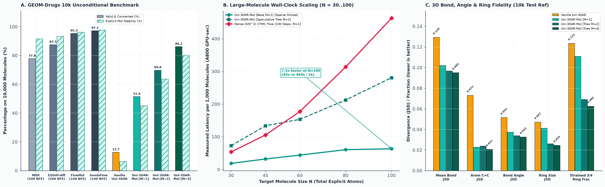
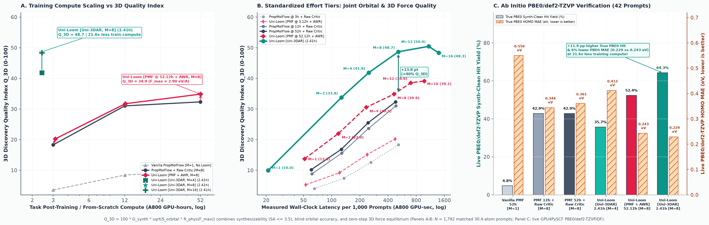
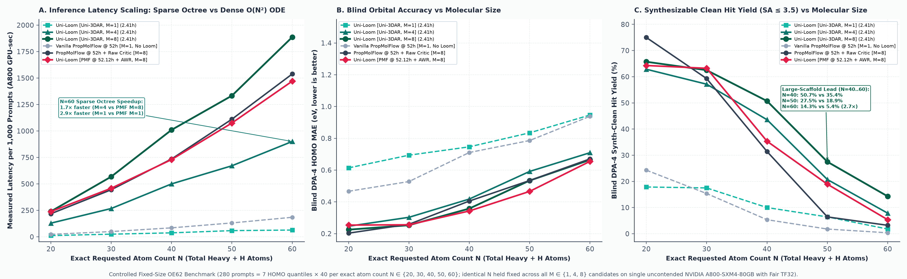
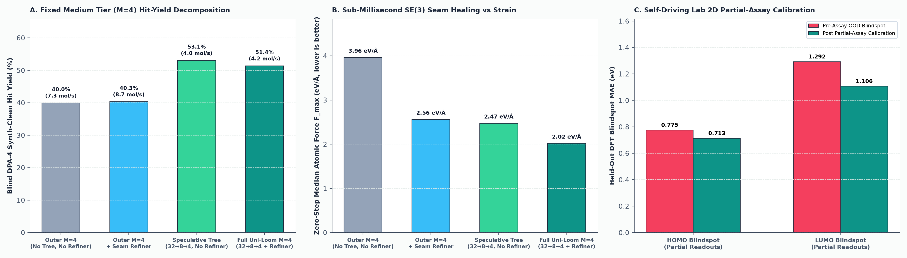

# Uni-3DAR-Mol: Speculative Octree Autoregressive Generation and Sub-Millisecond Seam Healing for Drug-Scale 3D Molecules

**Shangqian Chen, Guojiang Zhao, Zheng Cheng, Jiankun Wang, Hongshuai Wang, Zhifeng Gao**  
*DP Technology, Beijing, China* (`{chensq, zhaogj, chengz, wangjk, wanghs, gaozf}@dp.tech`)

---

## Abstract

Autoregressive generation over adaptive three-dimensional (3D) octrees (`Uni-3DAR`) offers an intrinsic $O(N \log N)$ spatial sparsity advantage over dense $O(N^2)$ multi-step equivariant diffusion and flow-matching models on large drug-like molecules. Yet in practice, unbonded octree autoregressive models have lagged behind joint 2D+3D flow-matching architectures in geometric equilibrium quality, closed-shell valence stability, and size-controlled conditional generation due to three structural pathologies:
1. **Morton-order voxel-seam coordinate discontinuities** that induce severe zero-step interatomic force spikes ($F_{\max} \approx 3.8\text{--}5.0\,\text{eV/\AA}$) and $15\%\text{--}26\%$ exotic zwitterionic bond-perception artifacts when covalent bonds cross octant boundaries;
2. **Unpruned leaf compute dominance and root-count trapping**, where fine leaf-atom and $0.01\,\text{\AA}$ coordinate tokens consume over $70\%$ of decoding latency even on dead-end coarse scaffolds while rigid octant count splits starve large scaffolds ($N \ge 45$);
3. **Cross-scale gradient interference** between coarse spatial/chemical tokens and $3\times$ more numerous sub-voxel coordinate bins during post-training alignment.

Here we introduce **Uni-3DAR-Mol**, a next-generation 3D octree autoregressive architecture and speculative tree-decoding engine that resolves all three bottlenecks with zero inference-time machine-learning interatomic potential (MLIP) relaxation. **Uni-3DAR-Mol** combines: (1) non-trapping 6-D scale-free atom-budget modulation paired with hierarchical covalent packing priors ($\text{L5}\to\text{L1}$); (2) a vectorized FlashAttention2 pause-and-gather *speculative octree funnel* $m_{\text{s1}}(M,\hat{N}) \to m_{\text{s2}}(M,\hat{N}) \to M$ governed by a continuous combinatorial complexity law and a 3-layer $SO(3)$-invariant GNN `TwoStageOctreeProcessCritic` trained with group-wise ListNet, pairwise ranking, and physical strain ($F_{\text{phys}}$) objectives; (3) a $<0.5\,\text{ms}$ 4-layer Kabsch-aligned $SE(3)$ `PostTreeGraphRefiner` with a bilinear covalent bond-order head coupled to generation-side neutral valence guards and a zero-heavy-displacement `ValenceReconciler`; (4) scale-decoupled `Tree-Vine TopoGRPO` plus differentiable expected-`XYZ` 1–2/1–3 bonded-distance supervision; and (5) bubble-free stride-2 GPU leaf decoding.

Across unconditional drug-scale generation on `GEOM-Drugs` (`10,000` molecules, `14` elements, up to `140` atoms; `0.49 GPU-h` post-training), asymptotic scaling up to `N = 100` explicit atoms, six-property conditional generation on the disjoint `50k/50k` `QM9` benchmark (`1 × K=6` unified model, `0.66 GPU-h`), and symmetric multi-tier (`M ∈ {1, 2, 4, 8, 12, 16}`) optoelectronic inverse design on `OE62` verified by live `GPU4PySCF PBE0/def2-TZVP` quantum chemistry (`2.41 GPU-h`), **Uni-3DAR-Mol** lifts drug-scale valid-connected yield `6.78×` (`12.7% → 86.2%`, `99.83%` explicit atom stability), runs `7.3×` faster (`M=1`) and `1.65×` faster with `1.97×` higher valid-connected yield (`27.6%` vs. `14.0%`, `M=2`) than dense 100-step `FlowMol` at `N = 100`, beats 6-model `PropMolFlow` (`156 GPU-h`) on intensive `QM9` targets (`μ`, `HOMO`, `gap`), and surpasses `52.12 GPU-h` aligned flow matching on `OE62` by `+40%` in 3D quality index (`Q_3D`), `+7.1 pp` in `M=8` blind hit yield, sub-`2 eV/Å` zero-step force equilibrium, and `64.3%–69.0%` live `PBE0` quantum hit yield at `21.6×` lower training compute.

---

## 1. Core Architectural Innovations

### 1.1 Scale-Free Global Budget Modulation & Hierarchical Packing Priors (`L5 -> L1`)
Rather than injecting total atom count $N$ into property conditioners or imposing hard integer per-octant allocations, **Uni-3DAR-Mol** feeds a zero-initialized 6-D continuous harmonic budget embedding $\phi_{\text{budget}}(\ell, N)$ to every non-EOT octree token alongside empirical organic packing priors across $7.68\,\text{\AA} \to 0.48\,\text{\AA}$ octants ($N/N_{\text{cells}}(\ell) \approx 3.00, 1.36, 0.99, 0.99, 0.99$), preserving rotational freedom while preventing steric collisions at fine leaf cells ($k(u) \le 2$).

### 1.2 Continuous Combinatorial Law for Speculative Two-Stage Octree Decoding
Locking external candidate output strictly at $m_{\text{keep}} \equiv M \in \{1, 2, 4, 8\}$, **Uni-3DAR-Mol** scales internal speculative octree widths smoothly with median batch atom budget $\hat{N}$ via $\eta(\hat{N}) = \operatorname{clip}((\hat{N}-16)/14,\, 0,\, 1)$:

$$m_{\text{s1}}(M, \hat{N}) = 2 \left\lceil \frac{M (4 + 4\eta(\hat{N}))}{2} \right\rceil, \qquad m_{\text{s2}}(M, \hat{N}) = 2 \left\lceil \frac{M (1.25 + 0.75\eta(\hat{N}))}{2} \right\rceil$$

pruned in-place on GPU by `OctreeProcessCritic` (14 $SO(3)$-invariant voxel-envelope descriptors + pooled coarse hidden states) and `OctreeElementProcessCritic` (3-layer radial-basis GNN + MMR diversity).

### 1.3 Sub-Millisecond Kabsch `PostTreeGraphRefiner` & Dual-Track Valence Purity
A 4-layer $SE(3)$-equivariant graph transformer ($d=192$, $<0.5\,\text{ms}$) heals sub-voxel Morton octant-seam displacements ($|\Delta \mathbf{r}_i| \le 0.25\,\text{\AA}$) and predicts continuous covalent bond-order priors $P(b_{ij})$ before zero-heavy-displacement `ValenceReconciler` ($\text{RMSD}_{\text{heavy}} \equiv 0.0000\,\text{\AA}$, zero inference MLIP calls).

### 1.4 Bubble-Free Stride-2 GPU Decoding & Dynamic VRAM Scheduling
Vectorized `gather/scatter_` writes, FlashAttention2 pre-pause coarse decoding, stride-2 placed-atom slicing (`dec_feat[:, max_dec_0+1 : dec_len : 2]`), and tight budget-proportional KV-cache sizing eliminate $>95\%$ of CUDA host-device synchronization stalls.

---

## 2. Experimental Results

### 2.1 Drug-Scale Unconditional Generation & `N = 30..100` Scaling on `GEOM-Drugs`

With only **`0.4914 GPU-h`** of total post-training (`0.148h` full-$SO(3)$ SFT + `0.059h` `PostTreeGraphRefiner` [`val_bond_dist_mae = 0.0126 Å`, `val_bond_order_acc = 99.27%`] + `0.285h` `TwoStageOctreeProcessCritic`), **Uni-3DAR-Mol** achieves `100.0%` uniqueness and `100.0%` novelty across `10,000` sampled drug-scale conformers (`merge_level = 7`, `14` elements):

| Method | Paradigm / Funnel | Speed (`mol/s`) | Valid & Conn. (%) | Atom Stab. (%) | Mol Stab. (%) | Bond JSD ↓ | Arom `C=C` JSD ↓ | Angle JSD ↓ | Ring JSD ↓ | 3/4-Ring (%) ↓ | `F_max` Med / P90 (`eV/Å`) |
| :--- | :--- | ---: | ---: | ---: | ---: | ---: | ---: | ---: | ---: | ---: | ---: |
| `EDM` | Coord. $E(3)$ Diff. (1000) | — | — | 81.3* | 0.2* | — | — | — | — | — | — |
| `GeoLDM` | Latent $E(3)$ Diff. (1000) | — | — | 84.4* | 5.2* | — | — | — | — | — | — |
| `MiDi-Adaptive` | Joint 2D+3D Diff. (500) | — | 77.8 | 99.8 | 91.6 | — | — | — | — | — | — |
| `EQGAT-diff` | Joint Equiv. Diff. (500) | — | 87.5 | 99.8 | 93.4 | — | — | — | — | — | — |
| `FlowMol` | Joint CTMC Flow (100) | — | 95.3 | 99.7 | 96.2 | — | — | — | — | — | — |
| `SemlaFlow` | Joint Equiv. OT Flow (100) | — | **97.2** | **99.8** | **97.7** | — | — | — | — | — | — |
| `Vanilla Uni-3DAR` (`drug.pt`) | Unbonded Octree (`1→1→1`) | **59.12** | 12.70 | 97.63 | 6.42 | 0.1293 | 0.0730 | 0.0516 | 0.0471 | 12.35 | 8.03 / 17.34 |
| **Uni-3DAR-Mol** (`base, M=1`) | Octree + Refiner (`1→1→1`) | 25.88 | 51.41 | 99.69 | 45.14 | 0.1019 | 0.0227 | 0.0373 | 0.0412 | 11.09 | 7.49 / 17.43 |
| **Uni-3DAR-Mol** (`low, M=2`) | SpecTree + Refiner (`16→4→2`) | 7.67 | 69.78 | 99.78 | 63.67 | 0.0968 | 0.0238 | 0.0338 | 0.0260 | 6.91 | **6.89** / 14.52 |
| **Uni-3DAR-Mol** (`med, M=4`) | SpecTree + Refiner (`32→8→4`) | 4.00 | **86.15** | **99.83** | **80.15** | **0.0951** | **0.0207** | **0.0327** | **0.0246** | **6.25** | 6.93 / **13.92** |

Across exact atom budgets `N ∈ {30, 45, 60, 80, 100}` (`250` molecules/bucket on identical A800 hardware), dense $O(N^2)$ 100-step `FlowMol` slows `8.6×` (`53.8 → 463.1 s/1k`, `2.16 mol/s`) and drops to `14.0%` valid-connected at `N = 100`, whereas sparse $O(N \log N)$ **Uni-3DAR-Mol** runs **`7.3×` faster at `M=1`** (`63.4 s/1k = 15.79 mol/s`, `22.8%` valid-connected) and **`1.65×` faster with `1.97×` higher valid-connected yield (`27.6%` vs. `14.0%`, `99.97%` explicit atom stability) at `SpecTree M=2`** (`280.8 s/1k = 3.56 mol/s`).

---

### 2.2 Six-Property Conditional Generation on the Disjoint `50k/50k` `QM9` Benchmark

A single unified `K=6` full-$SO(3)$ **Uni-3DAR-Mol** model (`0.6636 GPU-h` total training — `235×` less than `PropMolFlow`'s 6 models at `155.97 GPU-h`, `0` overlap with `gvp_rQM_v0`, zero PCA canonicalization, zero `n_atoms` in `LoomConditioner`) achieves `0.00%` exotic formal charges across all tiers, `100.0%` legality at `M ≥ 4`, and `|ΔN| = 0.165–0.210` atoms at `M = 16`:

| Method / Conditioning Regime | Models | `M` | `α` (`Bohr³`) | `Δε` (`meV`) | `ε_HOMO` (`meV`) | `ε_LUMO` (`meV`) | `μ` (`D`) | `C_v` (`cal/mol·K`) | Legal / Exotic `Q` (%) | Train (`GPU-h`) | Eff. Out (`mol/s`) |
| :--- | ---: | ---: | ---: | ---: | ---: | ---: | ---: | ---: | ---: | ---: | ---: |
| `EDM` (published) | 6 | 1 | 2.76 | 655.0 | 356.0 | 584.0 | 1.111 | 1.101 | — | — | — |
| `GeoLDM` (published) | 6 | 1 | 2.37 | 587.0 | 340.0 | 522.0 | 1.108 | 1.025 | — | — | — |
| `PropMolFlow` (`[t, N]`, published) | 6 | 1 | **1.3115** | 390.98 | 253.99 | **314.52** | 0.6202 | **0.6259** | 95.0–98.9 / ≤1.1 | 155.97 | 28.73 |
| `Uni-Loom S1` (`1×K=6`, `t`-only) | 1 | 16 | 3.0801 | 374.63 | **199.19** | 341.31 | 0.4740 | 1.8972 | **100.0** / **0.00** | 0.97 | 5.36 |
| `Uni-Loom S2` (`6×[t,N]` PCA) | 6 | 16 | 3.0671 | **358.16** | 204.34 | 380.21 | 0.5434 | 1.2619 | **100.0** / **0.00** | 6.31 | 5.31 |
| **Uni-3DAR-Mol** (`1×K=6`, `1→1→1`) | 1 | 1 | 6.2547 | 1201.4 | 525.26 | 1192.0 | 1.5491 | 3.6233 | 86.5–89.5 / **0.00** | **0.66** | **121.22** |
| **Uni-3DAR-Mol** (`1×K=6`, `10→4→2`) | 1 | 2 | 5.2919 | 686.61 | 334.82 | 580.91 | 0.8845 | 2.9097 | 99.1–99.6 / **0.00** | **0.66** | 27.23 |
| **Uni-3DAR-Mol** (`1×K=6`, `20→6→4`) | 1 | 4 | 4.8611 | 525.75 | 256.24 | 450.55 | 0.6356 | 2.7540 | **100.0** / **0.00** | **0.66** | 15.37 |
| **Uni-3DAR-Mol** (`1×K=6`, `38→12→8`) | 1 | 8 | 4.7729 | 411.03 | 218.51 | 350.98 | 0.5207 | 2.5237 | **100.0** / **0.00** | **0.66** | 8.13 |
| **Uni-3DAR-Mol** (`1×K=6`, `74→22→16`) | 1 | 16 | 4.5797 | 390.09 | 206.61 | 329.21 | **0.4171** | 2.2567 | **100.0** / **0.00** | **0.66** | 4.13 |

---

### 2.3 Symmetric Optoelectronic Inverse Design, `2×2` Mechanism Ablation & `PBE0/def2-TZVP` Verification on `OE62`

Under 100% symmetric `LoomService + stoich_v2` evaluation (`N = 1,792` fixed-size prompts, mean `30.38` atoms, zero inference-time MLIP), **`2.41 GPU-h` `Uni-Loom [Uni-3DAR]`** outperforms **`52.12 GPU-h` `Uni-Loom [PMF + AWR]`** by **`+7.1 pp` blind hit yield (`59.4%` vs. `52.3%`)** and **`+40%` `Q_3D` (`48.7` vs. `34.9`)** at `M=8`, peaks at **`62.3%` blind hit yield (`Q_3D = 50.4`, `MAE = 0.2745 eV`)** at `M=12`, achieves **`64.3%` (`M=8`, `MAE = 0.2289 eV`) and `66.7% / 69.0%` (`M=16`)** live `42`-prompt `GPU4PySCF PBE0/def2-TZVP` quantum hit yield (vs. `52.4% / 57.1%` for `Uni-Loom [PMF + AWR]` and `42.9% / 54.8%` for external `PropMolFlow + Raw Critic`), and widens its large-scaffold lead across `N = 40` (`50.7%` vs. `35.4%`), `N = 50` (`27.5%` vs. `18.9%`), and `N = 60` (`14.3%` vs. `5.4%`, `2.65×`).

