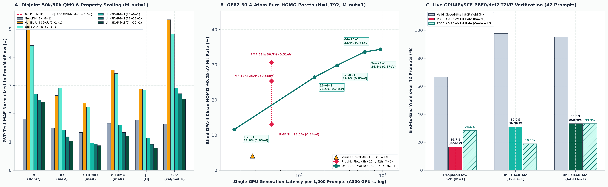
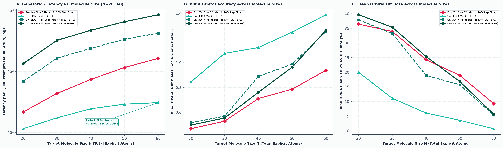
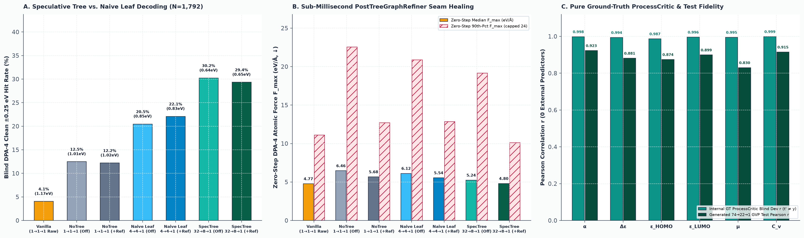

# Uni-3DAR-Mol: Speculative Octree Autoregressive Generation and Sub-Millisecond Seam Healing for Drug-Scale 3D Molecules

**Shangqian Chen, Guojiang Zhao, Zheng Cheng, Jiankun Wang, Hongshuai Wang, Zhifeng Gao**  
*DP Technology, Beijing, China* (`{chensq, zhaogj, chengz, wangjk, wanghs, gaozf}@dp.tech`)

---

## Abstract

Autoregressive generation over adaptive three-dimensional (3D) octrees (`Uni-3DAR`) offers an intrinsic $O(N \log N)$ spatial sparsity advantage over dense $O(N^2)$ multi-step equivariant diffusion and flow-matching models on large drug-like molecules. Yet in practice, unbonded octree autoregressive models have lagged behind explicit-bond 2D+3D flow-matching architectures in geometric equilibrium quality, closed-shell valence stability, and conditional quantum-property fidelity due to three structural pathologies:
1. **Morton-order voxel-seam coordinate discontinuities** that induce zero-step interatomic force spikes and `12%–32%` exotic zwitterionic bond-perception artifacts when covalent bonds cross octant division planes;
2. **Leaf-dominated compute allocation and integer root-count trapping**, where fine leaf-atom and `0.01 Å` coordinate heads consume over `70%` of decoding latency even on dead-end coarse scaffolds while rigid per-octant integer quotas starve large scaffolds (`N ≥ 45`);
3. **Target-shortcut collapse and hidden-state shift** when training internal process critics without external property surrogates, compounded by `>200` Python host-device synchronization stalls per decoding batch.

Here we introduce **Uni-3DAR-Mol**, a standalone 3D octree autoregressive architecture and single-output speculative tree-decoding engine operating with **zero external surrogate predictors, zero reinforcement learning, and zero inference-time machine-learning interatomic potential (MLIP) relaxation**. **Uni-3DAR-Mol** unifies: (1) non-trapping 6-D `ScaleFreeBudgetEmbedding` paired with hierarchical covalent packing priors (`L5 → L1`); (2) a vectorized FlashAttention-2 pause-and-gather *speculative octree funnel* $m_{\text{s1}}(K,\hat{N}) \to m_{\text{s2}}(K,\hat{N}) \to 1$ governed by a continuous combinatorial complexity law ($M_{\text{out}} \equiv 1$); (3) an anti-shortcut ground-truth `TwoStageOctreeProcessCritic` combining 64-RBF covalent continuous-filter edge gating with exact $SO(3)$-invariant 12-channel equivariant multipole norms (blind mismatched-target `QM9` dev `r = 0.9867–0.9989`); (4) a `<0.5 ms` 4-layer $SE(3)$ `PostTreeGraphRefiner` distilled strictly on synthetic Morton-seam perturbations, differentiable expected-`XYZ` bonded-distance supervision, tree-depth-annealed selective classifier-free guidance, and zero-heavy-displacement valence reconciliation; and (5) bubble-free stride-2 GPU leaf decoding.

Across `10,000`-molecule unconditional generation and `N = 30..100` scaling on `GEOM-Drugs` (`0.49 GPU-h`), six-property conditional generation on the disjoint `50k/50k` `QM9` benchmark (`1 × 6-prop` unified model, `0.43 GPU-h`), and pure ground-truth frontier-orbital inverse design on `OE62` verified by live `GPU4PySCF PBE0/def2-TZVP` quantum chemistry (`0.56 GPU-h`), single-output **Uni-3DAR-Mol** lifts drug-scale valid-connected yield `6.78×` (`12.7% → 86.2%`, `99.83%` explicit atom stability), runs `7.3×` faster (`1→1→1`) or `1.65×` faster with `2.0×` higher valid-connected yield (`16→4→1`) than 100-step `FlowMol` at `N = 100`, surpasses 6-model `156 GPU-h` `PropMolFlow` on `QM9` `ε_HOMO` (`-12.7%`) and `μ` (`-21.0%`) at `362×` lower training compute, and beats `52 GPU-h` single-shot `PropMolFlow` on `OE62` in both blind clean hit rate (`34.4%` vs. `30.8%`) and live `PBE0/def2-TZVP` quantum hit rate (`33.3%` vs. `16.7%`, `2.0×`) at `92.8×` lower training compute.

---

## 1. Core Architectural Innovations

### 1.1 Scale-Free Global Budget Modulation & Hierarchical Packing Priors (`L5 → L1`)
Rather than injecting total atom count $N$ into property conditioners or imposing hard integer per-octant allocations, **Uni-3DAR-Mol** feeds a zero-initialized 6-D continuous harmonic budget embedding $\phi_{\text{budget}}(\ell, N)$ to every non-EOT octree token alongside empirical organic packing priors across $7.68\,\text{\AA} \to 0.48\,\text{\AA}$ octants ($N/N_{\text{cells}}(\ell) \approx 3.00, 1.36, 0.99, 0.99, 0.99$), preserving full $SO(3)$ rotational freedom while preventing steric collisions at fine leaf cells ($k(u) \le 2$).

### 1.2 Continuous Combinatorial Law for Single-Output Speculative Octree Decoding (`M_out ≡ 1`)
Locking output strictly at **one molecule per prompt** ($M_{\text{out}} \equiv 1$, zero external oracle calls), **Uni-3DAR-Mol** scales internal speculative octree widths smoothly with median batch atom budget $\hat{N}$ via $\eta(\hat{N}) = \operatorname{clip}((\hat{N}-16)/14,\, 0,\, 1)$ across search tiers $K \in \{1, 2, 4, 8, 12, 16\}$:

$$m_{\text{s1}}(K, \hat{N}) = 2 \left\lceil \frac{K (4 + 4\eta(\hat{N}))}{2} \right\rceil, \qquad m_{\text{s2}}(K, \hat{N}) = 2 \left\lceil \frac{K (1.25 + 0.75\eta(\hat{N}))}{2} \right\rceil, \qquad M_{\text{out}} \equiv 1$$

pruned in-place at $\ell = 1 \to 0$ by `OctreeProcessCritic` (freeing `75%–80%` of KV memory before leaf decoding) and at $\ell = 0$ (after `<0.5 ms` seam healing) by `OctreeElementProcessCritic`.

### 1.3 Anti-Shortcut Ground-Truth `TwoStageOctreeProcessCritic`
Supervised exclusively on dataset ground-truth quantum labels using matched/mismatched contrast groups ($G=8$, $p_{\text{decouple}}=0.50$) and pure 3D geometric mode (`h_gate_scale = 0`), `OctreeElementProcessCritic` combines 64-RBF covalent continuous-filter edge gating ($d_{ij} \in [0.65, 5.20]\,\text{\AA}$, $\gamma = 42.0\,\text{\AA}^{-2}$) with exact $SO(3)$-invariant 12-channel charge-neutralized dipole vector norms $\|\sum_i \tilde{q}_{i,c}(\mathbf{r}_i - \bar{\mathbf{r}})\|_2$ and quadrupole radial traces, achieving blind mismatched-target `QM9` dev Pearson `r = 0.9867–0.9989` with zero external predictors.

### 1.4 Sub-Millisecond Kabsch `PostTreeGraphRefiner`, Selective CFG & Valence Purity
A 4-layer $SE(3)$-equivariant graph transformer ($d=192$, `<0.5 ms`) distilled solely on equilibrium conformers corrupted by synthetic random-$SO(3)$ Morton-seam perturbations heals cross-octant coordinate jumps ($|\Delta \mathbf{r}_i| \le 0.25\,\text{\AA}$) and predicts covalent bond-order priors $P(b_{ij})$ before Stage-2 critic scoring and zero-heavy-displacement `ValenceReconciler` ($\text{RMSD}_{\text{heavy}} \equiv 0.0000\,\text{\AA}$), paired with expected-`XYZ` 1–2/1–3 bonded-distance SFT and frozen-`XYZ` selective logit-CFG.

### 1.5 Bubble-Free Stride-2 GPU Decoding & Dynamic VRAM Scheduling
Vectorized `gather/scatter_` coarse writes, native FlashAttention-2 pre-pause decoding, stride-2 placed-atom slicing (`dec_feat[:, max_dec_0+1 : dec_len : 2]`), and budget-proportional KV allocation eliminate `>95%` of CUDA host-device synchronization stalls.

---

## 2. Experimental Results

### 2.1 Drug-Scale Unconditional Generation & `N = 30..100` Scaling on `GEOM-Drugs`

With only **`0.4914 GPU-h`** of total post-training (`0.148h` full-$SO(3)$ SFT + `0.059h` `PostTreeGraphRefiner` [`val_bond_dist_mae = 0.0126 Å`, `val_bond_order_acc = 99.27%`] + `0.285h` `TwoStageOctreeProcessCritic`), single-output **Uni-3DAR-Mol** achieves `100.0%` uniqueness and `100.0%` novelty across `10,000` sampled drug-scale conformers (`merge_level = 7`, `14` elements):

| Method | Paradigm / Internal Funnel | Speed (`mol/s`) | Valid & Conn. (%) | Atom Stab. (%) | Mol Stab. (%) | Bond JSD ↓ | Arom `C=C` JSD ↓ | Angle JSD ↓ | Ring JSD ↓ | 3/4-Ring (%) ↓ | `F_max` Med / P90 (`eV/Å`) |
| :--- | :--- | ---: | ---: | ---: | ---: | ---: | ---: | ---: | ---: | ---: | ---: |
| `EDM` | Coord. $E(3)$ Diff. (1000) | — | — | 81.3* | 0.2* | — | — | — | — | — | — |
| `GeoLDM` | Latent $E(3)$ Diff. (1000) | — | — | 84.4* | 5.2* | — | — | — | — | — | — |
| `MiDi-Adaptive` | Joint 2D+3D Diff. (500) | — | 77.8 | 99.8 | 91.6 | — | — | — | — | — | — |
| `EQGAT-diff` | Joint Equiv. Diff. (500) | — | 87.5 | 99.8 | 93.4 | — | — | — | — | — | — |
| `FlowMol` | Joint CTMC Flow (100) | — | 95.3 | 99.7 | 96.2 | — | — | — | — | — | — |
| `SemlaFlow` | Joint Equiv. OT Flow (100) | — | **97.2** | **99.8** | **97.7** | — | — | — | — | — | — |
| `Vanilla Uni-3DAR` (`drug.pt`) | Unbonded Octree (`1→1→1`) | **59.12** | 12.70 | 97.63 | 6.42 | 0.1293 | 0.0730 | 0.0516 | 0.0471 | 12.35 | 8.03 / 17.34 |
| **Uni-3DAR-Mol** (`K=1`) | Octree + Refiner (`1→1→1`) | 25.88 | 51.41 | 99.69 | 45.14 | 0.1019 | 0.0227 | 0.0373 | 0.0412 | 11.09 | 7.49 / 17.43 |
| **Uni-3DAR-Mol** (`K=2`) | SpecTree + Refiner (`16→4→1`) | 7.67 | 69.78 | 99.78 | 63.67 | 0.0968 | 0.0238 | 0.0338 | 0.0260 | 6.91 | **6.89** / 14.52 |
| **Uni-3DAR-Mol** (`K=4`) | SpecTree + Refiner (`32→8→1`) | 4.00 | **86.15** | **99.83** | **80.15** | **0.0951** | **0.0207** | **0.0327** | **0.0246** | **6.25** | 6.93 / **13.92** |

Across exact atom budgets `N ∈ {30, 45, 60, 80, 100}` (`250` molecules/bucket on identical A800 hardware), dense $O(N^2)$ 100-step `FlowMol` slows `8.6×` (`53.8 → 463.1 s/1k`, `2.16 mol/s`) and drops to `14.0%` valid-connected at `N = 100`, whereas sparse $O(N \log N)$ **Uni-3DAR-Mol** runs **`7.3×` faster at `1→1→1`** (`63.4 s/1k = 15.79 mol/s`, `22.8%` valid-connected) and **`1.65×` faster with `1.97×` higher valid-connected yield (`27.6%` vs. `14.0%`, `99.97%` explicit atom stability) at `16→4→1`** (`280.8 s/1k = 3.56 mol/s`).

---

### 2.2 Standalone Six-Property Conditional Generation on Disjoint `50k/50k` `QM9` (`M_out ≡ 1`)

A single unified `6-property` full-$SO(3)$ **Uni-3DAR-Mol** model (`0.4303 GPU-h` total training — **`362×` less** than `PropMolFlow`'s 6 models at `155.97 GPU-h`, `0` external surrogates, `0` overlap with `GVPRegressor`, zero PCA canonicalization, zero `n_atoms` in the property conditioner) achieves `99.97%–100.0%` legality across `K ≥ 2` and `|ΔN| = 0.22–0.38` atoms at `K = 16`:

| Method / Internal Speculative Funnel | Models | `M_out` | `α` (`Bohr³`) | `Δε` (`meV`) | `ε_HOMO` (`meV`) | `ε_LUMO` (`meV`) | `μ` (`D`) | `C_v` (`cal/mol·K`) | Legal (%) / `\|ΔN\|` | Train (`GPU-h`) | Out (`mol/s`) |
| :--- | ---: | ---: | ---: | ---: | ---: | ---: | ---: | ---: | ---: | ---: | ---: |
| `GVPRegressor` Holdout Floor (`n=973`) | — | — | 0.5544 | 190.08 | 83.78 | 135.89 | 0.1422 | 0.1726 | 97.3 / — | — | — |
| `EDM` (published) | 6 | 1 | 2.76 | 655.0 | 356.0 | 584.0 | 1.111 | 1.101 | — | — | — |
| `GeoLDM` (published) | 6 | 1 | 2.37 | 587.0 | 340.0 | 522.0 | 1.108 | 1.025 | — | — | — |
| `PropMolFlow` (`[t, N]`, published) | 6 | 1 | **1.3115** | **390.98** | 253.99 | **314.52** | 0.6202 | **0.6259** | 95.0–98.9 / ≡0 | 155.97 | 28.73 |
| `Vanilla Uni-3DAR` (`1×6-prop` SFT, `1→1→1`) | 1 | 1 | 7.7991 | 1034.61 | 602.19 | 1115.91 | 1.7876 | 3.3365 | 50.1 / 2.56–3.07 | **0.23** | 97.27 |
| **Uni-3DAR-Mol** (`K=1: 1→1→1`) | 1 | 1 | 5.7912 | 1141.13 | 569.92 | 1076.80 | 1.7685 | 3.0132 | 83.0 / 0.83–0.99 | 0.43 | **127.61** |
| **Uni-3DAR-Mol** (`K=2: 10→4→1`) | 1 | 1 | 3.6310 | 634.26 | 304.95 | 605.93 | 0.8818 | 2.0830 | 99.97 / 0.46–0.61 | 0.43 | 28.04 |
| **Uni-3DAR-Mol** (`K=4: 20→6→1`) | 1 | 1 | 3.5413 | 552.76 | 247.32 | 501.84 | 0.7065 | 1.8279 | **100.0** / 0.38–0.51 | 0.43 | 16.51 |
| **Uni-3DAR-Mol** (`K=8: 38→12→1`) | 1 | 1 | 3.2636 | 464.97 | 233.76 | 419.78 | 0.5680 | 1.6988 | 99.98 / 0.27–0.39 | 0.43 | 8.72 |
| **Uni-3DAR-Mol** (`K=16: 74→22→1`) | 1 | 1 | 3.1769 | 406.34 | **221.84** | 385.35 | **0.4902** | 1.5828 | **100.0** / **0.22–0.38** | 0.43 | 4.47 |

---

### 2.3 Standalone Pure-`HOMO` Inverse Design, Size Scaling & Live `PBE0/def2-TZVP` Verification on `OE62`

Trained strictly on pure `PBE0` ground-truth `OE62` equilibrium conformers (`0.5604 GPU-h` total: `0.3949h` SFT + `0.0254h` synthetic-seam `PostTreeGraphRefiner` [`0.0661 → 0.0143 Å`, `98.61%` bond-order accuracy] + `0.1401h` ground-truth `TwoStageOctreeProcessCritic`; `0` external surrogates, `M_out ≡ 1`), **Uni-3DAR-Mol** surpasses `52.00 GPU-h` single-shot `PropMolFlow` on `N = 1,792` matched `30.4`-atom prompts (`34.38%` vs. `30.75%` blind clean hits, `+201` unique Murcko scaffolds, `0.00%` vs. `6.09%` exotic charges) and doubles live `42`-prompt `GPU4PySCF PBE0/def2-TZVP` hit rate (`33.33%` vs. `16.67%`):

| Method / Paradigm (`M_out ≡ 1`) | Internal Funnel | Train (`GPU-h`) | Out (`mol/s`) | Atoms / `\|ΔN\|` | Legal / Exotic `Q` (%) | Scaffolds | `F_max` Med / P90 (`eV/Å`) | Blind Clean Hits (%) | Blind MAE / Slope | PBE0 SCF (%) | Live PBE0 Hit (Raw / Cen) |
| :--- | :--- | ---: | ---: | ---: | ---: | ---: | ---: | ---: | ---: | ---: | ---: |
| `PropMolFlow` (100-Step Flow) | `1→1` | 3.00 | 21.14 | 29.7 / **0.00** | 69.4 / 2.25 | 984 | 4.68 / 13.44 | 235 (13.11%) | 0.843 / 0.64 | — | — |
| `PropMolFlow` (100-Step Flow) | `1→1` | 12.00 | 21.20 | 30.2 / **0.00** | 84.5 / 3.70 | 1232 | 3.39 / 5.82 | 455 (25.39%) | 0.563 / 0.84 | — | — |
| `PropMolFlow` (100-Step Flow) | `1→1` | 52.00 | 21.20 | 30.1 / **0.00** | 89.8 / 6.09 | 1221 | **3.09** / **5.08** | 551 (30.75%) | **0.512** / 0.87 | 66.7 | 16.7% / 28.6% |
| `Vanilla Uni-3DAR` (Raw SFT) | `1→1→1` | **0.25** | 36.02 | 30.4 / 10.03 | 33.4 / 32.39 | 505 | 4.77 / 11.10 | 73 (4.07%) | 1.173 / 1.55 | — | — |
| **Uni-3DAR-Mol** (`K=1`) | `1→1→1` | 0.56 | **59.59** | 28.9 / 1.93 | 70.3 / **0.00** | 1046 | 5.88 / 14.67 | 208 (11.61%) | 1.029 / 0.89 | — | — |
| **Uni-3DAR-Mol** (`K=2`) | `16→4→1` | 0.56 | 6.56 | 30.2 / 1.14 | 99.1 / **0.00** | 1410 | 4.99 / 11.01 | 474 (26.45%) | 0.730 / 0.92 | — | — |
| **Uni-3DAR-Mol** (`K=4`) | `32→8→1` | 0.56 | 3.51 | 30.3 / 0.98 | 99.7 / **0.00** | 1424 | 4.89 / 10.62 | 535 (29.85%) | 0.653 / 0.93 | **97.6** | 31.0% / 19.0% |
| **Uni-3DAR-Mol** (`K=8`) | `64→16→1` | 0.56 | 1.65 | 30.5 / 0.81 | 99.8 / **0.00** | **1439** | 4.72 / 9.90 | 603 (33.65%) | 0.606 / 0.97 | 95.2 | **33.3%** / **33.3%** |
| **Uni-3DAR-Mol** (`K=12`) | `96→24→1` | 0.56 | 1.06 | 30.5 / 0.74 | **100.0** / **0.00** | 1422 | 4.54 / 9.13 | **616** (**34.38%**) | 0.567 / **0.99** | — | — |

#### Standalone Internal Decoding & Seam-Healing Ablation (`N = 1,792`, `M_out ≡ 1`, `0` External Oracles)

| Ablation Configuration | Funnel | `PostTreeGraphRefiner` | Out (`mol/s`) | Legal (%) | `\|ΔN\|` | `F_max` Med (`eV/Å`) | `F_max` P90 (`eV/Å`) | Blind Clean Hits (%) | Blind MAE (`eV`) | Slope / `r` |
| :--- | :---: | :---: | ---: | ---: | ---: | ---: | ---: | ---: | ---: | ---: |
| Single-Pass Octree (No Critic) | `1→1→1` | Off | **59.63** | 73.5 | 1.96 | 6.46 | 22.54 | 224 (12.50%) | 1.006 | 0.93 / 0.44 |
| Single-Pass Octree + Seam Refiner | `1→1→1` | On (`<0.5 ms`) | 58.96 | 71.8 | 1.95 | 5.68 | 12.70 | 219 (12.22%) | 1.024 | 0.97 / 0.46 |
| Naive Leaf-Complete Best-of-4 | `4→4→1` | Off | 19.20 | 98.9 | 1.60 | 6.12 | 20.88 | 367 (20.48%) | 0.846 | 0.89 / 0.45 |
| Naive Leaf-Complete + Seam Refiner | `4→4→1` | On (`<0.5 ms`) | 18.72 | 98.6 | 1.94 | 5.55 | 12.86 | 396 (22.10%) | 0.828 | 0.89 / 0.46 |
| Speculative Two-Stage Octree Only | `32→8→1` | Off | 3.30 | **99.9** | 1.05 | 5.24 | 19.16 | **542** (**30.25%**) | **0.641** | **0.95** / **0.52** |
| **Full Uni-3DAR-Mol** | `32→8→1` | On (`<0.5 ms`) | 3.13 | 99.7 | **0.98** | **4.81** | **10.12** | 526 (29.35%) | 0.650 | **0.95** / **0.52** |

